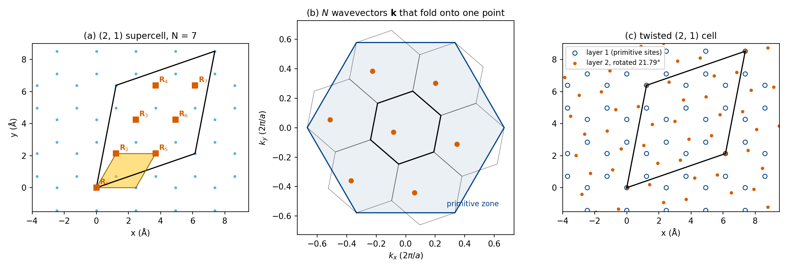

# How to unfold supercell bands onto the primitive Brillouin zone

On this page you unfold the bands of a supercell onto the Brillouin zone of its primitive cell with {py:func}`~PAOFLOW.models.band_unfold.unfold_bands`, so that you can compare them with primitive-cell bands or with angle-resolved photoemission (ARPES), which measures the crystal momentum of the primitive lattice. You need this for a supercell that breaks the primitive periodicity (an alloy, an impurity, a superstructure), because the primitive bands fold back into its smaller Brillouin zone and multiply its branches. Unfolding gives each supercell eigenstate $n$ a spectral weight $w_n(\mathbf{k})$, the probability that it has primitive crystal momentum $\mathbf{k}$, which shows how far the perturbation splits and spreads each primitive band. The input is the real-space Hamiltonian $H_{\alpha\beta}(\mathbf{R})$ of both cells, from a tight-binding model or from a projected DFT calculation. The script of this page builds its models in code and needs no input files.

## The spectral weight and the geometry it requires

The weight of supercell state $n$ at a wavevector $\mathbf{k}$ of the primitive zone is

$$
w_n(\mathbf{k}) = \frac{1}{N} \sum_{\alpha}\sum_{m} \left| \sum_{\ell=1}^{N} e^{-2\pi i\, \mathbf{k}\cdot\mathbf{R}_\ell}\, C^{n}_{\alpha m \ell}(\mathbf{k}) \right|^2 ,
$$

where the supercell holds $N$ primitive cells at the primitive lattice vectors $\mathbf{R}_\ell$, and $C^n_{\alpha m \ell}(\mathbf{k})$ is the coefficient of the state on orbital $m$ of primitive atom $\alpha$ in cell $\ell$. The sum over $\ell$ picks out the part of the state with momentum $\mathbf{k}$ rather than one of the $N - 1$ other wavevectors that fold onto the same supercell point. [Band unfolding: spectral weights of supercell states](../../internals/band-unfolding.md) derives the formula and its properties; two of them decide how you check and plot the result. First, the weights at each $\mathbf{k}$ add up to $n_\mathrm{awf}^\mathrm{PC}$, the number of orbitals of the primitive cell, so the run prints the largest deviation from this sum rule as a check of the geometry. Second, within a degenerate multiplet only the sum of the weights is defined, so plot the weights as markers at their energies, where the states of a multiplet fall on the same point and add up.

This formula requires that every supercell atom sit on a primitive atom shifted by one of the $\mathbf{R}_\ell$ and carry the same orbitals. The species, on-site energies and hoppings may differ from the primitive cell, which is what makes the weights informative, but the positions may not. {py:func}`~PAOFLOW.models.band_unfold.unfold_bands` finds the $\mathbf{R}_\ell$ and this atom mapping from the two geometries.



The figure draws these quantities for one layer of graphene in a supercell spanned by $2\mathbf{a}_1 + \mathbf{a}_2$ and its $60^\circ$ rotation. In (a), the light-blue points are the carbon sites, the amber parallelogram is the primitive cell and the black one the supercell, which holds $N = 7$ primitive cells at the translations $\mathbf{R}_1, \dots, \mathbf{R}_7$. In (b), the blue hexagon is the primitive Brillouin zone and the black hexagons are copies of the supercell zone, seven times smaller. The seven vermillion points differ by reciprocal lattice vectors of the supercell, so the supercell Hamiltonian is the same matrix at all of them, and the weight tells you to which of the seven each of its eigenstates belongs. In (c), the second layer is rotated by $21.79^\circ$, so its atoms (vermillion) are not primitive sites shifted by a lattice vector and the cell cannot be unfolded. For the same reason, relaxed impurities, vacancies and interstitials are outside the method.

## Unfolding a supercell of silicon

Give `unfold_bands` one model dictionary per cell, both with the same parameters. The model here is an environment-dependent tight-binding (EDTB) model of silicon: Slater–Koster bond integrals for an $sp^3d^5$ basis on three neighbour shells, with each hopping screened by the atoms around the bond (see [Environment-dependent Slater–Koster models](../../internals/sk-edtb.md)). Energies are in eV and distances in bohr.

```{literalinclude} band-unfolding/main.py
:language: python
:end-before: '# The primitive cell and the conventional cube of silicon'
```

:::{tip}
Download {download}`main.py <band-unfolding/main.py>` and {download}`figures.py <band-unfolding/figures.py>`, which draws the figures from its output.
:::

The primitive cell is the two-atom fcc cell, and the supercell the eight-atom conventional cube, $N = 4$. Give both geometries in Cartesian coordinates in units of the same `alat`, because the unfolding matches the atoms of the two cells by position:

```{literalinclude} band-unfolding/main.py
:language: python
:start-after: '# The primitive cell and the conventional cube of silicon'
:end-before: '# Unfolding the perfect supercell'
```

{py:class}`~PAOFLOW.models.edtb_params.EDTBModel` turns the parameters and a geometry into the model dictionary of the [tight-binding how-to](tight-binding-model.md), which `unfold_bands` reads:

```{literalinclude} band-unfolding/main.py
:language: python
:start-after: '# Unfolding the perfect supercell'
:end-before: '# A substitutional impurity'
```

Give `sym_points` in fractional coordinates of the reciprocal lattice of the primitive cell, because the path runs through the primitive zone; with the `a_vectors` above, X is $(2\pi/a)(1, 0, 0)$ and L is $(2\pi/a)(\tfrac12, \tfrac12, \tfrac12)$ up to sign. `nk_per_seg` is the number of k-points on each segment of the path. For the full path of the fcc zone with these `a_vectors`, pass the module's `FCC_SYM_POINTS` and `FCC_PATH` as `sym_points` and `path_str`. The run prints the matrix that relates the two sets of lattice vectors, the supercell atoms that each primitive atom maps to, and the sum rule:

```text
Transformation matrix M (det = 4):
  [-1  1 -1]
  [-1  1  1]
  [ 1  1 -1]
Found 4 translations inside SC.

Atom mapping (PC atom α → SC atom I):
  α=0: SC atoms [0, 3, 2, 1]
  α=1: SC atoms [4, 7, 6, 5]

PC: 18 orbitals,  SC: 72 orbitals,  N=4
Expected sum rule: Σ_n W_n(k) = 18
k-path: 161 points, 3 symmetry ticks

Sum rule:  Σ_n W_n(k)  mean = 18.000000  (expected 18),  max deviation = 1.42e-14
```

The returned `result` holds the supercell eigenvalues `result.E_sc` and their weights `result.W`, both of shape (k-points, supercell orbitals), the primitive-cell eigenvalues on the same path `result.E_pc`, the distance along the path `result.kdist`, and the positions and labels of the high-symmetry points `result.sym_ticks`. Draw the weights as markers whose area is proportional to $w_n(\mathbf{k})$ (see `figures.py`).

## Adding a substitutional impurity

Unfold the perfect supercell first, because its weights must reproduce the primitive bands, which tests the geometry and the k-path before you add a perturbation. Then model a substitutional impurity by changing the on-site energies of one atom in the supercell dictionary. The block below raises all nine orbitals of atom 0 by 1 eV, one impurity in eight atoms:

```{literalinclude} band-unfolding/main.py
:language: python
:start-after: '# A substitutional impurity'
:end-before: '# Saving the bands and weights'
```

Then save both runs for `figures.py`:

```{literalinclude} band-unfolding/main.py
:language: python
:start-after: '# Saving the bands and weights'
```


The figure shows `result` (left) and `result_imp` (right). The thin light-blue lines are the 72 folded bands of the perfect supercell, the vermillion markers the supercell states with weight above 0.02, and the dark-blue lines on the right the primitive bands. The energy zero is the valence-band maximum (VBM) of the primitive cell at $\Gamma$. In the perfect cell the weights select one branch out of every four, and the states with $w_n \approx 1$ coincide with the primitive bands to within $10^{-12}$ eV at $\Gamma$. With the impurity, the weight stays on branches close to the primitive bands but shifted upwards by about one eighth of the impurity potential, its average over the cell: the VBM moves by 0.118 eV and the lowest band at $\Gamma$ by 0.109 eV.


Beyond this shift, the impurity changes the bands in two places, which the zoom shows with the same colours and the primitive bands dashed. Halfway along L–$\Gamma$ (a), a folded band crosses a primitive one in the perfect cell; the impurity couples them and opens a gap of 0.24 eV. Across the gap the weight passes from one branch to the other (0.85 and 0.15, then 0.34 and 0.66, then 0.91 on the upper branch), so ARPES would see the primitive band continue through the gap with reduced intensity on either side. At X (b), the doubly degenerate primitive state at $-2.90$ eV becomes two supercell states, at $-2.90$ and $-2.68$ eV, with weight 1.00 each, because the impurity lowers the symmetry and lifts a degeneracy of the primitive crystal.

## Unfolding a projected DFT Hamiltonian

To unfold a DFT calculation, run PAOFLOW up to {py:meth}`~PAOFLOW.PAOFLOW.PAOFLOW.pao_hamiltonian` once for the primitive cell and once for the supercell, with the same pseudopotentials, the same PAO basis and the same lattice parameter `alat` in both Quantum ESPRESSO inputs. {py:func}`~PAOFLOW.models.band_unfold.paoflow_to_model_dict` then turns the `data_controller` of each run into a model dictionary for `unfold_bands`. Build these dictionaries only with this function, because the projected $H_{\alpha\beta}(\mathbf{R})$ has the opposite sign of $\mathbf{R}$ in its Fourier phase from the models above; the dictionary records the sign, and `unfold_bands` corrects for it. With the wrong sign the energies are unchanged, but the weights select the folded branches of $-\mathbf{k}$ instead of $\mathbf{k}$ (see [Environment-dependent Slater–Koster models](../../internals/sk-edtb.md)).

## Troubleshooting

| message | meaning | what to do |
| --- | --- | --- |
| `No SC atom found matching PC atom ... Check positions/lattice vectors.` | A primitive atom shifted by one of the $\mathbf{R}_\ell$ has no supercell atom on its site within $10^{-4}$ `alat`. The positions are relaxed or twisted, an atom is missing, or the two geometries use different `alat`. | Give the supercell its ideal positions and the same `alat` as the primitive cell. A twisted bilayer cannot be unfolded. |
| `SC atoms {...} are not mapped to any PC atom + translation.` | The supercell has more atoms than $N$ times the primitive cell, for example an interstitial. | Remove the extra atoms, or unfold a supercell without them. |
| `Orbital count mismatch: SC atom ...` | A substituted atom carries a different set of orbitals from the primitive atom it replaces. | Give the substituted atom the same orbitals. |
| `Sum-rule deviation ... exceeds tolerance.` | The weights at some k-point do not add up to $n_\mathrm{awf}^\mathrm{PC}$, so the geometry or the path does not match the primitive cell. | Check `a_vectors`, `alat` and the positions of both cells, and that `sym_points` are fractional coordinates of the primitive reciprocal lattice. |

## Where to go next

- [How to unfold the bands of large supercells with the sparse solver](unfold-large-supercells.md) unfolds cells of hundreds of atoms, where the full diagonalisation used here runs out of memory.
- [Band unfolding: spectral weights of supercell states](../../internals/band-unfolding.md) derives the spectral weight, the sum rule and the behaviour of degenerate multiplets.
- [How to run PAOFLOW on a tight-binding model](tight-binding-model.md) explains the model dictionaries and the other properties a model gives.
- [Environment-dependent Slater–Koster models](../../internals/sk-edtb.md) describes the EDTB models, their fitting and the Fourier conventions of the unfolding.
