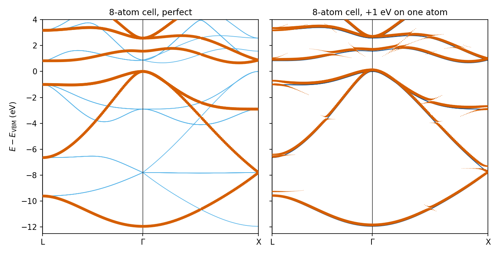
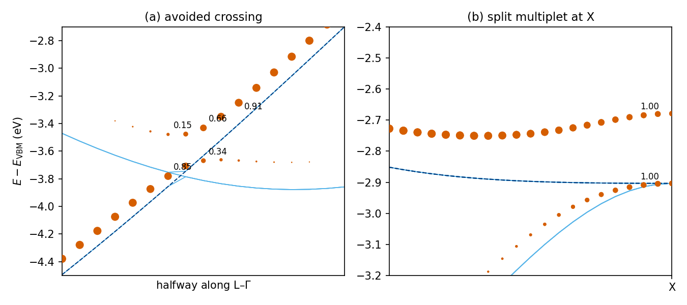

# How to unfold supercell bands onto the primitive Brillouin zone

On this page you unfold the bands of a supercell onto the Brillouin zone of its primitive cell with {py:func}`~PAOFLOW.models.band_unfold.unfold_bands`. Unfolding lets you compare the bands of a cell that breaks the primitive periodicity (an alloy, an impurity, a superstructure) with primitive-cell bands or with angle-resolved photoemission (ARPES), instead of reading the folded branches of its smaller zone. It gives each supercell eigenstate $n$ a spectral weight $w_n(\mathbf{k})$, the probability that the state has primitive crystal momentum $\mathbf{k}$ ([The weight in an orbital basis](../theory/band-unfolding.md#the-weight-in-an-orbital-basis)). The input is the real-space Hamiltonian $H_{\alpha\beta}(\mathbf{R})$ of both cells, from a tight-binding model or from a projected DFT calculation.

The method makes two approximations. The weights are those of an orthonormal orbital basis. Every supercell atom must sit on an ideal site of the primitive crystal, so relaxed positions, vacancies and interstitials are outside its scope.

:::{tip}
This page is built on the case [`si_supercell_unfold`](https://github.com/marcobn/PAOFLOW/tree/develop/examples/cases/si_supercell_unfold): open it in PAOFLOW Studio with *Examples…* → `si_supercell_unfold`, or copy it with `paoflow-gen --example si_supercell_unfold`. It needs no DFT data and runs in about a minute. Download {download}`band_unfolding.py <band-unfolding/band_unfolding.py>` into the copy of the case, which holds the Slater–Koster parameters `Si_SK_params.json` it reads, to run this page or to unfold your own supercell with your parameters and geometries, and {download}`figures.py <band-unfolding/figures.py>` to redraw the figures of this page from that run, in the same directory.
:::

## The model

Give `unfold_bands` one model dictionary per cell, both from the same parameters, so that the cells differ only by the perturbation you add. The model here is an environment-dependent tight-binding (EDTB) model of silicon, read from `Si_SK_params.json`. It holds Slater–Koster bond integrals for an $sp^3d^5$ basis on three neighbour shells. The atoms around each bond screen its hopping ([Environment-dependent Slater–Koster models](../../internals/sk-edtb.md)).

```{literalinclude} band-unfolding/band_unfolding.py
:language: python
:end-before: '# The primitive cell and the conventional cube of silicon'
```

## The two cells

The primitive cell is the two-atom fcc cell. The supercell is the eight-atom conventional cube, which holds $N = 4$ primitive cells. Give both geometries in Cartesian coordinates, in units of the same `alat`, because `unfold_bands` matches the atoms of the two cells by position:

```{literalinclude} band-unfolding/band_unfolding.py
:language: python
:start-after: '# The primitive cell and the conventional cube of silicon'
:end-before: '# Unfolding the perfect supercell'
```

Each supercell atom must map onto an atom of the primitive cell ([The atom mapping](../theory/band-unfolding.md#the-atom-mapping)). The mapping fixes some of its properties and leaves the others free:

| supercell atom | relative to the primitive atom it maps onto |
| --- | --- |
| position | the primitive site shifted by one of the $N$ primitive lattice vectors $\mathbf{R}_\ell$ that lie inside the supercell |
| number of orbitals | the same |
| species, on-site energies, hoppings | may differ |

Place each atom at that site itself, with fractional coordinates of the supercell between 0 and 1, and not at an equivalent position shifted by a supercell lattice vector. The weights use the translation $\mathbf{R}_\ell$ inside the cell, so an atom given at another image gets wrong weights. The sum rule below does not detect this error.


The figure draws this geometry for one graphene layer, in the supercell spanned by $2\mathbf{a}_1 + \mathbf{a}_2$ and its $60^\circ$ rotation. In (a), the amber primitive cell and its $N = 7$ translations $\mathbf{R}_\ell$ fill the black supercell; the light-blue points are the carbon sites.

In (b), the seven vermillion wavevectors lie in the primitive zone (blue) and differ by reciprocal lattice vectors of the supercell, whose zones are drawn in black. The supercell Hamiltonian is therefore the same matrix at all seven ([The mapping of wavevectors](../theory/band-unfolding.md#the-mapping-of-wavevectors)). The weight tells you to which of the seven each of its eigenstates belongs.

In (c), the second layer is rotated by $21.79^\circ$. Its atoms are not primitive sites shifted by a lattice vector, so this cell cannot be unfolded.

## Unfolding the perfect supercell

Unfold the perfect supercell first. Its weights must reproduce the primitive bands, so this run tests the geometry and the path. {py:class}`~PAOFLOW.models.edtb_params.EDTBModel` turns the parameters and a geometry into the model dictionary that `unfold_bands` reads, the one of the [tight-binding how-to](tight-binding-model.md):

```{literalinclude} band-unfolding/band_unfolding.py
:language: python
:start-after: '# Unfolding the perfect supercell'
:end-before: '# A substitutional impurity'
```

The path runs through the primitive zone, because each of its points is a primitive momentum $\mathbf{k}$:

| argument | meaning |
| --- | --- |
| `sym_points` | the high-symmetry points, in fractional coordinates of the reciprocal lattice of the primitive cell. With the `a_vectors` above, X is $(2\pi/a)(1, 0, 0)$ and L is $(2\pi/a)(\tfrac12, \tfrac12, \tfrac12)$ up to sign |
| `path_str` | the path through these points |
| `nk_per_seg` | the number of k-points on each segment of `path_str` |

For the full path of the fcc zone with these `a_vectors`, pass the module's `FCC_SYM_POINTS` and `FCC_PATH`. The run prints the matrix $M$ of the supercell vectors in terms of the primitive ones, the atom mapping and the sum rule:

```text
Transformation matrix M (det = 4):
  [-1  1 -1]
  [-1  1  1]
  [ 1  1 -1]
Found 4 translations inside SC.

Atom mapping (PC atom α → SC atom I):
  α=0: SC atoms [0, 3, 2, 1]
  α=1: SC atoms [4, 7, 6, 5]

PC: 18 orbitals,  SC: 72 orbitals,  N=4
Expected sum rule: Σ_n W_n(k) = 18
k-path: 161 points, 3 symmetry ticks

Sum rule:  Σ_n W_n(k)  mean = 18.000000  (expected 18),  max deviation = 1.07e-14
```

The weights at each $\mathbf{k}$ add up to the number of orbitals of the primitive cell, here 18 ([The sum rule](../theory/band-unfolding.md#the-sum-rule)). This holds for any geometry and any path, so the printed deviation checks only that the two models carry the same orbitals. To check the positions and the path, look at whether the states of weight 1 lie on the primitive bands, as in the figure below.

The returned `result` holds the bands and weights along the path:

| attribute | content |
| --- | --- |
| `E_sc` | supercell eigenvalues, of shape (k-points, supercell orbitals) |
| `W` | weights $w_n(\mathbf{k})$, of the same shape |
| `E_pc` | primitive eigenvalues |
| `kdist` | distance along the path |
| `sym_ticks` | the high-symmetry points on the path |

## Adding a substitutional impurity

Model a substitutional impurity by changing the on-site energies of one atom in the supercell dictionary. The block below raises all nine orbitals of atom 0 by 1 eV: one impurity in eight atoms.

```{literalinclude} band-unfolding/band_unfolding.py
:language: python
:start-after: '# A substitutional impurity'
:end-before: '# Saving the bands and weights'
```

Then save both runs to one file:

```{literalinclude} band-unfolding/band_unfolding.py
:language: python
:start-after: '# Saving the bands and weights'
```

Draw the weights as markers with area proportional to $w_n(\mathbf{k})$. Within a degenerate multiplet only the sum of the weights is defined ([Degenerate multiplets](../theory/band-unfolding.md#degenerate-multiplets)). Markers put the states of a multiplet on one point, where their weights add. Together, the markers draw the unfolded spectral function ([The unfolded spectral function](../theory/band-unfolding.md#the-unfolded-spectral-function)).



The left panel shows `result`, the right panel `result_imp`. The thin light-blue lines are the 72 folded bands of the perfect supercell, and the vermillion markers are the supercell states with weight above 0.02. The dark-blue lines on the right are the primitive bands. The energy zero is the valence-band maximum (VBM) of the primitive cell at $\Gamma$.

In the perfect cell the weights select one branch out of every four. The states with $w_n \approx 1$ coincide with the primitive bands to within $10^{-12}$ eV at $\Gamma$, so the geometry and the path are right.

With the impurity, the weight stays on branches close to the primitive bands. These branches are shifted upwards by about one eighth of the impurity potential, which is its average over the cell: the VBM moves by 0.118 eV, and the lowest band at $\Gamma$ by 0.109 eV ([Perturbations seen through the weights](../theory/band-unfolding.md#perturbations-seen-through-the-weights)).



The zoom shows two further changes, with the primitive bands dashed. In (a), halfway along L–$\Gamma$, a folded band crosses a primitive one in the perfect cell. The impurity couples the two bands and opens a gap of 0.24 eV. Across the gap the weight passes from one branch to the other, as the annotated weights show. ARPES would therefore see the primitive band continue through the gap, with reduced intensity.

In (b), the impurity lifts a degeneracy of the primitive crystal, because it lowers the symmetry. The doubly degenerate primitive state at X, at $-2.90$ eV, becomes two supercell states, at $-2.90$ and $-2.68$ eV, with weight 1.00 each.

## Unfolding a projected DFT Hamiltonian

To unfold a DFT calculation, run PAOFLOW up to {py:meth}`~PAOFLOW.PAOFLOW.PAOFLOW.pao_hamiltonian` twice, once for the primitive cell and once for the supercell. Use the same pseudopotentials, PAO basis and `alat` in both Quantum ESPRESSO inputs, so that the orbitals and positions of the two cells map onto each other. {py:func}`~PAOFLOW.models.band_unfold.paoflow_to_model_dict` then turns the `data_controller` of each run into a model dictionary for `unfold_bands`.

Build these dictionaries only with this function. The projected $H_{\alpha\beta}(\mathbf{R})$ stores its hoppings at $-\mathbf{R}$, and the dictionary records this sign for `unfold_bands` to correct. With the wrong sign, the weights select the folded branches of $-\mathbf{k}$ ([Band unfolding: implementation](../../internals/band-unfolding.md)).

The weights refer to the Löwdin-orthogonalised PAOs. They are as reliable as the projected bands, which the projectability controls ([Projectability](../theory/pao-hamiltonian.md#projectability)). For a spin-polarised calculation only the first spin channel is unfolded.

## Troubleshooting

| message | meaning | what to do |
| --- | --- | --- |
| `SC lattice vectors are not an integer multiple of PC vectors` | The supercell is not commensurate with the primitive cell, or the two cells use different `alat` or Cartesian frames. | Give both `a_vectors` in the same frame and units of the same `alat`. |
| `No SC atom found matching PC atom ... Check positions/lattice vectors.` | A primitive atom shifted by one of the $\mathbf{R}_\ell$ has no supercell atom on its site within $10^{-4}$ in fractional coordinates of the supercell. The positions are relaxed or twisted, an atom is missing, or the two geometries use different `alat`. | Give the supercell its ideal positions and the same `alat` as the primitive cell. A twisted bilayer cannot be unfolded. |
| `SC atoms {...} are not mapped to any PC atom + translation.` | The supercell has more atoms than $N$ times the primitive cell, for example an interstitial. | Unfold a supercell without the extra atoms. |
| `Orbital count mismatch: SC atom ...` | A substituted atom carries a different set of orbitals from the primitive atom it replaces. | Give the substituted atom the same orbitals. |
| `Sum-rule deviation ... exceeds tolerance.` | The primitive model has a different number of orbitals from the supercell atoms mapped onto it. | Build both models from the same basis. |

## Where to go next

- [Band unfolding: spectral weights of supercell states](../theory/band-unfolding.md) derives the weight and the limits of the method.
- [How to unfold the bands of large supercells with the sparse solver](unfold-large-supercells.md) unfolds cells of hundreds of atoms, where the full diagonalisation used here runs out of memory.
- [How to run PAOFLOW on a tight-binding model](tight-binding-model.md) explains the model dictionaries.
- [Band unfolding: implementation](../../internals/band-unfolding.md) describes the algorithm and its cost.
