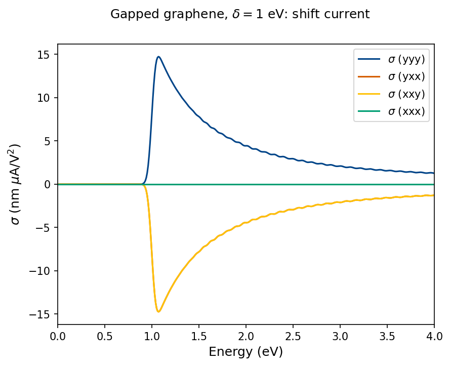
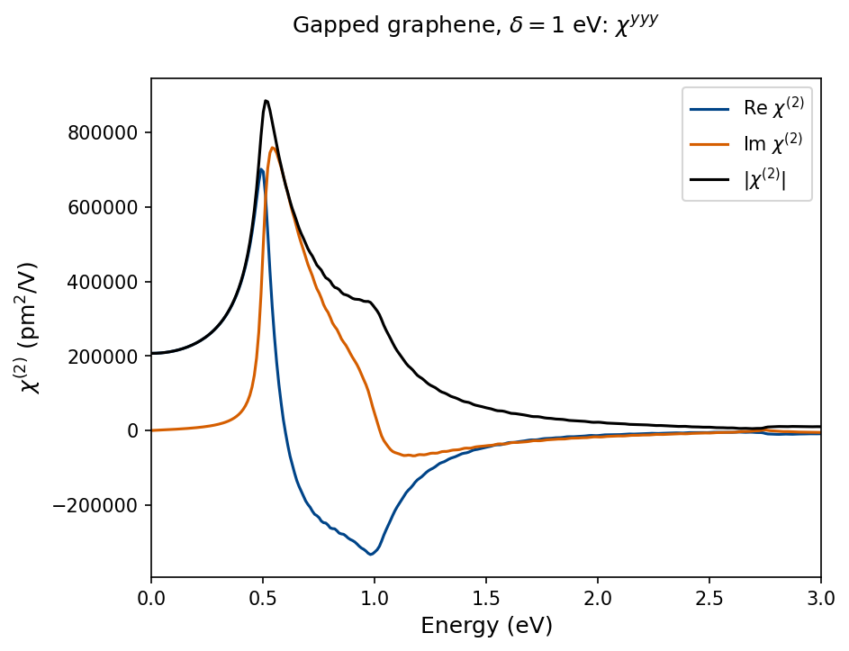

# How to compute the non-linear optical response of a tight-binding model

On this page you compute the second-order optical response of a tight-binding model with {py:meth}`~PAOFLOW.PAOFLOW.PAOFLOW.nonlinear_optics`: the shift current, the injection currents and the second-harmonic generation (SHG) susceptibility $\chi^{(2)}$. These responses vanish in a crystal with inversion symmetry, so a model is the natural place to test them: you switch inversion on and off with one parameter, and the point group tells you which components must vanish. The example is graphene with a sublattice potential, the simplest crystal without inversion. The [theory page](../theory/nonlinear-optics.md) derives the formulas the code evaluates. The responses rest on these approximations:

- independent electrons in the bands of the model, without excitons or local fields;
- the position operator diagonal on the orbital centres (the tight-binding approximation);
- interband transitions only, so the results apply to insulators and semiconductors;
- one constant broadening for all transitions, and injection currents given as rates, without a carrier relaxation time.

Base example: [examples/nlo_examples/Graphene/](https://github.com/marcobn/PAOFLOW/tree/master/examples/nlo_examples/Graphene)

:::{tip}
Download {download}`main.py <nonlinear-optics-model/main.py>` to compute the responses of your own model: replace `model` and set `nelec`, `components` and `nk` for it. The model is built in code, so the page needs no input files, and the script runs in about 15 s on one core. Download {download}`figures.py <nonlinear-optics-model/figures.py>` to redraw the figures of this page from that run and to check the numbers it quotes, by running it in the same directory after `python main.py > main.log`.
:::

## Computing the responses

The `graphene` model with $\delta = 1$ eV has the on-site energies $\pm\delta/2$ on the two sublattices, a gap of 1 eV at K and K′, and the point group $D_{3h}$, with $\mathbf{a}_1$ along $x$ and a mirror perpendicular to $x$. The script computes the responses directly after the constructor:

```{literalinclude} nonlinear-optics-model/main.py
:language: python
:end-before: '# The same model with inversion symmetry'
```

`nonlinear_optics()` interpolates $H_{\alpha\beta}(\mathbf{R})$ at the k-points of its own mesh, so on a model you call it right after the constructor, without `interpolated_hamiltonian()` or `pao_eigh()`. On a DFT Hamiltonian it must come after `pao_hamiltonian()` and before these two calls, which release $H_{\alpha\beta}(\mathbf{R})$. Five arguments depend on the model.

`components` selects the tensor components $abc$, with $a$ the direction of the current or polarisation and $b$, $c$ those of the field. The point group fixes which ones are independent ([Point groups and inversion](../theory/nonlinear-optics.md#point-groups-and-inversion)): in $D_{3h}$ with this orientation, $yyy = -yxx = -xxy$ and $xxx = 0$ for every response. The list holds these four, so the run checks the relations as well as computing the one independent component.

`nk=(300, 300, 1)` gives 90 000 k-points of the two-dimensional zone. The responses come from transitions near K and K′, where the bands are closest, and the mesh must sample the transition energies there more finely than `eta`, or the spectra oscillate with the mesh. Check the mesh by repeating the run on a denser one: the peaks should not move.

`eta=0.05` (eV) is the width of the Gaussians that replace the $\delta$ functions of the shift and injection currents, and the imaginary part of the resonance denominators of $\chi^{(2)}$ ([Broadening](../theory/nonlinear-optics.md#broadening)). It sets the resolution of the spectra: features narrower than `eta`, such as the onset at the gap, are broadened by it.

`nelec=2` fills the lower band. A model has no electron count of its own, and without spin–orbit coupling each band holds two electrons, so `nelec` is twice the number of occupied bands ([Occupations and spin](../theory/nonlinear-optics.md#occupations-and-spin)).

`twoD=True` gives the responses of the sheet: the bulk responses multiplied by the height of the cell, $|\mathbf{a}_3| = 10a$ for this model, in nm µA/V² for the shift current, nm A V⁻² s⁻¹ for the injection currents and pm²/V for $\chi^{(2)}$. Without it the responses depend on the vacuum in the cell, which is not a property of the layer ([Bulk and sheet units](../theory/nonlinear-optics.md#bulk-and-sheet-units)).

The position matrix elements are measured from the orbital centres, which `nonlinear_optics()` takes from the atomic positions of the model. For a model of your own, give exact positions, or pass the centres in crystal coordinates as `orbital_positions`, because an error in them breaks the symmetry of the responses (see [Checking the result](#checking-the-result)).

The run writes one file per response and component, with the photon energy (eV) and the value: `shift_*` (shift current), `shiftm_*` (magnetic shift current), `injectc_*` and `injectm_*` (circular and magnetic injection currents), and `shgr_*`, `shgi_*`, `shga_*` (real part, imaginary part and modulus of $\chi^{(2)}$). {py:meth}`~PAOFLOW.GPAO.GPAO.plot_optical` reads them by these prefixes, and `figures.py` draws the two figures below with it.



The shift current sets in at the 1 eV gap and peaks at 14.74 nm µA/V² at 1.07 eV, just above the gap, with an onset broadened by `eta`, and then decays as the transitions move away from the valleys. Each transition displaces the electron by the [shift vector](../theory/nonlinear-optics.md#shift-current), so the current is largest where many transitions with a large displacement fall at one photon energy. The `yxx` and `xxy` curves lie on top of each other, at $-\sigma^{yyy}$, and $\sigma^{xxx}$ is zero.



$\chi^{(2)}$ has two resonances, at half the gap and at the gap ([Second-harmonic generation](../theory/nonlinear-optics.md#second-harmonic-generation)). $|\chi^{yyy}|$ peaks at $8.85 \times 10^{5}$ pm²/V at 0.51 eV, the two-photon resonance, where $2\hbar\omega$ reaches the gap. At the one-photon resonance the real part has its minimum, $-3.33 \times 10^{5}$ pm²/V at 0.98 eV, and $|\chi^{yyy}|$ a shoulder. Below both resonances $\chi^{(2)}$ tends to the static value $|\chi^{yyy}(0)| = 2.07 \times 10^{5}$ pm²/V.

## Checking the result

Symmetry gives the cheapest checks, because a component that the point group forbids must come out at the level of numerical noise. A model carries no symmetry operations, so `nonlinear_optics()` sums over the full mesh and the relations test the calculation; on a DFT run the default `symmetry=True` imposes them ([Symmetry reduction of the k-mesh](../theory/nonlinear-optics.md#symmetry-reduction-of-the-k-mesh)). The centrosymmetric run uses the same model with $\delta = 0$ on a coarser mesh, since it only tests that the responses vanish:

```{literalinclude} nonlinear-optics-model/main.py
:language: python
:start-after: '# The same model with inversion symmetry'
:end-before: '# Symmetry checks'
```

The script prints the checks after the two runs:

```{literalinclude} nonlinear-optics-model/main.py
:language: python
:start-after: '# Symmetry checks'
```

The output is:

```text
shift current: peak 14.74 nm muA/V^2 at 1.07 eV
  |yyy + yxx|, |yyy + xxy| <= 7.3e-04, |xxx| <= 7.4e-15
|chi_yyy|: 2.070e+05 pm^2/V at 0, peak 8.849e+05 at 0.51 eV
Re chi_yyy: minimum -3.330e+05 pm^2/V at 0.98 eV
max |shiftm|: yyy 0.0e+00, yxx 0.0e+00, xxy 9.3e-14, xxx 0.0e+00
max |injectm|: yyy 2.5e-04, yxx 4.3e-04, xxy 8.6e-05, xxx 4.5e-04
max |injectc|: yyy 1.2e-06, yxx 1.4e-06, xxy 8.6e+04, xxx 1.4e-06
delta = 0: max |shift| 5.8e-14, max |chi| 7.6e-06
```

Read it in three steps. First, the $D_{3h}$ relations hold to $7 \times 10^{-4}$ nm µA/V², $5 \times 10^{-5}$ of the peak, and $\sigma^{xxx}$ stays at $10^{-14}$. Second, the magnetic shift and injection currents are odd under [time reversal](../theory/nonlinear-optics.md#time-reversal), which the model preserves, so they vanish: `shiftm_*` stays below $10^{-13}$ and `injectm_*` below $5 \times 10^{-4}$, in the units of their files. Third, with $\delta = 0$ the model has inversion symmetry and every response vanishes, the shift current to $10^{-13}$ nm µA/V² and $|\chi^{(2)}|$ to $10^{-5}$ pm²/V.

The circular injection current is the exception. It is antisymmetric in its two field indices, so its `yyy`, `yxx` and `xxx` components vanish for any crystal, and only `xxy` tests the point group: it is allowed only in gyrotropic point groups, which $D_{3h}$ is not ([Permutation of the field indices](../theory/nonlinear-optics.md#permutation-of-the-field-indices)). Yet `injectc_xxy.dat` reaches $-8.6 \times 10^{4}$ nm A V⁻² s⁻¹ at 1.75 eV. The cause is the orbital centres: the built-in `graphene` model stores its atomic positions to five decimals, which breaks the threefold rotation of the position operator at the $10^{-5}$ level, and the same error is the residual of the shift-current relations in the first step. With the exact centres, `orbital_positions=[[1/3, 1/3, 0], [2/3, 2/3, 0]]`, both drop to the level of the other forbidden components. Do not use `injectc_xxy` of the built-in model as a physical result.

## Applying it to a DFT Hamiltonian

On a Hamiltonian from a DFT run, three further arguments matter. `scissor` (eV) shifts the conduction bands rigidly in every transition energy, which corrects the PBE gap while keeping the position matrix elements ([Scissor shift](../theory/nonlinear-optics.md#scissor-shift)). `position_dipoles=True` adds the dipoles between orbitals of one atom to the position operator, which matters for transitions such as $s$–$p$ across the gap of a III–V semiconductor ([Position dipoles](../theory/nonlinear-optics.md#position-dipoles)). `degeneracy_tol`, 0.01 eV by default, groups nearly degenerate bands, whose numerical asymmetries the responses would otherwise amplify into forbidden components ([Degenerate bands](../theory/nonlinear-optics.md#degenerate-bands)). To test the symmetry relations of a DFT run, pass `symmetry=False`.

## Where to go next

- [Second-order optical response](../theory/nonlinear-optics.md) derives the shift current, the injection currents and the SHG, with their symmetry constraints and approximations.
- [Non-linear optics](../../internals/nonlinear-optics.md) explains how the code evaluates them and lists the symmetry tests on model Hamiltonians and the GaAs and GeS examples.
- [How to run PAOFLOW on a tight-binding model](tight-binding-model.md) lists the other models and shows how to build one with your own parameters.
- [Tutorial 05](../tutorials/tutorial05.ipynb) computes the Berry curvature and Chern number of the same gapped graphene.
