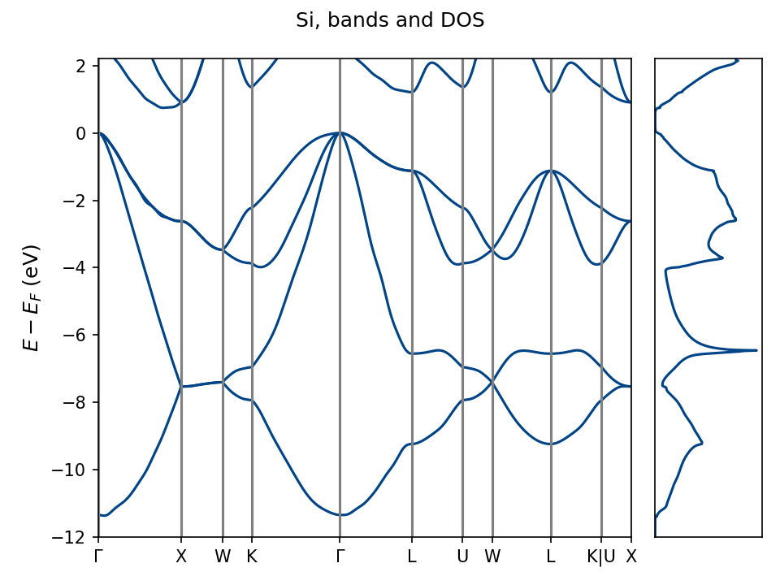
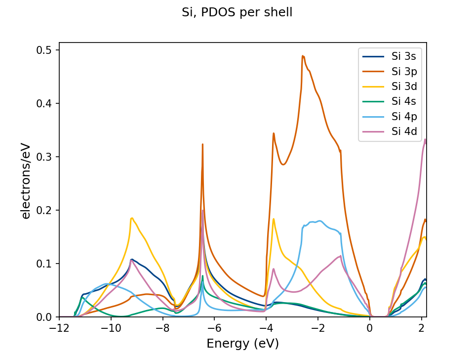

# How to plot PAOFLOW output with GPAO

On this page you plot the output files of a finished PAOFLOW run with the {py:class}`~PAOFLOW.GPAO.GPAO` class: the band structure, the density of states (DOS) and the projected DOS (PDOS). GPAO reads the text files that each property writes to `outputdir`. You can therefore plot a run without its `PAOFLOW` object, for example after a cluster job. GPAO computes nothing, so a figure carries the approximations of the run that wrote the files.

:::{tip}
This page is built on the case [`si_bands_transport`](https://github.com/marcobn/PAOFLOW/tree/develop/examples/cases/si_bands_transport): open it in PAOFLOW Studio with *Examples…* → `si_bands_transport`, or copy it with `paoflow-gen --example si_bands_transport`. Download {download}`plotting.py <plotting/plotting.py>` into the copy, or beside your own run, to plot it. It reads the files in `output/`, the `outputdir` of the case's `main.py`, and saves the figures of this page. Download {download}`figures.py <plotting/figures.py>` to check that a rerun still gives the numbers quoted here. To make the plotted files without the QE runs, copy the case with `paoflow-gen --example si_bands_transport --with-data`. It extracts `silicon.save` from `si_bands_transport-v2.tar.gz` of the release [case-data](https://github.com/marcobn/PAOFLOW/releases/tag/case-data). Then run `python main.py` in the copy, in about two minutes on one core, and `python plotting.py` after it, in about 10 s.
:::

## Setting up

```{literalinclude} plotting/plotting.py
:language: python
:end-before: '# Band structure and DOS'
```

The calls below pass the colors of `palette` through `col` or `cols`, because the GPAO defaults (black, red, green and blue) differ from those of this documentation.

## Band structure and DOS

You plot the bands and the DOS from three files of the run:

| File | Written by | Content |
| ---- | ---------- | ------- |
| `bands_0.dat` | `bands()` | the band energies along the path, relative to $E_F$ |
| `kpath_points.txt` | `bands()` | the high-symmetry points of the path, which `sym_points` reads for the tick marks |
| `dosdk_0.dat` | `dos()` | the DOS against energy |

```{literalinclude} plotting/plotting.py
:language: python
:start-after: '# Band structure and DOS'
:end-before: '# Projected DOS grouped by orbital'
```

Each GPAO method draws one new figure and calls `matplotlib.pyplot.show()`, which opens a window when you run a script. To write the figure to a file instead, as the script does, run with `MPLBACKEND=Agg python plotting.py` and call `matplotlib.pyplot.savefig('name.png')` after the GPAO call.

On the k axis, a jump in the path gets one tick with both labels, such as `K|U`. The other arguments of the calls set the axes:

| Argument | Effect |
| -------- | ------ |
| `label` (`band_label` in {py:meth}`~PAOFLOW.GPAO.GPAO.plot_dos_beside_bands`) | the label of the energy axis |
| `y_lim` | the energy range |
| a list of files and a list of `labels` in {py:meth}`~PAOFLOW.GPAO.GPAO.plot_bands` | overlays the bands of several runs, to compare them |

Keep `y_lim` of `plot_dos_beside_bands` inside the energy range of `dos(emin, emax)`. The DOS panel shares the energy axis with the bands, and it stops where the DOS file stops.



The figure shows the run of the case's `main.py`, which projects onto the `standard` basis and calls `bands(ibrav=2, nk=2000)` and `dos(emin=-12.0, emax=2.2, ne=1000)`. The energy zero is $E_F$, here the valence-band maximum (VBM) at $\Gamma$. The conduction-band minimum (CBM) lies on the $\Gamma$–X line at 0.746 eV, so the DOS is zero between 0 and 0.746 eV. The DOS panel ends at `emax`, 2.2 eV.

## Projected DOS grouped by orbital

To see which orbitals make up each part of the DOS, plot the PDOS summed over groups of orbitals ([Projected density of states](../theory/density-of-states.md#projected-density-of-states)). Here each group is one shell of both Si atoms. `dos()` writes one PDOS file per pseudo-atomic orbital, named by atom and orbital (`Si1_3s_pdosdk_0.dat`, `Si1_3px_pdosdk_0.dat`, ...). {py:meth}`~PAOFLOW.GPAO.GPAO.plot_pdos` draws one curve per file. With `psum_inds` it draws one curve per group instead. `psum_inds` is a list with one inner list per group, which holds the positions of the group's files in the list of files.

```{literalinclude} plotting/plotting.py
:language: python
:start-after: '# Projected DOS grouped by orbital'
```

The script reads the shell of each file from its name, so the groups follow the basis of the run. The `standard` basis of the case's `main.py` holds the $3s$, $3p$ and $3d$ pseudo-orbitals and the $4s$, $4p$ and $4d$ shells. A group of the two atoms therefore holds 2 files for an $s$ shell, 6 for a $p$ shell and 10 for a $d$ shell. With the projections of `projwfc.x` (the projector *projwfc* in the case's form), the basis holds only the pseudo-orbitals, and only the first three groups remain. With `psum_inds` given, `labels` and `cols` take one entry per group rather than per file.



The $3p$ orbitals carry half of the weight between $-4$ eV and the VBM. At the bottom of the valence band, below $-10$ eV, the weight spreads over all six shells, with the largest share on $3s$. Integrated over the valence band, the six curves share the 4.00 states per spin as follows:

| Shell | $3s$ | $3p$ | $3d$ | $4s$ | $4p$ | $4d$ |
| ----- | ---- | ---- | ---- | ---- | ---- | ---- |
| States per spin | 0.49 | 1.51 | 0.70 | 0.19 | 0.57 | 0.54 |

The [bands and DOS tutorial](../tutorials/tutorial01.ipynb#density-of-states-and-projected-dos) discusses this distribution, and why the $d$ shells, which Si does not occupy, still get a share.

## Other properties

GPAO plots the files of the other properties in the same way, with one method per file type. The case of each property has a `plot.py`, written by Studio or `paoflow-gen`, that calls it:

| Plot | Cases |
| ---- | ----- |
| Berry curvature under the bands | [`fe_anomalous_hall`](https://github.com/marcobn/PAOFLOW/tree/develop/examples/cases/fe_anomalous_hall) |
| Spin Hall conductivity | [`pt_spin_hall`](https://github.com/marcobn/PAOFLOW/tree/develop/examples/cases/pt_spin_hall), [`snte_spin_texture`](https://github.com/marcobn/PAOFLOW/tree/develop/examples/cases/snte_spin_texture) |
| Conductivity and Seebeck coefficient | [`al_dos_transport`](https://github.com/marcobn/PAOFLOW/tree/develop/examples/cases/al_dos_transport), [`alp_hubbard_optics`](https://github.com/marcobn/PAOFLOW/tree/develop/examples/cases/alp_hubbard_optics) |

The Fermi surface is the exception. `fermi_surface()` writes it to `FermiSurf_0.bxsf`, as in [`snte_spin_texture`](https://github.com/marcobn/PAOFLOW/tree/develop/examples/cases/snte_spin_texture), and the `fermi-plotter` command draws it instead of GPAO ({py:mod}`PAOFLOW.gen.fermi_plotter` lists its options). The command needs the `fermisurface` extra, `pip install "PAOFLOW[fermisurface]"`.

## Where to go next

- {py:class}`~PAOFLOW.GPAO.GPAO` lists every plotting method, including those for Berry curvature, spin Hall conductivity, transport, optics, phonons and electron–phonon properties, with their arguments.
- [Band structure and density of states of silicon](../tutorials/tutorial01.ipynb) produces the band and DOS files used here and explains what they contain.
- [Band velocities, density of states and adaptive smearing](../theory/density-of-states.md) derives the DOS and the PDOS in these files.
