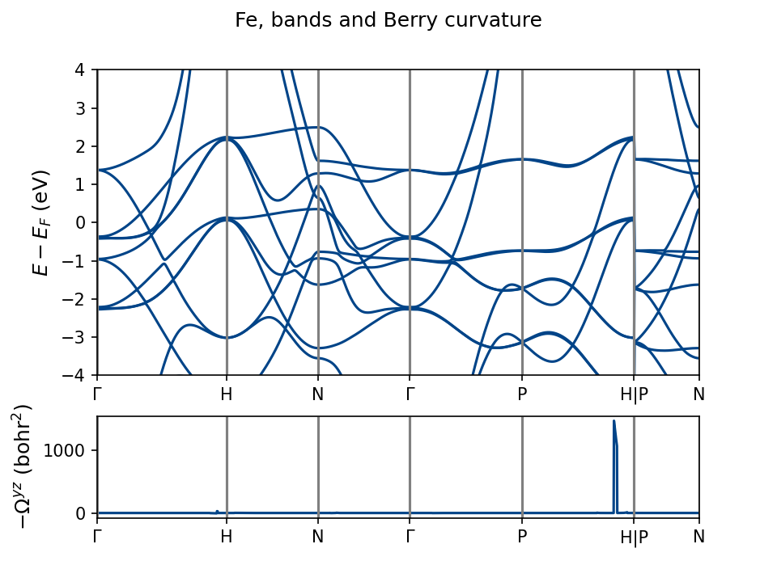
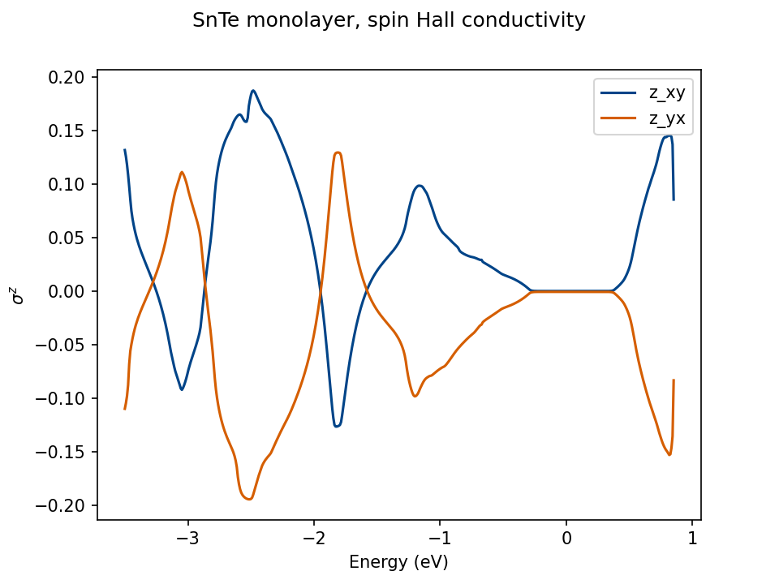
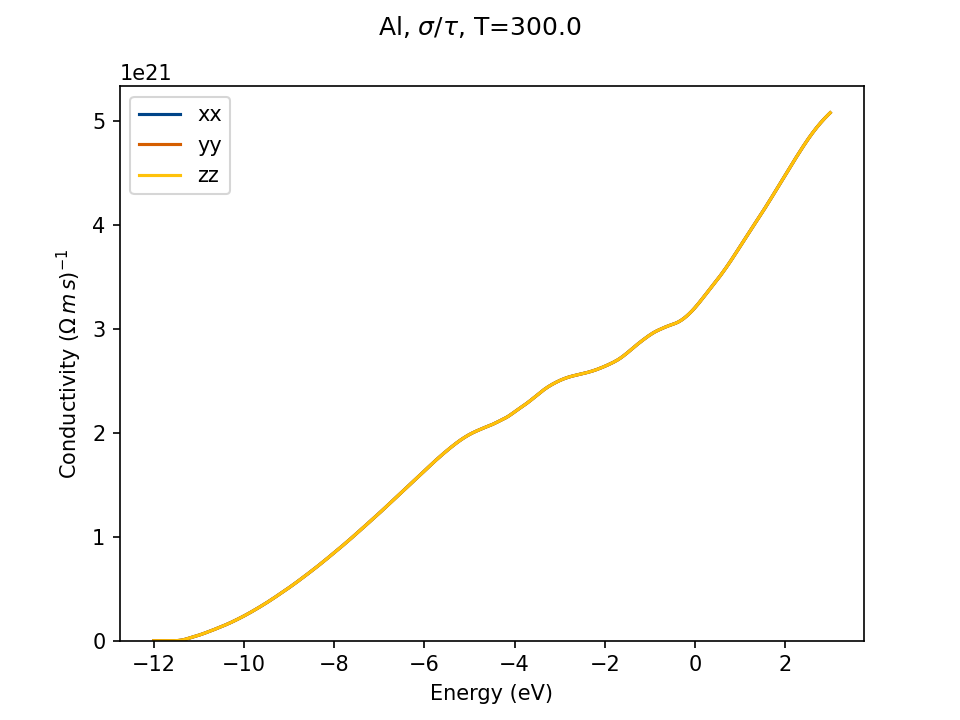
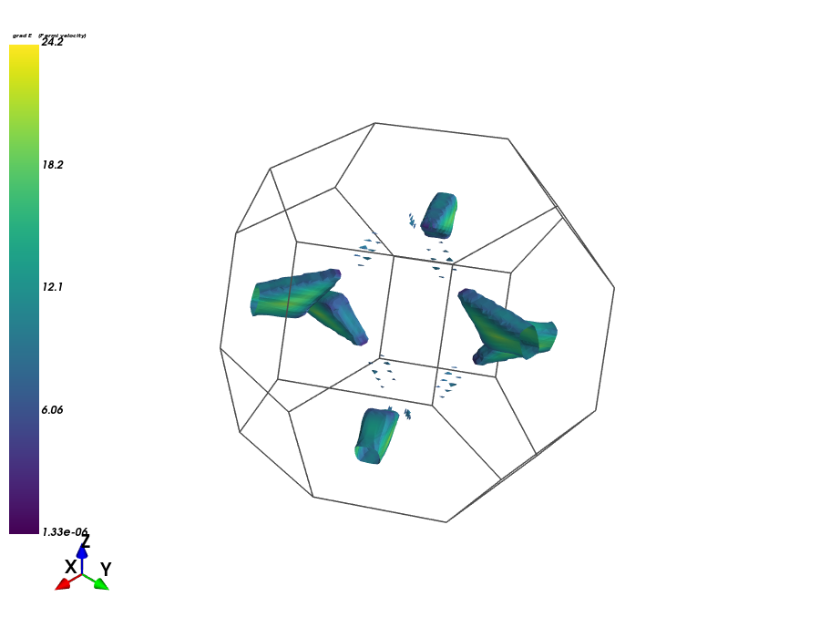

# How to plot PAOFLOW output with GPAO

On this page you plot the output files of a finished PAOFLOW run with the {py:class}`~PAOFLOW.GPAO.GPAO` class: band structures, the density of states (DOS) and projected DOS (PDOS), the Berry curvature, the spin Hall conductivity (SHC), transport tensors and the Fermi surface. GPAO reads the text files that each property writes to `outputdir`, so you can plot a run without its `PAOFLOW` object, after a cluster job, for example. GPAO computes nothing, so a figure carries the approximations of the run that wrote the files.

Base examples: [examples/qe_examples/example01/](https://github.com/marcobn/PAOFLOW/tree/master/examples/qe_examples/example01) (Si), [examples/qe_examples/example02/](https://github.com/marcobn/PAOFLOW/tree/master/examples/qe_examples/example02) (Al), [examples/qe_examples/example04/](https://github.com/marcobn/PAOFLOW/tree/master/examples/qe_examples/example04) (Fe), [examples/qe_examples/example05/](https://github.com/marcobn/PAOFLOW/tree/master/examples/qe_examples/example05) (Pt), [examples/qe_examples/example06/](https://github.com/marcobn/PAOFLOW/tree/master/examples/qe_examples/example06) (AlP), [examples/qe_examples/example08/](https://github.com/marcobn/PAOFLOW/tree/master/examples/qe_examples/example08) (SnTe monolayer), [examples/pyskeaf_examples/Bi/](https://github.com/marcobn/PAOFLOW/tree/master/examples/pyskeaf_examples/Bi) (Bi)

:::{tip}
Download {download}`main.py <plotting/main.py>` to plot your own run: replace the paths under `plotting/` with files of its `outputdir`, and it saves every figure of this page. Download {download}`figures.py <plotting/figures.py>` to check that a rerun of an example still gives the numbers quoted here. The files of the examples are in `howto_assets.tar.gz` of the release [tutorial-assets-v2](https://github.com/marcobn/PAOFLOW/releases/tag/tutorial-assets-v2); `tar xzf howto_assets.tar.gz` creates one folder per system under `plotting/`, and both scripts run from the directory that contains it.
:::

## Setting up

```{literalinclude} plotting/main.py
:language: python
:end-before: '# Band structure and DOS'
```

The calls below pass the colors of `palette` through `col` or `cols`, because the GPAO defaults (black, red, green and blue) differ from those of this documentation.

## Band structure and DOS

You plot the bands from `bands_0.dat` and `kpath_points.txt` of `bands()`, with energies relative to $E_F$, and the DOS from `dosdk_0.dat` of `dos()`.

```{literalinclude} plotting/main.py
:language: python
:start-after: '# Band structure and DOS'
:end-before: '# Projected DOS grouped by orbital'
```

Each GPAO method draws one new figure and calls `matplotlib.pyplot.show()`, which opens a window when you run a script. To write the figure to a file instead, as the script does, run with `MPLBACKEND=Agg python main.py` and call `matplotlib.pyplot.savefig('name.png')` after the GPAO call.

The tick marks of the k axis come from `kpath_points.txt`, which `sym_points` reads; a jump in the path gets one tick with both labels, such as `K|U`. `label` (`band_label` in {py:meth}`~PAOFLOW.GPAO.GPAO.plot_dos_beside_bands`) sets the energy-axis label and `y_lim` the energy range. Keep `y_lim` of `plot_dos_beside_bands` inside the energy range of `dos(emin, emax)`, because the DOS panel shares the energy axis and stops where the DOS file stops. To compare two runs, pass a list of files and a list of `labels` to {py:meth}`~PAOFLOW.GPAO.GPAO.plot_bands`, which overlays them.


The figure shows the files of example01, which calls `bands(ibrav=2, nk=2000)` and `dos(emin=-12.0, emax=2.2, ne=1000)`. The energy zero is $E_F$, here the valence-band maximum (VBM) at $\Gamma$, and the conduction-band minimum (CBM) is at 0.754 eV on the $\Gamma$–X line, so the DOS is zero between 0 and 0.754 eV. The DOS panel ends at `emax`, 2.2 eV.

## Projected DOS grouped by orbital

To see which orbitals make up each part of the DOS, you plot the PDOS ([Projected density of states](../theory/density-of-states.md#projected-density-of-states)) summed over groups of orbitals, here the $3s$, $3p$ and $3d$ shells of both Si atoms. `dos()` writes one PDOS file per pseudo-atomic orbital, named by atom and orbital (`Si1_3s_pdosdk_0.dat`, `Si1_3px_pdosdk_0.dat`, ...). {py:meth}`~PAOFLOW.GPAO.GPAO.plot_pdos` draws one curve per file, or, with `psum_inds`, one curve per group of files, where each inner list holds the positions in the file list of the files to add up.

```{literalinclude} plotting/main.py
:language: python
:start-after: '# Projected DOS grouped by orbital'
:end-before: '# Berry curvature under the bands of Fe'
```

The groups, built from the file names, hold 2, 6 and 10 files. With `psum_inds` given, `labels` and `cols` take one entry per group rather than per file.


The $3s$ orbitals carry most of the weight at the bottom of the valence band, below $-10$ eV, and the $3p$ orbitals between $-4$ eV and the VBM. Integrated over the valence band, the three curves hold 0.81, 2.27 and 0.92 of the 4.00 states per spin; [Tutorial 01](../tutorials/tutorial01.ipynb#7-density-of-states-and-projected-dos) discusses this distribution.

## Berry curvature along the path

You plot the Berry curvature in a panel under the bands, to match its peaks to the bands that cause them. {py:meth}`~PAOFLOW.PAOFLOW.PAOFLOW.topology` with `Berry=True, spol=..., ipol=..., jpol=...` writes the curvature along the path of `bands()`, summed over the occupied bands, in bohr$^2$, to `Omega_{spol}_{ipol}{jpol}.dat`. The file holds $-\Omega^{ij}$, the opposite sign of the curvature $\Omega^{ij}$ of the Kubo formula ([Berry curvature from the Kubo formula](../theory/berry-topology.md#berry-curvature-from-the-kubo-formula)), so label the axis with the sign. The spin direction `spol` appears first in the name even though only the spin Berry curvature `Omegaj_*.dat` depends on it. Example04 (bcc Fe with spin–orbit coupling) calls `topology(spol=2, ipol=1, jpol=2, Berry=True)`, so its file is `Omega_z_yz.dat`.

```{literalinclude} plotting/main.py
:language: python
:start-after: '# Berry curvature under the bands of Fe'
:end-before: '# Spin Hall conductivity of Pt and of the SnTe monolayer'
```

In {py:meth}`~PAOFLOW.GPAO.GPAO.plot_berry_under_bands`, `y_lim` applies to the bands only, and the curvature panel spans the range of the data. To choose the range of the curvature as well, plot it alone with `plotter.plot_berry(fe + 'Omega_z_yz.dat', sym_points=fe + 'kpath_points.txt', y_lim=(-50.0, 50.0))`.



The curve peaks at $1.47\times10^{3}$ bohr$^2$ on the P–H line close to H, where two bands lie 1.2 meV above and 31 meV below $E_F$. The peak sits there because each pair of an occupied and an empty band enters the curvature with the inverse square of its energy difference, which is largest where such a pair nearly touches at $E_F$.

## Spin Hall conductivity

You plot the SHC against the Fermi energy from the files of {py:meth}`~PAOFLOW.PAOFLOW.PAOFLOW.spin_Hall`. `spin_Hall(s_tensor=[[ipol, jpol, spol]])` writes `shcEf_{spol}_{ipol}{jpol}.dat`, with the Fermi energy relative to $E_F$ (eV) and the conductivity $\sigma^{s}_{ij}$ with the bands kept rigid, in $(\hbar/e)\,(\Omega\,\mathrm{cm})^{-1}$ ([Spin Berry curvature and spin Hall conductivity](../theory/berry-topology.md#spin-berry-curvature-and-spin-hall-conductivity)). {py:meth}`~PAOFLOW.GPAO.GPAO.plot_shc` takes one file, or a list of files drawn together, and labels each curve with the last four characters of its file name (`z_xy`).

```{literalinclude} plotting/main.py
:language: python
:start-after: '# Spin Hall conductivity of Pt and of the SnTe monolayer'
:end-before: '# Conductivity of Al and Seebeck coefficient of AlP'
```

The second call passes `label` because the default label, $(\Omega\,\mathrm{cm})^{-1}$, is the unit of a bulk calculation. A two-dimensional run, `spin_Hall(twoD=True)` as in example08, divides by the area of the cell in bohr$^2$ instead of its volume and does not convert to SI units, so its file holds the sheet conductivity in units with $\hbar = e = 1$, in which the quantum $e/2\pi$ of a spin Hall plateau is $1/2\pi \approx 0.16$.


In Pt (example05), $\sigma^z_{xy}$ is 1961 $(\hbar/e)\,(\Omega\,\mathrm{cm})^{-1}$ at $E_F$ and reaches its maximum, 2025, 0.09 eV above it.



In the SnTe monolayer (example08), the two components have opposite signs. Inside the gap, between the VBM at $-0.30$ eV and the CBM at 0.38 eV, both stay within 0.0024 of zero, about 1% of their largest magnitude, 0.19, and far below the quantum $1/2\pi$.

## Conductivity and Seebeck coefficient

You plot the transport tensors against the chemical potential $\mu$ from the files of {py:meth}`~PAOFLOW.PAOFLOW.PAOFLOW.transport`, one file per tensor, with the columns temperature (K), $\mu$ relative to $E_F$ (eV), and the components $xx$, $yy$, $zz$, $xy$, $xz$, $yz$. Without scattering channels the relaxation time is constant and equal to 1 s, so `sigmagauss_0.dat` holds $\sigma/\tau$ ([Constant relaxation time](../theory/boltzmann-transport.md#constant-relaxation-time)). The argument `t_ele` selects the components: by default the three diagonal ones, `[(0, 1)]` for $xy$, and `[]` for the average of the diagonal. Each temperature in the file gets its own figure, and {py:meth}`~PAOFLOW.GPAO.GPAO.plot_seebeck` converts $S$ from V/K to $\mu$V/K.

```{literalinclude} plotting/main.py
:language: python
:start-after: '# Conductivity of Al and Seebeck coefficient of AlP'
```

The Seebeck call gives `y_lim` because the automatic y range covers the whole $\mu$ range of the file, not only `x_lim`. For AlP that range would reach $-1.88\times10^{4}\,\mu$V/K, the value at $\mu = -8$ eV, and flatten the curve inside `x_lim`.



For cubic Al (example02), the three diagonal components coincide, as the symmetry of the crystal requires, and $\sigma/\tau$ is $3.20\times10^{21}\,(\Omega\,\mathrm{m\,s})^{-1}$ at $E_F$ and 300 K.


For AlP (example06), the sign of the Seebeck coefficient tells which carriers dominate. It is positive for $\mu$ below 1.43 eV, where holes carry the current, and negative above, with extremes of $+4495\,\mu$V/K at 1.35 eV and $-2876\,\mu$V/K at 1.51 eV; the VBM and CBM of the run are at $-0.81$ and 1.62 eV.

## Fermi surface

You draw the Fermi surface with the `fermi-plotter` command rather than with GPAO, from `FermiSurf_0.bxsf` of {py:meth}`~PAOFLOW.PAOFLOW.PAOFLOW.fermi_surface`, which holds the energies of the bands that cross $E_F$ on the full k-grid, relative to $E_F$. `fermi-plotter` draws the surface at the `Fermi Energy` of the file, 0 for PAOFLOW files, colored by $|\nabla_\mathbf{k} E|$ in eV bohr. It needs Mayavi, which the `fermisurface` extra installs (`pip install "PAOFLOW[fermisurface]"`), and for the interactive window also a Qt binding such as PySide6.

```bash
fermi-plotter plotting/bi/FermiSurf_0.bxsf --interp 2 --cmap viridis
fermi-plotter plotting/bi/FermiSurf_0.bxsf --interp 2 --cmap viridis --save bi_fermi_surface.png
```

The first command opens an interactive window, and the second writes the PNG, off-screen on Linux and Windows. These options change the surface:

- `--interp N`: Fourier upsampling of the k-grid by `N`, for smooth sheets.
- `--fermi-shift dE`: the surface at $E_F + dE$ (eV), that of the crystal doped with rigid bands ([Rigid-band approximation](../theory/boltzmann-transport.md#rigid-band-approximation)).
- `--band`: one band or a list (`--band 15,16`) instead of all bands in the file.
- `--bz ws|cell|none`: the Wigner–Seitz cell (default), the reciprocal cell of the grid, or no outline.
- `--supercell N --center`: N cells with $\Gamma$ in the middle, to show pockets that the cell boundary cuts.



The figure shows the Bi example, whose file holds the bands within 1 eV of $E_F$ on a grid of 33 points per direction, drawn with the commands above. Two bands cross $E_F$. Band 16 forms the elongated sheets, which enclose electrons because its energy rises from a minimum of $-0.42$ eV inside them. Band 15 reaches only 0.02 eV above $E_F$, so its hole pockets are the small fragments, drawn alone by `--band 15`. Resolving them needs a denser k-grid in the run, because `--interp` only interpolates between the energies the file holds.

## Where to go next

- {py:class}`~PAOFLOW.GPAO.GPAO` lists every plotting method, including those for optics, phonons and electron–phonon properties, with their arguments.
- [Tutorial 01](../tutorials/tutorial01.ipynb) and [Tutorial 02](../tutorials/tutorial02.ipynb) produce the band, DOS and transport files used here and explain what they contain.
- [Berry curvature and topological invariants](../theory/berry-topology.md) and [Boltzmann transport in the relaxation-time approximation](../theory/boltzmann-transport.md) derive the quantities in these files.
- [How to compare pyskeaf orbits with measured quantum-oscillation frequencies](quantum-oscillations.md) uses the BXSF files of `fermi_surface()` for de Haas–van Alphen orbits.
