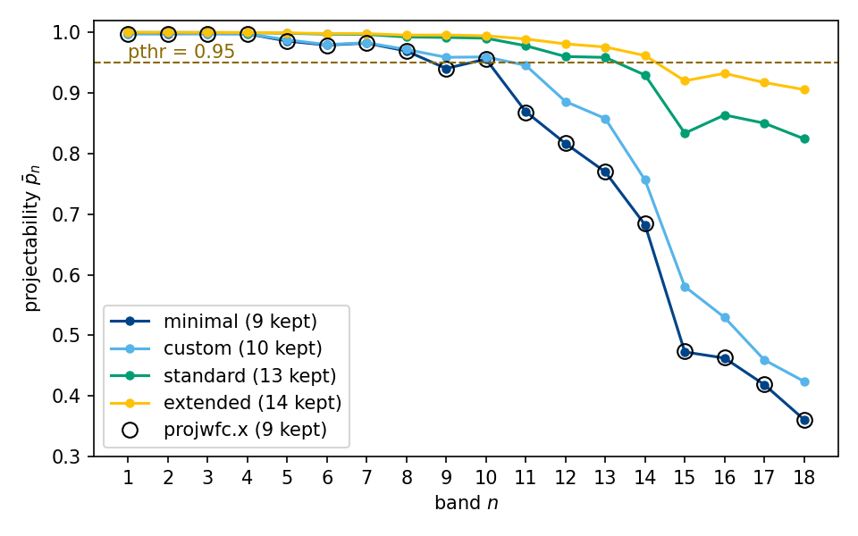
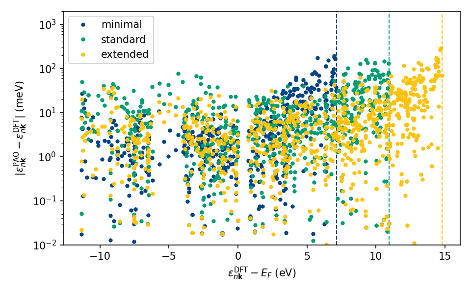

# How to choose the projections onto the PAO basis

On this page you choose the basis of pseudo-atomic orbitals (PAOs) onto which the Kohn–Sham states are projected, and the program that computes the projections. Two programs do it: `projwfc.x` of Quantum ESPRESSO (QE), whose output {py:meth}`~PAOFLOW.PAOFLOW.PAOFLOW.read_atomic_proj_QE` reads, and PAOFLOW itself, with {py:meth}`~PAOFLOW.PAOFLOW.PAOFLOW.projections`.

The basis decides how many bands the PAO Hamiltonian reproduces, and up to which energy. That energy is the PAO shift $\eta$, introduced with the projectability in the [bands and DOS tutorial](../tutorials/tutorial01.ipynb). With any basis, the PAO bands follow the DFT bands only below $\eta$, so a property is reliable only when the energy range it needs lies below $\eta$. The number of orbitals in the basis, $n_\mathrm{awf}$, sets the cost of every later step.

:::{tip}
This page is built on the case [`si_bands_transport`](https://github.com/marcobn/PAOFLOW/tree/develop/examples/cases/si_bands_transport): open it in PAOFLOW Studio with *Examples…* → `si_bands_transport`, or copy it with `paoflow-gen --example si_bands_transport`. Download {download}`projections.py <projections/projections.py>` into the copy, or beside your own calculation, to compare the routes: it builds the PAO Hamiltonian and the bands once per route, each in `output_<route>/`. Download {download}`figures.py <projections/figures.py>` to redraw the figures of this page from that run. It reads the output folders, the printed output saved as `projections.log`, and `bands.out`, the output of the DFT band run {download}`bands.in <projections/bands.in>`, which this page adds to the QE runs of the case together with {download}`proj.in <projections/proj.in>`. To skip the QE runs, copy the case with `paoflow-gen --example si_bands_transport --with-data`. It extracts `bands.out` and `silicon.save`, with the wavefunctions and `atomic_proj.xml`, from `si_bands_transport-v1.tar.gz` of the release [case-data](https://github.com/marcobn/PAOFLOW/releases/tag/case-data). Then run `python projections.py > projections.log` in the copy, in 18 s on one core.
:::

## The routes

Both programs project onto the same kind of basis. Each orbital is a radial function of the isolated pseudo-atom times a real spherical harmonic, and the orbitals are Löwdin-orthogonalised ([Löwdin orthogonalisation](../theory/pao-hamiltonian.md#löwdin-orthogonalisation)). The routes differ in the radial functions they can use and in the data they read:

| Route | Basis | Reads from the `.save` directory | Use it when |
| ----- | ----- | -------------------------------- | ----------- |
| `read_atomic_proj_QE()` | the pseudo-orbitals stored in the pseudopotential | `atomic_proj.xml` of `projwfc.x` | you keep only the projections of a run, not its wavefunctions |
| `projections(configuration='minimal')` | the same pseudo-orbitals | the wavefunctions `wfc*.dat` | the valence and lowest conduction bands suffice |
| `projections(configuration='standard')`, `'extended'` | pseudo-orbitals plus shells of higher principal quantum number | the wavefunctions | you need conduction bands higher up |
| `projections(configuration={...})` | the shells you list, per element | the wavefunctions | a preset gives too few or too many orbitals |

## Setting up

```{literalinclude} projections/projections.py
:language: python
:end-before: '# The projections of projwfc.x'
```

The function `hamiltonian()` runs the steps of the bands and DOS tutorial up to the band structure, once per route, each in its own `outputdir`. Only the projection call differs between the routes. With `verbose=True`, `projectability()` prints for each route:

- the projectability $\bar p_n$ of each band, averaged over the k-points
- the number of bands the Hamiltonian keeps
- the energy range of the first band beyond the kept ones, whose lower end is $\eta$

## The projections of projwfc.x

`projwfc.x` projects the Kohn–Sham states onto the pseudo-orbitals stored in the pseudopotential file (`PP_PSWFC` of a UPF file). It writes the projection amplitudes to `atomic_proj.xml` in the `.save` directory. Run it after `nscf.in`, with the input {download}`proj.in <projections/proj.in>` of this page:

```text
 &projwfc
    prefix = 'silicon'
    outdir = './'
    filpdos = 'silicon.pdos'
    lwrite_overlaps = .true.
    lbinary_data = .false.
 /
```

Two settings of `proj.in` matter to PAOFLOW:

| Setting | Effect |
| ------- | ------ |
| `lbinary_data = .false.` | writes `atomic_proj.xml` in the XML format that PAOFLOW parses |
| `lwrite_overlaps = .true.` | adds the overlap matrices $S(\mathbf{k})$; PAOFLOW keeps them only with `save_overlaps=True` in the constructor |

An ACBN0 run sets `save_overlaps=True` itself, because ACBN0 needs the Hamiltonian in the non-orthogonal basis ([The Hamiltonian in the non-orthogonal basis](../theory/pao-hamiltonian.md#the-hamiltonian-in-the-non-orthogonal-basis)). `read_atomic_proj_QE()` takes no arguments. It reads `atomic_proj.xml` and the pseudopotential files from `savedir`:

```{literalinclude} projections/projections.py
:language: python
:start-after: '# The projections of projwfc.x'
:end-before: '# The pseudo-orbitals of the pseudopotential'
```

The Si pseudopotential stores the $3s$, $3p$ and $3d$ shells, which give 18 PAOs in the two-atom cell. With this basis the Hamiltonian keeps 9 bands: the four valence bands and the five lowest conduction bands. $\eta$ lies 7.16 eV above $E_F$.

This route takes the basis from the pseudopotential and the projections from `atomic_proj.xml`, so it needs no wavefunctions. You can therefore reduce the `.save` directory to `data-file-schema.xml`, the pseudopotentials and `atomic_proj.xml`. For Si these take 2.4 MB, against 8.1 MB for the wavefunctions, which also grow with the number of plane waves. The price is the basis. It holds the pseudo-orbitals of the pseudopotential and nothing else, so a pseudopotential without unoccupied shells gives a basis without them. The route also takes one more QE run, and it works only with QE.

## The pseudo-orbitals of the pseudopotential

`configuration='minimal'` projects onto the same pseudo-orbitals, but PAOFLOW computes the projections itself, from the wavefunctions `wfc*.dat` that `pw.x` writes:

```{literalinclude} projections/projections.py
:language: python
:start-after: '# The pseudo-orbitals of the pseudopotential'
:end-before: '# Radial tables of the larger bases'
```

With the same basis, the two routes give the same result. The projectabilities agree with those of `projwfc.x` to 0.002, and the bands along the path to 2 meV; the open circles in the projectability figure below show the comparison. Choose between the two routes by the data you keep, not by the physics.

## Radial tables of the larger bases

The conduction bands have weight on shells that the pseudopotential does not store. The presets `standard` and `extended` add such shells. PAOFLOW reads each shell of these presets from a radial table, a file that holds the radial function of the shell. {py:func}`~PAOFLOW.basis_gen.driver.generate_basis_for_pseudo` writes the radial tables, one per shell, to `BASIS_PS/Si/`. It takes the shells that the pseudopotential stores as they are. It computes the others as bound states of the pseudo-atom in a spherical box.

```{literalinclude} projections/projections.py
:language: python
:start-after: '# Radial tables of the larger bases'
:end-before: '# The standard and extended presets'
```

`preset='extended'` writes the radial tables of the largest preset, which contains the shells of the others, in 2 s for Si. On the command line, `paoflow-genbasis-ps --pseudo <file.UPF> --out BASIS_PS` does the same.

## The standard and extended presets

Pass the preset as `configuration`, and the folder of the radial tables in `BASIS_PS/` as `basispath`:

```{literalinclude} projections/projections.py
:language: python
:start-after: '# The standard and extended presets'
:end-before: '# Shells generated at run time'
```

For Si, the presets add these shells to the pseudo-orbitals:

| Basis | Shells of each Si atom | PAOs in the cell |
| ----- | ---------------------- | ---------------- |
| `minimal` | $3s$, $3p$, $3d$ | 18 |
| `standard` | those of `minimal`, and $4s$, $4p$, $4d$ | 36 |
| `extended` | those of `standard`, and $5s$, $5p$ | 44 |

For another element, `projections()` prints the shells it resolves when `verbose=True`. The rules of each preset are under `configuration` in {py:meth}`~PAOFLOW.PAOFLOW.PAOFLOW.projections`.



Each added shell raises the projectability of the conduction bands, so a larger basis keeps more bands: 9 with `minimal` and 14 with `extended`. `projectability()` counts the bands above `pthr` and keeps that number of lowest bands, which need not be the same bands. With `minimal`, nine bands pass, band 10 at 0.956 among them, but band 9, at 0.940, does not. The Hamiltonian keeps the nine lowest bands, so band 9 is kept and band 10 dropped.

To see which basis reproduces the DFT bands, compare the PAO bands with a DFT band run. The input {download}`bands.in <projections/bands.in>` of this page computes the DFT bands at 65 of the 506 points of the path. Run it after `scf.in` and before `nscf.in`. Both runs write their wavefunctions to the `.save` directory, and the projections need those of the nscf grid, so the nscf run comes last.


Below its $\eta$, each basis follows the DFT points at the scale of the figure. The bands that a basis does not keep lie flat at its $\eta$. A larger basis keeps more bands, so it reaches higher: $\eta$ rises from 7.16 eV above $E_F$, the valence-band maximum, for `minimal` to 14.79 eV for `extended`.



The PAO bands equal the DFT bands at the points of the DFT grid ([Exactness on the DFT grid](../theory/pao-hamiltonian.md#exactness-on-the-dft-grid)). The differences in this figure are therefore errors of the interpolation between the grid points. A larger basis does not by itself interpolate better: up to 2 eV above $E_F$, the largest error is 77 meV with `standard`, against 27 meV with `minimal`. The error grows as the energy approaches $\eta$. With `minimal` it reaches 174 meV within 1.5 eV of its $\eta$, while `extended` stays below 37 meV up to 6 eV above $E_F$.

| Basis | Kept bands | $\eta$ above $E_F$ (eV) | Largest error up to 2 eV above $E_F$ (meV) | Largest error up to 6 eV above $E_F$ (meV) |
| ----- | ---------- | ------------------------ | ------------------------------------------ | ------------------------------------------ |
| `minimal` | 9 | 7.16 | 27 | 174 |
| `standard` | 13 | 10.96 | 77 | 77 |
| `extended` | 14 | 14.79 | 37 | 37 |

A larger basis also costs more in every later step. The memory of $H(\mathbf{R})$ and of the interpolated meshes grows as $n_\mathrm{awf}^2$, and the time of each diagonalisation as $n_\mathrm{awf}^3$. On Si, a diagonalisation with `extended` therefore takes about 15 times longer than with `minimal`.

Choose the smallest basis whose $\eta$ lies a few eV above the energy range of your property. When you need the bands in that range to better than 0.1 eV, compare them with a DFT band run. For Si, transport near the gap needs only `minimal`, which also has the smallest errors in the valence bands. An absorption spectrum up to a photon energy $\hbar\omega$ needs final states up to $\hbar\omega$ above the valence-band maximum, so a spectrum up to about 10 eV needs `extended`.

## Shells generated at run time

Without `basispath`, `projections()` generates the shells of the preset from the pseudopotentials in `savedir`. It uses the method that writes the radial tables in `BASIS_PS/`, but keeps the shells in memory and generates them again at every run:

```{literalinclude} projections/projections.py
:language: python
:start-after: '# Shells generated at run time'
:end-before: '# Shells chosen by hand'
```

The bands equal those from the radial tables in `BASIS_PS/` to $10^{-6}$ eV. The projections take 2.5 s instead of 1.1 s, because the shells are generated at every run. VASP input takes this route: PAOFLOW reads its PAW datasets from `potcar_dir` of the constructor. Three arguments act only on this route:

| Argument | Default | What it sets |
| -------- | ------- | ------------ |
| `r_box` | the smaller of the end of the radial mesh and 10 bohr | the radius of the spherical box, which bounds the extent of the shells the pseudopotential does not store |
| `n_points` | 2000 | the number of points of the radial mesh |
| `save_basis` | `False` | `True` writes the shells to `outputdir/BASIS_PS/` as radial tables, to inspect them or to reuse them with `basispath` |

## Shells chosen by hand

A dictionary as `configuration` lists the shells of each element:

```{literalinclude} projections/projections.py
:language: python
:start-after: '# Shells chosen by hand'
```

The shell labels are the names of the radial tables in `BASIS_PS/Si/`, such as `4S.dat`, without the extension. A value can also be a preset name. Here the dictionary adds the $4s$ shell to the pseudo-orbitals of `minimal`. It costs two more PAOs, keeps one more band and raises $\eta$ to 7.75 eV. A dictionary thus adds the shell that carries the conduction states you need, without the cost of a full preset.

## Ultrasoft and PAW pseudopotentials

Ultrasoft and projector-augmented-wave (PAW) pseudo-wavefunctions are orthonormal in an augmented metric. Two arguments of `projections()` decide how the projections treat it. At their defaults, neither changes a norm-conserving run such as this one. The case [`si_uspp_basis_presets`](https://github.com/marcobn/PAOFLOW/tree/develop/examples/cases/si_uspp_basis_presets) runs the presets with an ultrasoft pseudopotential.

| Argument | Default | With ultrasoft or PAW pseudopotentials |
| -------- | ------- | -------------------------------------- |
| `pseudo_orbitals` | `'auto'` | takes the shells that the pseudopotential stores from the pseudopotential, and only the other shells from the radial tables in `basispath`, or from the run-time generation without it; `True` or `False` forces either choice |
| `plain_overlap` | `False` | `True` projects with the plain plane-wave overlap instead of the augmented metric, and PAOFLOW prints a warning |

Keep both defaults. Only the stored pseudo-orbitals are consistent with the augmented metric: all-electron radial tables give the Ga $3d$ bands of PAW GaAs a projectability of 0.86 to 0.90. The plain overlap is an approximation that breaks the symmetry at some k-points and inflates the projectabilities ([the augmented metric](../../internals/internal-basis.md#ultrasoft-and-paw-pseudopotentials-the-augmented-metric)).

## Where to go next

- [Projectability](../theory/pao-hamiltonian.md#projectability) and [The PAO shift](../theory/pao-hamiltonian.md#the-pao-shift): the physics behind the kept bands and $\eta$.
- [Internal basis workflow](../../internals/internal-basis.md): how the presets and the radial tables in `BASIS_PS/` are built.
- {py:meth}`~PAOFLOW.PAOFLOW.PAOFLOW.projections`: the full list of arguments.
