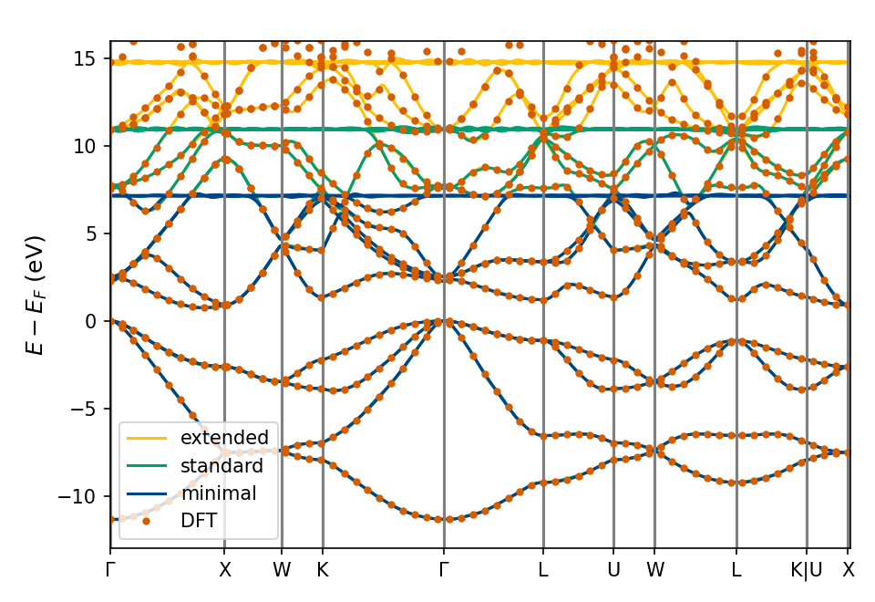

# How to choose the projections onto the PAO basis

On this page you choose the basis of pseudo-atomic orbitals (PAOs) onto which the Kohn–Sham states are projected, and the program that computes the projections: `projwfc.x` of Quantum ESPRESSO (QE), whose output {py:meth}`~PAOFLOW.PAOFLOW.PAOFLOW.read_atomic_proj_QE` reads, or PAOFLOW itself, with {py:meth}`~PAOFLOW.PAOFLOW.PAOFLOW.projections`. The basis decides how many bands the PAO Hamiltonian reproduces and up to which energy, through the projectability and the PAO shift $\eta$ introduced in the [bands and DOS tutorial](../tutorials/tutorial01.ipynb). Its number of orbitals $n_\mathrm{awf}$ sets the cost of every later step. With any basis, the PAO bands follow the DFT bands only below $\eta$, so a property is reliable only when the energy range it needs lies below $\eta$.

:::{tip}
This page is built on the case [`si_bands_transport`](https://github.com/marcobn/PAOFLOW/tree/develop/examples/cases/si_bands_transport): open it in PAOFLOW Studio with *Examples…* → `si_bands_transport`, or copy it with `paoflow-gen --example si_bands_transport`. Download {download}`projections.py <../../../examples/cases/si_bands_transport/projections.py>` to compare the routes on your own calculation: it builds the PAO Hamiltonian and the bands once per route, each in `output_<route>/`. Download {download}`figures.py <projections/figures.py>` to redraw the figures of this page from that run, its printed output, saved as `projections.log`, and the output `bands.out` of the DFT band run of the case. To skip the QE runs, copy the case with `paoflow-gen --example si_bands_transport --with-data`, which extracts `silicon.save`, with the wavefunctions and `atomic_proj.xml`, and `bands.out` from `si_bands_transport-v2.tar.gz` of the release [case-data](https://github.com/marcobn/PAOFLOW/releases/tag/case-data), and run `python projections.py > projections.log` in the copy, in 18 s on one core.
:::

## The routes

The two programs project onto the same kind of basis, radial functions of the isolated pseudo-atom times real spherical harmonics, Löwdin-orthogonalised ([Löwdin orthogonalisation](../theory/pao-hamiltonian.md#löwdin-orthogonalisation)). They differ in which radial functions they can use and in the data they read:

| Route | Basis | Reads from the `.save` directory | Use it when |
| ----- | ----- | -------------------------------- | ----------- |
| `read_atomic_proj_QE()` | the pseudo-orbitals stored in the pseudopotential | `atomic_proj.xml` of `projwfc.x` | you keep only the projections of a run, not its wavefunctions |
| `projections(configuration='minimal')` | the same pseudo-orbitals | the wavefunctions `wfc*.dat` | the valence and lowest conduction bands suffice |
| `projections(configuration='standard')`, `'extended'` | pseudo-orbitals plus shells of higher principal quantum number | the wavefunctions | you need conduction bands higher up |
| `projections(configuration={...})` | the shells you list, per element | the wavefunctions | a preset gives too few or too many orbitals |

## Setting up

```{literalinclude} ../../../examples/cases/si_bands_transport/projections.py
:language: python
:end-before: '# The projections of projwfc.x'
```

`hamiltonian()` runs the steps of the bands and DOS tutorial up to the band structure, once per route, each in its own `outputdir`; only the projection call differs. With `verbose=True`, `projectability()` prints the projectability $\bar p_n$ of each band averaged over the k-points, the number of bands the Hamiltonian keeps, and the energy range of the first band beyond them, whose lower end is $\eta$.

## The projections of projwfc.x

`projwfc.x` projects the Kohn–Sham states onto the pseudo-orbitals that the pseudopotential file stores (`PP_PSWFC` of a UPF file) and writes the amplitudes to `atomic_proj.xml` in the `.save` directory. Run it after `nscf.in`, with the input `proj.in` of the case:

```text
 &projwfc
    prefix = 'silicon'
    outdir = './'
    filpdos = 'silicon.pdos'
    lwrite_overlaps = .true.
    lbinary_data = .false.
 /
```

`lbinary_data = .false.` writes the XML format that PAOFLOW parses. `lwrite_overlaps = .true.` adds the overlap matrices $S(\mathbf{k})$, which PAOFLOW keeps only with `save_overlaps=True` in the constructor; an ACBN0 run sets it itself, because ACBN0 needs the Hamiltonian in the non-orthogonal basis ([The Hamiltonian in the non-orthogonal basis](../theory/pao-hamiltonian.md#the-hamiltonian-in-the-non-orthogonal-basis)). `read_atomic_proj_QE()` takes no arguments: it reads `atomic_proj.xml` and the pseudopotential files from `savedir`.

```{literalinclude} ../../../examples/cases/si_bands_transport/projections.py
:language: python
:start-after: '# The projections of projwfc.x'
:end-before: '# The pseudo-orbitals of the pseudopotential'
```

The Si pseudopotential stores the $3s$, $3p$ and $3d$ shells, 18 PAOs in the two-atom cell. The Hamiltonian keeps 9 bands, the four valence bands and five conduction bands, and $\eta$ is 7.16 eV above $E_F$.

This route needs no basis files and no wavefunctions, so the `.save` directory can be reduced to `data-file-schema.xml`, the pseudopotentials and `atomic_proj.xml`: 2.4 MB for Si, against 8.1 MB of wavefunctions, which also grow with the number of plane waves. The price is the basis: the pseudo-orbitals of the pseudopotential and nothing else, so a pseudopotential without unoccupied shells gives a basis without them. The route also takes one more QE run, and works only with QE.

## The pseudo-orbitals of the pseudopotential

`configuration='minimal'` projects onto the same pseudo-orbitals inside PAOFLOW, from the wavefunctions `wfc*.dat` that `pw.x` writes:

```{literalinclude} ../../../examples/cases/si_bands_transport/projections.py
:language: python
:start-after: '# The pseudo-orbitals of the pseudopotential'
:end-before: '# Radial tables of the larger bases'
```

The basis is the same, and so is the result: the projectabilities agree with those of `projwfc.x` to 0.002 (the open circles in the figure below), and the bands along the path to 2 meV. Choose between the two routes by the data you keep, not by the physics.

## Radial tables of the larger bases

The conduction bands have weight on shells that the pseudopotential does not store. The larger bases add such shells, with one table of radial functions per shell. {py:func}`~PAOFLOW.basis_gen.driver.generate_basis_for_pseudo` writes these tables to `BASIS_PS/Si/`: it takes the shells that the pseudopotential stores as they are, and computes the others as bound states of the pseudo-atom in a spherical box.

```{literalinclude} ../../../examples/cases/si_bands_transport/projections.py
:language: python
:start-after: '# Radial tables of the larger bases'
:end-before: '# The standard and extended presets'
```

`preset='extended'` writes the shells of the largest preset, which contains the others, in 2 s for Si; on the command line, `paoflow-genbasis-ps --pseudo <file.UPF> --out BASIS_PS` does the same.

## The standard and extended presets

```{literalinclude} ../../../examples/cases/si_bands_transport/projections.py
:language: python
:start-after: '# The standard and extended presets'
:end-before: '# Shells generated at run time'
```

`basispath` is the folder of the tables. For Si, `standard` adds the $4s$, $4p$ and $4d$ shells to the pseudo-orbitals, for 36 PAOs, and `extended` also $5s$ and $5p$, for 44 PAOs. With `verbose=True`, `projections()` prints the shells it resolves; {py:meth}`~PAOFLOW.PAOFLOW.PAOFLOW.projections` gives the rules under `configuration`.


Each added shell raises the projectability of the conduction bands, so the Hamiltonian keeps 9 bands with `minimal`, 13 with `standard` and 14 with `extended`. `projectability()` counts the bands above `pthr` and keeps that number of lowest bands, so with `minimal` it keeps band 9, at 0.940, and drops band 10, at 0.956.

To see which basis reproduces the DFT bands, compare them with a DFT band run at 65 of the 506 points of the path, `bands.in` of the case. Run it after `scf.in` and before `nscf.in`, because the nscf run then replaces its wavefunctions in the `.save` directory with those of the grid, which the projections read.



The bands that a basis does not keep lie flat at its $\eta$: 7.16 eV for `minimal`, 10.96 eV for `standard` and 14.79 eV for `extended`, above $E_F$, the valence-band maximum. Below its $\eta$, each basis follows the DFT points at the scale of the figure.


The PAO bands equal the DFT bands at the points of the DFT grid ([Exactness on the DFT grid](../theory/pao-hamiltonian.md#exactness-on-the-dft-grid)), so the differences in this figure are errors of the interpolation between them. Within 2 eV of $E_F$ the largest error is 27 meV with `minimal`, 77 meV with `standard` and 37 meV with `extended`: a larger basis does not by itself interpolate better. The error grows as the energy approaches $\eta$. With `minimal` it reaches 174 meV within 1.5 eV of its $\eta$, while `extended` stays below 37 meV up to 6 eV above $E_F$.

A larger basis also costs more in every later step: the memory of $H(\mathbf{R})$ and of the interpolated meshes grows as $n_\mathrm{awf}^2$, the time of each diagonalisation as $n_\mathrm{awf}^3$, about 15 times longer for `extended` than for `minimal` on Si. Choose the smallest basis whose $\eta$ lies a few eV above the energy range of your property, and compare its bands in that range with a DFT band run when you need them to better than 0.1 eV. For Si, transport near the gap needs only `minimal`, which also has the smallest errors in the valence bands. An absorption spectrum up to a photon energy $\hbar\omega$ needs final states up to $\hbar\omega$ above the valence-band maximum, so `extended` up to about 10 eV.

## Shells generated at run time

Without `basispath`, `projections()` generates the shells of the preset from the pseudopotentials in `savedir` at each run, in memory, by the same method as the tables:

```{literalinclude} ../../../examples/cases/si_bands_transport/projections.py
:language: python
:start-after: '# Shells generated at run time'
:end-before: '# Shells chosen by hand'
```

The bands equal those of the tables to $10^{-6}$ eV, but the projections take 2.5 s instead of 1.1 s, because the generation is repeated at every run. This is the route for VASP input, whose PAW datasets PAOFLOW reads from `potcar_dir` of the constructor. Three arguments act only here: `r_box`, the radius of the box in bohr (default the smaller of the end of the radial mesh and 10), which bounds the extent of the shells the pseudopotential does not store; `n_points`, the size of the radial mesh (default 2000); and `save_basis=True`, which writes the shells to `outputdir/BASIS_PS/` for inspection or reuse as tables.

## Shells chosen by hand

A dictionary gives the shells of each element:

```{literalinclude} ../../../examples/cases/si_bands_transport/projections.py
:language: python
:start-after: '# Shells chosen by hand'
```

The labels are those of the files in `BASIS_PS/Si/`, and a value can also be a preset name. Here the $4s$ shell alone, two more PAOs than `minimal`, keeps one more band and raises $\eta$ to 7.75 eV: a dictionary adds the shell that carries the conduction states you need without the cost of a full preset.

## Ultrasoft and PAW pseudopotentials

Ultrasoft and projector-augmented-wave (PAW) pseudo-wavefunctions are orthonormal in an augmented metric, and two arguments of `projections()` decide how the projections treat it. Neither changes a norm-conserving run such as this one; the case [`si_uspp_basis_presets`](https://github.com/marcobn/PAOFLOW/tree/develop/examples/cases/si_uspp_basis_presets) runs the presets with an ultrasoft one.

- `pseudo_orbitals` (default `'auto'`): with ultrasoft or PAW pseudopotentials, the shells that the pseudopotential stores come from it and only the others from the tables, because only the stored pseudo-orbitals are consistent with the augmented metric; all-electron tables give the Ga $3d$ bands of PAW GaAs a projectability of 0.86 to 0.90. `True` or `False` forces either choice.
- `plain_overlap` (default `False`): `True` projects with the plain plane-wave overlap instead, an approximation that breaks the symmetry at some k-points and inflates the projectabilities ([the augmented metric](../../internals/internal-basis.md#ultrasoft-and-paw-pseudopotentials-the-augmented-metric)); PAOFLOW prints a warning.

## Where to go next

- [Projectability](../theory/pao-hamiltonian.md#projectability) and [The PAO shift](../theory/pao-hamiltonian.md#the-pao-shift): the physics behind the kept bands and $\eta$.
- [Internal basis workflow](../../internals/internal-basis.md): how the presets and the radial tables are built.
- {py:meth}`~PAOFLOW.PAOFLOW.PAOFLOW.projections`: the full list of arguments.
