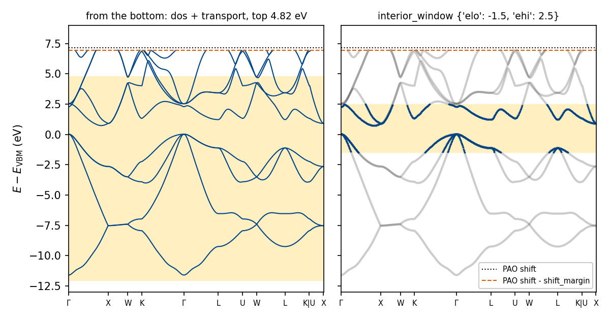

# How to choose which states the sparse backend solves

On this page you choose which eigenstates the sparse backend computes at each k-point. The dense pipeline of the [bands and DOS tutorial](../tutorials/tutorial01.ipynb) solves every band the pseudo-atomic orbital (PAO) basis represents. The sparse backend instead solves in each pass, one loop over all k-points of the mesh (the [large-cell tutorial](../tutorials/tutorial04.ipynb)), only the states that the properties of that pass need, because for a large cell the time and memory per k-point grow with the number of states solved. This is the second approximation of the backend, after the truncation of $H(\mathbf{R})$: a state left out contributes nothing, which is exact only where the property gives it no weight ([Solving part of the spectrum](../theory/large-cells.md#solving-part-of-the-spectrum)). In normal use you set nothing, because the backend derives the states from the energy ranges you give the properties; you read that choice in `sparse.log`, and change it with `nev` or `interior_window`.

:::{tip}
This page is built on the case [`si_sparse_backend`](https://github.com/marcobn/PAOFLOW/tree/develop/examples/cases/si_sparse_backend): open it in PAOFLOW Studio with *Examples…* → `si_sparse_backend`, or copy it with `paoflow-gen --example si_sparse_backend`. Download {download}`sparse_states.py <../../../examples/cases/si_sparse_backend/sparse_states.py>` to compare these settings on your own calculation: set `savedir` to its `.save` directory and `ibrav` of `bands()` to its lattice. Download {download}`figures.py <sparse-states/figures.py>` to redraw the figure of this page from that run, in the same directory after `python sparse_states.py > sparse_states.log`. Both read `silicon.save`, which the QE runs of the case write; to skip them, use `paoflow-gen --example si_sparse_backend --with-data`, which extracts it from the release [case-data](https://github.com/marcobn/PAOFLOW/releases/tag/case-data). The workflow runs in about a minute on 4 cores.
:::

## The change

Every setting of this page is an entry of `sparse_config` in the constructor. The script builds the Si Hamiltonian of each run with this function, in which only `sparse_config` changes:

```{literalinclude} ../../../examples/cases/si_sparse_backend/sparse_states.py
:language: python
:end-before: '# The window derived from the property ranges'
```

## The default: from the bottom of the spectrum to the highest range

By default each pass solves the states from the bottom of the spectrum up to the highest energy range among its properties, plus a margin that depends on the property:

| property | range | margin above it |
| --- | --- | --- |
| `dos` (with PDOS), `conductivity`, intra-band `rashba_edelstein` | `emin`, `emax` | four times the largest adaptive smearing width |
| `transport`, `doping` | `emin`, `emax` | $10\,k_BT$ at the highest temperature |
| `fermi_surface`, `spin_texture`, `orbital_texture` | `fermi_dw`, `fermi_up` | none |
| `dielectric_tensor` | up to `emax` | none |

Each margin is the reach of the weight the property gives a state beyond its range. A Gaussian of adaptive width $\sigma$ ([Band velocities and adaptive smearing](../tutorials/tutorial01.ipynb#band-velocities-and-adaptive-smearing)) is $10^{-7}$ of its peak at $4\sigma$ ([Smearing tails](../theory/large-cells.md#smearing-tails)), and the derivative of the Fermi function in the transport integrals is $1.8\times10^{-4}$ of its peak at $10\,k_BT$, 0.26 eV at 300 K ([The Fermi window](../theory/large-cells.md#the-fermi-window)). For a pass on the two-atom Si cell with `{'bond_order': 36}`,

```{literalinclude} ../../../examples/cases/si_sparse_backend/sparse_states.py
:language: python
:start-after: '# The window derived from the property ranges'
:end-before: '# A fixed number of bands'
```

`sparse.log` in the output directory records the window and how it was built:

```text
Solve window (mesh pass 1)
--------------------------
  properties             dos, transport
  probe                  16 k-points; largest adaptive width 0.656 eV (afac 0.70, k spacing 0.0392 1/Bohr)
  smearing margin (eV)   2.624  (4 x the largest adaptive width)
  thermal margin (eV)    0.259 at 300 K  (10 kT)
  window (eV)            bottom of the spectrum to 4.824
  bands per k-point      9 of 18  (8 states below the window top at the probe points, padded to 16; capped at the 9 projectable bands)
```

The window ends at 4.82 eV above the valence-band maximum (VBM), the energy zero of this page: the `emax` of 2.2 eV plus the smearing margin of 2.62 eV. The largest adaptive width is not known before the pass, so the backend estimates it from a probe, a full diagonalisation of $\tilde H(\mathbf{k})$ at 16 sample k-points, which also counts the bands below the top of the window. The sample points can miss the steepest band, so after the pass the widths of the whole mesh are checked, and a warning names the shortfall if states above the window could still contribute.



The left panel shades the window of this pass on the bands of the run.

## Properties that need every state

The anomalous, spin and orbital Hall conductivities, the Berry curvature, `linear_response`, `effective_mass`, `site_projected_bands` and `transport(do_hall=True)` sum over pairs of bands in which a distant state still contributes, with a power of the energy difference, so no margin covers them ([Properties that need every state](../theory/large-cells.md#properties-that-need-every-state)). A pass that contains one of them therefore solves the full spectrum for all its properties, a full diagonalisation of the $n_\mathrm{awf} \times n_\mathrm{awf}$ matrix at every k-point, whose time grows as $n_\mathrm{awf}^3$ in the number of orbitals $n_\mathrm{awf}$. Because that matrix must fit in memory, these properties stop with an error above `dense_n_max` orbitals (default 4096, about 270 MB per matrix), so compute them on a smaller cell.

## The upper limit set by the PAO shift

`projectability()` places every Kohn–Sham state that the PAO basis does not represent at one energy, the PAO shift ([The PAO shift](../theory/pao-hamiltonian.md#the-pao-shift)), 7.161 eV above the VBM for Si. On the DFT k-grid these placeholder states sit exactly at the shift, but between grid points they spread around it and would appear as spurious bands. The backend therefore drops every state at or above the shift minus `shift_margin` (default 0.2 eV) at every k-point and writes the dropped states as `NaN` in band files: 647 states along the path of the figure, where the bands end at the dashed line. For the same reason, a property range that reaches above this limit is reduced to it ([The states of a pass](../theory/large-cells.md#the-states-of-a-pass)).

Raise `shift_margin` when a band plot shows flat or erratic bands just below the limit, which are placeholder states that spread further than 0.2 eV. Lower it when you need real bands close to the shift, at the risk of keeping placeholder states.

## `nev`: a fixed number of bands

```{literalinclude} ../../../examples/cases/si_sparse_backend/sparse_states.py
:language: python
:start-after: '# A fixed number of bands'
:end-before: '# An interior window with fixed bounds'
```

With `nev` the backend solves that many bands from the bottom at every k-point and in every pass, instead of deriving the number from the property ranges. Give it on a cell with thousands of orbitals, where each probe diagonalisation is expensive, and above `dense_n_max` orbitals the probe cannot run at all, so the backend solves every state below the PAO shift, usually more than a k-point can afford. A fixed count also keeps the solved states the same across runs.

The price is that no smearing margin is added, so a count that is too small leaves out states the DOS or the transport integrals need near the top of their range. The widths are still checked after the pass. With `nev=8` on Si the pass of the previous section ends at 2.46 eV, and the run warns:

```text
WARNING: sparse dos may be contaminated near the window edge: the largest adaptive width on the mesh is 0.689 eV, but the solved states end 0.338 eV past the range [-12.000, 2.200]; use a finer k-mesh or give a larger 'nev'
```

`nev` also sets the bands of `bands()`, which has no energy range and otherwise solves every band below the PAO shift; if `nev` is smaller than that, `bands()` stops and names the `nev` it needs.

## `interior_window`: only the states inside a window

```{literalinclude} ../../../examples/cases/si_sparse_backend/sparse_states.py
:language: python
:start-after: '# An interior window with fixed bounds'
:end-before: '# An interior window around the property ranges'
```

An interior window solves only the states between $\varepsilon_\mathrm{lo}$ and $\varepsilon_\mathrm{hi}$, the one setting whose cost per k-point falls below that of a full diagonalisation on a large cell. A window from the bottom of the spectrum reaches the Fermi level, so it holds a fixed fraction of all states, 9 of 18 for the two-atom Si cell and 62 of 144 for the 16-atom cell of the large-cell tutorial, whatever the cell size ([Growth with the cell size](../theory/large-cells.md#growth-with-the-cell-size)). The fraction inside an interior window shrinks as the cell grows, and only a small fraction lets the backend use an iterative eigensolver ([The eigensolver of the sparse backend](../../internals/sparse-eigensolver.md)). With explicit bounds, as above, the property ranges are clipped to the window and transport keeps the chemical potential $10\,k_BT$ inside each edge. The right panel of the figure shows the states `bands()` solves in this window, over the full bands in grey: up to 5 states per k-point, and none where no band lies inside the window.

With `{}` the backend places the window around the property ranges of each pass, with the margins of the table on both sides:

```{literalinclude} ../../../examples/cases/si_sparse_backend/sparse_states.py
:language: python
:start-after: '# An interior window around the property ranges'
```

For ranges of $-1$ to 1.5 eV the window is $[-3.624, 4.124]$ eV. The price is that the states below $\varepsilon_\mathrm{lo}$ are never computed, and with them the number of electrons:

| property | under an interior window |
| --- | --- |
| DOS, PDOS | computed inside the window; absent, not zero, outside it |
| `transport` | chemical potentials kept $10\,k_BT$ inside each edge |
| `doping`, Hall coefficient, band curvature, properties that need every state | skipped with a warning, because they need the total number of carriers or every state |
| band files | padded with `NaN`; the columns are not band indices, since the number of states inside the window varies with k |
| `bands()` | with `{}`, takes the window of the last property pass, so it must come after a property |

The run above therefore skips `doping()`. The margins also limit how narrow the window can be: the adaptive widths shrink as $N_\mathrm{mesh}^{-1/3}$ with the number of k-points $N_\mathrm{mesh}$, so on a coarse mesh, as here, a window with enough clearance on both sides covers most of the spectrum, and an interior window pays only on a converged k-mesh. It cannot be combined with `nev`.

## Troubleshooting

| message | meaning | what to do |
| --- | --- | --- |
| `... sum over interband pairs that include every state, which needs the full spectrum per k-point` | a property that needs every state, on a cell with more than `dense_n_max` orbitals | run it on a smaller cell |
| `... iterative regime (> 12.5%), but n exceeds dense_n_max = 4096` | too many orbitals and too large a part of the spectrum requested | narrow the property ranges, give `nev`, or use `interior_window` |
| `... may be contaminated near the window edge` | the adaptive widths on the mesh reach past the solved states | a finer k-mesh, a larger `nev`, or wider interior bounds |
| `sparse bands: ... had their highest computed band below the window top` | `nev` is smaller than the bands `bands()` solves | give the `nev` the message names |
| `interior_window={}: the bounds come from the property ranges, and no property of this pass has one` | `bands()` was called before any property under automatic interior bounds | call `bands()` after a property, or give `{'elo': ..., 'ehi': ...}` |
| `... SKIPPED under the interior window: ...` | the property needs states below the window | run it without `interior_window` |

## Where to go next

- [Solving part of the spectrum](../theory/large-cells.md#solving-part-of-the-spectrum) derives the margins, the cap below the PAO shift and the growth of the solved fraction with the cell size.
- [The eigensolver of the sparse backend](../../internals/sparse-eigensolver.md): how the states of one k-point are solved, and why the solver depends on their number.
- [How to choose the truncation of the sparse Hamiltonian](sparse-truncation.md), the first approximation of the backend.
- {py:class}`~PAOFLOW.sparse.config.SparseConfig` lists every option of `sparse_config` with its default.
