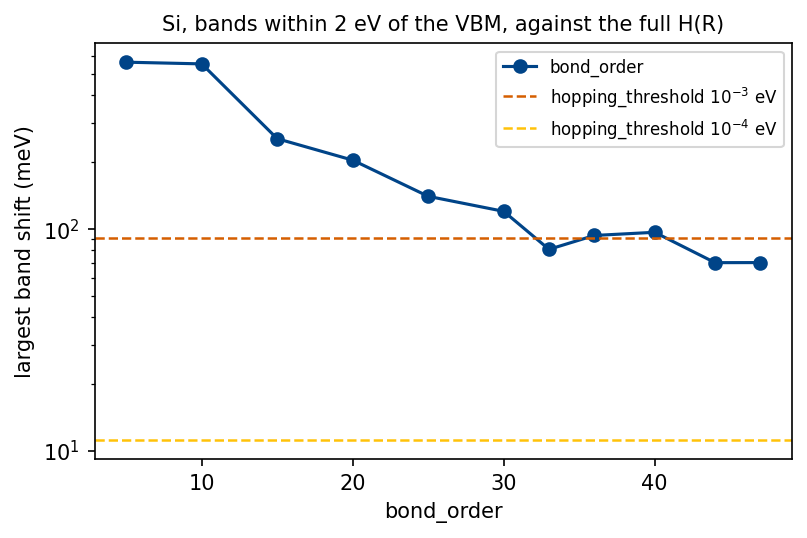

# How to choose the truncation of the sparse Hamiltonian

On this page you choose which hoppings of the PAO Hamiltonian $H_{\alpha\beta}(\mathbf{R})$ the sparse backend keeps. The backend stores $H_{\alpha\beta}(\mathbf{R})$ as a list of hoppings between pairs of pseudo-atomic orbitals (PAOs) and drops the small ones, and that truncation is an approximation: it moves every band, and with them every property of the run ([Truncating the hoppings](../theory/large-cells.md#truncating-the-hoppings)). You choose a cutoff on the bond length, with `bond_order` or `rcut`, and converge it on the bands near the energies your properties use. [Large cells on the sparse backend](../tutorials/tutorial04.ipynb) shows the workflow in which the truncation sits; the examples below use its Si calculation.

:::{tip}
This page is built on the case [`si_sparse_backend`](https://github.com/marcobn/PAOFLOW/tree/develop/examples/cases/si_sparse_backend): open it in PAOFLOW Studio with *Examples…* → `si_sparse_backend`, or copy it with `paoflow-gen --example si_sparse_backend`. Download {download}`sparse_truncation.py <../../../examples/cases/si_sparse_backend/sparse_truncation.py>` to converge the truncation of your own calculation: set `savedir` to its `.save` directory and `ibrav` of `bands()` to its lattice. Download {download}`figures.py <sparse-truncation/figures.py>` to redraw the figures of this page from that run, by running it in the same directory after `python sparse_truncation.py > sparse_truncation.log`. Both read `silicon.save`, which the QE runs of the case write; to skip them, extract it from `tutorial_assets.tar.gz` of the release [tutorial-assets-v2](https://github.com/marcobn/PAOFLOW/releases/tag/tutorial-assets-v2) with `tar xzf tutorial_assets.tar.gz --strip-components=1 tutorial01/silicon.save`. The script computes the Si bands with the full Hamiltonian and 14 truncations, in about a minute on 4 cores.
:::

## The change

The truncation is an entry of `sparse_config` in the constructor. The script computes the Si bands of each run with this function, in which only `sparse_config` changes:

```{literalinclude} ../../../examples/cases/si_sparse_backend/sparse_truncation.py
:language: python
:end-before: '# Truncate by neighbour shells'
```

Give `bond_order` or `rcut` in every run, because without either the backend drops the hoppings below $10^{-3}$ eV, a cut that splits degenerate bands (see [`hopping_threshold`](#hopping_threshold-a-quick-truncation-for-tests)):

```{literalinclude} ../../../examples/cases/si_sparse_backend/sparse_truncation.py
:language: python
:start-after: '# Truncate by neighbour shells'
:end-before: '# Keep every hopping'
```

The hoppings are dropped once, inside `pao_hamiltonian()`, so the truncation cannot change later in the run: to compare two truncations, start two runs.

## Which hoppings are small

Plot the hoppings against bond length to see which ones a truncation can drop. `save_sparse_hamiltonian()` in the function above writes the kept hoppings to `hamiltonian.npz` in the output directory, and a threshold of zero keeps all of them:

```{literalinclude} ../../../examples/cases/si_sparse_backend/sparse_truncation.py
:language: python
:start-after: '# Keep every hopping'
:end-before: '# One shell beyond the R grid'
```


The figure shows every element $|H_{\alpha\beta}(\mathbf{R})|$ of the full Si Hamiltonian, on its $12\times12\times12$ DFT grid, against the length of the bond it connects. The vertical lines are the cutoffs of `bond_order=10` and `bond_order=36` and the longest cutoff the grid allows, and the horizontal lines the thresholds of $10^{-3}$ and $10^{-4}$ eV. The hoppings fall in vertical columns, one per neighbour shell, the set of bonds of one length, marked by the ticks at the top. They decay with the length of the bond, but slowly, because $H(\mathbf{R})$ is the Fourier transform of the PAO Hamiltonian on the DFT grid and not a maximally localised model ([Decay of the hoppings](../theory/pao-hamiltonian.md#decay-of-the-hoppings)): the nearest-neighbour shell at 4.59 Bohr has hoppings up to 1.27 eV, and hoppings of $3.7\times10^{-3}$ eV remain beyond 30 Bohr. Within one shell the elements spread over several orders of magnitude, because each couples a different pair of orbitals. A truncation is therefore either a vertical line in this figure, a cut by bond length, or a horizontal line, a cut by size, and the two keep different hoppings.

## Truncation by bond length

Use a cutoff on the bond length, because it keeps the symmetry of the crystal: a symmetry operation maps a bond onto bonds of the same length, so a cutoff keeps or drops whole shells, and degenerate levels move together without splitting ([Truncation and crystal symmetry](../theory/large-cells.md#truncation-and-crystal-symmetry)). This matters for every property that depends on the degeneracies: band crossings, topological invariants, and tensor components that vanish by symmetry.


The figure shows the doubly degenerate conduction-band pair of Si on the second half of the $\Gamma$–L line, 3.390 eV above the valence-band maximum (VBM) at L, with the full Hamiltonian (grey) and two truncations. With `bond_order=36` the pair stays degenerate, 0.02 meV apart at L, but moves up by 46 meV. With a threshold of $10^{-3}$ eV it stays closer to the full bands but splits by 11.9 meV at L.

The price of the symmetry is accuracy, set by how fast the hoppings decay with distance. In a covalent semiconductor such as Si the decay is slow: the cutoff at the 36th shell (32.1 Bohr) still drops 1956 hoppings above $10^{-3}$ eV, and it moves the bands within 2 eV of the VBM by up to 93 meV.

The cutoff also has an upper limit, the radius up to which the $\mathbf{R}$ grid of the DFT k-grid represents each bond by one element: 36.7 Bohr for the $12\times12\times12$ grid of Si (the dotted line in the first figure). Beyond it a bond shares its element with a shorter periodic image and has no length of its own ([The range limit of the DFT grid](../theory/large-cells.md#the-range-limit-of-the-dft-grid)), so a longer cutoff stops the run with an error that gives the limit. On the Si grid the longest allowed cutoff still moves the bands near the gap by up to 70 meV. To reach further, use a denser DFT k-grid, which extends the $\mathbf{R}$ grid. You give the cutoff in one of two ways.

### `bond_order`: a number of neighbour shells

`bond_order=n` keeps the bonds up to the $n$-th distinct interatomic distance: 1 is the nearest neighbours (4.59 Bohr in Si), 2 the second neighbours. Because the shells move with the lattice, the same `bond_order` describes the same physical truncation along a series of strained or relaxed structures, which makes it the choice for comparing them. On the $12\times12\times12$ grid of Si the largest allowed value is 47, and one shell more stops the run:

```{literalinclude} ../../../examples/cases/si_sparse_backend/sparse_truncation.py
:language: python
:start-after: '# One shell beyond the R grid'
:end-before: '# Truncate by radius'
```

### `rcut`: a radius

```{literalinclude} ../../../examples/cases/si_sparse_backend/sparse_truncation.py
:language: python
:start-after: '# Truncate by radius'
:end-before: '# Converge the cutoff against the full Hamiltonian'
```

`rcut` fixes the range in Bohr, the natural choice to compare materials with different shell structures. The backend moves the radius down into the gap above the outermost shell it reaches, so that it never keeps part of a shell, and `sparse.log` in the output directory records both values:

```text
  cutoff radius (Bohr)   30.000 requested, 29.981 applied (moved into the gap above the last shell)
```

## Choosing the cutoff

Raise `bond_order` or `rcut` until the bands near the energies your property uses stop moving, within the limit of the $\mathbf{R}$ grid. Judge the bands rather than the DOS, because each band moves by its own amount and with either sign, and the integral over the Brillouin zone averages these shifts, so a DOS can look converged while single bands have moved ([Error of the eigenvalues](../theory/large-cells.md#error-of-the-eigenvalues)). For Si, the script repeats the run for a series of `bond_order` values:

```{literalinclude} ../../../examples/cases/si_sparse_backend/sparse_truncation.py
:language: python
:start-after: '# Converge the cutoff against the full Hamiltonian'
:end-before: '# Truncate by hopping size'
```



The figure shows this test for Si: the largest shift of the bands within 2 eV of the VBM along the fcc path, against the full Hamiltonian, as only `bond_order` changes. The shift falls from 564 meV at `bond_order=5` to 70 meV at 44 and 47, but not steadily: `bond_order=33` gives 81 meV, while 36 and 40 give 93 and 97 meV, because each shell adds hoppings with their own phases and signs. Therefore compare several cutoffs before you accept one, rather than stopping at the first that looks converged. The dashed lines mark the two hopping thresholds: on this grid $10^{-4}$ eV gives smaller shifts than any cutoff, at the price of split degeneracies.

For a first estimate without the full Hamiltonian, read the bound on the eigenvalue shift that `sparse.log` prints, the largest sum of the magnitudes of the dropped hoppings of one orbital:

```text
  max eigenvalue shift from truncation (eV)  4.11
```

No eigenvalue at any k-point moves by more than this bound ([A bound on the eigenvalue shift](../theory/large-cells.md#a-bound-on-the-eigenvalue-shift)), but the bound is loose, because the phases of the dropped hoppings partly cancel in the actual shifts: for `bond_order=36` on Si it is 4.11 eV, where the largest shift of the lowest eight bands is 0.26 eV. A small bound therefore guarantees a small error, while a large one means that you have to measure the error as above.

## `hopping_threshold`: a quick truncation for tests

```{literalinclude} ../../../examples/cases/si_sparse_backend/sparse_truncation.py
:language: python
:start-after: '# Truncate by hopping size'
```

`hopping_threshold` drops every element with $|H_{\alpha\beta}(\mathbf{R})|$ below the threshold, in eV. For a quick test of a workflow it is easier to set than a cutoff, because it needs no knowledge of the shells or of the limit of the $\mathbf{R}$ grid. On Si, $10^{-4}$ eV moves the bands within 2 eV of the VBM by up to 11 meV, and the default $10^{-3}$ eV by up to 91 meV.

However, a threshold breaks the crystal symmetry, because the same coupling appears as elements of different size on two bonds related by a symmetry operation, and the threshold keeps a different set of elements on each ([Truncation and crystal symmetry](../theory/large-cells.md#truncation-and-crystal-symmetry)). As a result, degenerate bands split, by 11.9 meV at L in the second figure. Keep the threshold for tests and exploratory runs. For the same reason it cannot be combined with `bond_order` or `rcut`.

## Troubleshooting

| message | meaning | what to do |
| --- | --- | --- |
| `rcut = ... Bohr exceeds the aliasing-safe radius ...` or `bond_order=... exceeds the ... neighbour shells representable` | the cutoff is longer than the $\mathbf{R}$ grid represents | use a smaller cutoff or a denser DFT k-grid |
| `hopping_threshold cannot be combined with rcut or bond_order` | a threshold and a bond-length cutoff were both given | give one of them |

## Where to go next

- [Truncating the hoppings](../theory/large-cells.md#truncating-the-hoppings) derives the eigenvalue error, its bound and the effect on symmetry.
- [How to choose which states the sparse backend solves](sparse-states.md), the second approximation of the backend.
- {py:class}`~PAOFLOW.sparse.config.SparseConfig` lists every option of `sparse_config` with its default.
