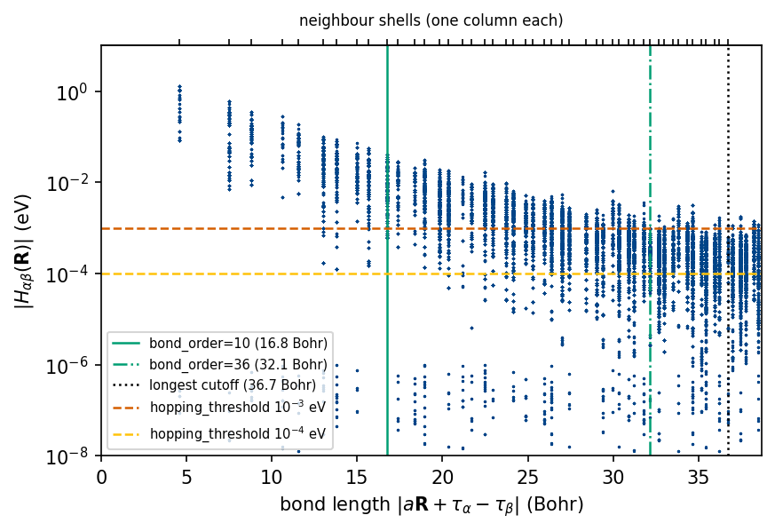
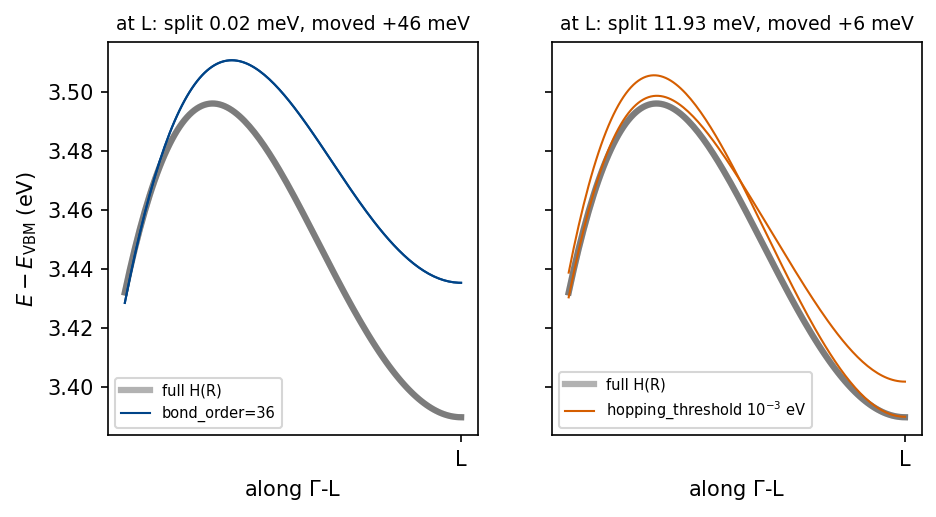

# How to choose the truncation of the sparse Hamiltonian

On this page you choose which hoppings of the PAO Hamiltonian $H_{\alpha\beta}(\mathbf{R})$ the sparse backend keeps. The backend stores $H_{\alpha\beta}(\mathbf{R})$ as a list of hoppings between pairs of pseudo-atomic orbitals (PAOs), and drops the small ones to keep the list short. This truncation is an approximation: it moves every band, and so every property computed from the bands ([Truncating the hoppings](../theory/large-cells.md#truncating-the-hoppings)). You set it as a cutoff on the bond length, with `bond_order` or `rcut`, and raise the cutoff until the bands you need stop moving. The workflow around the truncation is in [Large cells on the sparse backend](../tutorials/tutorial04.ipynb); the examples here use its Si calculation.

:::{tip}
This page is built on the case [`si_sparse_backend`](https://github.com/marcobn/PAOFLOW/tree/develop/examples/cases/si_sparse_backend): open it in PAOFLOW Studio with *Examples…* → `si_sparse_backend`, or copy it with `paoflow-gen --example si_sparse_backend`. Download {download}`sparse_truncation.py <sparse-truncation/sparse_truncation.py>` into the copy, or beside your own calculation to converge its truncation: set `savedir` to its `.save` directory and `ibrav` of `bands()` to its lattice. Download {download}`figures.py <sparse-truncation/figures.py>` to redraw the figures of this page from that run, by running it in the same directory after `python sparse_truncation.py > sparse_truncation.log`. Both read `silicon.save`, which the QE runs of the case write; to skip them, use `paoflow-gen --example si_sparse_backend --with-data`, which extracts it from the release [case-data](https://github.com/marcobn/PAOFLOW/releases/tag/case-data). The script computes the Si bands with the full Hamiltonian and 14 truncations, in about a minute on 4 cores.
:::

## The change

The truncation is an entry of `sparse_config` in the constructor. The script computes the Si bands once per truncation with this function, and only `sparse_config` changes between runs:

```{literalinclude} sparse-truncation/sparse_truncation.py
:language: python
:end-before: '# Truncate by neighbour shells'
```

Always give `bond_order` or `rcut`. Without either, the backend drops every hopping below $10^{-3}$ eV, and that cut splits degenerate bands (see [`hopping_threshold`](#hopping_threshold-a-quick-truncation-for-tests)):

```{literalinclude} sparse-truncation/sparse_truncation.py
:language: python
:start-after: '# Truncate by neighbour shells'
:end-before: '# Keep every hopping'
```

The hoppings are dropped once, inside `pao_hamiltonian()`, so to compare two truncations you start two runs.

## Which hoppings are small

To see which hoppings a truncation can drop, plot them against bond length. `save_sparse_hamiltonian()` in the function above writes the kept hoppings to `hamiltonian.npz` in the output directory. A threshold of zero keeps all of them:

```{literalinclude} sparse-truncation/sparse_truncation.py
:language: python
:start-after: '# Keep every hopping'
:end-before: '# One shell beyond the R grid'
```



Each point is one element $|H_{\alpha\beta}(\mathbf{R})|$ of the full Si Hamiltonian. The points fall in columns, one per neighbour shell: a shell is the set of bonds of one length. Within a column the elements spread over several orders of magnitude, because each couples a different pair of orbitals.

The hoppings decay with bond length, but slowly. The nearest neighbours, at 4.59 Bohr, reach 1.27 eV, and hoppings of $3.7\times10^{-3}$ eV remain beyond 30 Bohr. The decay is slow because $H(\mathbf{R})$ is the Fourier transform of the PAO Hamiltonian on the DFT grid, not a maximally localised model ([Decay of the hoppings](../theory/pao-hamiltonian.md#decay-of-the-hoppings)).

A truncation is a line in this figure. A cut by bond length is a vertical line, which keeps or drops whole columns. A cut by size is a horizontal line, which keeps the large elements of every column. The two keep different hoppings.

## Truncation by bond length

Use a cutoff on the bond length, because it keeps the symmetry of the crystal. A symmetry operation maps a bond onto bonds of the same length, so a cutoff keeps or drops whole shells. Degenerate levels then move together without splitting ([Truncation and crystal symmetry](../theory/large-cells.md#truncation-and-crystal-symmetry)). Every property that depends on degeneracies needs this: band crossings, topological invariants, and tensor components that vanish by symmetry.



The figure follows a doubly degenerate conduction-band pair of Si towards L, 3.390 eV above the valence-band maximum (VBM). With `bond_order=36` the pair stays degenerate but moves up by 46 meV. With a threshold of $10^{-3}$ eV it stays closer to the full bands, but splits by 11.9 meV at L.

The price of the symmetry is accuracy. How much depends on how fast the hoppings decay, and in a covalent semiconductor such as Si they decay slowly. The cutoff at the 36th shell (32.1 Bohr) still drops 1956 hoppings above $10^{-3}$ eV, and moves the bands within 2 eV of the VBM by up to 93 meV.

The cutoff also has an upper limit, set by the DFT k-grid. The $\mathbf{R}$ grid of a k-grid gives each bond its own element only up to a radius: 36.7 Bohr for the $12\times12\times12$ grid of Si, the dotted line in the first figure. Beyond it, a bond shares its element with a shorter periodic image and has no length of its own ([The range limit of the DFT grid](../theory/large-cells.md#the-range-limit-of-the-dft-grid)). A longer cutoff therefore stops the run, with an error that gives the limit. On Si, even the longest allowed cutoff moves the bands near the gap by up to 70 meV; to reach further, use a denser DFT k-grid.

The two flags set the same kind of cutoff and differ in what they hold fixed:

| | `bond_order=n` | `rcut=r` |
| --- | --- | --- |
| Keeps | the bonds up to the $n$-th distinct interatomic distance | the bonds up to $r$ Bohr |
| Same truncation across | strained or relaxed structures of one material, because the shells move with the lattice | materials with different shell structures |
| Largest value on the Si grid | 47 | 36.7 Bohr |

### `bond_order`: a number of neighbour shells

`bond_order=1` keeps the nearest neighbours (4.59 Bohr in Si), `bond_order=2` adds the second neighbours, and so on. On the Si grid, one shell beyond 47 stops the run:

```{literalinclude} sparse-truncation/sparse_truncation.py
:language: python
:start-after: '# One shell beyond the R grid'
:end-before: '# Truncate by radius'
```

### `rcut`: a radius

```{literalinclude} sparse-truncation/sparse_truncation.py
:language: python
:start-after: '# Truncate by radius'
:end-before: '# Converge the cutoff against the full Hamiltonian'
```

The backend moves `rcut` down into the gap above the outermost shell it reaches, so that it never keeps part of a shell. `sparse.log` in the output directory records both radii:

```text
  cutoff radius (Bohr)   30.000 requested, 29.981 applied (moved into the gap above the last shell)
```

## Choosing the cutoff

Raise `bond_order` or `rcut` until the bands near the energies your property uses stop moving. Judge the bands, not the DOS. Each band moves by its own amount and with either sign, and the DOS averages these shifts over the Brillouin zone, so it can look converged while single bands still move ([Error of the eigenvalues](../theory/large-cells.md#error-of-the-eigenvalues)). For Si, the script repeats the run for a series of `bond_order` values:

```{literalinclude} sparse-truncation/sparse_truncation.py
:language: python
:start-after: '# Converge the cutoff against the full Hamiltonian'
:end-before: '# Truncate by hopping size'
```


The largest shift falls from 564 meV at `bond_order=5` to 70 meV at 47, but not steadily: it rises again from 81 meV at 33 to 97 meV at 40. Each new shell adds hoppings with their own phases and signs, so one more shell can make the bands worse. Compare several cutoffs before you accept one, rather than stopping at the first that looks converged. On this grid the threshold of $10^{-4}$ eV gives smaller shifts than any cutoff, at the price of split degeneracies.

For a first estimate without the full Hamiltonian, read the bound on the eigenvalue shift in `sparse.log`. The bound is the largest sum of the magnitudes of the hoppings dropped from one orbital:

```text
  max eigenvalue shift from truncation (eV)  4.11
```

No eigenvalue at any k-point moves by more than this bound ([A bound on the eigenvalue shift](../theory/large-cells.md#a-bound-on-the-eigenvalue-shift)). The bound is loose, though, because the phases of the dropped hoppings partly cancel in the real shifts. For `bond_order=36` on Si it is 4.11 eV, while the lowest eight bands move by at most 0.26 eV. A small bound guarantees a small error; a large one means you measure the error as above.

## `hopping_threshold`: a quick truncation for tests

```{literalinclude} sparse-truncation/sparse_truncation.py
:language: python
:start-after: '# Truncate by hopping size'
```

`hopping_threshold` drops every element with $|H_{\alpha\beta}(\mathbf{R})|$ below the threshold, in eV. It needs no knowledge of the shells or of the grid limit, so it is the quick choice for testing a workflow. On Si, $10^{-4}$ eV moves the bands within 2 eV of the VBM by up to 11 meV, and the default $10^{-3}$ eV by up to 91 meV.

However, a threshold breaks the crystal symmetry. Two bonds related by a symmetry operation carry the same coupling, but spread over elements of different size, so the threshold keeps a different set of elements on each ([Truncation and crystal symmetry](../theory/large-cells.md#truncation-and-crystal-symmetry)). Degenerate bands then split, by 11.9 meV at L in the second figure. Keep the threshold for tests and exploratory runs. Added to a cutoff, it would split the degeneracies the cutoff keeps, so the backend accepts only one of them.

## Troubleshooting

| message | meaning | what to do |
| --- | --- | --- |
| `rcut = ... Bohr exceeds the aliasing-safe radius ...` or `bond_order=... exceeds the ... neighbour shells representable` | the cutoff is longer than the $\mathbf{R}$ grid represents | use a smaller cutoff or a denser DFT k-grid |
| `hopping_threshold cannot be combined with rcut or bond_order` | a threshold and a bond-length cutoff were both given | give one of them |

## Where to go next

- [Truncating the hoppings](../theory/large-cells.md#truncating-the-hoppings) derives the eigenvalue error, its bound and the effect on symmetry.
- [How to choose which states the sparse backend solves](sparse-states.md), the second approximation of the backend.
- {py:class}`~PAOFLOW.sparse.config.SparseConfig` lists every option of `sparse_config` with its default.
