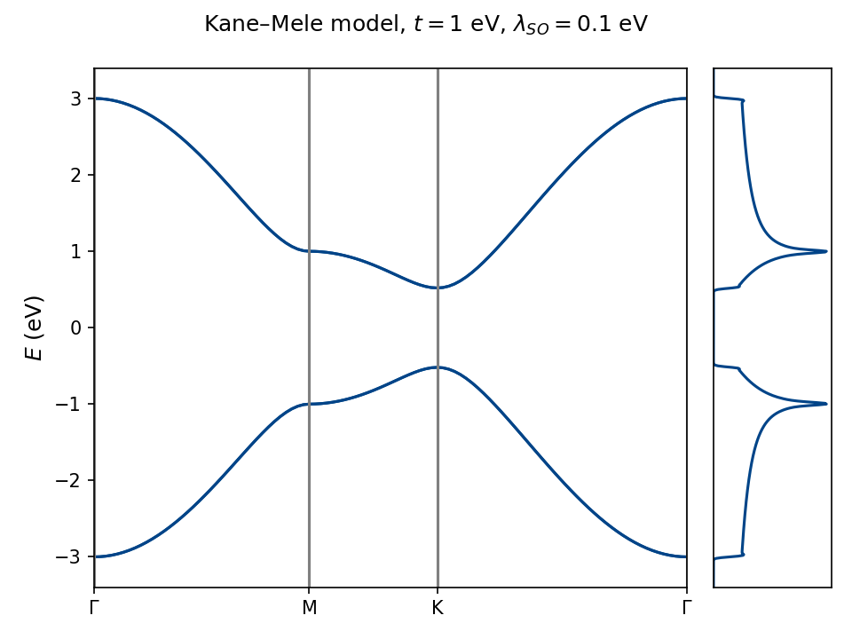

# How to run PAOFLOW on a tight-binding model

On this page you run PAOFLOW on a tight-binding model instead of a DFT calculation. The `model` argument of {py:class}`~PAOFLOW.PAOFLOW.PAOFLOW` supplies the real-space Hamiltonian $H_{\alpha\beta}(\mathbf{R})$ directly. In the [bands and DOS tutorial](../tutorials/tutorial01.ipynb), by contrast, it comes from projecting the Kohn–Sham states on pseudo-atomic orbitals (PAOs). Every property is computed from $H_{\alpha\beta}(\mathbf{R})$ alone, so the calls that follow the constructor remain the same as in a DFT-based workflow.

The Hamiltonian is then exactly the model: its basis is orthogonal, and its parameters are in eV. A model is therefore where you test a property against a known answer.

:::{tip}
This page is built on the case [`kane_mele_tb_model`](https://github.com/marcobn/PAOFLOW/tree/develop/examples/cases/kane_mele_tb_model): open it in PAOFLOW Studio with *Examples…* → `kane_mele_tb_model`, or copy it with `paoflow-gen --example kane_mele_tb_model`. The model is built in code, so the case has no input files. Download {download}`tight_binding_model.py <tight-binding-model/tight_binding_model.py>` to start your own model from it, replacing the model and keeping the calls; it runs in about 10 s on one core, and the [spin Hall tutorial](../tutorials/tutorial05.ipynb) makes the same calls. Download {download}`figures.py <tight-binding-model/figures.py>` to redraw the figure of this page from that run, in the same directory after `python tight_binding_model.py > tight_binding_model.log`.
:::

## Replacing the DFT steps with a model

The script computes the bands, the density of states (DOS) and the spin Hall conductivity of the Kane–Mele model. This model is graphene with spin–orbit coupling. The script starts with the model:

```{literalinclude} tight-binding-model/tight_binding_model.py
:language: python
:end-before: '# Bands along a path'
```

The constructor builds $H_{\alpha\beta}(\mathbf{R})$, the lattice vectors and the orbital positions from the dictionary. There are no Kohn–Sham states to project, so you leave out {py:meth}`~PAOFLOW.PAOFLOW.PAOFLOW.read_atomic_proj_QE`, {py:meth}`~PAOFLOW.PAOFLOW.PAOFLOW.projectability` and {py:meth}`~PAOFLOW.PAOFLOW.PAOFLOW.pao_hamiltonian`. You keep every call from {py:meth}`~PAOFLOW.PAOFLOW.PAOFLOW.bands` on. Five settings of these calls depend on the model instead of on a DFT calculation.

```{literalinclude} tight-binding-model/tight_binding_model.py
:language: python
:start-after: '# Bands along a path'
:end-before: '# Bands and velocities on the mesh'
```

You give the k-path with `band_path` and `high_sym_points`, in crystal coordinates of the reciprocal vectors of the model. `bands()` also needs `ibrav`, although it does not change a path given this way. Pass the Quantum ESPRESSO number of the model's lattice: 4 for hexagonal, 1 for simple cubic, 2 for fcc.

```{literalinclude} tight-binding-model/tight_binding_model.py
:language: python
:start-after: '# Bands and velocities on the mesh'
:end-before: '# Spin Hall conductivity of the sheet'
```

A two-dimensional model such as Kane–Mele has no hopping along $z$, so $H(\mathbf{k})$ does not depend on $k_z$. Set `nfft3=1` in {py:meth}`~PAOFLOW.PAOFLOW.PAOFLOW.interpolated_hamiltonian`, so that the mesh has a single k-point along $z$.

The adaptive smearing needs a floor, `min_width`. The adaptive width of the [bands and DOS tutorial](../tutorials/tutorial01.ipynb#band-velocities-and-adaptive-smearing) vanishes with the band velocity. On the mesh of a model, the velocity vanishes exactly at the high-symmetry points. Without a floor, these states appear in the DOS as spikes, or fall between its energy points and are missed ([The width floor](../theory/density-of-states.md#band-extrema-flat-bands-and-the-width-floor)). Choose a floor at or above the spacing of the DOS energy grid. The script uses 0.02 eV, twice the spacing.

The energy zero is the zero of the model parameters, because PAOFLOW does not count electrons in a model. Properties scanned in energy, such as the DOS, give a value at every chemical potential between `emin` and `emax`. Read them at the filling of your model.



The spin–orbit term opens a gap of 1.0392 eV at K. This gap is $6\sqrt{3}\,\lambda_{SO}$ for $\lambda_{SO}$ = `soc_par` = 0.1 eV ([Kane–Mele model](../theory/berry-topology.md#the-quantum-spin-hall-model-of-kane-and-mele)). The DOS integrates to 2.00 states below $E = 0$, two of the four bands, so $E = 0$ lies in the gap at half filling.

```{literalinclude} tight-binding-model/tight_binding_model.py
:language: python
:start-after: '# Spin Hall conductivity of the sheet'
```

Pass `twoD=True` to the properties that are normalised by the cell, such as {py:meth}`~PAOFLOW.PAOFLOW.PAOFLOW.spin_Hall` and {py:meth}`~PAOFLOW.PAOFLOW.PAOFLOW.nonlinear_optics`. They then divide by the area of the cell instead of its volume. `spin_Hall(twoD=True)` gives the sheet conductivity in units with $\hbar = e = 1$, not in SI units, so a quantum spin Hall plateau of $e/2\pi$ reads $1/2\pi$ ([Spin Hall conductivity](../theory/berry-topology.md#spin-berry-curvature-and-spin-hall-conductivity)).

In this run, `kane_mele/shcEf_z_xy.dat` holds the plateau 0.158987 at $E = 0$, for the default broadening `delta=0.05` eV. The plateau lies 0.1% below $1/2\pi$, and the script runs a second, smaller broadening; the [spin Hall tutorial](../tutorials/tutorial05.ipynb#the-spin-hall-conductivity-and-its-plateau-in-the-gap) explains both.

## Choosing the model

PAOFLOW takes a model in three forms, which differ in how much of the model you write yourself:

| form | `model` argument | use it for |
| ---- | ---------------- | ---------- |
| [Built-in model](#built-in-models) | `{'label': 'Kane_Mele', 't': 1.0, ...}` | graphene, Kane–Mele and simple cubic models, with their parameters |
| [Slater–Koster model](#a-slaterkoster-model-with-your-own-parameters) | `{'label': 'Slater_Koster', 'model': {...}}` | a material with $s$, $p$, $d$ orbitals in the two-centre approximation, from bond integrals |
| [PythTB model](#models-built-with-pythtb) | `{'label': 'haldane_pythtb', ...}`, or a PythTB `TBModel` object | further lattice models, and any lattice and basis with hoppings you set one by one |

### Built-in models

The `label` selects the model, in upper or lower case; the other keys are its parameters, in eV.

| `label`       | parameters                                                                            | lattice and basis                                      | steps that run                                   |
| ------------- | ------------------------------------------------------------------------------------- | ------------------------------------------------------ | ------------------------------------------------ |
| `'graphene'`  | `t` (first-neighbour hopping), `delta` (on-site $\pm\delta/2$ on the two sublattices) | honeycomb, $a = 2.46$ Å, one orbital per site, no spin | `bands()`, `berry_phase()`, `nonlinear_optics()` |
| `'cubium'`    | `t`                                                                                   | simple cubic, $a = 1$ Å, one orbital                   | `bands()`                                        |
| `'cubium2'`   | `t`, `Eg` (gap between the two bands)                                                 | simple cubic, $a = 1$ Å, two orbitals                  | `bands()`                                        |
| `'Kane_Mele'` | `t`, `soc_par`, `r_par`, `v_par`; optional `alat` (Å, default 1)                      | honeycomb, two spin-orbitals per site                  | all steps of the script above                    |

The [spin Hall tutorial](../tutorials/tutorial05.ipynb#the-kanemele-model-and-its-spinorbit-gap) gives the Kane–Mele Hamiltonian and the meaning of its parameters.

The other three models stop at {py:meth}`~PAOFLOW.PAOFLOW.PAOFLOW.pao_eigh` or {py:meth}`~PAOFLOW.PAOFLOW.PAOFLOW.gradient_and_momenta`. They do not define the number of bands or the orbital positions that these steps need. For a property of graphene on a k-mesh, use `Kane_Mele` with `soc_par=0`, `r_par=0` and `v_par=delta / (2 * t)` instead. This is the graphene Hamiltonian with every band doubled by spin.

For the bands of the cubic models, use the path `'G-X-M-G-R'` with $X = (0, \tfrac12, 0)$, $M = (\tfrac12, \tfrac12, 0)$, $R = (\tfrac12, \tfrac12, \tfrac12)$ and `ibrav=1`. The cases [`graphene_tb_model`](https://github.com/marcobn/PAOFLOW/tree/develop/examples/cases/graphene_tb_model) and [`cubium_tb_model`](https://github.com/marcobn/PAOFLOW/tree/develop/examples/cases/cubium_tb_model) compute the bands of these models. The [Berry phase tutorial](../tutorials/tutorial06.ipynb) computes the Berry phases and the Chern number of gapped graphene.

To compare two parameter sets, run each in its own `outputdir` and pass both band files to {py:meth}`~PAOFLOW.GPAO.GPAO.plot_bands`.

### A Slater–Koster model with your own parameters

The label `'Slater_Koster'` builds $H_{\alpha\beta}(\mathbf{R})$ in the two-centre approximation. Each hopping is the Slater–Koster combination of the bond integrals $V_{ss\sigma}$, $V_{sp\sigma}$, $V_{pp\sigma}$, $V_{pp\pi}$ with the direction cosines of the bond. You give the model under the key `'model'`:

| key | content | units |
| --- | ------- | ----- |
| `a_vectors` | the lattice vectors | `alat` |
| `atoms` | one entry per atom, keyed `'0'`, `'1'`, ..., with the position `tau` in Cartesian coordinates, the list of `orbitals`, and the on-site energy of each orbital | `alat` for `tau`, eV for the energies |
| `hoppings` | the bond integrals: a flat dictionary applies them to the nearest neighbours; nested dictionaries under `'nn'`, `'nnn'` and `'nnnn'` set the first, second and third shells | eV |

Next to `label`, set `alat` (bohr, default 1) to the lattice constant of the material. It leaves the bands unchanged, but it sets the length scale of velocities, conductivities and Berry curvatures. The unit depends on the model: `alat` is in bohr for `'Slater_Koster'`, but in ångström for `'Kane_Mele'`. {py:func}`~PAOFLOW.models.models.Slater_Koster` lists the full input, including $d$ orbitals and several shells per atom.

The case [`si_slater_koster_model`](https://github.com/marcobn/PAOFLOW/tree/develop/examples/cases/si_slater_koster_model) builds silicon with an $sp^3$ basis on the two atoms of the diamond cell. Its parameters are those of D. A. Papaconstantopoulos, _Handbook of the Band Structure of Elemental Solids: From Z = 1 to Z = 112_, 2nd ed. (Springer, 2015). With nearest-neighbour bonds only, the conduction-band minimum of silicon does not lie near X. To place it there, add second-neighbour hoppings (`'nnn'`) or more orbitals per atom.

### Models built with PythTB

[PythTB](https://pythtb.readthedocs.io/en/latest/) builds models of any lattice and basis from on-site energies and hoppings. Install it with the `pythtb` extra, `pip install "PAOFLOW[pythtb]"`, which pulls in PythTB 2. PAOFLOW takes a PythTB model in two ways: through a label for one of the models PAOFLOW defines, or as a model object you build yourself. In both cases the lattice constant is 1 bohr. The lattice vectors of the model are in this unit, and so are the lengths in velocities and conductivities.

| `label`                 | parameters                                                              | lattice and basis                                 |
| ----------------------- | ----------------------------------------------------------------------- | ------------------------------------------------- |
| `'cubium_pythtb'`       | `t`                                                                     | simple cubic, one orbital                         |
| `'cubium2_pythtb'`      | `t`, `Eg`                                                               | simple cubic, two orbitals                        |
| `'checkerboard_pythtb'` | `delta` (on-site $\mp\delta$), `t`                                      | square, two orbitals                              |
| `'graphene_pythtb'`     | `delta` (on-site $\pm\delta/2$), `t`                                    | honeycomb, one orbital per site                   |
| `'haldane_pythtb'`      | `delta` (on-site $\mp\delta$), `t1`, `t2`, `phi`                        | honeycomb, one orbital per site                   |
| `'kane_mele_pythtb'`    | `delta`, `t`, `soc`, `rashba`                                           | honeycomb, two spin-orbitals per site             |
| `'fu_kane_mele_pythtb'` | `t`, `soc`, `dt` (list of four changes of the first-neighbour hoppings) | diamond, two spin-orbitals per site               |
| `'ssh_pythtb'`          | `v`, `w`                                                                | one-dimensional chain; does not build with PythTB 2 |

All of them except `ssh_pythtb` run the steps from `interpolated_hamiltonian()` to `dos()`. `spin_Hall()` also runs on the models with spin, `kane_mele_pythtb` and `fu_kane_mele_pythtb`.

When a built-in model stops before the step you need, change its label to that of its PythTB version, for example `{'label': 'graphene_pythtb', 't': 2.7, 'delta': 0.0}`. The two versions describe the same model: `kane_mele_pythtb` with `soc=0.1` and `rashba=0` gives the same gap and spin Hall conductivity as `Kane_Mele` with `soc_par=0.1`.

For a model PAOFLOW does not define, build a `TBModel` object with PythTB and pass it as `model`, in place of the dictionary. The calls that follow are those of the script above. PAOFLOW reads the hoppings and their phases as PythTB defines them. You therefore set a complex hopping, such as the second-neighbour term $t_2 e^{i\phi}$ of the Haldane model ([The Haldane model](../theory/berry-topology.md#the-haldane-model)), with `set_hop` as in PythTB.

## Other properties

Any other property is called as in a DFT run, provided the model defines what it needs (see the tables above). For example, {py:meth}`~PAOFLOW.PAOFLOW.PAOFLOW.transport` runs with its usual arguments on a three-dimensional Slater–Koster model. On a two-dimensional model, however, `transport()` stops. It inverts the $3 \times 3$ conductivity tensor, whose $zz$ component is zero without hopping along $z$ ([Boltzmann transport](../theory/boltzmann-transport.md#conductivity-seebeck-coefficient-and-thermal-conductivity)).

## Troubleshooting

| message                                                                                                     | meaning                                                               | what to do                                                             |
| ----------------------------------------------------------------------------------------------------------- | --------------------------------------------------------------------- | ---------------------------------------------------------------------- |
| `KeyError: 'kq'` in `bands()`, with `SUGGESTION: pao_hamiltonian must be called before bands`               | `ibrav` is missing                                                    | pass the `ibrav` of the model's lattice together with the path         |
| `KeyError: 'bnd'` in `pao_eigh()`, with `SUGGESTION: pao_hamiltonian must be called before pao_eigh`        | the model does not define the number of bands (`graphene`)            | use `Kane_Mele` with `soc_par=0`, `r_par=0`, `v_par=delta / (2 * t)`   |
| `KeyError: 'Dnm'` in `gradient_and_momenta()`                                                               | the model does not define the orbital positions (`cubium`, `cubium2`) | use these models for `bands()` only, or their `_pythtb` versions       |
| `check t_tensor components - matrix cannot be singular` and `LinAlgError: Singular matrix` in `transport()` | the model is two-dimensional, and its $zz$ conductivity is zero       | `transport()` does not run on a two-dimensional model                  |
| `ERROR: Label "..." not found in builtin models.`                                                           | the label is not one of the built-in models                           | check the spelling against the tables above                            |
| `ModuleNotFoundError: No module named 'pythtb'`                                                             | a `_pythtb` label or a PythTB object needs PythTB                     | `pip install "PAOFLOW[pythtb]"`                                        |
| `Check! TB model finite (nonperiodic) in one or more dimensions not implemented`                            | printed for every model passed as a PythTB object                     | harmless: the run continues                                            |
| `ValueError: Conjugate element already specified for i=1, j=0, R=[0]` with `ssh_pythtb`                     | PythTB 2 rejects a hopping that this model sets twice                 | build the chain as a PythTB object, setting each hopping once          |

## Where to go next

- [Spin Hall conductivity of the Kane–Mele model](../tutorials/tutorial05.ipynb) explains the spin Hall conductivity of the Kane–Mele model computed by the script of this page.
- [Berry phases and Chern number of gapped graphene](../tutorials/tutorial06.ipynb) computes the Berry phases and the Chern number of gapped graphene.
- [How to compute the non-linear optical response of a tight-binding model](nonlinear-optics-model.md) computes the shift current and second-harmonic generation of gapped graphene.
- [Environment-dependent Slater–Koster models](../../internals/sk-edtb.md) extends the two-centre model above with screened hoppings.
