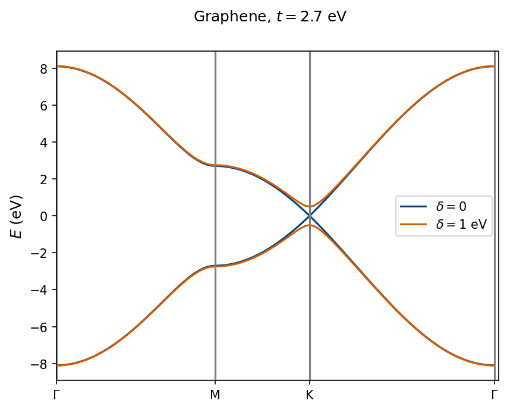
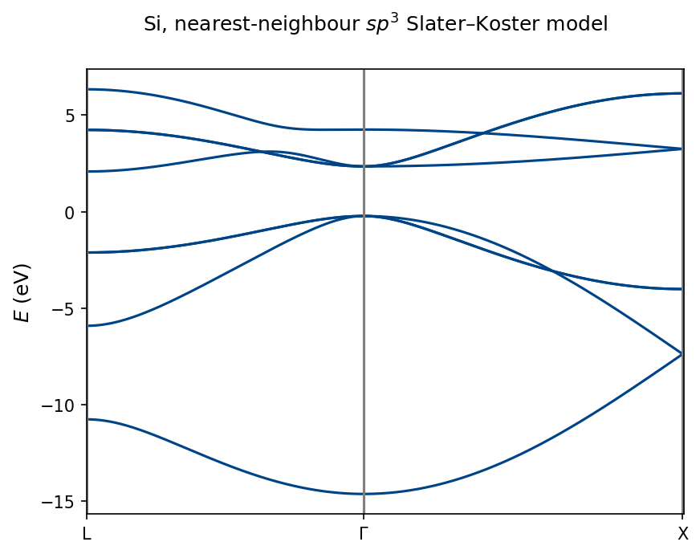

# How to run PAOFLOW on a tight-binding model

On this page you run PAOFLOW on a tight-binding model instead of a DFT calculation. The `model` argument of {py:class}`~PAOFLOW.PAOFLOW.PAOFLOW` supplies the real-space Hamiltonian $H_{\alpha\beta}(\mathbf{R})$ directly, as one of the built-in models, a Slater–Koster model with your own parameters, or a model built with the PythTB package, in contrast to [Tutorial 01](../tutorials/tutorial01.ipynb), where it comes from projecting the Kohn–Sham states on pseudo-atomic orbitals (PAOs). Every property is computed from $H_{\alpha\beta}(\mathbf{R})$ alone, so the calls that follow the constructor remain the same as the ones you would use for a DFT-based workflow. The Hamiltonian is then the model and nothing else, in an orthogonal basis with the model parameters in eV, so a model is where you test a property against a known answer.

:::{tip}
Every model on this page is built in code, so the page needs no input files. Download {download}`main.py <tight-binding-model/main.py>` to start your own model from these, replacing a model and keeping the calls; it runs in about 30 s, and its PythTB section needs the `pythtb` extra. Download {download}`figures.py <tight-binding-model/figures.py>` to redraw the figures of this page from that run, in the same directory after `python main.py > main.log`.
:::

## Replacing the DFT steps with a model

The script below computes the bands and the density of states (DOS) of the Kane–Mele model.

```{literalinclude} tight-binding-model/main.py
:language: python
:end-before: '# Two parameter sets of graphene'
```

The constructor builds $H_{\alpha\beta}(\mathbf{R})$, the lattice vectors and the orbital positions from the dictionary. You therefore leave out {py:meth}`~PAOFLOW.PAOFLOW.PAOFLOW.read_atomic_proj_QE`, {py:meth}`~PAOFLOW.PAOFLOW.PAOFLOW.projectability` and {py:meth}`~PAOFLOW.PAOFLOW.PAOFLOW.pao_hamiltonian`, because there are no Kohn–Sham states to project, and you keep every call from {py:meth}`~PAOFLOW.PAOFLOW.PAOFLOW.bands` on. Four settings depend on the model instead of on a DFT calculation.

The k-path is given with `band_path` and `high_sym_points`, in crystal coordinates of the reciprocal vectors of the model. `bands()` also needs `ibrav`, although it does not change a path given this way: pass the Quantum ESPRESSO number of the model's lattice, 4 for hexagonal, 1 for simple cubic and 2 for fcc.

A two-dimensional model, such as Kane–Mele, has no hopping along $z$, so $H(\mathbf{k})$ does not depend on $k_z$. Set `nfft3=1` in {py:meth}`~PAOFLOW.PAOFLOW.PAOFLOW.interpolated_hamiltonian`, and pass `twoD=True` to the properties that are normalised by the cell, such as {py:meth}`~PAOFLOW.PAOFLOW.PAOFLOW.spin_Hall` and {py:meth}`~PAOFLOW.PAOFLOW.PAOFLOW.nonlinear_optics`, so that they divide by the area of the cell instead of its volume. `spin_Hall(twoD=True)` then gives the sheet conductivity in units with $\hbar = e = 1$, not in SI units, so a quantum spin Hall plateau of $e/2\pi$ reads $1/2\pi$ ([Spin Hall conductivity](../theory/berry-topology.md#spin-berry-curvature-and-spin-hall-conductivity)).

The adaptive smearing needs a floor, `min_width`. On the mesh of a model the band velocity vanishes exactly at the high-symmetry points, and with it the adaptive width of [Section 6 of Tutorial 01](../tutorials/tutorial01.ipynb#6-band-velocities-and-adaptive-smearing), so without a floor these states appear in the DOS as spikes or are missed between its energy points ([The width floor](../theory/density-of-states.md#band-extrema-flat-bands-and-the-width-floor)). Choose a floor at or above the spacing of the DOS energy grid, here twice it, 0.02 eV.

The energy zero is the zero of the model parameters, because PAOFLOW does not count electrons in a model. Properties scanned in energy, such as the DOS, give a value at every chemical potential between `emin` and `emax`; read them at the filling of your model.


The spin–orbit term opens a gap of 1.0392 eV at K, equal to $6\sqrt{3}\,\lambda_{SO}$ for $\lambda_{SO}$ = `soc_par` = 0.1 eV ([Kane–Mele model](../theory/berry-topology.md#the-quantum-spin-hall-model-of-kane-and-mele)), and the DOS integrates to 2.00 states below $E = 0$, two of the four bands, so $E = 0$ lies in the gap at half filling.

## Choosing the model

### Built-in models

The `label` selects the model, in upper or lower case; the other keys are its parameters, in eV.

| `label`       | parameters                                                                            | lattice and basis                                      | steps that run                                   |
| ------------- | ------------------------------------------------------------------------------------- | ------------------------------------------------------ | ------------------------------------------------ |
| `'graphene'`  | `t` (first-neighbour hopping), `delta` (on-site $\pm\delta/2$ on the two sublattices) | honeycomb, $a = 2.46$ Å, one orbital per site, no spin | `bands()`, `berry_phase()`, `nonlinear_optics()` |
| `'cubium'`    | `t`                                                                                   | simple cubic, $a = 1$ Å, one orbital                   | `bands()`                                        |
| `'cubium2'`   | `t`, `Eg` (gap between the two bands)                                                 | simple cubic, $a = 1$ Å, two orbitals                  | `bands()`                                        |
| `'Kane_Mele'` | `t`, `soc_par`, `r_par`, `v_par`; optional `alat` (Å, default 1)                      | honeycomb, two spin-orbitals per site                  | all steps of the script above                    |

[Section 1 of Tutorial 05](../tutorials/tutorial05.ipynb#1-the-kanemele-model-and-its-spinorbit-gap) gives the Kane–Mele Hamiltonian and the meaning of its parameters. The other three models stop at {py:meth}`~PAOFLOW.PAOFLOW.PAOFLOW.pao_eigh` or {py:meth}`~PAOFLOW.PAOFLOW.PAOFLOW.gradient_and_momenta`, because they do not define the number of bands or the orbital positions that these steps need. For a property of graphene on a k-mesh, use `Kane_Mele` with `soc_par=0`, `r_par=0` and `v_par=delta / (2 * t)` instead: it is the graphene Hamiltonian with every band doubled by spin. For the cubic models, use the path `'G-X-M-G-R'` with $X = (0, \tfrac12, 0)$, $M = (\tfrac12, \tfrac12, 0)$, $R = (\tfrac12, \tfrac12, \tfrac12)$ and `ibrav=1`.

To compare two parameter sets, run each in its own `outputdir` and pass both band files to {py:meth}`~PAOFLOW.GPAO.GPAO.plot_bands`:

```{literalinclude} tight-binding-model/main.py
:language: python
:start-after: '# Two parameter sets of graphene'
:end-before: '# A Slater-Koster model of silicon'
```



With $\delta = 0$ the two bands touch at K, the Dirac point, and span $\pm 3|t| = \pm 8.1$ eV at $\Gamma$. The sublattice potential $\pm\delta/2$ breaks inversion symmetry and opens a gap $\delta$ at K and K′ ([Gapped graphene](../theory/berry-topology.md#gapped-graphene-and-the-valley-berry-phase)). This gapped model is the one whose Berry phases [Tutorial 05](../tutorials/tutorial05.ipynb#3-berry-phases-on-loops-around-a-valley-of-gapped-graphene) computes, and the one of the [non-linear optics how-to](nonlinear-optics-model.md).

### A Slater–Koster model with your own parameters

The label `'Slater_Koster'` builds $H_{\alpha\beta}(\mathbf{R})$ in the two-centre approximation: each hopping is the Slater–Koster combination of the bond integrals $V_{ss\sigma}$, $V_{sp\sigma}$, $V_{pp\sigma}$, $V_{pp\pi}$ with the direction cosines of the bond. The model below is silicon with an $sp^3$ basis on the two atoms of the diamond cell, with parameters from D. A. Papaconstantopoulos, _Handbook of the Band Structure of Elemental Solids: From Z = 1 to Z = 112_, 2nd ed. (Springer, 2015).

```{literalinclude} tight-binding-model/main.py
:language: python
:start-after: '# A Slater-Koster model of silicon'
:end-before: '# The Haldane model built with PythTB'
```

The keys under `'model'` are:

- `a_vectors`: the lattice vectors, in units of `alat`.
- `atoms`: one entry per atom, keyed `'0'`, `'1'`, ..., with the position `tau` in Cartesian coordinates in units of `alat`, the list of `orbitals`, and the on-site energy (eV) of each orbital.
- `hoppings`: the bond integrals (eV). A flat dictionary applies them to the nearest neighbours; nested dictionaries under `'nn'`, `'nnn'` and `'nnnn'` set the first, second and third shells.

Set `alat` (bohr, default 1) to the lattice constant of the material: it leaves the bands unchanged but sets the length scale of velocities, conductivities and Berry curvatures. {py:func}`~PAOFLOW.models.models.Slater_Koster` lists the full input, including $d$ orbitals and several shells per atom.



The valence-band maximum is at $\Gamma$ at $-0.229$ eV and the conduction-band minimum at L at 2.081 eV, a gap of 2.309 eV. In silicon the conduction-band minimum lies near X instead, and a nearest-neighbour $sp^3$ basis cannot produce it: that takes second-neighbour hoppings (`'nnn'`) or more orbitals per atom.

### Models built with PythTB

[PythTB](https://pythtb.readthedocs.io/en/latest/) builds models of any lattice and basis from on-site energies and hoppings. Install it with the `pythtb` extra, `pip install "PAOFLOW[pythtb]"`, which pulls in PythTB 2. PAOFLOW takes a PythTB model in two ways: through a label for one of the models PAOFLOW defines, or as a model object you build yourself. In both cases the lattice constant is 1 bohr, the unit of the lattice vectors of the model, so velocities and conductivities are in units of it.

| `label`                 | parameters                                                              | lattice and basis                                 |
| ----------------------- | ----------------------------------------------------------------------- | ------------------------------------------------- |
| `'cubium_pythtb'`       | `t`                                                                     | simple cubic, one orbital                         |
| `'cubium2_pythtb'`      | `t`, `Eg`                                                               | simple cubic, two orbitals                        |
| `'checkerboard_pythtb'` | `delta` (on-site $\mp\delta$), `t`                                      | square, two orbitals                              |
| `'graphene_pythtb'`     | `delta` (on-site $\pm\delta/2$), `t`                                    | honeycomb, one orbital per site                   |
| `'haldane_pythtb'`      | `delta` (on-site $\mp\delta$), `t1`, `t2`, `phi`                        | honeycomb, one orbital per site                   |
| `'kane_mele_pythtb'`    | `delta`, `t`, `soc`, `rashba`                                           | honeycomb, two spin-orbitals per site             |
| `'fu_kane_mele_pythtb'` | `t`, `soc`, `dt` (list of four changes of the first-neighbour hoppings) | diamond, two spin-orbitals per site               |
| `'ssh_pythtb'`          | `v`, `w`                                                                | one-dimensional chain; does not build with PythTB 2 |

All of them except `ssh_pythtb` run the steps from `interpolated_hamiltonian()` to `dos()`, and `spin_Hall()` runs on the models with spin, `kane_mele_pythtb` and `fu_kane_mele_pythtb`. When a built-in model stops before the step you need, swap it for its PythTB version by changing the label, for example `{'label': 'graphene_pythtb', 't': 2.7, 'delta': 0.0}`; `kane_mele_pythtb` with `soc=0.1` and `rashba=0` gives the same gap and spin Hall conductivity as `Kane_Mele` with `soc_par=0.1`.

For a model PAOFLOW does not define, build it with PythTB and pass the object as `model`. The script below builds the Haldane model, a honeycomb lattice with one orbital per site and a complex second-neighbour hopping $t_2 e^{i\phi}$:

```{literalinclude} tight-binding-model/main.py
:language: python
:start-after: '# The Haldane model built with PythTB'
```

The gap of this run, 1.5588 eV at K and K′, equals $6\sqrt{3}\,|t_2|$, the value for $\phi = \pi/2$ ([The Haldane model](../theory/berry-topology.md#the-haldane-model)), so PAOFLOW reads the hoppings and their phases as PythTB defines them. [Section 4 of Tutorial 05](../tutorials/tutorial05.ipynb#4-chern-numbers-the-berry-flux-through-the-whole-zone) computes the Chern number of its lower band.

## Other properties

Any other property is called as in a DFT run, provided the model defines what it needs (see the tables above); for a three-dimensional Slater–Koster model, {py:meth}`~PAOFLOW.PAOFLOW.PAOFLOW.transport` runs with its usual arguments. On a two-dimensional model `transport()` stops, because it inverts the $3 \times 3$ conductivity tensor, whose $zz$ component is zero without hopping along $z$ ([Boltzmann transport](../theory/boltzmann-transport.md#conductivity-seebeck-coefficient-and-thermal-conductivity)).

## Troubleshooting

| message                                                                                                     | meaning                                                               | what to do                                                             |
| ----------------------------------------------------------------------------------------------------------- | --------------------------------------------------------------------- | ---------------------------------------------------------------------- |
| `KeyError: 'kq'` in `bands()`, with `SUGGESTION: pao_hamiltonian must be called before bands`               | `ibrav` is missing                                                    | pass the `ibrav` of the model's lattice together with the path         |
| `KeyError: 'bnd'` in `pao_eigh()`, with `SUGGESTION: pao_hamiltonian must be called before pao_eigh`        | the model does not define the number of bands (`graphene`)            | use `Kane_Mele` with `soc_par=0`, `r_par=0`, `v_par=delta / (2 * t)`   |
| `KeyError: 'Dnm'` in `gradient_and_momenta()`                                                               | the model does not define the orbital positions (`cubium`, `cubium2`) | use these models for `bands()` only, or their `_pythtb` versions       |
| `check t_tensor components - matrix cannot be singular` and `LinAlgError: Singular matrix` in `transport()` | the model is two-dimensional, and its $zz$ conductivity is zero       | `transport()` does not run on a two-dimensional model                  |
| `ERROR: Label "..." not found in builtin models.`                                                           | the label is not one of the built-in models                           | check the spelling against the tables above                            |
| `ModuleNotFoundError: No module named 'pythtb'`                                                             | a `_pythtb` label or a PythTB object needs PythTB                     | `pip install "PAOFLOW[pythtb]"`                                        |
| `Check! TB model finite (nonperiodic) in one or more dimensions not implemented`                            | printed for every model passed as a PythTB object                     | harmless: the run continues                                            |
| `ValueError: Conjugate element already specified for i=1, j=0, R=[0]` with `ssh_pythtb`                     | PythTB 2 rejects a hopping that this model sets twice                 | build the chain as a PythTB object, setting each hopping once          |

## Where to go next

- [Tutorial 05](../tutorials/tutorial05.ipynb) computes the spin Hall conductivity, Berry phases and Chern numbers of the models on this page.
- [How to compute the non-linear optical response of a tight-binding model](nonlinear-optics-model.md) computes the shift current and second-harmonic generation of gapped graphene.
- [Environment-dependent Slater–Koster models](../../internals/sk-edtb.md) extends the two-centre model above with screened hoppings.
