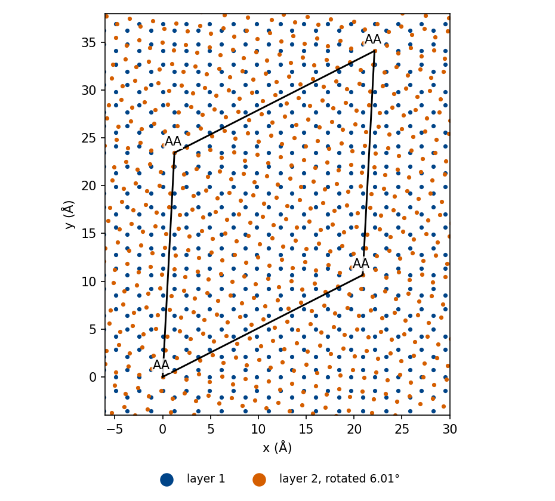
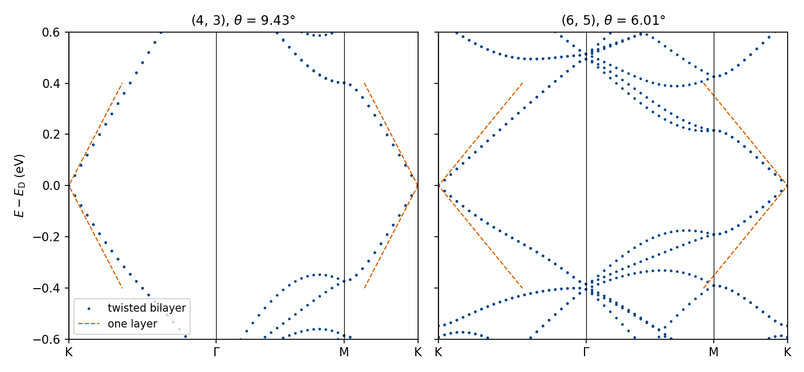
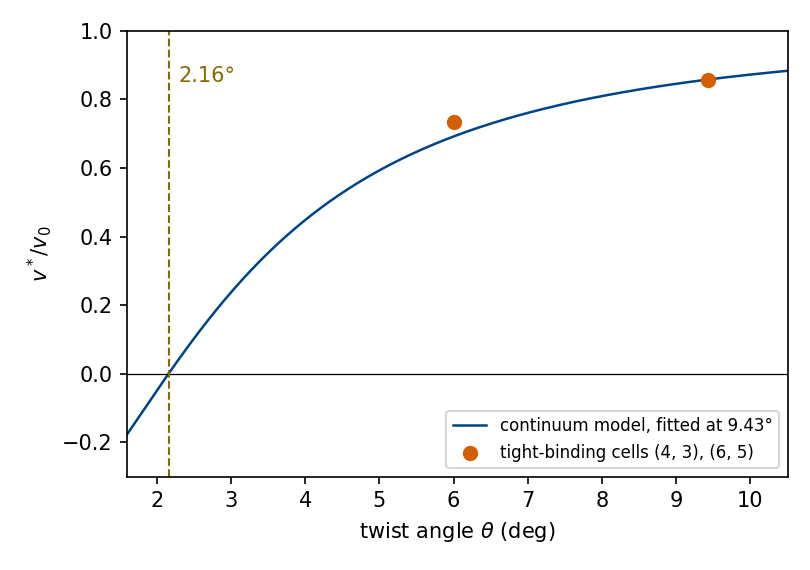

# How to compute the band structure of twisted bilayer graphene

On this page you build the commensurate cells of twisted bilayer graphene, compute their bands near the Dirac energy, and follow the Dirac velocity as the twist angle $\theta$ decreases. Small angles need cells of thousands of atoms. These are too many for the dense diagonalisation of the [bands and DOS tutorial](../tutorials/tutorial01.ipynb), so a sparse solver computes only the states near the Dirac energy. The Hamiltonian is a tight-binding model with rigid, flat layers. It leaves out the relaxation of real samples, which changes the bands at small angles.

:::{tip}
This page is built on the case [`tbg_unfold`](https://github.com/marcobn/PAOFLOW/tree/develop/examples/cases/tbg_unfold): open it in PAOFLOW Studio with *Examples…* → `tbg_unfold`, or copy it with `paoflow-gen --example tbg_unfold`. Download {download}`twisted_bilayer.py <twisted-bilayer/twisted_bilayer.py>` into the copy to run this page, to compute other cells or to use your own model, and run it as `OMP_NUM_THREADS=1 python twisted_bilayer.py > twisted_bilayer.log`; its two cells take 6 minutes on 4 cores. Run {download}`figures.py <twisted-bilayer/figures.py>` after it, in the same directory, to redraw the figures of this page from that run. To redraw them without the calculation, run `figures.py` in a copy made with `paoflow-gen --example tbg_unfold --with-data`, which holds the outputs of `twisted_bilayer.py` from the release [case-data](https://github.com/marcobn/PAOFLOW/releases/tag/case-data).
:::

The model is the [environment-dependent tight-binding (EDTB) model of carbon](unfold-large-supercells.md#a-carbon-model-with-distance-dependent-hoppings) of the how-to on unfolding large supercells. The script holds a copy of it, the `carbon` dictionary, and builds the cells in code, so it needs no input files.

```{literalinclude} twisted-bilayer/twisted_bilayer.py
:language: python
:end-before: '# The commensurate cell (n, m)'
```

## Commensurate cells

A twisted bilayer is a crystal only at the angles where a lattice vector of the lower layer is also a lattice vector of the rotated upper layer. Each pair of integers $n > m \ge 0$ gives one such angle. At this angle, $n\mathbf{a}_1 + m\mathbf{a}_2$ of the lower layer coincides with $m\mathbf{a}_1 + n\mathbf{a}_2$ of the upper one. The cell then holds $n^2 + nm + m^2$ primitive cells per layer ([Commensurate twist angles](../theory/band-unfolding.md#commensurate-twist-angles)), and each atom carries nine $sp^3d^5$ orbitals.

Use the cells $(n, n - 1)$. Each of them is one period $L$ of the moiré pattern, the smallest cell for its angle ([The moiré period](../theory/band-unfolding.md#the-moiré-period)):

| $(n, m)$ | $\theta$ (deg) | atoms | orbitals | $L$ (Å) |
| --- | --- | --- | --- | --- |
| (2, 1) | 21.79 | 28 | 252 | 6.5 |
| (4, 3) | 9.43 | 148 | 1332 | 15.0 |
| (6, 5) | 6.01 | 364 | 3276 | 23.5 |
| (10, 9) | 3.48 | 1084 | 9756 | 40.5 |
| (15, 14) | 2.28 | 2524 | 22716 | 61.8 |
| (17, 16) | 2.00 | 3268 | 29412 | 70.3 |
| (20, 19) | 1.70 | 4564 | 41076 | 83.1 |
| (31, 30) | 1.08 | 11164 | 100476 | 129.9 |

The function below builds the $(n, m)$ cell. It takes the lattice constant of graphene, $a = 2.46$ Å, as `alat`. It puts the lower layer at $z = 0$ and rotates the upper layer about the origin, which is a site of both layers:

```{literalinclude} twisted-bilayer/twisted_bilayer.py
:language: python
:start-after: '# The commensurate cell (n, m)'
:end-before: '# Dirac points of the AA bilayer at K, split by the interlayer hopping'
```



The stacking of the two layers varies across the cell. At its corners, the atoms of the two layers lie on top of each other: this is AA stacking. Between the corners, the stacking passes through AB and BA regions, where half of the upper atoms sit over the centres of the lower hexagons. This pattern repeats every 23.5 Å, the $L$ of the table, so the cell holds one period of it.

## The interlayer distance

Set the interlayer distance `d` by the interlayer coupling it gives in your model. The coupling decides at which angles the bands flatten: the angle at which the Dirac velocity vanishes is proportional to the interlayer tunnelling ([Dirac velocity in the continuum model](../theory/band-unfolding.md#dirac-velocity-in-the-continuum-model)).

The default `d=2.68` Å suits this carbon model, whose hoppings between the layers are weak at the spacing of real bilayers, 3.35 Å. The AA-stacked bilayer gives a measure of the coupling. In this bilayer, the interlayer hopping shifts the Dirac cones of the two layers apart. Its two Dirac points at K lie 0.188 eV apart at 3.35 Å, and 0.684 eV apart at 2.68 Å. The shorter distance therefore moves the flat bands to larger angles, whose cells are smaller. Before you compare angles with experiment, check this coupling against the AA splitting from DFT. This block computes both splittings:

```{literalinclude} twisted-bilayer/twisted_bilayer.py
:language: python
:start-after: '# Dirac points of the AA bilayer at K, split by the interlayer hopping'
:end-before: '# Bands of the (4, 3) and (6, 5) cells'
```

## Bands with the sparse solver

Compute the bands with {py:class}`~PAOFLOW.spectrum.sparse_bands.SparseEDTB`. It stores the Hamiltonian of the cell as a sparse matrix of bonds. At each k-point, it computes only the `n_eigs` eigenvalues closest to the energy `sigma` (eV), with the shift-invert Lanczos method of SciPy's `eigsh`. The energy range of these states is called the window below. The script runs the solver for the cells $(4, 3)$ and $(6, 5)$:

```{literalinclude} twisted-bilayer/twisted_bilayer.py
:language: python
:start-after: '# Bands of the (4, 3) and (6, 5) cells'
:end-before: '# A short segment from the moire K point towards G'
```

The arguments of `compute_bands` set the path, the window and the parallel run:

| argument | in the script | meaning and choice |
| -------- | ------------- | ------------------ |
| path and points | `'K-G-M-K'`, `moire` | points in fractional coordinates of the reciprocal lattice of the cell, so G, M and K are points of the moiré Brillouin zone. Because the two cell vectors are at $60^\circ$, K is $(\tfrac23, \tfrac13)$ (see [the coordinates of the K point](unfold-large-supercells.md#the-coordinates-of-the-k-point)) |
| `nk` | `60` | the number of k-points of the whole path |
| `sigma` | `-0.52` | the centre of the window (eV). Set it to the Dirac energy of the model: here the mean of the two Dirac points of the AA bilayer at 2.68 Å, $-0.521$ eV, printed by the block above |
| `n_eigs` | `40` | the number of states per k-point, which sets the width of the window |
| `n_workers` | `-1` | the number of workers over which the k-points are distributed. `-1` uses the cores of the process (its share of the node under `mpirun`), with at most four workers above 5000 orbitals (see [Smaller angles](#smaller-angles)) |

Choose `n_eigs` so that the window covers your plot at every k-point. The number of states per eV grows with the number of atoms, so the same 40 states span a narrower window in a larger cell. They span at least $E_\mathrm{D} - 1.623$ to $E_\mathrm{D} + 1.678$ eV at every k-point of the $(4, 3)$ path, but only $E_\mathrm{D} - 1.084$ to $E_\mathrm{D} + 1.151$ eV for $(6, 5)$. Here $E_\mathrm{D}$ is the Dirac energy of the cell, the energy zero of the figure below. To check a run, compare these edges with the energy range of your plot.

Start the script with `OMP_NUM_THREADS=1`, because several threads per worker oversubscribe the cores. `compute_bands` writes the bands to `bands_0.dat` in `outputdir`, and the high-symmetry points to `kpath_points.txt`.



Plot the eigenvalues as markers, not lines. The window moves with k, so the $j$-th eigenvalue need not follow one band. The energy zero $E_\mathrm{D}$ is the mean of the four states at the moiré K point. One Dirac point of each layer folds onto this point ([Why a twisted cell does not unfold](../theory/band-unfolding.md#why-a-twisted-cell-does-not-unfold)). $E_\mathrm{D}$ is $-0.521$ eV for $(4, 3)$ and $-0.519$ eV for $(6, 5)$. The cone of one layer is drawn with the velocity $v_0$ fitted in the next section.

The cones of the two layers meet at M. There the interlayer coupling turns their crossing into a saddle point. As the angle decreases, the bands flatten:

| $\theta$ | band above $E_\mathrm{D}$ at M (eV) | band below $E_\mathrm{D}$ at M (eV) |
| --- | --- | --- |
| $9.43^\circ$ | 0.401 | $-0.373$ |
| $6.01^\circ$ | 0.216 | $-0.191$ |

From $9.43^\circ$ to $6.01^\circ$, the separation of these two bands shrinks by a factor of 1.90. With a constant velocity it would shrink only with the moiré zone, by a factor of 1.57, so the Dirac velocity drops as well.

## The velocity at the Dirac point

To measure that drop, fit the renormalised velocity $v^*$ at the Dirac point. For decoupled layers $v^*/v_0 = 1$, and at the magic angle $v^*$ vanishes. Compute the bands on a segment from K towards $\Gamma$, 4 % of its length,

```{literalinclude} twisted-bilayer/twisted_bilayer.py
:language: python
:start-after: '# A short segment from the moire K point towards G'
:end-before: '# Slope of the Dirac cone'
:dedent: 4
```

and fit the slope of the lower of the two bands that leave the Dirac point upwards:

```{literalinclude} twisted-bilayer/twisted_bilayer.py
:language: python
:start-after: '# Slope of the Dirac cone'
:end-before: '# Continuum model of Bistritzer and MacDonald'
```

The k-distances are in radians per `alat`, so the slope is $\hbar v^*$ in eV $\cdot$ `alat`. The fit leaves out the first point after K. The four states at K are split by up to 1.18 meV, which distorts the slope closest to K.

The reference $v_0$ comes from the same fit on one layer of the model. Its segment is 0.4 % of K–$\Gamma$ long, so that $|\mathbf{k} - \mathbf{K}|$ is as small as in the moiré cells. The fit gives $\hbar v_0 = 1.603$ eV $\cdot$ `alat` $= 3.94$ eV Å, or $v_0 = 5.99 \times 10^5$ m/s. The twisted cells give:

| cell | $\theta$ | $\hbar v^*$ (eV $\cdot$ `alat`) | $v^*/v_0$ |
| --- | --- | --- | --- |
| $(4, 3)$ | $9.43^\circ$ | 1.376 | 0.858 |
| $(6, 5)$ | $6.01^\circ$ | 1.177 | 0.734 |

The continuum model of R. Bistritzer and A. H. MacDonald, Proc. Natl. Acad. Sci. USA 108, 12233 (2011), predicts how $v^*$ continues to smaller angles. In this model, $v^*/v_0$ depends only on one ratio, $\alpha$: the interlayer tunnelling divided by the kinetic energy across the moiré zone. The ratio grows as $1/\theta$ at small angles, and $v^*$ vanishes at $\alpha = 1/\sqrt3$ ([Dirac velocity in the continuum model](../theory/band-unfolding.md#dirac-velocity-in-the-continuum-model)). The last block fits $\alpha$ to the $9.43^\circ$ cell, which gives $\alpha = 0.132$, and scales it as $1/\theta$:

```{literalinclude} twisted-bilayer/twisted_bilayer.py
:language: python
:start-after: '# Continuum model of Bistritzer and MacDonald'
```



The continuum model gives $v^*/v_0 = 0.693$ at $6.01^\circ$, 0.041 below the computed value. The tight-binding velocity therefore drops more slowly than the continuum model predicts.

The model velocity vanishes at $\theta = 2.16^\circ$. Fitted to the $6.01^\circ$ cell instead, the model puts this angle at $1.97^\circ$. The difference between the two is the uncertainty of the estimate, and the $(17, 16)$ cell at $2.00^\circ$ lies within it. With the real interlayer distance the magic angle would be smaller, because the coupling is weaker.

## Smaller angles

Plan a run at a smaller angle from the time of one k-point. The cost per k-point grows faster than the number of orbitals, because the shift-invert method factorises the Hamiltonian at each k-point, and the factors of a sparse matrix fill in. Cells such as $(10, 9)$, or $(17, 16)$ near the magic angle of this model, therefore belong on a cluster node. Time one k-point first, with `bands.eigvals_at_k([2 / 3, 1 / 3, 0], n_eigs=40, sigma=-0.52)`, and watch its memory. Then choose `nk` and the number of cores.

The memory of the factors also limits the parallel run. `n_workers=-1` therefore starts fewer workers as the cell grows:

| orbitals in the cell | workers started by `n_workers=-1` |
| -------------------- | --------------------------------- |
| up to 5000 | one per core of the process |
| 5000 to 20000 | at most four |
| above 20000 | one: the k-points run one after the other |

Pass a larger `n_workers` only when the memory of one k-point times the number of workers fits in the node. To lower the cost per k-point, reduce `n_eigs` instead. The velocity needs 8 states, and the bands within a few hundred meV of $E_\mathrm{D}$ at these angles need 40.

These bands cannot be unfolded onto the Brillouin zone of graphene with {py:func}`~PAOFLOW.models.band_unfold.unfold_bands`, because the atoms of the rotated layer are not primitive sites shifted by a lattice vector, as the unfolding requires ([Why a twisted cell does not unfold](../theory/band-unfolding.md#why-a-twisted-cell-does-not-unfold)).

## Where to go next

- [Band unfolding: spectral weights of supercell states](../theory/band-unfolding.md#twisted-bilayers) derives the commensurate angles, the moiré period and the continuum-model velocity.
- [How to unfold the bands of large supercells with the sparse solver](unfold-large-supercells.md) introduces the carbon model and the sparse solver.
- [Environment-dependent Slater–Koster models](../../internals/sk-edtb.md) describes the EDTB models and their fitting.
