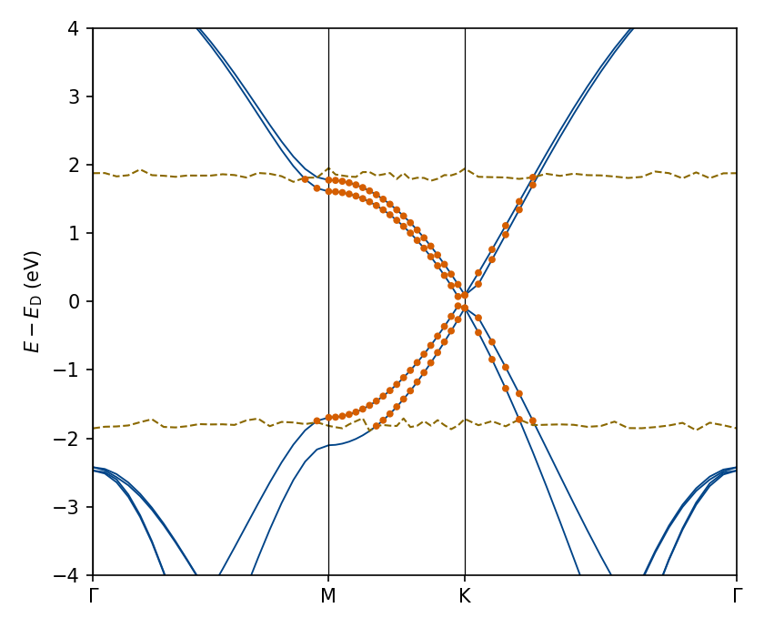

# How to unfold the bands of large supercells with the sparse solver

On this page you unfold the bands of a supercell of hundreds to thousands of atoms with {py:func}`~PAOFLOW.models.band_unfold.unfold_bands_sparse`. You need it when the full diagonalisation of {py:func}`~PAOFLOW.models.band_unfold.unfold_bands` runs out of memory or time ([How to unfold supercell bands onto the primitive Brillouin zone](band-unfolding.md)). The sparse route computes at each k-point only the `n_eigs` supercell states closest to an energy `sigma`, with their spectral weights. These weights are the same as on the full route. The approximation is that only part of the spectrum is unfolded ([Partial spectra](../theory/band-unfolding.md#partial-spectra)). The route needs a tight-binding model whose hoppings are a function of the bond length.

:::{tip}
This page is built on the case [`tbg_unfold`](https://github.com/marcobn/PAOFLOW/tree/develop/examples/cases/tbg_unfold): open it in PAOFLOW Studio with *Examples…* → `tbg_unfold`, or copy it with `paoflow-gen --example tbg_unfold`. The model and the cells are built in code, so the page needs no input files. Download {download}`unfold_large_supercells.py <unfold-large-supercells/unfold_large_supercells.py>` into the copy to run this page, or to unfold your own large supercell: replace the model, the cell builder and the path with yours. Run it as `OMP_NUM_THREADS=1 python unfold_large_supercells.py`; it takes about 2 minutes on 4 cores. Run {download}`figures.py <unfold-large-supercells/figures.py>` after it, in the same directory, to redraw the figure of this page from that run.
:::

## A carbon model with distance-dependent hoppings

Give the supercell as an environment-dependent tight-binding (EDTB) model with distance-dependent hoppings. The sparse route evaluates each hopping from its bond length. It cannot use one parameter set per neighbour shell, as the silicon model of the dense how-to does.

The carbon model below takes the form of L. Goodwin, A. J. Skinner and D. G. Pettifor, Europhys. Lett. 9, 701 (1989). Each Slater–Koster channel decays with the bond length $r$ from its value at $r_0 = 2.684$ bohr, the nearest-neighbour distance of graphene:

| entry | meaning |
| --- | --- |
| `V0` | value of the channel at $r_0$ |
| `r_0` | reference bond length $r_0$ |
| `n` | power of $r_0/r$ with which the channel falls off |
| `r_c`, `n_c` | length and sharpness of the exponential decay that multiplies the power law |

Energies are in eV and distances in bohr. The basis is $sp^3d^5$. The atoms around each bond also screen its hopping, as described in [Environment-dependent Slater–Koster models](../../internals/sk-edtb.md).

```{literalinclude} unfold-large-supercells/unfold_large_supercells.py
:language: python
:end-before: '# The (n, m) supercell of AA bilayer graphene'
```

## Building the supercell

The system is AA-stacked bilayer graphene, with 3.35 Å between the layers. The $(n, m)$ supercell is spanned by $n\mathbf{a}_1 + m\mathbf{a}_2$ and its $60^\circ$ rotation, and holds $n^2 + nm + m^2$ primitive cells per layer. The function below builds this cell, with the lattice constant of graphene as `alat`. It places every atom on a primitive site shifted by a primitive lattice vector inside the cell, as the unfolding requires ([The atom mapping](../theory/band-unfolding.md#the-atom-mapping)):

```{literalinclude} unfold-large-supercells/unfold_large_supercells.py
:language: python
:start-after: '# The (n, m) supercell of AA bilayer graphene'
:end-before: '# Unfolding with the sparse solver'
```

## Unfolding with the sparse solver

Call `unfold_bands_sparse` with the same arguments as `unfold_bands`, plus the arguments of the solver:

```{literalinclude} unfold-large-supercells/unfold_large_supercells.py
:language: python
:start-after: '# Unfolding with the sparse solver'
:end-before: '# The edges of the window'
```

| argument | meaning | default |
| --- | --- | --- |
| `sigma` | energy, in eV, nearest which the states are solved | 0.0 |
| `n_eigs` | number of states solved at each k-point | 100 |
| `n_workers` | number of processes over which the k-points are split; `-1` uses all the cores available to the process, which under `mpirun` is its share of the node | 1 |

The solver is the shift-invert Lanczos method of SciPy's `eigsh`. This iterative method converges first to the eigenvalues nearest `sigma`, and needs only a sparse factorisation of the Hamiltonian at each k-point. Below, the window is the energy range of the `n_eigs` states it returns at a k-point.

The sparse route saves the memory that stops the full route. The $(4, 3)$ cell holds $N = 37$ primitive cells of the bilayer, 148 atoms and 1332 orbitals. The full route would store its $H_{\alpha\beta}(\mathbf{R})$ as $1332^2$ complex numbers on each of 125 lattice vectors, 3.5 GB. That memory grows as the square of the number of orbitals. The sparse route stores the list of bonds, which grows linearly with the number of atoms.

Each worker process runs its own linear algebra. Start the script with `OMP_NUM_THREADS=1`, because several threads per process would oversubscribe the cores. Each worker also holds one factorisation in memory. The factorisation fills in, so its cost grows faster than the number of orbitals ([Band unfolding: implementation](../../internals/band-unfolding.md#the-sparse-route)). Before you run a larger cell, time one k-point and watch its memory.

## The coordinates of the K point

Give K as $(\tfrac23, \tfrac13)$ in `sym_points`, because the primitive vectors here, $\mathbf{a}_1 = a(1, 0)$ and $\mathbf{a}_2 = a(\tfrac12, \tfrac{\sqrt3}{2})$, are at $60^\circ$. The fractional coordinates of K depend on the angle between the primitive vectors:

| angle between $\mathbf{a}_1$ and $\mathbf{a}_2$ | K | the point $(\tfrac13, \tfrac13)$ |
| --- | --- | --- |
| $60^\circ$, as here | $(\tfrac23, \tfrac13)$ | two thirds of the way from $\Gamma$ to M |
| $120^\circ$ | $(\tfrac13, \tfrac13)$ | K |

On a $60^\circ$ cell, a path through $(\tfrac13, \tfrac13)$ therefore misses the Dirac points. The module's `HEX_SYM_POINTS` uses $(\tfrac13, \tfrac13)$, so do not pass it for cells built at $60^\circ$.

## Choosing the window

Choose `sigma` inside the energy range you want to resolve, here the Dirac energy of the bilayer. Then choose `n_eigs` large enough that the window covers that range at every k-point. A supercell has $N$ times as many states per eV as its primitive cell, so the same `n_eigs` covers a narrower window in a larger cell. The window is also narrowest where the bands are densest. A larger `n_eigs` widens it, at a higher cost per k-point. To check the window, compare its edges with the energy range you plot:

```{literalinclude} unfold-large-supercells/unfold_large_supercells.py
:language: python
:start-after: '# The edges of the window'
:end-before: '# Saving the bands, the weights and the supercell model'
```

Then save the results and the supercell model:

```{literalinclude} unfold-large-supercells/unfold_large_supercells.py
:language: python
:start-after: '# Saving the bands, the weights and the supercell model'
```



In the figure, the dark-blue lines are the bands of the primitive AA bilayer, and the vermillion markers are the supercell states, with area proportional to $w_n(\mathbf{k})$. The dashed amber lines are the edges of the window at each k-point.

The energy zero $E_\mathrm{D} = -0.519$ eV is the mean of the two Dirac points at K. The interlayer hopping of AA stacking shifts these points to $E_\mathrm{D} \pm 0.094$ eV, one for the bonding and one for the antibonding combination of the layers.

Inside the window the unfolding is complete. The window covers at least $E_\mathrm{D} - 1.71$ to $E_\mathrm{D} + 1.75$ eV at every k-point, and inside it every state with weight lies on a primitive band, as it must in a perfect supercell. Outside the window there is no weight, even where the primitive bands run, for example on most of $\Gamma$–M. A window narrower than the plot therefore leaves blank regions that look like gaps.

Keep the range you interpret inside the window for a second reason: the window can cut a degenerate multiplet at its edge. The solver then returns only some of its states, and part of its summed weight ([Degenerate multiplets](../theory/band-unfolding.md#degenerate-multiplets)). In this run, the lower edge at $\Gamma$ falls on a six-fold multiplet, of which the window holds 4 states. The cut multiplets and the missing states outside the window also mean that the weights at a k-point do not add up to the number of primitive orbitals, unlike on the full route ([The sum rule](../theory/band-unfolding.md#the-sum-rule)).

## Troubleshooting

| message | meaning | what to do |
| --- | --- | --- |
| `eigsh failed to converge for ... eigenvalues near sigma=...` | The Lanczos iterations did not converge at some k-point of a cell above 6000 orbitals; smaller cells fall back to a full diagonalisation. | Lower `n_eigs`, or pass a larger `maxiter` or `ncv`, which `unfold_bands_sparse` forwards to `eigsh`. |
| `No SC atom found matching PC atom ... Check positions/lattice vectors.` | The supercell atoms are not primitive sites shifted by a lattice vector. | See the troubleshooting table of [How to unfold supercell bands onto the primitive Brillouin zone](band-unfolding.md#troubleshooting). |

## Where to go next

- [Band unfolding: spectral weights of supercell states](../theory/band-unfolding.md) derives the weights and explains what a partial spectrum leaves out.
- [How to compute the band structure of twisted bilayer graphene](twisted-bilayer.md) uses the same carbon model and solver for cells that cannot be unfolded.
- [Environment-dependent Slater–Koster models](../../internals/sk-edtb.md) describes the EDTB models and their fitting.
- [Band unfolding: implementation](../../internals/band-unfolding.md) describes the sparse route, its parallel distribution and its memory.
