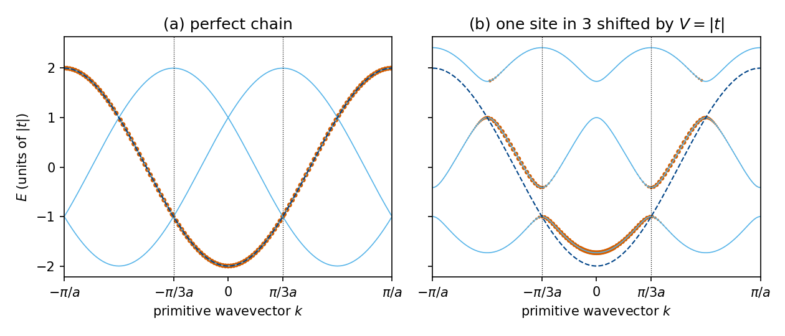

# Band unfolding: spectral weights of supercell states

This page explains how the bands of a supercell are unfolded onto the Brillouin zone of its primitive cell. It shows which wavevectors fold onto one point of the supercell zone, and derives the spectral weight that assigns each supercell state a primitive crystal momentum. It then explains what the weights tell about a perturbation of the crystal, and which cells cannot be unfolded. Two functions evaluate the weights:

| Function | Supercell states |
| --- | --- |
| {py:func}`~PAOFLOW.models.band_unfold.unfold_bands` | all of them, from a full diagonalisation of the supercell Hamiltonian |
| {py:func}`~PAOFLOW.models.band_unfold.unfold_bands_sparse` | the states near one energy |

Both take the real-space Hamiltonian $H_{\alpha\beta}(\mathbf{R})$ of the primitive cell and of the supercell, from a tight-binding model or from the projection of [The PAO Hamiltonian](pao-hamiltonian.md). The folding of bands is derived in [Band folding](large-cells.md#band-folding). The last section applies the geometry to twisted bilayers, the commensurate cells that the method cannot unfold.

## Folding of the primitive bands

### The supercell and its translations

A supercell has lattice vectors $\mathbf{A}_i = \sum_j M_{ij}\,\mathbf{a}_j$ that are integer combinations of the primitive vectors $\mathbf{a}_j$. It holds

$$
N = |\det M|
$$

primitive cells, displaced from one another by the $N$ primitive lattice vectors $\mathbf{R}_\ell$, $\ell = 1, \dots, N$, that lie inside the supercell. Every primitive lattice vector is one of the $\mathbf{R}_\ell$ plus a supercell lattice vector $\mathbf{T}$, so the primitive lattice splits into $N$ copies of the supercell lattice.

PAOFLOW finds $M$ from the two sets of lattice vectors. Both sets are given in Cartesian coordinates, in units of the same lattice parameter `alat`. The run stops when $M$ is not an integer matrix. As the $\mathbf{R}_\ell$, PAOFLOW takes the primitive lattice vectors whose fractional coordinates in the supercell lie in $[0, 1)$.

The reciprocal lattice of the supercell is spanned by the $\mathbf{B}_i$, with $\mathbf{B}_i\cdot\mathbf{A}_j = 2\pi\delta_{ij}$. It contains the reciprocal lattice of the primitive cell, and its zone is $N$ times smaller. $N$ of its vectors, $\mathbf{G}_1, \dots, \mathbf{G}_N$, are inequivalent modulo the primitive reciprocal lattice. They label the primitive wavevectors $\mathbf{k} = \mathbf{K} + \mathbf{G}_j$ that fold onto a point $\mathbf{K}$ of the supercell zone. The supercell bands at $\mathbf{K}$ are the primitive bands of all $N$ of these wavevectors ([Band folding](large-cells.md#band-folding)).

### The mapping of wavevectors

The unfolding runs over a path in the primitive zone and never reduces $\mathbf{k}$ into the supercell zone. Both Hamiltonians are built in the lattice gauge, with the Bloch phase of the cell and not of the atom:

$$
H^\mathrm{SC}(\mathbf{k}) = \sum_{\mathbf{T}} H^\mathrm{SC}(\mathbf{T})\, e^{i\mathbf{k}\cdot\mathbf{T}} ,
$$

where $\mathbf{T}$ runs over the supercell lattice vectors of the stored hoppings. Since $e^{i\mathbf{G}_j\cdot\mathbf{T}} = 1$ for every $\mathbf{T}$, $H^\mathrm{SC}(\mathbf{K} + \mathbf{G}_j) = H^\mathrm{SC}(\mathbf{K})$. The supercell Hamiltonian evaluated at the primitive wavevector $\mathbf{k}$ is therefore the matrix of the folded point, with the same eigenvectors, and no explicit folding is needed.

The high-symmetry points of the path, `sym_points`, are fractional coordinates $f_i$ of the primitive reciprocal lattice, $\mathbf{k} = \sum_i f_i\,\mathbf{b}_i$. The code measures $\mathbf{k}$ in units of $2\pi/a_\mathrm{lat}$ and lattice vectors in units of $a_\mathrm{lat}$. Every phase $e^{i\mathbf{k}\cdot\mathbf{R}}$ on this page therefore reads $e^{2\pi i\,\mathbf{k}\cdot\mathbf{R}}$ in the source. `unfold_bands_sparse` passes the same point to the supercell solver as the fractional coordinates $\mathbf{k}\cdot\mathbf{A}_i/2\pi$ of the supercell reciprocal lattice.

The direction of the phase matters for the weights. Suppose a Hamiltonian stores its hopping to $\boldsymbol{\tau}_\beta + \mathbf{R}$ at $-\mathbf{R}$. It then gives $H(-\mathbf{k})$ in place of $H(\mathbf{k})$. With time reversal the energies are the same, but the eigenvectors belong to the mirror point, and the weights select the folded branches of $-\mathbf{k}$. The projected DFT Hamiltonian is stored in this opposite convention, which the code corrects before the transform ([Band unfolding: implementation](../../internals/band-unfolding.md)).

## The spectral weight

### Weights from the overlap with primitive Bloch states

A supercell eigenstate $|\Psi_{n\mathbf{K}}\rangle$ with energy $E_n(\mathbf{K})$ is in general a mixture of primitive Bloch states of the $N$ wavevectors $\mathbf{K} + \mathbf{G}_j$. Popescu and Zunger [1] define its spectral weight at one of them as the summed overlap with all primitive Bloch states $|\psi_{\nu\mathbf{k}}\rangle$ of that wavevector,

$$
w_n(\mathbf{k}) = \sum_{\nu} \bigl|\langle \psi_{\nu\mathbf{k}} | \Psi_{n\mathbf{K}} \rangle\bigr|^2 = \langle \Psi_{n\mathbf{K}} | \hat P_\mathbf{k} | \Psi_{n\mathbf{K}} \rangle ,
$$

where $\hat P_\mathbf{k} = \sum_\nu |\psi_{\nu\mathbf{k}}\rangle\langle\psi_{\nu\mathbf{k}}|$ projects on the states of primitive crystal momentum $\mathbf{k}$. The sum over all primitive bands $\nu$ makes the weight independent of the primitive Hamiltonian: any complete orthonormal basis of the states with momentum $\mathbf{k}$ gives the same projector. In plane waves, $|\Psi_{n\mathbf{K}}\rangle$ has coefficients $C_n(\mathbf{K} + \mathbf{g})$ on the supercell reciprocal lattice vectors $\mathbf{g}$. The weight is then the sum $\sum_{\mathbf{h}} |C_n(\mathbf{k} + \mathbf{h})|^2$ over the primitive reciprocal lattice vectors $\mathbf{h}$, the form of Ref. [1].

### The weight in an orbital basis

In a basis of orthonormal localised orbitals, the projector is built from Bloch sums of the orbitals of the primitive cell [2, 3]. Each supercell orbital carries a label $(\alpha, m, \ell)$: it is orbital $m$ of the atom at $\boldsymbol{\tau}_\alpha + \mathbf{R}_\ell$. That atom is the copy of primitive atom $\alpha$ in primitive cell $\ell$ of the supercell. The Bloch sum of orbital $(\alpha, m)$ over all primitive cells of a crystal of $N_c$ cells,

$$
|\chi_{\alpha m}(\mathbf{k})\rangle = \frac{1}{\sqrt{N_c}} \sum_{\ell=1}^{N} \sum_{\mathbf{T}} e^{i\mathbf{k}\cdot(\mathbf{R}_\ell + \mathbf{T})}\, |\alpha m, \mathbf{R}_\ell + \mathbf{T}\rangle ,
$$

has momentum $\mathbf{k}$. The $n_\mathrm{awf}^\mathrm{PC}$ Bloch sums, one per orbital of the primitive cell, span the states of momentum $\mathbf{k}$ in the orbital space.

In the lattice gauge, the supercell eigenstate has coefficients $C^n_{\alpha m \ell}(\mathbf{k})$ on the Bloch sums $\sum_\mathbf{T} e^{i\mathbf{k}\cdot\mathbf{T}}|\alpha m, \mathbf{R}_\ell + \mathbf{T}\rangle$ of the supercell orbitals, normalised over the $N_c/N$ supercells. Its overlap with $|\chi_{\alpha m}(\mathbf{k})\rangle$ is therefore $N^{-1/2}\sum_\ell e^{-i\mathbf{k}\cdot\mathbf{R}_\ell}\, C^n_{\alpha m\ell}(\mathbf{k})$, and the weight is

$$
w_n(\mathbf{k}) = \frac{1}{N} \sum_{\alpha}\sum_{m} \left| \sum_{\ell=1}^{N} e^{-i\mathbf{k}\cdot\mathbf{R}_\ell}\, C^{n}_{\alpha m \ell}(\mathbf{k}) \right|^2 .
$$

Both functions evaluate this form, with the eigenvectors of $H^\mathrm{SC}(\mathbf{k})$ at each point of the path. The sum over $\ell$ is a discrete Fourier transform over the $N$ copies of the primitive cell. It keeps the part of the state that has momentum $\mathbf{k}$, and drops the parts with the $N - 1$ other wavevectors that fold onto the same $\mathbf{K}$.

The derivation assumes an orthonormal basis. A tight-binding model is written in one, and the projected Hamiltonian is a matrix in the Löwdin-orthogonalised PAOs ([Löwdin orthogonalisation](pao-hamiltonian.md#löwdin-orthogonalisation)). These orbitals carry tails on the neighbouring atoms. Near a substituted atom they therefore differ from the translated orbitals of the primitive cell. The weights there measure the momentum of the state in the basis of the supercell, which is what the label $(\alpha, m, \ell)$ refers to.

### The atom mapping

The label $(\alpha, m, \ell)$ exists only when every supercell atom sits at $\boldsymbol{\tau}_\alpha + \mathbf{R}_\ell$ for one primitive atom $\alpha$ and one translation, and carries as many orbitals as atom $\alpha$. The species, on-site energies and hoppings may differ from those of the primitive cell; that difference is what the weights measure. The positions and the orbital counts may not differ. PAOFLOW builds this atom mapping from the two geometries, within $10^{-4}$ in fractional coordinates of the supercell. It stops when a primitive site has no supercell atom, when a supercell atom is left over, or when the orbital counts differ.

The phase $e^{-i\mathbf{k}\cdot\mathbf{R}_\ell}$ in the weight is the displacement of the supercell atom from its primitive atom. The code takes it as the translation reduced into the supercell. The weights are therefore correct when you give each supercell atom at $\boldsymbol{\tau}_\alpha + \mathbf{R}_\ell$ with that $\mathbf{R}_\ell$, not at an image shifted by a supercell vector ([Band unfolding: implementation](../../internals/band-unfolding.md)).

## What the weights mean

### Probability of a primitive momentum

The weights of one supercell state over its $N$ folded wavevectors add up to one,

$$
\sum_{j=1}^{N} w_n(\mathbf{K} + \mathbf{G}_j) = 1 ,
$$

because the phases $N^{-1/2}e^{-i(\mathbf{K}+\mathbf{G}_j)\cdot\mathbf{R}_\ell}$ form a unitary matrix in $j$ and $\ell$, and the eigenvector is normalised. $w_n(\mathbf{k})$ is therefore the probability that the supercell state has primitive crystal momentum $\mathbf{k}$.

In a supercell of the perfect crystal, every state is a primitive Bloch state. It has weight 1 at its own $\mathbf{k}$ and 0 at the other $N - 1$. Unfolding then selects one folded branch out of $N$ and reproduces the primitive bands.

### The sum rule

Summed over all supercell states at fixed $\mathbf{k}$, the weights count the Bloch sums onto which they project:

$$
\sum_{n} w_n(\mathbf{k}) = n_\mathrm{awf}^\mathrm{PC} .
$$

The identity follows from the completeness of the eigenvectors, $\sum_n C^n_{\alpha m\ell}\, C^{n*}_{\alpha m\ell'} = \delta_{\ell\ell'}$, for any phases of unit modulus. It therefore holds whatever the positions, the image of each atom or the path. It fails only when the primitive model has a different number of orbitals from the supercell atoms mapped onto it. {py:func}`~PAOFLOW.models.band_unfold.unfold_bands` prints the largest deviation and warns above 0.01.

Because it holds for any geometry and path, the sum rule cannot test them. Test them on the perfect supercell instead: its states of weight 1 must lie on the primitive bands.

### Degenerate multiplets

Within a degenerate multiplet of the supercell, the weight of a single state is not defined. The weight is the expectation value of a projector, so it depends on the orthonormal basis that the eigensolver returns inside the multiplet, and that basis is arbitrary. Only the sum over the multiplet is defined. In the perfect supercell this sum equals the number of primitive states at $\mathbf{k}$ in the multiplet. Exact multiplets are common in supercells, because wavevectors related by a symmetry fold onto the same $\mathbf{K}$ with equal energies.

### The unfolded spectral function

The weights define the unfolded spectral function

$$
A(\mathbf{k}, E) = \sum_{n} w_n(\mathbf{k})\, \delta\bigl(E - E_n(\mathbf{k})\bigr) ,
$$

the effective band structure of Ref. [1]. Its integral over $E$ at each $\mathbf{k}$ is $n_\mathrm{awf}^\mathrm{PC}$, the number of primitive bands, however many supercell states carry the weight. $A(\mathbf{k}, E)$ is the quantity to compare with primitive-cell bands. Apart from the photoemission matrix elements, it is also the quantity to compare with the intensity of angle-resolved photoemission, which resolves the momentum of the primitive lattice.

PAOFLOW returns $E_n(\mathbf{k})$ and $w_n(\mathbf{k})$. To show $A(\mathbf{k}, E)$ without a broadening, draw each state as a marker with area proportional to its weight. The states of a multiplet then fall on the same point, where their weights add.

### Perturbations seen through the weights

A perturbation $\Delta V$ that breaks the primitive periodicity, such as a substitution or a change of on-site energies on one atom, couples each primitive state $|\psi_{\nu\mathbf{k}}\rangle$ to the states of the folded wavevectors $\mathbf{k} + \mathbf{G}_j$. Perturbation theory gives three effects on the weights, which the figure shows on the simplest example.

The figure shows a chain with one orbital per site and hopping $t$, in a supercell of $N = 3$ sites. The thin light-blue lines are the folded supercell bands, the dashed dark-blue line is the primitive band $2t\cos ka$, and the area of each vermillion marker is proportional to $w_n(k)$. In the perfect chain (a), the weights pick one branch out of three and trace the primitive band. In (b), the on-site energy of one site in three is raised by $V = |t|$.

The first effect is a shift. The cell average of $\Delta V$ shifts each primitive state by $\langle\psi_{\nu\mathbf{k}}|\Delta V|\psi_{\nu\mathbf{k}}\rangle$, here $V/N$. In general, when the on-site energies of one of the $N$ copies of atom $\alpha$ rise by $V$, the shift is $V$ times the weight of the primitive state on atom $\alpha$, divided by $N$.

The second effect is a gap. Where two folded branches cross, $\Delta V$ couples them. When the two branches shift alike, it opens a gap of $2|\langle\psi_{\nu',\mathbf{k}+\mathbf{G}_j}|\Delta V|\psi_{\nu\mathbf{k}}\rangle|$ to first order. In the chain the gaps open at $k = \pm\pi/3a$, the boundaries of the supercell zone, and at $\pm 2\pi/3a$. Across a gap the weight passes from one branch to the other. The primitive band therefore appears to continue through the gap, with reduced intensity on either side.

The third effect is a splitting. A perturbation that lowers the point symmetry splits a degenerate primitive level into supercell states, which can each keep a weight close to 1.

Away from the crossings the weight stays on one branch. This is why the unfolded bands of a dilute perturbation look like shifted primitive bands.

## Limits of the method

### Cells that are not commensurate

The supercell must be a supercell of the primitive lattice, with integer $M$. A cell whose lattice vectors are not integer combinations of the primitive ones, within a tolerance of $10^{-6}$ on $M$, has no folded wavevectors $\mathbf{G}_j$ and no translations $\mathbf{R}_\ell$. PAOFLOW rejects it. Give both cells with the same `alat`, because $M$ and the atom mapping compare lengths in its units.

### Relaxed and defect cells

The orbital form of the weight needs the atom mapping. It therefore covers substitutions, and changes of on-site energies and hoppings, on ideal positions. Relaxed positions, vacancies and interstitials have no mapping. The plane-wave form of Popescu and Zunger needs only the lattice vectors and treats them [1], but PAOFLOW evaluates the orbital form.

You can unfold a relaxed cell with its atoms put back on the ideal sites. The effect of the relaxation then survives only as far as the hoppings of the model or of the projection carry it. In a model, you can represent a vacancy by an atom whose orbitals lie far from the energies of interest. The orbital count is then kept, and these orbitals barely mix into the bands you study.

### Partial spectra

{py:func}`~PAOFLOW.models.band_unfold.unfold_bands_sparse` is for cells too large for a full diagonalisation. At each $\mathbf{k}$ it computes the `n_eigs` supercell states closest to the energy `sigma`, with the shift-invert Lanczos method. These states span a window in energy around `sigma`. Each returned eigenvector is exact, so its weight is exact.

The sum rule does not hold, because the states outside the window are not computed. An energy range where the window has no states therefore shows no weight, even where primitive bands run. A degenerate multiplet at the edge of the window can be cut, and then only part of its weight is returned. The window covers fewer eV in a larger cell, since the number of supercell states per eV is $N$ times that of the primitive cell.

## Twisted bilayers

Two layers of a hexagonal crystal rotated against each other by an angle $\theta$ form a crystal only at commensurate angles. The cell of that crystal cannot be unfolded onto the zone of one layer (see [Why a twisted cell does not unfold](#why-a-twisted-cell-does-not-unfold)). Its bands are computed in the Brillouin zone of the cell, the moiré zone, with the same sparse solver as the large supercells.

### Commensurate twist angles

Take integers $n > m \ge 0$ and primitive vectors $\mathbf{a}_1$ and $\mathbf{a}_2$ at $60^\circ$. The lattice vector $\mathbf{T}_1 = n\mathbf{a}_1 + m\mathbf{a}_2$ of the lower layer coincides with the vector $m\mathbf{a}_1 + n\mathbf{a}_2$ of the upper layer when the upper layer is rotated by the angle between them:

$$
\cos\theta = \frac{n^2 + m^2 + 4nm}{2\,(n^2 + nm + m^2)} .
$$

$\mathbf{T}_1$ and its $60^\circ$ rotation $\mathbf{T}_2 = -m\mathbf{a}_1 + (n+m)\mathbf{a}_2$ are lattice vectors of both layers, and they span the commensurate cell. In this cell each layer holds $n^2 + nm + m^2 = |\mathbf{T}_1|^2/a^2$ primitive cells, where $a = |\mathbf{a}_1|$ is the lattice constant of one layer.

### The moiré period

The two rotated lattices beat against each other with the moiré period

$$
L = \frac{a}{2\sin(\theta/2)} ,
$$

the length over which the local stacking passes from AA through AB and BA, and back. In AA stacking the atoms of the two layers sit on top of each other.

For the pairs $(n, n-1)$, $|\mathbf{T}_1|^2 = a^2(3n^2 - 3n + 1)$ and $\sin^2(\theta/2) = [4(3n^2 - 3n + 1)]^{-1}$, so $L = |\mathbf{T}_1|$. The cell is then one moiré period, the smallest cell for its angle. Other pairs can give cells that hold several periods. The number of atoms grows as $L^2 \propto \theta^{-2}$, which is why small angles need cells of thousands of atoms.

### Why a twisted cell does not unfold

The commensurate cell is a supercell of each layer's lattice, but not of a primitive cell that holds both layers. The atoms of the rotated layer do not sit at the sites of an untwisted bilayer shifted by a lattice vector. No primitive atom $\alpha$ and translation $\mathbf{R}_\ell$ label them, so the [atom mapping](#the-atom-mapping) fails.

The Dirac points of the two layers are rotated by $\theta$ against each other. In the moiré zone they fold onto the corners, one Dirac point of each layer onto the moiré K. The bands of a weakly coupled bilayer therefore show four states at the moiré K near the Dirac energy.

### Dirac velocity in the continuum model

At small angles, the continuum model of Bistritzer and MacDonald [4] describes each layer by its Dirac cone, with velocity $v_0$. It describes the interlayer coupling by a tunnelling amplitude $w$ between the cones, which the moiré pattern repeats with period $L$. The cones of the two layers are $k_\theta = 2|\mathbf{K}|\sin(\theta/2)$ apart, where $|\mathbf{K}| = 4\pi/3a$ is the distance from $\Gamma$ to K of one layer. The kinetic energy across the moiré zone is then $\hbar v_0 k_\theta$. The ratio

$$
\alpha = \frac{w}{\hbar v_0\, k_\theta}
$$

of coupling to kinetic energy controls the bands, and the Dirac velocity at the moiré K is renormalised to

$$
\frac{v^*}{v_0} = \frac{1 - 3\alpha^2}{1 + 6\alpha^2} .
$$

The velocity vanishes at $\alpha = 1/\sqrt{3}$, the first magic angle, where the bands around charge neutrality become flat. With the coupling of Ref. [4] this is near $\theta = 1.1^\circ$. Since $k_\theta \propto \theta$ at small angles, $\alpha \propto w/\theta$, and the magic angle is proportional to $w$. A model with a stronger interlayer coupling, for example from a shorter interlayer distance, therefore has its flat bands at a larger angle, in a smaller cell.

The continuum model keeps only the low-energy Dirac cones, a single tunnelling amplitude for all stackings and the lowest Fourier components of the moiré coupling. It therefore holds at small angles and for energies close to the Dirac point. A tight-binding model of the commensurate cell keeps all bands and the full interlayer hopping, and its velocity can differ from the continuum prediction at larger angles. Both models assume rigid, flat layers. They leave out the relaxation of real samples, which changes the bands at small angles.

## Used in

- [How to unfold supercell bands onto the primitive Brillouin zone](../howtos/band-unfolding.md): the weights of a perfect and of a perturbed eight-atom silicon cell, an avoided crossing and a split multiplet, and the route for a projected DFT Hamiltonian.
- [How to unfold the bands of large supercells with the sparse solver](../howtos/unfold-large-supercells.md): weights of a window of states in a supercell of AA bilayer graphene, and the edges of that window.
- [How to compute the band structure of twisted bilayer graphene](../howtos/twisted-bilayer.md): commensurate cells, moiré bands near the Dirac energy, and the Dirac velocity compared with the continuum model.

## References

1. V. Popescu and A. Zunger, Extracting E versus k effective band structure from supercell calculations on alloys and impurities, Phys. Rev. B 85, 085201 (2012).
2. P. B. Allen, T. Berlijn, D. A. Casavant and J. M. Soler, Recovering hidden Bloch character: Unfolding electrons, phonons, and slabs, Phys. Rev. B 87, 085322 (2013).
3. W. Ku, T. Berlijn and C.-C. Lee, Unfolding first-principles band structures, Phys. Rev. Lett. 104, 216401 (2010).
4. R. Bistritzer and A. H. MacDonald, Moiré bands in twisted double-layer graphene, Proc. Natl. Acad. Sci. USA 108, 12233 (2011).
