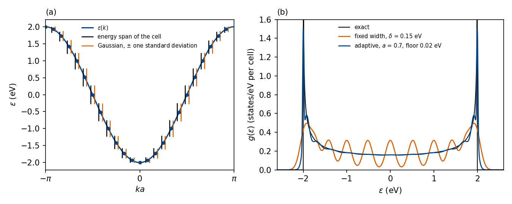

# Band velocities, density of states and adaptive smearing

This page explains how PAOFLOW turns the eigenvalues of the interpolated PAO Hamiltonian into Brillouin-zone sums. It builds on [The PAO Hamiltonian](pao-hamiltonian.md), which derives $H_{\alpha\beta}(\mathbf{R})$ and its Fourier interpolation onto the mesh of $N_\mathrm{mesh}$ k-points that {py:meth}`~PAOFLOW.PAOFLOW.PAOFLOW.pao_eigh` diagonalises. Each quantity of the page has its method:

| Quantity | Method |
| --- | --- |
| Band velocities and velocity matrix elements, from the k-gradient of $\tilde H(\mathbf{k})$ | {py:meth}`~PAOFLOW.PAOFLOW.PAOFLOW.gradient_and_momenta` |
| Adaptive width of the Gaussian broadening of each state | {py:meth}`~PAOFLOW.PAOFLOW.PAOFLOW.adaptive_smearing` |
| Density of states (DOS) and projected density of states (PDOS), with the adaptive widths or one fixed width | {py:meth}`~PAOFLOW.PAOFLOW.PAOFLOW.dos` |
| Fermi energy, the energy zero | read from the DFT run, or recomputed by {py:meth}`~PAOFLOW.PAOFLOW.PAOFLOW.interpolated_hamiltonian` |

The band velocities derived here also enter the Boltzmann transport tensors and the optical response.

## Band velocities from the PAO Hamiltonian

The band velocity follows from the same real-space Hamiltonian that gives the bands, without finite differences between mesh points. The starting point is the Fourier sum of the PAO Hamiltonian,

$$
\tilde H_{\alpha\beta}(\mathbf{k}) = \sum_{\mathbf{R}} e^{i\mathbf{k}\cdot\mathbf{R}}\, H_{\alpha\beta}(\mathbf{R}) ,
\qquad
\tilde H(\mathbf{k})\, U_n(\mathbf{k}) = \varepsilon_{n\mathbf{k}}\, U_n(\mathbf{k}) ,
$$

where $H_{\alpha\beta}(\mathbf{R}) = \langle\phi_{\alpha,\mathbf{0}}|H|\phi_{\beta,\mathbf{R}}\rangle$ is the hopping from orbital $\beta$ in the cell at $\mathbf{R}$ to orbital $\alpha$ in the home cell, in the orthonormal PAO basis. The column $U_n(\mathbf{k})$ holds the components $U_{\alpha n}(\mathbf{k}) = \langle\phi_\alpha|n\mathbf{k}\rangle$ of the eigenstate $|n\mathbf{k}\rangle$.

### The gradient of the Hamiltonian

The velocity operator of the crystal is $\hat{\mathbf{v}} = (i/\hbar)[\hat H, \hat{\mathbf{r}}]$, so its matrix in the PAO basis needs the position operator. PAOFLOW takes the position operator diagonal, with each orbital at the centre $\boldsymbol{\tau}_\alpha$ of its atom: $\hat{\mathbf{r}}\,|\phi_{\alpha,\mathbf{R}}\rangle \approx (\mathbf{R} + \boldsymbol{\tau}_\alpha)\,|\phi_{\alpha,\mathbf{R}}\rangle$. The commutator between two orbitals is then the hopping times the vector between their centres,

$$
\langle\phi_{\alpha,\mathbf{0}}|[\hat H, \hat{\mathbf{r}}]|\phi_{\beta,\mathbf{R}}\rangle = (\mathbf{R} + \boldsymbol{\tau}_\beta - \boldsymbol{\tau}_\alpha)\, H_{\alpha\beta}(\mathbf{R}) ,
$$

and the Bloch sum of these matrix elements gives the velocity matrix at $\mathbf{k}$:

$$
\hbar\,\mathbf{v}_{\alpha\beta}(\mathbf{k}) = i\sum_{\mathbf{R}} (\mathbf{R} + \boldsymbol{\tau}_\beta - \boldsymbol{\tau}_\alpha)\, e^{i\mathbf{k}\cdot\mathbf{R}}\, H_{\alpha\beta}(\mathbf{R})
= \nabla_{\mathbf{k}} \tilde H_{\alpha\beta}(\mathbf{k}) + i(\boldsymbol{\tau}_\beta - \boldsymbol{\tau}_\alpha)\, \tilde H_{\alpha\beta}(\mathbf{k}) .
$$

The first term is the analytic gradient of the Fourier sum. `gradient_and_momenta()` evaluates it by a fast Fourier transform of $\mathbf{R}\,H(\mathbf{R})$ on the real-space grid of the interpolated mesh. The second term comes from the positions of the atoms inside the cell, and vanishes for a cell with one atom.

The code stores this matrix with the opposite sign, as $-\hbar\mathbf{v}$, in eV bohr. Every quantity on this page uses $|\mathbf{v}|$ only, so the sign drops out. PAOFLOW calls these matrices momenta, although they differ from the momentum matrix elements $\mathbf{p}_{nm}$ by the factor $\hbar/m_e$.

### Band velocity and velocity matrix elements

Transformed to the eigenstates, the velocity matrix splits into two parts. Its diagonal holds the band velocities, and its off-diagonal elements are the interband matrix elements. Write $\tau^{(i)}_{nm} = \sum_\alpha U^*_{\alpha n}(\mathbf{k})\, \tau^{(i)}_\alpha\, U_{\alpha m}(\mathbf{k})$ for the matrix of the orbital centres between eigenstates. In matrix form the second term of the velocity is $i[\tilde H, \boldsymbol{\tau}]$, which between eigenstates becomes $i(\varepsilon_{n\mathbf{k}} - \varepsilon_{m\mathbf{k}})\,\boldsymbol{\tau}_{nm}$, so

$$
\hbar\,\mathbf{v}_{nm}(\mathbf{k}) = U_n^\dagger(\mathbf{k})\, \nabla_{\mathbf{k}}\tilde H(\mathbf{k})\, U_m(\mathbf{k}) + i\,(\varepsilon_{n\mathbf{k}} - \varepsilon_{m\mathbf{k}})\,\boldsymbol{\tau}_{nm}(\mathbf{k}) .
$$

On the diagonal the second term vanishes, and the first is the derivative of the eigenvalue. Differentiating $\varepsilon_{n\mathbf{k}} = U_n^\dagger \tilde H U_n$ gives $U_n^\dagger(\nabla_\mathbf{k}\tilde H)U_n + \varepsilon_{n\mathbf{k}}\nabla_\mathbf{k}(U_n^\dagger U_n)$, and the last term is zero because the eigenvectors stay normalised (the Hellmann–Feynman theorem). Therefore

$$
\mathbf{v}_{n\mathbf{k}} = \mathbf{v}_{nn}(\mathbf{k}) = \hbar^{-1}\nabla_{\mathbf{k}}\varepsilon_{n\mathbf{k}} ,
$$

the band velocity, exact for the interpolated bands at every mesh point. It is the velocity of a wave packet built from states of band $n$ near $\mathbf{k}$. It is large where the band is steep, zero at band extrema and saddle points, and small across a flat $d$ or $f$ band. The Boltzmann transport tensors use it, and on this page it sets the width of each state in the DOS.

The off-diagonal elements are the interband velocity matrix elements of the optical response, and they depend on the position operator. The orbital-centre approximation above neglects the dipole matrix elements $\langle\phi_\alpha|\hat{\mathbf{r}} - \boldsymbol{\tau}|\phi_\beta\rangle$ between different orbitals of one atom, such as $s$ and $p$. These dipoles are of the order of the orbital radius. The band velocity does not depend on them, because the diagonal of any commutator $[\tilde H, X]$ between eigenstates is zero. The `position_dipoles` argument of `gradient_and_momenta()` adds the dipoles ({py:meth}`~PAOFLOW.PAOFLOW.PAOFLOW.position_dipole_correction`, and [Position dipoles](../../internals/position-dipoles.md) for the implementation). The adaptive widths are still taken from the band velocities without them.

### Velocities at degenerate bands

At a k-point where two or more bands are degenerate, the eigenvalues alone do not define the velocity of each band. Any rotation of the eigenvectors inside the degenerate subspace is an equally valid set of eigenstates, and $U_n^\dagger \nabla_\mathbf{k}\tilde H\, U_n$ changes with the rotation. Degenerate perturbation theory resolves this. Take a step $\mathbf{q} = q\,\hat{\mathbf{e}}_l$ away from $\mathbf{k}$ along the Cartesian direction $l$, and let $P$ project on the degenerate subspace. To first order in $q$, the step splits the degenerate level into the eigenvalues of $q\,P\,\partial_{k_l}\tilde H\,P$. The eigenvalues of $P\,\partial_{k_l}\tilde H\,P$ are therefore the slopes of the split branches along $l$.

PAOFLOW applies this to every group of the bands kept by the projectability whose energies agree within $10^{-5}$ eV. For each direction $l$ separately, it diagonalises $P\,\partial_{k_l}\tilde H\,P$ and assigns the slopes in ascending order to the bands of the group. Each Cartesian component of the velocity is then correct as a set. The three components given to one band, however, can belong to different branches, because the rotation that diagonalises the subspace differs between directions. The speed $|\mathbf{v}_{n\mathbf{k}}|$ of a band in a degenerate group is then a combination of slopes of different branches: of the right magnitude, but not that of any single branch. The adaptive widths are affected only at the degenerate k-points. On a $\Gamma$-centred mesh these include the points on the symmetry lines of the Brillouin zone.

## Density of states on a k-mesh

The DOS per cell and per spin channel is the Brillouin-zone average of a delta function at each band energy,

$$
g(\varepsilon) = \frac{\Omega}{(2\pi)^3}\int_\mathrm{BZ} d^3k \sum_n \delta(\varepsilon - \varepsilon_{n\mathbf{k}})
\;\approx\; \frac{1}{N_\mathrm{mesh}} \sum_{\mathbf{k}} \sum_{n=1}^{n_\mathrm{bnd}} \tilde\delta(\varepsilon - \varepsilon_{n\mathbf{k}};\, \sigma_{n\mathbf{k}}) ,
$$

with $\Omega$ the cell volume. A sum of delta functions over a finite mesh is a set of spikes, not a density. On the mesh, each delta function is therefore replaced by a broadened function $\tilde\delta$ of width $\sigma_{n\mathbf{k}}$. `dos()` evaluates the right-hand side in states per eV per cell, one file per spin channel. With spin–orbit coupling the PAO basis contains both spins, so each band holds one electron and the single channel counts both spins.

The band sum runs over the $n_\mathrm{bnd}$ lowest bands, those kept by the projectability. The remaining $n_\mathrm{awf} - n_\mathrm{bnd}$ bands sit at the PAO shift $\eta$, the energy given to the part of the PAO space that no kept DFT state spans (see [The PAO Hamiltonian](pao-hamiltonian.md)). They are not DFT bands and do not enter $g(\varepsilon)$. The DOS is therefore reliable only below $\eta$, minus a few widths, where the PAO bands follow the DFT bands.

### Fixed-width smearing

The broadening function the code evaluates is the Gaussian

$$
\tilde\delta(x;\, \sigma) = \frac{1}{\sqrt{\pi}\,\sigma}\, e^{-x^2/\sigma^2} ,
$$

whose standard deviation is $\sigma/\sqrt{2}$, not $\sigma$. Every width on this page, including the `delta` argument of `dos()` and the adaptive widths below, is a $\sigma$ in this convention. Without adaptive widths, `dos()` gives every state the same width $\sigma_{n\mathbf{k}} = \delta$, the `delta` argument (0.01 eV by default). It also clips the upper end of its energy grid to $\eta$.

A fixed width has to satisfy two conditions. It must be larger than the energy spacing of neighbouring mesh states on the steepest band, or the DOS oscillates with the mesh. It must also be small compared with the features of the DOS, or it rounds them. The convolution with the Gaussian shifts the DOS by

$$
\frac{\sigma^2}{4}\, g''(\varepsilon) + \mathcal{O}(\sigma^4)
$$

where $g$ is smooth, and spreads a band edge or a van Hove singularity over about $\sigma$. A dispersive band near a flat one, such as a metal $sp$ band crossing a narrow $d$ band, has no width that satisfies both conditions. Panel (b) of the figure in [Width from the band velocity](#width-from-the-band-velocity) shows the oscillations of a fixed width that is too small for the mesh.

With `smearing='m-p'` the Gaussian is replaced by the Methfessel–Paxton function [2], which adds Hermite polynomials $H_{2n}$ to cancel the low-order terms of the error above. The code evaluates

$$
\tilde\delta_\mathrm{MP}(x;\, \sigma) = \frac{e^{-x^2/\sigma^2}}{\sqrt{\pi}\,\sigma}\left[1 + \sum_{n=1}^{4} \frac{(-1)^n}{n!\,4^n\sqrt{\pi}}\, H_{2n}\!\left(\frac{x}{\sigma}\right)\right] ,
$$

in which each correction carries a factor $1/\sqrt{\pi}$ that the function of Ref. [2] does not have. The extra factor changes how much of the error cancels. The function of Ref. [2] of order 4 has vanishing moments up to the eighth, so the error terms up to $\sigma^8$ cancel. With the extra factor, the second moment is $(1/2 - 1/(2\sqrt{\pi}))\,\sigma^2 \approx 0.22\,\sigma^2$, against $\sigma^2/2$ for the Gaussian, so the $\sigma^2$ error is reduced but not removed. Both versions of the function take negative values, so a Methfessel–Paxton DOS can be negative near sharp features.

## Adaptive smearing

Adaptive smearing chooses the width of each state from the energy range its part of the Brillouin zone spans [1]. This removes the conflict between steep and flat bands. A state on a steep band gets a wide function, which fills the energy range up to its neighbours on the mesh. A state on a flat band gets a narrow one, which keeps a sharp feature sharp.

### Width from the band velocity

Each mesh point $\mathbf{k}_i$ stands for a cell of the Brillouin zone of volume $(2\pi)^3/(\Omega N_\mathrm{mesh})$. The k-integral of the DOS is therefore a sum over these cells of the average of $\delta(\varepsilon - \varepsilon_{n\mathbf{k}})$ over each cell. To first order in $\mathbf{q} = \mathbf{k} - \mathbf{k}_i$, the band inside the cell is $\varepsilon_{n\mathbf{k}_i} + \nabla_\mathbf{k}\varepsilon_{n\mathbf{k}_i}\cdot\mathbf{q}$. The cell average of the delta function is then the distribution of this linear function over the cell. For a cube of side $\delta k$, each Cartesian component of $\mathbf{q}$ is uniform over $\delta k$, with variance $\delta k^2/12$. The energies of the cell then have the variance $|\nabla_\mathbf{k}\varepsilon_{n\mathbf{k}_i}|^2\,\delta k^2/12$. Replacing that distribution by a Gaussian whose width is proportional to its spread gives the width that `adaptive_smearing()` evaluates,

$$
\sigma_{n\mathbf{k}} = a\, |\nabla_{\mathbf{k}}\varepsilon_{n\mathbf{k}}|\, \delta k ,
\qquad
\delta k = \left(\frac{8\pi^3}{\Omega\, N_\mathrm{mesh}}\right)^{1/3} ,
$$

with $|\nabla_\mathbf{k}\varepsilon_{n\mathbf{k}}| = \hbar|\mathbf{v}_{n\mathbf{k}}|$ in eV bohr, $\Omega$ in bohr$^3$, and $\delta k$ the cube root of the volume of a mesh cell. The prefactor $a$ is the `afac` argument. Its default is 0.7 for the Gaussian and 1.0 for the Methfessel–Paxton function.

Matching the variance of the Gaussian, $\sigma^2/2$, to the variance of the cell gives $a = 1/\sqrt{6} \approx 0.41$. The default is about 1.7 times wider, so that each Gaussian overlaps those of the neighbouring mesh points. The sum then has no oscillations left from the discreteness of the mesh.

The figure samples a one-dimensional band $\varepsilon(k) = -2t\cos ka$, with $t = 1$ eV, on 24 points, so that $\delta k$ is the mesh spacing $2\pi/(24a)$. In panel (a) the adaptive widths with $a = 0.7$ follow the energy span of each mesh cell: both grow with the slope of the band and shrink at its bottom and top.

Panel (b) shows why a fixed width fails on this band. A width of 0.15 eV is narrower than the spacing of the mesh energies in the middle of the band, about 0.5 eV, so the DOS oscillates around the exact one. At the band edges the same width is too wide and rounds the divergences. The adaptive DOS follows the exact one across the band and keeps the edges sharp, with a floor of 0.02 eV on the widths (see the next section).

### Band extrema, flat bands and the width floor

The linear expansion fails where the gradient vanishes. At a band extremum or saddle point on the mesh, $\sigma_{n\mathbf{k}} = 0$. The band still varies across the cell, to second order in $\mathbf{q}$, by about $\hbar^2\delta k^2/(8m^*)$ for an effective mass $m^*$. Such a narrow state is a problem for the energy grid of the DOS, whose spacing is $\Delta\varepsilon$. A state with $\sigma_{n\mathbf{k}}$ much smaller than $\Delta\varepsilon$ is missed when it falls between two grid points. When it falls on one, it is counted as a spike of height $1/(\sqrt{\pi}\,\sigma_{n\mathbf{k}} N_\mathrm{mesh})$. In both cases the integral of the DOS over a band is wrong, and `dos()` prints a warning with the number of such states. The same happens on a flat band, whose width is small everywhere.

The `min_width` argument of `adaptive_smearing()` sets a floor on every width, and `max_width` a cap, so that the stored width is $\min(\max(\sigma_{n\mathbf{k}}, w_\mathrm{min}), w_\mathrm{max})$. Choose `min_width` at or above the energy spacing $\Delta\varepsilon$ of the grid of every later call that sums over states (`dos()`, `doping()`, `transport()`). Keep it well below the features you want to resolve. With that floor every state is counted, and the floor, not the grid, bounds the error at the extrema. The floor is also the energy resolution of the band edges: an edge of a semiconductor appears spread over about $w_\mathrm{min}$.

Two further limits come from the definition of $\delta k$:

| Geometry | Effect on the widths |
| --- | --- |
| A mesh with different spacings along the reciprocal-lattice vectors | The cube root of the cell volume is an average spacing, so the widths are too large along the dense directions and too small along the coarse ones. |
| A slab or a two-dimensional model, with one k-point along the normal and vacuum in the cell | $\Omega$ includes the vacuum, and $\delta k$ is not the in-plane spacing. The widths differ from the in-plane estimate by a factor that depends on the vacuum thickness, so set `afac` for that geometry. |

## Projected density of states

The PDOS decomposes the DOS by orbital: each state contributes with the weight of orbital $\alpha$ in its eigenvector,

$$
g_\alpha(\varepsilon) = \frac{1}{N_\mathrm{mesh}} \sum_{\mathbf{k}} \sum_{n=1}^{n_\mathrm{awf}} |U_{\alpha n}(\mathbf{k})|^2\; \tilde\delta(\varepsilon - \varepsilon_{n\mathbf{k}};\, \sigma_{n\mathbf{k}}) ,
$$

with the same widths as the DOS. The PAO basis of the Hamiltonian is orthonormal, so $\sum_\alpha |U_{\alpha n}|^2 = 1$ and the PDOS of all orbitals adds up to the DOS. This is a Löwdin decomposition, with no overlap populations to share between atoms.

In contrast to the DOS, the band sum of the PDOS runs over all $n_\mathrm{awf}$ bands, including those at $\eta$, and `dos()` clips the upper end of the energy grid to $\eta$. The sum of the PDOS therefore equals $g(\varepsilon)$ up to a few widths below $\eta$. Above that, it also contains the tails of the states at $\eta$.

The weight of an orbital measures the character of a state in the chosen basis, not an occupation of an atomic shell. Orthogonalisation mixes the tails of neighbouring orbitals into each basis function. A shell that is empty in the free atom, such as Si $3d$, can therefore carry a sizeable weight in the bonding states, and the split between atoms depends on the basis.

## Fermi energy

The Fermi energy $E_F$ is the energy zero of every PAOFLOW output. It enters the DOS only through that zero, and the occupations only through the methods that need them.

### Energy zero from the DFT run

PAOFLOW reads $E_F$ from the DFT output and subtracts it from all eigenvalues before building the Hamiltonian. What it reads depends on the occupations of the DFT run:

| DFT occupations | $E_F$ |
| --- | --- |
| Smearing | The Fermi energy of QE |
| Fixed, treated by PAOFLOW as an insulator | The highest occupied level: the valence-band maximum over the k-points of the DFT grid |

If the valence-band maximum lies between the points of the DFT grid, the interpolated bands rise above zero there. The amount decreases with the density of the DFT grid.

### Fermi energy on the interpolated mesh

With `reshift_Ef=True`, {py:meth}`~PAOFLOW.PAOFLOW.PAOFLOW.interpolated_hamiltonian` recomputes $E_F$ on the interpolated mesh and shifts the diagonal of $\tilde H(\mathbf{k})$ by it. For an insulator, $E_F$ is the maximum over the mesh of band $N_e/2$, or of band $N_e$ with spin–orbit coupling, where $N_e$ is the number of valence electrons per cell. For a metal, $E_F$ solves the electron count

$$
N_e = \frac{s}{N_\mathrm{mesh}} \sum_{\mathbf{k}} \sum_{n} \theta_\mathrm{MP}\!\left(\frac{\varepsilon_{n\mathbf{k}} - E_F}{\sigma_F}\right) ,
\qquad
\theta_\mathrm{MP}(x) = \frac{1 - \operatorname{erf}(x)}{2} + \frac{e^{-x^2}}{\sqrt{\pi}} \sum_{n=1}^{4} \frac{(-1)^n}{n!\,4^n\sqrt{\pi}}\, H_{2n-1}(x) ,
$$

by bisection to $10^{-10}$ electrons. The spin factor is $s = 2$ ($s = 1$ with spin–orbit coupling), and the width is fixed at $\sigma_F = 0.01$ eV. $\theta_\mathrm{MP}$ is the occupation whose derivative is the Methfessel–Paxton function of [Fixed-width smearing](#fixed-width-smearing), with the same extra $1/\sqrt{\pi}$ in its corrections.

Because $\sigma_F$ is fixed and narrow, the mesh has to resolve it. The spacing that matters is that of the mesh states crossing $E_F$, about $\hbar|\mathbf{v}_F|\delta k$, with $\mathbf{v}_F$ the velocity at the Fermi level. The count is a smooth function of $E_F$ only if this spacing is below $\sigma_F$. On a coarser mesh, $E_F$ jumps by up to that spacing when the mesh changes.

### Chemical potential at fixed carrier density

At finite temperature and doping, {py:meth}`~PAOFLOW.PAOFLOW.PAOFLOW.doping` finds the chemical potential $\mu$ by integrating the DOS of this page with the Fermi–Dirac occupation. The equation it solves, and the energy window and k-mesh it needs, are in [Chemical potential at fixed carrier density](boltzmann-transport.md#chemical-potential-at-fixed-carrier-density) on the transport page.

## Sources of error

Besides the errors of the Hamiltonian itself, the DOS of a calculation depends on three numerical choices. The interpolation error of the bands between the points of the DFT grid, and the error from the PAO shift, are discussed in [The PAO Hamiltonian](pao-hamiltonian.md).

| Choice | What it decides | How the error behaves |
| --- | --- | --- |
| The mesh | Which states are sampled | Quantities that depend on a feature narrower in k than the mesh spacing converge only as the mesh is refined. |
| The widths | How much of the sampled structure survives | A fixed width gives the $\sigma^2 g''/4$ bias of [Fixed-width smearing](#fixed-width-smearing), which does not fall as the mesh is refined. Adaptive widths scale with $a\,\delta k$, so their error falls with the mesh spacing, except at the extrema, where the floor $w_\mathrm{min}$ sets it, and at the degenerate k-points of [Velocities at degenerate bands](#velocities-at-degenerate-bands). |
| The energy grid of `dos()` | Whether every state is counted | A grid coarser than the narrowest width that matters misses states or counts them as spikes. |

The mesh error is the one to watch in a doped semiconductor or a metal. A small electron pocket, or the region near a band edge that holds the carriers, is represented by a few states. The quantities that depend on it, such as a carrier density or the DOS at $E_F$ of a metal, then converge slowly. To test them, repeat the calculation on a denser mesh with {py:meth}`~PAOFLOW.PAOFLOW.PAOFLOW.interpolated_hamiltonian` and compare.

The integral of the DOS checks the widths and the energy grid together. Up to the middle of a gap, it counts the occupied bands per spin. A deviation from an integer by more than the precision of the integration means that states were lost, through a floor below the grid spacing or an energy window that cuts a band.

## Used in

- [Band structure and density of states of silicon](../tutorials/tutorial01.ipynb): band velocities and adaptive Gaussian widths of silicon on a $24\times24\times24$ mesh, then its DOS and the PDOS on the $3s$ to $4d$ shells of the standard basis, with a sum-rule check of the valence states.
- [Boltzmann transport in silicon](../tutorials/tutorial02.ipynb): band velocities and adaptive widths with a floor for the Boltzmann transport of silicon, and the chemical potential at fixed carrier density from the DOS.
- [How to plot PAOFLOW output with GPAO](../howtos/plotting.md): the PDOS summed per orbital shell.
- [How to run PAOFLOW on a tight-binding model](../howtos/tight-binding-model.md): the `min_width` floor of the adaptive widths on the mesh of a model.

## References

1. J. R. Yates, X. Wang, D. Vanderbilt and I. Souza, Spectral and Fermi surface properties from Wannier interpolation, Phys. Rev. B 75, 195121 (2007).
2. M. Methfessel and A. T. Paxton, High-precision sampling for Brillouin-zone integration in metals, Phys. Rev. B 40, 3616 (1989).
