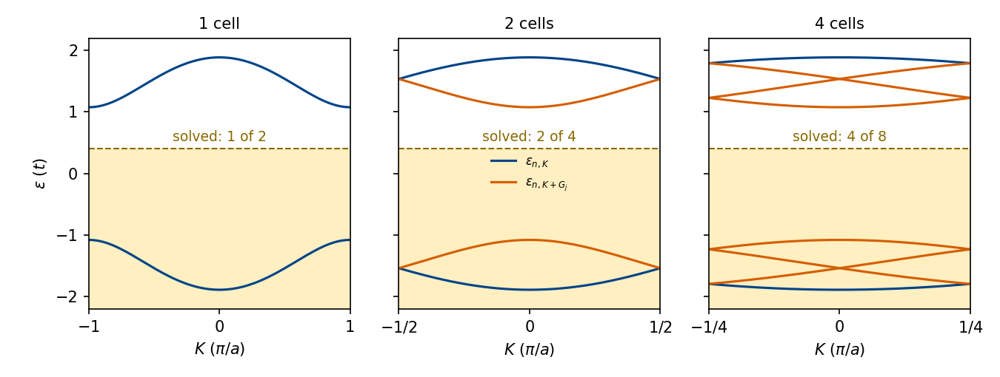

# Large cells: truncated hoppings, doubled cells and partial spectra

This page explains the physics of the route PAOFLOW takes for cells with thousands of orbitals: the truncation of the real-space Hamiltonian $H_{\alpha\beta}(\mathbf{R})$ to a list of hoppings, the doubling of a cell into a supercell of the same crystal, and the solution of only the part of the spectrum that a property needs. The dense pipeline of [The PAO Hamiltonian](pao-hamiltonian.md) keeps $\tilde H(\mathbf{k})$, its gradient and its eigenvectors on the whole k-mesh, $N_\mathrm{mesh}\,n_\mathrm{awf}^2$ complex numbers each, which a large cell cannot afford. The sparse backend, selected with `sparse=True` in the {py:class}`~PAOFLOW.PAOFLOW.PAOFLOW` constructor and set up with the options of {py:class}`~PAOFLOW.sparse.config.SparseConfig`, truncates $H_{\alpha\beta}(\mathbf{R})$ in {py:meth}`~PAOFLOW.PAOFLOW.PAOFLOW.pao_hamiltonian`, doubles the cell with {py:meth}`~PAOFLOW.PAOFLOW.PAOFLOW.doubling_Hamiltonian`, and solves one k-point at a time. How one k-point is solved is described in [The eigensolver of the sparse backend](../../internals/sparse-eigensolver.md).

## The Hamiltonian as a list of hoppings

The sparse backend stores $H_{\alpha\beta}(\mathbf{R})$, the hopping from orbital $\beta$ in the cell at $\mathbf{R}$ to orbital $\alpha$ in the home cell ([The real-space Hamiltonian](pao-hamiltonian.md#the-real-space-hamiltonian)), as a list of its elements. At each k-point it evaluates the Fourier sum over the kept elements $\mathcal{K}$,

$$
\tilde H^{c}_{\alpha\beta}(\mathbf{k}) = \sum_{\mathbf{R}\,:\,(\alpha,\beta,\mathbf{R})\in\mathcal{K}} e^{i\mathbf{k}\cdot\mathbf{R}}\, H_{\alpha\beta}(\mathbf{R}) ,
$$

which is the [Fourier interpolation](pao-hamiltonian.md#fourier-interpolation) of the truncated Hamiltonian at any $\mathbf{k}$, on a path and on a mesh alike. A coefficient on a face of the box of lattice vectors is split equally between its two images, as {py:meth}`~PAOFLOW.PAOFLOW.PAOFLOW.interpolated_hamiltonian` does ([Paths and meshes](pao-hamiltonian.md#paths-and-meshes)), so band paths on the sparse backend follow the mesh form and differ from the dense band path between grid points by the size of the face hoppings.

The list pays off through locality. A dense $H(\mathbf{R})$ holds $n_\mathrm{awf}^2$ elements on each of the $N_k$ lattice vectors of the box. A list truncated at a bond length $r_c$ holds, for each orbital, only the orbitals within $r_c$ of it, a number that does not depend on the size of the cell. The list therefore grows linearly with the number of atoms, while the dense array grows quadratically.

## Truncating the hoppings

The truncation removes a set of elements $\Delta H_{\alpha\beta}(\mathbf{R})$ once, from $H(\mathbf{R})$ of the DFT cell, and every later step works with $H - \Delta H$. Each element is dropped together with its Hermitian partner, $\Delta H(-\mathbf{R}) = \Delta H(\mathbf{R})^\dagger$, so $\tilde H^c(\mathbf{k})$ stays Hermitian. Three keys of `sparse_config` choose the elements, in two different ways.

### Cutoff by bond length

`rcut` and `bond_order` keep an element if the bond it connects is at most $r_c$ long:

$$
d_{\alpha\beta}(\mathbf{R}) = |\mathbf{R} + \boldsymbol{\tau}_\beta - \boldsymbol{\tau}_\alpha| \le r_c ,
$$

where $\boldsymbol{\tau}_\alpha$ is the position of the atom that carries orbital $\alpha$. For two partners on a face of the box, stored at lattice vectors of different length, the shorter length counts. The bonds of one length form a neighbour shell. `bond_order` $= n$ places $r_c$ just above the $n$-th distinct interatomic distance (distances within $10^{-3}$ Bohr count as one), and an explicit `rcut`, in Bohr, is moved down into the gap above the outermost shell it reaches, so a cutoff keeps or drops whole shells. It also keeps or drops the whole block of an atom pair at once, since all orbitals of an atom share its bonds, and it never drops an on-site element.

### Threshold on the size of the hoppings

`hopping_threshold` $h$ keeps an element if $|H_{\alpha\beta}(\mathbf{R})| > h$, the largest magnitude over the spin channels. Without any of the three keys, $h = 10^{-3}$ eV. A threshold cannot be combined with a cutoff, for the reason given in [Truncation and crystal symmetry](#truncation-and-crystal-symmetry).

### Error of the eigenvalues

To first order in the dropped elements, the eigenvalue of the state $|n\mathbf{k}\rangle$, with components $U_{\alpha n}(\mathbf{k})$ in the PAO basis, moves by

$$
\delta\varepsilon_{n\mathbf{k}} = -\langle n\mathbf{k}|\Delta\tilde H(\mathbf{k})|n\mathbf{k}\rangle = -\sum_{\mathbf{R}} e^{i\mathbf{k}\cdot\mathbf{R}} \sum_{\alpha\beta} U^*_{\alpha n}(\mathbf{k})\, \Delta H_{\alpha\beta}(\mathbf{R})\, U_{\beta n}(\mathbf{k}) .
$$

The shift is linear in the dropped hoppings, weighted by the orbital character of the state and by the Bloch phases, so it differs between bands and k-points and takes both signs. Summed over all bands it is $-\mathrm{Tr}\,\Delta\tilde H(\mathbf{k})$, whose average over the Brillouin zone keeps only the on-site terms $\mathbf{R} = \mathbf{0}$, which a cutoff never drops. Integrated quantities such as the DOS therefore average shifts of opposite sign and hide much of the error of single bands: judge a truncation on the bands near the energies your property uses.

The size of the shifts is set by the decay of the hoppings ([Decay of the hoppings](pao-hamiltonian.md#decay-of-the-hoppings)). With an exponential decay the error falls exponentially with $r_c$. With a power-law tail, $|H(\mathbf{R})| \sim |\mathbf{R}|^{-m}$, the number of bonds in a shell at distance $d$ grows as $d^2$, so the summed magnitude of the dropped hoppings falls only as $r_c^{3-m}$. Each shell enters $\delta\varepsilon_{n\mathbf{k}}$ with its own phases and signs, so the error need not fall steadily as shells are added, and a larger cutoff can move a band further than a smaller one; compare several cutoffs before accepting one.

### A bound on the eigenvalue shift

A bound that holds at every $\mathbf{k}$ and for every band follows in two steps. For an eigenvector $x$ of the Hermitian matrix $\Delta\tilde H(\mathbf{k})$ with eigenvalue $\lambda$, take the component $x_\alpha$ of largest magnitude: $|\lambda|\,|x_\alpha| = |\sum_\beta \Delta\tilde H_{\alpha\beta} x_\beta| \le |x_\alpha| \sum_\beta |\Delta\tilde H_{\alpha\beta}(\mathbf{k})|$, the argument of the Gershgorin circle theorem. With $|\Delta\tilde H_{\alpha\beta}(\mathbf{k})| \le \sum_\mathbf{R} |\Delta H_{\alpha\beta}(\mathbf{R})|$, every eigenvalue of $\Delta\tilde H(\mathbf{k})$ is bounded by

$$
B = \max_\alpha \sum_{\beta,\mathbf{R}} |\Delta H_{\alpha\beta}(\mathbf{R})| .
$$

By the min–max characterisation of the eigenvalues of a Hermitian matrix, adding a Hermitian matrix of norm at most $B$ moves the $n$-th eigenvalue by at most $B$ (Weyl's inequality), so $|\varepsilon^c_{n\mathbf{k}} - \varepsilon_{n\mathbf{k}}| \le B$ for every $n$ and $\mathbf{k}$. `sparse.log` prints $B$, taking the larger spin channel in each term, as the largest eigenvalue shift from the truncation. The bound adds magnitudes whose phases partly cancel in $\delta\varepsilon_{n\mathbf{k}}$, so it is rigorous but loose: a small $B$ guarantees a small error, while a large $B$ means that the error has to be measured on the bands.

### The range limit of the DFT grid

A cutoff has meaning only where the box of lattice vectors represents each bond by one element. $H(\mathbf{R})$ on the box sums the true hoppings over all images of the Born–von Kármán supercell ([Aliasing](pao-hamiltonian.md#aliasing)), so a bond longer than the inradius of that supercell, half its smallest interplanar spacing, shares its element with a shorter image and has no length of its own. Within $|\boldsymbol{\tau}_\alpha - \boldsymbol{\tau}_\beta|$ below that radius, a bond can also be stored at an image that is not its shortest, so members of one shell sit at lattice vectors of different length. A cutoff that reaches either kind of bond stops the run with an error that gives the largest allowed value; a denser DFT k-grid enlarges the supercell and the range.

### Truncation and crystal symmetry

A symmetry operation $\mathcal{S}$ of the crystal maps a bond onto a bond of the same length and rotates the orbitals at its two ends. The block of $H(\mathbf{R})$ of an atom pair transforms as

$$
H_{\mathcal{S}a,\,\mathcal{S}b}(\mathbf{R}') = D_a(\mathcal{S})\, H_{ab}(\mathbf{R})\, D_b^\dagger(\mathcal{S}) ,
$$

where $\mathcal{S}a$ is the image of atom $a$, $\mathbf{R}'$ the lattice vector of the image bond, and $D_a(\mathcal{S})$ the rotation matrix of the orbitals of atom $a$. A cutoff keeps or drops whole blocks by length, so it keeps or drops a bond and all its images together, and $\Delta\tilde H(\mathbf{k})$ has the symmetry of the crystal. At a k-point where the symmetry makes a level $g$-fold degenerate, degenerate perturbation theory shifts it by the eigenvalues of $-P\,\Delta\tilde H\,P$, with $P$ the projector on the degenerate states; for a symmetric $\Delta\tilde H$ and states of one irreducible representation this matrix is a multiple of the identity, by Schur's lemma, and the level moves without splitting.

A threshold, in contrast, acts on single elements. The rotation $D_a\,H_{ab}\,D_b^\dagger$ mixes the elements of a block, so the same coupling has elements of different size on two equivalent bonds: a $p_x$–$p_x$ element is a $\sigma$-type hopping on a bond along $x$ and a $\pi$-type one on a bond along $y$. The threshold keeps a different set of elements on each, $\Delta\tilde H(\mathbf{k})$ breaks the symmetry, and degenerate levels split by amounts of the order of the dropped elements. Band crossings, symmetry-protected degeneracies and tensor components that vanish by symmetry are affected, so a threshold suits quick tests and is not combined with a cutoff.

A cutoff keeps the symmetry that the elements of $H(\mathbf{R})$ carry and adds no breaking of its own. The full $H(\mathbf{R})$ also holds the elements near the edge of the box, where equivalent bonds can sit at lattice vectors of different length, so its bands can break the symmetry slightly off the DFT grid; a cutoff below the range limit removes these elements. The degeneracies at a high-symmetry point of the truncated bands remain the test.

## Cell doubling

{py:meth}`~PAOFLOW.PAOFLOW.PAOFLOW.doubling_Hamiltonian` builds the Hamiltonian of a supercell from the truncated list of the DFT cell, without a new DFT calculation. `doubling_Hamiltonian(nx, ny, nz)` doubles the cell $n_x$, $n_y$ and $n_z$ times along the three lattice vectors, so the supercell holds $N = 2^{n_x+n_y+n_z}$ cells of the crystal and $N n_\mathrm{awf}$ orbitals.

### The doubled Hamiltonian

Doubling along $\mathbf{a}_1$ gives the lattice vectors $\mathbf{A}_1 = 2\mathbf{a}_1$, $\mathbf{A}_2 = \mathbf{a}_2$, $\mathbf{A}_3 = \mathbf{a}_3$, and two copies of every orbital, $(\alpha, s)$ with $s = 0, 1$, centred at $\boldsymbol{\tau}_\alpha + s\,\mathbf{a}_1$. The hopping from $(\beta, s')$ in the supercell at $\mathbf{M} = M_1\mathbf{A}_1 + M_2\mathbf{A}_2 + M_3\mathbf{A}_3$ to $(\alpha, s)$ in the home supercell is a hopping of the crystal, between cells $(2M_1 + s' - s)\,\mathbf{a}_1 + M_2\mathbf{a}_2 + M_3\mathbf{a}_3$ apart:

$$
H^{(2)}_{(\alpha s),(\beta s')}(\mathbf{M}) = H_{\alpha\beta}(2M_1 + s' - s,\, M_2,\, M_3) ,
\qquad
H^{(2)}(\mathbf{M}) = \begin{pmatrix} H(2\mathbf{M}) & H(2\mathbf{M} + \mathbf{a}_1) \\ H(2\mathbf{M} - \mathbf{a}_1) & H(2\mathbf{M}) \end{pmatrix} ,
$$

where $2\mathbf{M}$ stands for the lattice vector $(2M_1, M_2, M_3)$ of the crystal. Every element of the doubled list is an element of the original one, placed twice, once for each copy, so the doubled Hamiltonian describes the same crystal exactly. Each bond keeps its length, so the doubled cell carries the same truncation and the same bound $B$. The face coefficients of [The Hamiltonian as a list of hoppings](#the-hamiltonian-as-a-list-of-hoppings) are split before the doubling, while the plane is still a face of the box, so that the bands of the doubled Hamiltonian fold exactly onto the original ones. Repeating the step gives the larger supercells.

### Band folding

The supercell has the reciprocal lattice vectors $\mathbf{B}_1 = \mathbf{b}_1/2$, $\mathbf{B}_2 = \mathbf{b}_2$, $\mathbf{B}_3 = \mathbf{b}_3$, and a Brillouin zone half as large. A Bloch state of the crystal at $\mathbf{k}$ is also a Bloch state of the supercell, at the wavevector $\mathbf{K}$ of the smaller zone with $\mathbf{k} = \mathbf{K} + \mathbf{G}_j$, where $\mathbf{G}_j$ is $\mathbf{0}$ or $\mathbf{B}_1$: since $e^{i\mathbf{G}_j\cdot\mathbf{M}} = 1$ on the supercell lattice, splitting the Bloch sum over $\mathbf{R} = \mathbf{M} + s\,\mathbf{a}_1$ gives the eigenvector of the supercell with components

$$
c_{(\alpha s)}(\mathbf{K}) = \frac{1}{\sqrt{2}}\, e^{i\mathbf{k}\cdot s\mathbf{a}_1}\, U_{\alpha n}(\mathbf{k}) .
$$

For $N$ cells the same argument with the $N$ vectors $\mathbf{G}_j$ of the supercell reciprocal lattice inside the original zone gives

$$
\bigl\{\varepsilon^{(N)}_{m\mathbf{K}}\bigr\}_{m=1}^{N n_\mathrm{awf}} = \bigcup_{j=1}^{N} \bigl\{\varepsilon_{n,\mathbf{K}+\mathbf{G}_j}\bigr\}_{n=1}^{n_\mathrm{awf}} :
$$

the bands of the supercell are those of the original cell folded into the smaller zone.

The figure shows the folding for a chain with two orbitals per cell and an energy gap. The supercell zone shrinks by $N$, and at each $\mathbf{K}$ the $N$ branches $\varepsilon_{n,\mathbf{K}+\mathbf{G}_j}$ stack up; the deep-blue branch is the original band at $\mathbf{K}$, the vermillion ones are folded in from $\mathbf{K} + \mathbf{G}_j$. Energies are in units of the hopping $t$ between the two orbitals of a cell. The shaded region is discussed in [Growth with the cell size](#growth-with-the-cell-size).

### What doubling changes

A mesh of $M_i/2$ points along a doubled axis, folded back with the $\mathbf{G}_j$, is exactly the mesh of $M_i$ points of the original cell, for even $M_i$. Brillouin-zone sums on the two meshes contain the same states: the DOS of the supercell is $N$ times the DOS per original cell, and the transport tensors, per unit volume, are unchanged. So are the adaptive widths, because the mesh spacing $\delta k = [8\pi^3/(\Omega N_\mathrm{mesh})]^{1/3}$ depends only on $\Omega N_\mathrm{mesh}$ ([Width from the band velocity](density-of-states.md#width-from-the-band-velocity)).

The band velocities carry over when the velocity matrix uses the orbital centres of the supercell, $\boldsymbol{\tau}_\alpha + s\,\mathbf{a}_1$ for the copy $s$ ([The gradient of the Hamiltonian](density-of-states.md#the-gradient-of-the-hamiltonian)): the term with the centres is then the commutator $i[\tilde H, \boldsymbol{\tau}]$, whose diagonal in the eigenstates vanishes, and the band velocity of a folded state is that of the state it comes from. The sparse backend uses these centres.

Three things change. The supercell has $N$ times as many bands at each $\mathbf{K}$, so solving one k-point costs more, while the number of k-points falls by $N$. A supercell band index does not label a band of the crystal, because the folded branches interleave, and a band path shows $N$ times as many bands; unfolding assigns each supercell state its weight at a crystal momentum $\mathbf{k}$ [1]. Finally, wavevectors $\mathbf{K} + \mathbf{G}_j$ related by a symmetry fold onto the same $\mathbf{K}$ with equal energies, so the folded bands contain exact multiplets that the original cell does not have; quantities of single states in such a multiplet depend on the basis chosen inside it, sums over the multiplet do not.

Doubling adds no physics, so the supercell is a cell of known answer on which the large-cell route can be checked against the original cell, as in the [large-cell tutorial](../tutorials/tutorial04.ipynb). A cell that breaks the periodicity, such as a defect supercell or a slab, needs its own DFT calculation, whose $H(\mathbf{R})$ is truncated in the same way.

## Solving part of the spectrum

Most properties weight each state with a function of its energy that vanishes away from an energy range, so the states beyond the reach of that function do not contribute. The sparse backend therefore solves, in each pass (one loop over all k-points of the mesh), only the states its properties need: each property has an energy range, set by its arguments, and a margin, the reach of its weight beyond the range.

### The Fermi window

Transport coefficients and carrier densities weight each state with the Fermi window $-\partial f^0/\partial\varepsilon = [4k_BT\cosh^2((\varepsilon - \mu)/2k_BT)]^{-1}$ ([Transport distribution and smearing](boltzmann-transport.md#transport-distribution-and-smearing)), or with the occupation $f^0$ itself. Far from $\mu$ the window falls as $e^{-|\varepsilon - \mu|/k_BT}$ and is $1.8\times10^{-4}$ of its peak at $|\varepsilon - \mu| = 10\,k_BT$, so {py:meth}`~PAOFLOW.PAOFLOW.PAOFLOW.transport` and {py:meth}`~PAOFLOW.PAOFLOW.PAOFLOW.doping` need the states up to $10\,k_BT$ above the highest chemical potential of their range, at the highest temperature `tmax`. With adaptive smearing, transport also broadens each state by its width $\sigma_{n\mathbf{k}}$, whose tails can reach further. The margin of transport is the thermal one only, so these tails are covered when a property with the smearing margin below, such as the DOS over the same range, shares the pass.

### Smearing tails

The DOS, the projected DOS and the conductivity of {py:meth}`~PAOFLOW.PAOFLOW.PAOFLOW.conductivity` broaden each state with the Gaussian $\pi^{-1/2}\sigma^{-1} e^{-x^2/\sigma^2}$ of its adaptive width ([Fixed-width smearing](density-of-states.md#fixed-width-smearing)). At $x = 4\sigma$ the Gaussian is $e^{-16} \approx 10^{-7}$ of its peak, so a state contributes to the range $[e_\mathrm{min}, e_\mathrm{max}]$ only within four widths of it. The widths $\sigma_{n\mathbf{k}} = a\,|\nabla_\mathbf{k}\varepsilon_{n\mathbf{k}}|\,\delta k$ differ between states, and the margin uses the largest, $4\sigma_\mathrm{max}$, set by the steepest band, which the backend estimates at a few sample k-points before the pass and checks on the whole mesh after it ([How to choose which states the sparse backend solves](../howtos/sparse-states.md)). Since $\delta k \propto N_\mathrm{mesh}^{-1/3}$, the margin shrinks as the mesh is refined.

### The states of a pass

A pass solves, at every k-point, the states from the bottom of the spectrum up to

$$
\varepsilon_\mathrm{top} = \min\Bigl(\eta - \Delta_\eta,\; \max_{p}\,\bigl(e^{(p)}_\mathrm{max} + m^{(p)}\bigr)\Bigr) ,
$$

the highest range $e^{(p)}_\mathrm{max}$ among the properties $p$ of the pass plus its margin $m^{(p)}$, which is $10\,k_BT_\mathrm{max}$, $4\sigma_\mathrm{max}$, or zero for a property without a weight that reaches past its range. The cap $\eta - \Delta_\eta$ lies `shift_margin` $= \Delta_\eta$ (default 0.2 eV) below the PAO shift $\eta$ ([The PAO shift](pao-hamiltonian.md#the-pao-shift)). The levels at $\eta$ represent no DFT state; they sit exactly at $\eta$ on the DFT grid but spread around it between the grid points, so every state above the cap is dropped at every k-point and a range that reaches above it is lowered below it.

The number of states below $\varepsilon_\mathrm{top}$ varies with $\mathbf{k}$, and the backend solves the same number at every k-point, the largest over the zone. Solving from the bottom keeps every lower state, so electron counts are complete. A window that also excludes the lowest states, `interior_window`, solves fewer states but loses the electron count ([How to choose which states the sparse backend solves](../howtos/sparse-states.md)).

### Growth with the cell size

Solving from the bottom saves a fixed fraction of the work, not a power of the cell size. By [Band folding](#band-folding), the number of supercell states below an energy at $\mathbf{K}$ is the sum of the counts of the original cell at the $N$ wavevectors $\mathbf{K} + \mathbf{G}_j$, so on average over the zone it is $N$ times the count of the original cell, and the number of orbitals is $N$ times larger as well. The fraction of the spectrum below $\varepsilon_\mathrm{top}$ is therefore the same for every cell size, as the shaded states of the figure show: 1 of 2, 2 of 4 and 4 of 8 for a window that ends in the gap. A window from the bottom reaches at least the Fermi level, so it holds a sizeable fraction of the spectrum, and each k-point costs about as much as a full diagonalisation ([The eigensolver of the sparse backend](../../internals/sparse-eigensolver.md)). Only a window that excludes the lowest states holds a fraction that shrinks as the cell grows.

### Properties that need every state

Properties that involve derivatives of the eigenstates need every state of the model at every k-point, whatever their energy range. Differentiating $\tilde H|u_n\rangle = \varepsilon_n|u_n\rangle$ and expanding the derivative of the state in the eigenstates, $\sum_m |u_m\rangle\langle u_m| = \mathbb{1}$ over all $n_\mathrm{awf}$ of them, turns these derivatives into interband sums. The band curvature, which {py:meth}`~PAOFLOW.PAOFLOW.PAOFLOW.transport` needs for the Hall and Nernst tensors with `do_hall=True` ([Hall coefficient](boltzmann-transport.md#hall-coefficient)) and {py:meth}`~PAOFLOW.PAOFLOW.PAOFLOW.effective_mass` for the effective masses, is evaluated as

$$
\frac{\partial^2\varepsilon_{n\mathbf{k}}}{\partial k_i\,\partial k_j} = \langle u_n|\partial_i\partial_j\tilde H|u_n\rangle + \sum_{m\neq n} \frac{2\,\mathrm{Re}\bigl[(\partial_i\tilde H)_{nm}\,(\partial_j\tilde H)_{mn}\bigr]}{\varepsilon_{n\mathbf{k}} - \varepsilon_{m\mathbf{k}}} ,
$$

with the pairs closer than $10^{-3}$ eV left out of the sum and each degenerate group diagonalised first, as in [Velocities at degenerate bands](density-of-states.md#velocities-at-degenerate-bands). The Berry curvature of the anomalous, spin and orbital Hall conductivities is the interband sum of [Berry curvature from the Kubo formula](berry-topology.md#berry-curvature-from-the-kubo-formula), and the Kubo responses of {py:meth}`~PAOFLOW.PAOFLOW.PAOFLOW.linear_response` are sums over pairs of states as well ([The Kubo formula for a static electric field](linear-response.md#the-kubo-formula-for-a-static-electric-field)).

A state far away in energy still contributes to these sums: its term falls as $|(\partial\tilde H)_{nm}|^2/|\varepsilon_n - \varepsilon_m|$ in the curvature and as $|\varepsilon_n - \varepsilon_m|^{-2}$ in the Berry curvature, a power and not an exponential, so no margin makes it negligible. The sums also obey rules that hold only for the complete set: the Berry curvature summed over all bands vanishes at every $\mathbf{k}$, and a pair $(n, m)$ enters the curvatures of $n$ and $m$ with opposite signs. The levels at the PAO shift belong to the complete set and enter as intermediate states, as on the dense pipeline. A pass that contains one of these properties therefore solves the full spectrum, a full diagonalisation of the $n_\mathrm{awf} \times n_\mathrm{awf}$ matrix at every k-point, which limits the cells on which they can be computed ([The eigensolver of the sparse backend](../../internals/sparse-eigensolver.md)).

## Used in

- [Large cells on the sparse backend](../tutorials/tutorial04.ipynb): the truncated list of hoppings of Si at a neighbour shell and its eigenvalue bound, a $2\times2\times2$ supercell built by doubling and its folded bands, and the DOS and transport tensors of the supercell from a pass that solves part of the spectrum, compared with the original cell.
- [How to choose the truncation of the sparse Hamiltonian](../howtos/sparse-truncation.md): `bond_order`, `rcut` and `hopping_threshold` on Si, the decay of its hoppings with bond length, the degeneracy split by a threshold and the convergence of the band shifts with the cutoff.
- [How to choose which states the sparse backend solves](../howtos/sparse-states.md): the margins of each property, the properties that need every state, the cap below the PAO shift, and the options `nev` and `interior_window`.

## References

1. V. Popescu and A. Zunger, Extracting E versus k effective band structure from supercell calculations on alloys and impurities, Phys. Rev. B 85, 085201 (2012).
