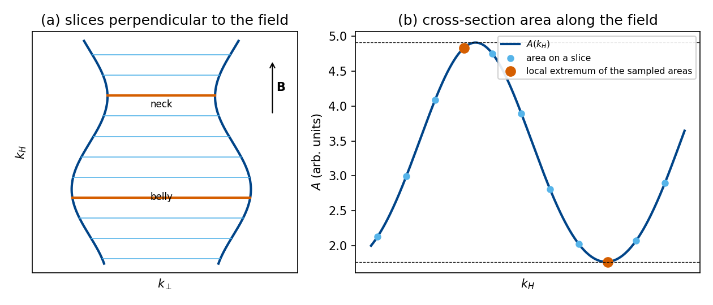

# Quantum oscillations and extremal Fermi-surface orbits

This page explains how the frequencies and cyclotron masses of de Haas–van Alphen (dHvA), Shubnikov–de Haas and torque measurements follow from the Fermi surface, how PAOFLOW finds them on the interpolated bands, and what a comparison between the calculated and the measured values can establish. {py:meth}`~PAOFLOW.PAOFLOW.PAOFLOW.fermi_surface` writes the bands that cross the Fermi level on the interpolated k-mesh, {py:meth}`~PAOFLOW.PAOFLOW.PAOFLOW.pyskeaf` finds the extremal orbits of each band for a set of field directions, and {py:class}`~PAOFLOW.agentic.qo_analysis.analysis_driver.QuantumOscillationAnalysis` compares them with measured frequencies and masses. The page builds on [The PAO Hamiltonian](pao-hamiltonian.md), which derives the interpolated bands $\varepsilon_{n\mathbf{k}}$, and on [Band velocities, density of states and adaptive smearing](density-of-states.md), which defines the band velocity $\mathbf{v}_{n\mathbf{k}}$ and the Fermi energy $E_F$.

## Semiclassical orbits in a magnetic field

In a magnetic field $\mathbf{B}$ an electron at the Fermi level obeys $\hbar\,d\mathbf{k}/dt = -e\,\mathbf{v}_{n\mathbf{k}}\times\mathbf{B}$. The force is perpendicular to both $\mathbf{B}$ and $\mathbf{v}_{n\mathbf{k}} = \hbar^{-1}\nabla_\mathbf{k}\varepsilon_{n\mathbf{k}}$, so the electron keeps its energy and its wave-vector component $k_H$ along the field: it moves on the intersection of the Fermi surface with a plane perpendicular to $\mathbf{B}$. Where that intersection is a closed curve, the motion in k-space is periodic, a cyclotron orbit. Its real-space projection perpendicular to $\mathbf{B}$ is the same curve rotated by $90^\circ$ and scaled by $\hbar/(eB)$.

### The Onsager relation

Quantising the periodic motion with the Bohr–Sommerfeld rule gives the allowed orbits: the area $A$ that an orbit encloses in k-space can only take the values

$$
A_\nu(\varepsilon, k_H) = \frac{2\pi e B}{\hbar}\,(\nu + \gamma), \qquad \nu = 0, 1, 2, \dots
$$

with a phase $\gamma$, equal to $1/2$ for a free electron [1, 3]. As $B$ increases, these Landau tubes expand and leave the Fermi surface one after another. Each exit changes the free energy, so every equilibrium property of the metal oscillates, periodic in $1/B$, with the frequency

$$
F = \frac{\hbar}{2\pi e}\, A_\mathrm{ext} ,
$$

the Onsager relation [1]. In tesla, with $A_\mathrm{ext}$ in $\text{Å}^{-2}$, $F = 1.0476\times10^{4}\,A_\mathrm{ext}$, the factor that pyskeaf applies to every orbit area before writing it in kT. A frequency of $1$ kT therefore corresponds to an orbit area of about $0.1\ \text{Å}^{-2}$, a few per cent of a typical Brillouin-zone cross-section.

### Extremal orbits

The area $A$ in the Onsager relation is not that of any cross-section. The cross-sections at different $k_H$ have different areas $A(k_H)$, and their contributions to the magnetisation have phases $2\pi F(k_H)/B$ that vary with $k_H$, so they cancel on integration over $k_H$ except near the values where $A(k_H)$ is stationary, $\partial A/\partial k_H = 0$ [2, 3]. Only these extremal cross-sections, a maximum (belly) or a minimum (neck) of the area along the field, give oscillations, with the frequency of the extremal area $A_\mathrm{ext}$. A sheet can have several extremal orbits for one field direction, and every sheet that crosses the plane contributes its own: the measured spectrum is the set of extremal areas of the whole Fermi surface, one frequency per orbit.

The figure shows a warped cylinder, such as the sheet of a layered metal with the field along the layer normal. Its cross-section area varies with $k_H$ between the belly and the neck (the dashed lines in panel b), and the two extrema give two frequencies. Rotating the field away from the cylinder axis changes both areas; for a cylinder without warping $F$ grows as $1/\cos\theta$ with the angle $\theta$ from the axis, and a spherical sheet gives the same $F$ in every direction. The dependence $F(\theta)$ over a rotation therefore maps the shape of each sheet, which is why calculated and measured frequencies are compared over an angle sweep rather than at one direction.

## Cyclotron effective mass

The period of a cyclotron orbit defines the cyclotron mass $m^*$ through $\omega_c = eB/m^*$. Integrating $dt = \hbar\,dk/(e B |\mathbf{v}_\perp|)$ around the orbit, with $\mathbf{v}_\perp$ the velocity component in the plane of the orbit, gives the period, and therefore

$$
m^* = \frac{\hbar^2}{2\pi} \oint \frac{dk}{|\nabla_{\perp}\varepsilon_{n\mathbf{k}}|} = \frac{\hbar^2}{2\pi}\,\frac{\partial A}{\partial \varepsilon} ,
$$

where the second form follows because a change $d\varepsilon$ of the energy moves each point of the orbit outwards by $d\varepsilon/|\nabla_\perp\varepsilon|$ [3]. pyskeaf evaluates the line integral on each extremal orbit, with the in-plane gradient of the interpolated energies on the slice and the arclength of the contour, and reports $m^*/m_e$ through the factor $\hbar^2/(2\pi m_e) = 0.08914\ \mathrm{Ry}\,\text{Å}^2$. The mass is large where the band is flat near the Fermi level: an orbit that passes close to a saddle point or a flat $d$ band is heavy, an orbit on a steep $sp$ band light.

### Electron and hole orbits

An orbit that encloses occupied states is an electron orbit, its area grows with energy and $\partial A/\partial\varepsilon > 0$; an orbit that encloses empty states is a hole orbit, with $\partial A/\partial\varepsilon < 0$. pyskeaf reports $|m^*|$ and carries the sign separately, as the carrier type: it samples the interpolated energy at the centroid of the contour and labels the orbit an electron orbit when that energy lies below the Fermi level. For a strongly non-convex orbit, whose centroid can lie outside the enclosed region, this test can give the wrong label.

### Rigid shift of the Fermi level

The same derivative tells how an orbit responds to a shift $\Delta E$ of the Fermi level with the bands held fixed. From the Onsager relation and the cyclotron mass,

$$
\frac{dF}{dE} = \pm\frac{\hbar}{2\pi e}\,\frac{2\pi |m^*|}{\hbar^2} = \pm\frac{|m^*|}{e\hbar} = \pm\, 8.637\,\frac{|m^*|}{m_e}\ \mathrm{T\,meV^{-1}} ,
$$

positive for electron and negative for hole orbits. {py:meth}`~PAOFLOW.agentic.qo_analysis.analysis_driver.QuantumOscillationAnalysis.fermi_level_scan` compares the shift of each orbit between pyskeaf runs at $E_F - \Delta E$, $E_F$ and $E_F + \Delta E$ (the `fermi_energy` argument of `pyskeaf()`) with this slope. A ratio near 1 confirms that the energy units are consistent and that the orbit responds as a rigid band; it also gives the size of the frequency error that a given error of $E_F$ produces. The shift is absolute, so a small pocket is the most sensitive in relative terms: for $|m^*| = 0.3\,m_e$ a shift of 10 meV moves $F$ by 26 T, a quarter of a 100 T frequency.

## Temperature damping and the measured mass

The measured cyclotron mass comes from the temperature dependence of the oscillation amplitude, described by the Lifshitz–Kosevich (LK) formula [2, 3]. For each extremal orbit and harmonic $p$, the oscillatory magnetisation is

$$
\tilde M \propto B^{1/2} \left|\frac{\partial^2 A}{\partial k_H^2}\right|^{-1/2} \sum_{p=1}^{\infty} p^{-3/2}\, R_T\, R_D\, R_S\, \sin\!\left[2\pi p\left(\frac{F}{B} - \gamma\right) \pm \frac{\pi}{4}\right] ,
$$

with the sign $-$ for a maximum and $+$ for a minimum of the area, and the reduction factors

$$
R_T = \frac{X}{\sinh X}, \quad X = \frac{2\pi^2 p\, k_B T\, m^*}{e\hbar B} = 14.69\, p\, \frac{m^*}{m_e}\,\frac{T}{B}\ \mathrm{T\,K^{-1}}, \qquad
R_D = e^{-2\pi^2 p\, k_B T_D m^*/(e\hbar B)}, \qquad
R_S = \cos\!\left(\frac{p\pi g m^*}{2 m_e}\right) ,
$$

for the thermal smearing of the Fermi level, the scattering (through the Dingle temperature $T_D = \hbar/(2\pi k_B\tau)$) and the Zeeman splitting with the $g$ factor. A fit of the amplitude against $T$ at fixed $B$ to $R_T$ gives $m^*_\mathrm{LK}$, the mass of the LK table that PAOFLOW reads; PAOFLOW itself does not evaluate this formula.

Three features of the formula matter for the comparison. The curvature factor $|\partial^2 A/\partial k_H^2|^{-1/2}$ makes a flat extremum, such as the belly of a nearly cylindrical sheet, give a large amplitude, and a sharply curved one a weak signal; pyskeaf reports the curvature of every orbit, $\partial^2 F/\partial k_H^2$ in kT Å$^2$, from the areas on three neighbouring slices. The factors $R_T$ and $R_D$ fall exponentially with $m^*$, so heavy orbits can be absent from a measurement although the calculation finds them. The harmonics $pF$, and, when oscillations mix through the magnetisation or through magnetic breakdown, the combinations $F_i \pm F_j$, add peaks to the spectrum that belong to no extremal orbit. A torque measurement adds a fourth feature: it records the component of $\tilde M$ perpendicular to $\mathbf{B}$, proportional to $(1/F)\,\partial F/\partial\theta$, so an orbit whose frequency is stationary in the rotation angle gives no torque signal there [3].

## Mass enhancement

The measured mass is larger than the band mass because the quasiparticles near the Fermi level are dressed by phonons, and by spin and charge fluctuations that the DFT bands do not contain. The electron–phonon self-energy changes the Fermi surface only to order $\hbar\omega_D/E_F$, with $\omega_D$ the Debye frequency, so the frequencies are those of the bands, but within $\hbar\omega_D$ of the Fermi level it reduces the band velocity to $\mathbf{v}_{n\mathbf{k}}/(1 + \lambda_{n\mathbf{k}})$, with $\lambda_{n\mathbf{k}}$ the electron–phonon coupling of the state [4]. Inserting the reduced velocity into the cyclotron mass gives

$$
m^*_\mathrm{LK} = m^*_\mathrm{band}\,(1 + \lambda_\mathrm{orbit}), \qquad
\lambda_\mathrm{orbit} = \frac{\oint \lambda_{n\mathbf{k}}\; dk/|\mathbf{v}_\perp|}{\oint dk/|\mathbf{v}_\perp|} ,
$$

an average of the coupling along the orbit weighted by the time the electron spends on each segment.

{py:meth}`~PAOFLOW.agentic.qo_analysis.analysis_driver.QuantumOscillationAnalysis.direction_analysis` uses the left-hand equation in reverse and reports $1 + \lambda = m^*_\mathrm{LK}/m^*_\mathrm{band}$ for each assigned branch, with $m^*_\mathrm{band}$ the mass of the calculated orbit. This ratio contains every renormalisation that the DFT bands lack, and the error of the band mass, so it is an upper bound on the electron–phonon part rather than a measurement of it. It is a test of the assignment: a ratio below 1 means that the measured orbit is lighter than the calculated one, which no coupling produces, and branches of similar orbital character should give similar ratios. The function {py:func}`~PAOFLOW.agentic.qo_analysis.mass_enhancement.enhanced_masses` computes $\lambda_\mathrm{orbit}$ from the state-resolved coupling of an electron–phonon calculation instead. It weights the orbit by arclength, $dk$ in place of $dk/|\mathbf{v}_\perp|$, which is exact for an orbit of uniform speed and otherwise differs from the weighted average by the variation of $|\mathbf{v}_\perp|$ along the orbit; the spread of $\lambda_{n\mathbf{k}}$ on the orbit, which it also reports, bounds that difference.

## Finding extremal orbits on the interpolated Fermi surface

The orbits come from the Supercell K-space Extremal Area Finder (SKEAF) algorithm of Rourke and Julian [5], which `pyskeaf()` re-implements. Its input is one file per band with $\varepsilon_{n\mathbf{k}}$ on the interpolated k-mesh of {py:meth}`~PAOFLOW.PAOFLOW.PAOFLOW.interpolated_hamiltonian`, written by `fermi_surface()` for every band whose energy range overlaps the window `fermi_dw`, `fermi_up` around $E_F$.

### Slices of a supercell

A plane perpendicular to $\mathbf{B}$ crosses the reciprocal cell along a general direction, so an orbit can extend over several cells. The algorithm therefore samples a supercell, a cube in the frame of the field with side $4 b_\mathrm{max}$, where $b_\mathrm{max}$ is the length of the longest reciprocal-lattice vector. The cube is cut into planes perpendicular to $\mathbf{B}$ with the spacing

$$
\Delta k = \frac{b_\mathrm{max}}{N_\mathrm{int} - 1}
$$

within and between the planes, where $N_\mathrm{int}$ is the `num_interpolation` argument of `pyskeaf()`. The energies at these points come from a tricubic Lagrange interpolation of the band on the k-mesh, periodic across the cell. On each plane, the contours $\varepsilon = E_F$ are traced, and every closed contour that does not touch the edge of the plane is an orbit, with its area from the polygon of the contour. Contours with an area below $2\Delta k^2$ are dropped as unresolved.

### Extremum detection

The orbits on neighbouring planes are matched into chains, one chain per orbit followed along the field, by their position and overlap. An orbit inside a chain is extremal when its area is larger, or smaller, than the areas of its two neighbours in the chain. The curvature that enters the LK amplitude comes from the same three areas $A_-$, $A_0$, $A_+$ at spacings $h_-$, $h_+$:

$$
\frac{\partial^2 F}{\partial k_H^2} = \frac{\hbar}{2\pi e}\,\frac{2}{h_- + h_+}\left(\frac{A_+ - A_0}{h_+} - \frac{A_0 - A_-}{h_-}\right) .
$$

Because the extremum is located only to within half a spacing, the reported area differs from the true extremal area by at most $|\partial^2 A/\partial k_H^2|\,\Delta k^2/8$, the error visible in panel (b) of the figure above. It is always on the inner side: below a maximum and above a minimum.

### Supercell copies

The supercell holds several copies of the reciprocal cell, so each physical extremal orbit is found several times, once in each copy that contains it whole. pyskeaf merges orbits whose centres, reduced to the reciprocal cell, lie within the `orbit_tolerance` fraction of the cell and whose frequencies agree within `frequency_tolerance`, and reports the mean frequency and mass, their spread, and the number of copies merged. A genuine orbit on a smooth sheet is found in many copies and planes. An orbit that exists only where a plane cuts a sheet near the edge of the supercell, or a numerical extremum from a small kink in the interpolated band, is found in a few. The number of copies is therefore a measure of reliability, and the `min_copies` cut of the analysis keeps orbits above it. With `allow_wall_orbits=True`, the default of `pyskeaf()`, orbits close to the supercell walls are kept, so the cut is the only filter of these artefacts.

## Field direction and crystal indices

pyskeaf specifies the field by a polar angle $\theta$ from $+z$ and an azimuthal angle $\phi$ from $+x$ in the Cartesian frame of the band files, $\hat{\mathbf{B}} = (\cos\phi\sin\theta,\ \sin\phi\sin\theta,\ \cos\theta)$. A measured direction is given by indices $[hkl]$ of the conventional cell, and turning them into angles needs a convention:

$$
\mathbf{B} \parallel h\mathbf{a}^* + k\mathbf{b}^* + l\mathbf{c}^* \quad (\text{reciprocal}), \qquad
\mathbf{B} \parallel h\mathbf{a} + k\mathbf{b} + l\mathbf{c} \quad (\text{real}),
$$

with $\mathbf{a}^*, \mathbf{b}^*, \mathbf{c}^*$ the reciprocal vectors of the conventional cell. The reciprocal convention puts the field normal to the $(hkl)$ planes, the usual meaning of the indices of a sample facet; the real convention puts it along the lattice row. The two agree only for directions with one non-zero index in a cell with orthogonal axes, so for a mixed direction in a non-cubic crystal the wrong convention compares the measurement with a rotation in a different plane.

## Comparing calculated and measured frequencies

A Fermi surface with several sheets has many extremal orbits at each direction, spread over decades in frequency, and a measured frequency often lies close to some calculated one by chance. The comparison in `QuantumOscillationAnalysis` therefore uses two tests with different power: a pointwise test over the rotation, judged against chance, and a test of the anisotropy of labelled branches.

### Pointwise matches and chance baselines

For each measured peak $(\theta_i, F_i)$ whose relative amplitude exceeds the `weak_threshold`, {py:meth}`~PAOFLOW.agentic.qo_analysis.analysis_driver.QuantumOscillationAnalysis.sweep_comparison` takes, among the calculated orbits $j$ within the angle window $\Delta\theta$ of $\theta_i$, the one nearest in $\ln F$, and counts the peak as matched when

$$
\frac{|F_{j^*} - F_i|}{F_i} \le t, \qquad j^* = \arg\min_{j:\,|\theta_j - \theta_i| \le \Delta\theta} |\ln F_j - \ln F_i| ,
$$

with $t$ the `tolerance` and $\Delta\theta$ the `angle_window`. The match rate is the fraction of matched peaks. It is compared with two baselines, each averaged over 200 random draws: the rate for frequencies drawn log-uniformly between 15 T and 8000 T at the measured angles, and the rate for the measured frequencies moved to randomly chosen measured angles. The first tests whether the calculation does better than any frequency would; the second keeps the distribution of the measured frequencies and tests only the agreement specific to each angle. A rate that does not exceed both baselines by several standard deviations carries no evidence, however high it is, because the density of calculated orbits alone sets the chance of a coincidence.

### Anisotropy ratios

A branch labelled in the measurement at two directions gives a sharper test. {py:meth}`~PAOFLOW.agentic.qo_analysis.analysis_driver.QuantumOscillationAnalysis.direction_analysis` tries every pair of orbits of one Fermi surface (one group of bands) within the `anisotropy_window` of the two measured frequencies, and ranks the pairs by

$$
s = \left|\frac{F_2^\mathrm{c}}{F_1^\mathrm{c}} - \frac{F_2^\mathrm{e}}{F_1^\mathrm{e}}\right| + \frac{1}{2}\sum_{i=1,2} \frac{|F_i^\mathrm{c} - F_i^\mathrm{e}|}{F_i^\mathrm{e}} + \frac{w}{2}\sum_{i=1,2}\left|\ln\frac{m_i^\mathrm{e}}{m_i^\mathrm{c}}\right| ,
$$

with c for calculated, e for measured, and $w$ the `mass_weight` (0.2 by default; the mass term is dropped when a mass is missing). The first term compares the anisotropy, the change of the extremal area between the two directions, which depends on the shape of the sheet; an error that scales the whole sheet, such as a small error of $E_F$ on a large sheet, cancels in the ratio. The second term keeps the absolute frequencies close, and the third the masses. The best pair is called reproduced when the two ratios differ by less than 0.03, right in sign but wrong in magnitude when both ratios lie on the same side of 1 (or the measured ratio is within 0.01 of 1), and likely coincidental otherwise. When the calculated frequencies deviate by more than 5 % at both directions and the two deviations differ by less than 3 percentage points, the pair is flagged as a uniform offset: the sheet has the right shape and the wrong size.

## Limits of the comparison

The calculated frequencies inherit the errors of the bands and add those of the orbit search. Each limit below decides whether a disagreement points to the physics or to the calculation.

### Position of the Fermi level

The Fermi level of the calculation is set by the electron count of the DFT run on the DFT bands (see [Fermi energy](density-of-states.md#fermi-energy)). An error of the exchange-correlation functional moves the sheets relative to each other, not rigidly, and a real sample has defects and a stoichiometry that change the electron count. A rigid shift with `fermi_energy` tests the sensitivity of each orbit, through the slope of [Rigid shift of the Fermi level](#rigid-shift-of-the-fermi-level), but it changes the electron count, so in a compensated metal it cannot represent a sample in which electron and hole sheets shift in opposite directions.

### Spin–orbit coupling and Kramers pairs

With spin–orbit coupling in a crystal with inversion symmetry and without magnetic order, every band is doubly degenerate at every $\mathbf{k}$ (a Kramers pair). The two band indices of a pair describe one Fermi surface, and their orbits count once; the small difference between their frequencies is the numerical error of the orbit search. Without inversion symmetry the pair splits into two sheets with distinct frequencies. A scalar-relativistic calculation has no such splitting, and also misses the gaps that spin–orbit coupling opens where bands cross, which change the topology of the sheets near the crossing.

### Magnetic breakdown

pyskeaf follows one band at a time, and the bands are ordered by energy at each $\mathbf{k}$. Where two sheets come close, separated by a gap $k_g$ in k-space, an electron in a field tunnels between them with the probability $P = e^{-B_0/B}$, and the orbits of the coupled network have the frequencies of sums and differences of the single-band areas [3, 6]. PAOFLOW estimates the breakdown field as

$$
B_0 = \frac{\pi}{2}\,\frac{\hbar}{e}\,k_g^2 ,
$$

which is Chambers' expression [6] with the geometric factor of the junction, set by the curvatures of the two trajectories, taken as one. With $k_g$ in $\text{Å}^{-1}$, $B_0 = 1.03\times10^{5}\,k_g^2$ T, so a gap of $0.02\ \text{Å}^{-1}$ breaks down at about 40 T and a gap of $0.01\ \text{Å}^{-1}$ at about 10 T, within the range of a laboratory magnet. {py:meth}`~PAOFLOW.agentic.qo_analysis.analysis_driver.QuantumOscillationAnalysis.breakdown_gaps` lists such near-contacts between sheets; a gap smaller than the spacing of the k-mesh is not resolved.

### Resolution of the k-mesh

The k-mesh of the band files, not $N_\mathrm{int}$, limits the accuracy of the areas. The Lagrange interpolation reproduces the bands between the mesh points only where they are smooth on the scale of the mesh spacing, so a pocket a few mesh spacings across, a neck, or a region near a band crossing is resolved only on a denser mesh from `interpolated_hamiltonian()`; the Fourier interpolation of the PAO Hamiltonian provides it at the cost of the diagonalisation (see [Fourier interpolation](pao-hamiltonian.md#fourier-interpolation)). $N_\mathrm{int}$ then sets the spacing $\Delta k$ of the slices: the smallest resolved orbit has the area $2\Delta k^2$, and the extremal area carries the error of [Extremum detection](#extremum-detection). A denser k-mesh or a larger $N_\mathrm{int}$ that changes a frequency by more than the spread of its copies shows that the orbit is not converged; {py:meth}`~PAOFLOW.agentic.qo_analysis.analysis_driver.QuantumOscillationAnalysis.compare_runs` makes that comparison orbit by orbit.

## Used in

- [How to compare pyskeaf orbits with measured quantum-oscillation frequencies](../howtos/quantum-oscillations.md): the extremal orbits of NbSn2 with spin–orbit coupling over a rotation from $[001]$ to $[110]$, tested against torque peaks and chance, with anisotropy ratios and mass enhancements of the labelled branches.

## References

1. L. Onsager, Interpretation of the de Haas–van Alphen effect, Phil. Mag. 43, 1006 (1952).
2. I. M. Lifshitz and A. M. Kosevich, Theory of magnetic susceptibility in metals at low temperature, Sov. Phys. JETP 2, 636 (1956).
3. D. Shoenberg, Magnetic Oscillations in Metals (Cambridge University Press, Cambridge, 1984).
4. G. Grimvall, The Electron-Phonon Interaction in Metals (North-Holland, Amsterdam, 1981).
5. P. M. C. Rourke and S. R. Julian, Numerical extraction of de Haas–van Alphen frequencies from calculated band energies, Comput. Phys. Commun. 183, 324 (2012).
6. R. G. Chambers, Magnetic breakdown in real metals, Proc. Phys. Soc. 88, 701 (1966).
