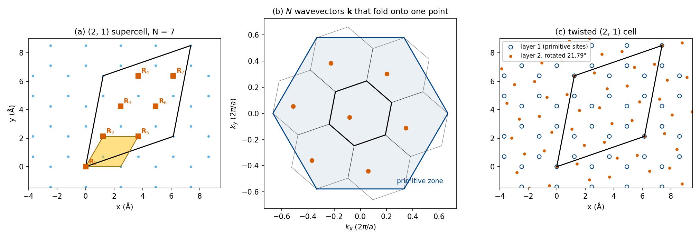
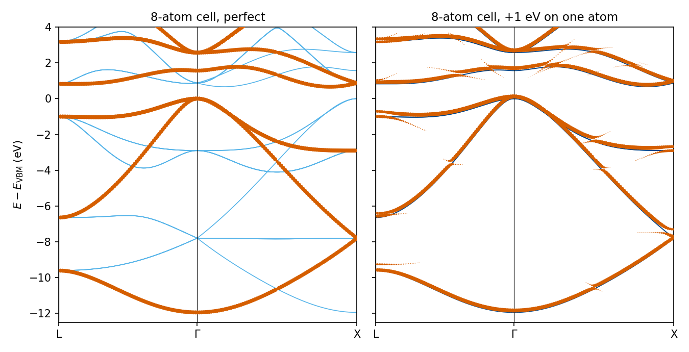
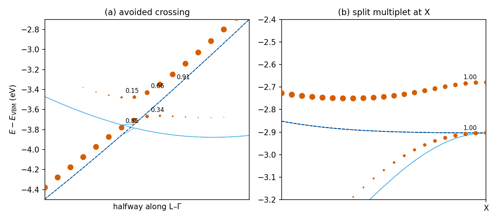
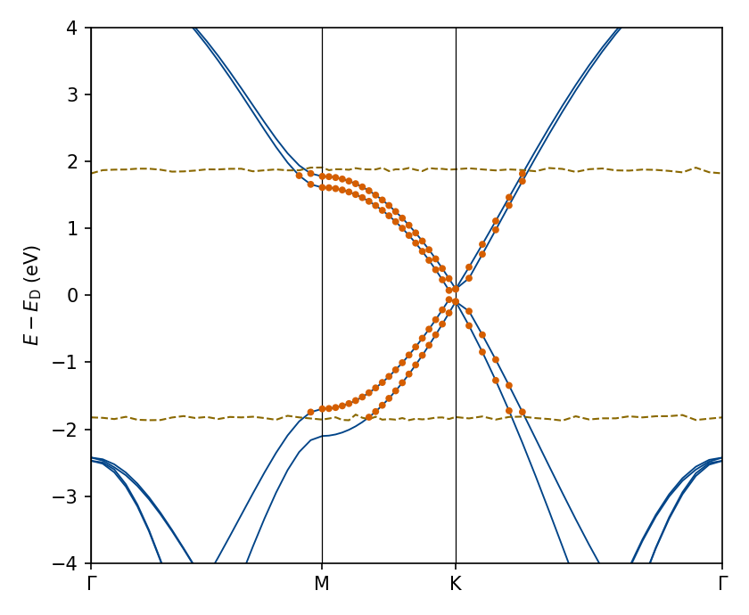

# How to unfold supercell bands onto the primitive Brillouin zone

A supercell calculation (a substitutional alloy, an impurity, a commensurate superstructure) has a small Brillouin zone, and the bands of the primitive crystal fold back into it. Its band structure therefore has many more branches than the primitive one, and you cannot compare it directly with primitive-cell bands or with angle-resolved photoemission (ARPES), which measures the crystal momentum of the primitive lattice. Unfolding assigns each supercell eigenstate a spectral weight $w_n(\mathbf{k})$ at every wavevector $\mathbf{k}$ of the primitive zone: the probability that the state has primitive crystal momentum $\mathbf{k}$ (V. Popescu and A. Zunger, Phys. Rev. B 85, 085201 (2012)). The weights show which supercell states keep the character of a primitive band, and how far a perturbation splits and spreads it. PAOFLOW unfolds the real-space Hamiltonian $H_{\alpha\beta}(\mathbf{R})$ of a tight-binding model or of a projected DFT calculation. The scripts on this page build their models in code and need no input files.

The method has one condition on the geometry. Every supercell atom must sit on a primitive-cell atom shifted by a primitive lattice vector, and carry the same orbitals. The species, on-site energies and hoppings may differ from the primitive cell, which is what makes the weights informative, but the positions may not. A relaxed impurity, a vacancy, an interstitial and a twisted bilayer (panel (c) of the figure below) are therefore outside its reach.

## The spectral weight

The supercell lattice vectors $\mathbf{A}_i$ are integer combinations of the primitive ones, $\mathbf{A}_i = \sum_j M_{ij}\mathbf{a}_j$, and the supercell holds $N = |\det M|$ primitive cells, displaced from each other by the primitive lattice vectors $\mathbf{R}_\ell$, $\ell = 1, \dots, N$. {py:func}`~PAOFLOW.models.band_unfold.unfold_bands` finds $M$, the $\mathbf{R}_\ell$ and, for each primitive atom $\alpha$, the supercell atom at $\boldsymbol{\tau}_\alpha + \mathbf{R}_\ell$ on its own. At each $\mathbf{k}$ of the path in the primitive zone, it diagonalises the supercell Hamiltonian $\tilde H(\mathbf{k})$ and evaluates, for every supercell eigenstate $n$ with coefficients $C^n_{\alpha m \ell}(\mathbf{k})$ on orbital $m$ of atom $\alpha$ in cell $\ell$,

$$
w_n(\mathbf{k}) = \frac{1}{N} \sum_{\alpha}\sum_{m} \left| \sum_{\ell=1}^{N} e^{-2\pi i\, \mathbf{k}\cdot\mathbf{R}_\ell}\, C^{n}_{\alpha m \ell}(\mathbf{k}) \right|^2 .
$$

The sum over $\ell$ is a discrete Fourier transform over the $N$ copies of the primitive cell: it picks out the part of the state that has crystal momentum $\mathbf{k}$ rather than one of the $N - 1$ other wavevectors that fold onto the same supercell point. A state of the perfect supercell is a primitive Bloch state, so its weight is 1 at its own $\mathbf{k}$ and 0 elsewhere. A perturbation that breaks the primitive periodicity mixes the folded states, and the weight of one primitive band is then shared among several supercell states. The weights obey the sum rule $\sum_n w_n(\mathbf{k}) = n_\mathrm{awf}^\mathrm{PC}$, the number of orbitals in the primitive cell, and the run prints its largest deviation as a check of the geometry.



The figure draws these quantities for one layer of graphene in the $(n, m) = (2, 1)$ supercell, built as in the section [Large supercells](#large-supercells). In (a), the light-blue points are the carbon sites, the amber parallelogram is the primitive cell and the black one the supercell, which holds $N = 7$ primitive cells at the translations $\mathbf{R}_1, \dots, \mathbf{R}_7$. In (b), the blue hexagon is the primitive Brillouin zone and the black hexagons are copies of the supercell zone, seven times smaller. The seven vermillion points differ by reciprocal lattice vectors of the supercell, so the supercell Hamiltonian at all of them is the same matrix; its 7 times as many eigenstates are the primitive states of all seven, and the weight tells you which of them each state belongs to. In (c), the second layer is rotated by $21.79^\circ$ instead of stacked on the first: its atoms (vermillion) are not primitive sites shifted by a lattice vector, so the mapping above does not exist and the cell cannot be unfolded.

Where several supercell states are degenerate, the eigensolver returns an arbitrary orthonormal basis of the multiplet, and the weight of each state in it is arbitrary too. Only the sum over the multiplet is defined, and it equals the degeneracy of the primitive band at that $\mathbf{k}$. Plot the weights as markers at their energies: degenerate states then fall on the same point and add up.

## Unfolding a supercell of silicon

The model is an environment-dependent tight-binding (EDTB) model of silicon: Slater–Koster bond integrals for an $sp^3d^5$ basis on three neighbour shells, with each hopping screened by the atoms around the bond (see [Environment-dependent Slater–Koster models](../../internals/sk-edtb.md)). Energies are in eV and distances in bohr. {py:class}`~PAOFLOW.models.edtb_params.EDTBModel` takes the parameters and a geometry, and its `to_model_dict()` gives the model dictionary of the [tight-binding how-to](tight-binding-model.md) that the unfolding reads:

```python
import numpy as np
from PAOFLOW.models.band_unfold import unfold_bands
from PAOFLOW.models.edtb_params import EDTBModel

spd = ['s', 'px', 'py', 'pz', 'dxy', 'dyz', 'dzx', 'dx2-y2', 'dz2']
si_params = {
    'edtb_version': '1.0',
    'basis': {'Si': {'orbitals': spd, 'l_channels': ['s', 'p', 'd']}},
    'onsite': {'Si': {'s': -3.76717, 'p': 1.88404, 't2g': 5.55238, 'eg': 5.49235}},
    'hoppings': {'Si-Si': [  # one entry per neighbour shell, r_ref = shell radius (bohr)
        {'r_ref': 4.58968, 'params': {
            'sss': -1.43863, 'sps': -2.19284, 'sds': 1.39344, 'pps': 2.45055, 'ppp': -0.71398,
            'pds': -0.18045, 'pdp': 0.91304, 'dds': 0.14564, 'ddp': 0.32818, 'ddd': -0.20873}},
        {'r_ref': 7.494997, 'params': {
            'sss': -0.09207, 'sps': -0.19994, 'sds': 0.25732, 'pps': 0.14479, 'ppp': -0.03920,
            'pds': -0.58344, 'pdp': 0.05952, 'dds': -0.21677, 'ddp': 0.22660, 'ddd': -0.03560}},
        {'r_ref': 8.788663, 'params': {
            'sss': -0.10306, 'sps': -0.02571, 'sds': 0.11758, 'pps': -0.10026, 'ppp': 0.06022,
            'pds': -0.10671, 'pdp': 0.04463, 'dds': -0.22592, 'ddp': 0.08134, 'ddd': 0.00171}},
    ]},
    'screening': {'r_cut': 8.0, 'gamma': {'Si-Si': {
        'ss': 0.02701, 'sp': 0.00661, 'sd': 0.02200, 'pp': -0.01298, 'pd': 0.01929, 'dd': 0.06764}}},
}
```

The primitive cell is the two-atom fcc cell; the supercell is the eight-atom conventional cube, $N = 4$. Both geometries give `a_vectors` and the positions `tau` in Cartesian coordinates in units of the same `alat`, which the unfolding requires:

```python
alat = 10.599478  # bohr
fcc = {'alat': alat, 'a_vectors': [[-0.5, 0.0, 0.5], [0.0, 0.5, 0.5], [-0.5, 0.5, 0.0]],
       'atoms': [{'species': 'Si', 'tau': [0.0, 0.0, 0.0]},
                 {'species': 'Si', 'tau': [0.25, 0.25, 0.25]}]}
fcc_sites = [[0, 0, 0], [0.5, 0.5, 0], [0.5, 0, 0.5], [0, 0.5, 0.5]]
cube = {'alat': alat, 'a_vectors': np.eye(3).tolist(),
        'atoms': [{'species': 'Si', 'tau': list(np.add(s, b))}
                  for b in ([0, 0, 0], [0.25, 0.25, 0.25]) for s in fcc_sites]}

pc = EDTBModel(si_params, fcc).to_model_dict()
sc = EDTBModel(si_params, cube).to_model_dict()
points = {'G': [0, 0, 0], 'X': [0.5, 0.0, 0.5], 'L': [0.5, 0.5, 0.5]}
result = unfold_bands(pc, sc, sym_points=points, path_str='L-G-X', nk_per_seg=80)
```

`sym_points` are fractional coordinates in the reciprocal basis of the primitive cell, so the path runs through the primitive zone; with the `a_vectors` above, X is $(2\pi/a)(1, 0, 0)$ and L is $(2\pi/a)(\tfrac12, \tfrac12, \tfrac12)$ up to sign. `nk_per_seg` is the number of k-points on each segment of the path. The module also defines the points and the standard path of the fcc zone for these `a_vectors`, `FCC_SYM_POINTS` and `FCC_PATH` (`'Γ-X-W-K-Γ-L-U-W-L-K|U-X'`), which you can pass as `sym_points` and `path_str` for the full path. The run prints the matrix $M$, the supercell atoms that each primitive atom maps to, and the sum rule:

```text
Transformation matrix M (det = 4):
  [-1  1 -1]
  [-1  1  1]
  [ 1  1 -1]
Found 4 translations inside SC.

Atom mapping (PC atom α → SC atom I):
  α=0: SC atoms [0, 3, 2, 1]
  α=1: SC atoms [4, 7, 6, 5]

PC: 18 orbitals,  SC: 72 orbitals,  N=4
Expected sum rule: Σ_n W_n(k) = 18
k-path: 161 points, 3 symmetry ticks

Sum rule:  Σ_n W_n(k)  mean = 18.000000  (expected 18),  max deviation = 1.07e-14
```

The returned `result` holds the supercell eigenvalues `result.E_sc` and their weights `result.W`, both of shape (k-points, supercell orbitals), the eigenvalues of the primitive cell on the same path `result.E_pc`, the distance along the path `result.kdist` and the positions and labels of the high-symmetry points `result.sym_ticks`. {py:func}`~PAOFLOW.models.band_unfold.plot_unfolded` draws them for a first look.

In the perfect supercell the weights reproduce the primitive bands, which tests the geometry and the k-path before you add a perturbation. To model a substitutional impurity, change the on-site energies of one atom in the supercell dictionary. The example below raises all nine orbitals of atom 0 by 1 eV, one impurity in eight atoms:

```python
impurity = EDTBModel(si_params, cube).to_model_dict()
site = impurity['model']['atoms']['0']
for orbital in site['orbitals']:
    site[orbital] += 1.0
result_imp = unfold_bands(pc, impurity, sym_points=points, path_str='L-G-X', nk_per_seg=80)
```



The figure shows `result` (left) and `result_imp` (right). The thin light-blue lines are the 72 folded bands of the perfect supercell, the vermillion markers the supercell states with marker area proportional to $w_n(\mathbf{k})$ (states with $w_n < 0.02$ are left out), and the dark-blue lines on the right the primitive bands. The energy zero is the valence-band maximum of the primitive cell at $\Gamma$. On the left, the weights select one branch out of every four, and the states with $w_n \approx 1$ coincide with the primitive bands to $10^{-14}$ eV at $\Gamma$. At L and X the folded copies are degenerate with the unfolded band: there the four-fold group at L carries weights such as 0.09, 0.25, 0.00 and 0.65, which add up to 1. With the impurity, the weight stays with branches close to the primitive bands, displaced upwards by about one eighth of the impurity potential, the average of the potential over the cell: the valence-band maximum moves by 0.118 eV and the lowest band at $\Gamma$ by 0.109 eV.



The zoom shows the two places where the impurity changes more than the energy, with the same colours as above and the primitive bands dashed. Halfway along L–$\Gamma$ (a), a folded band crosses a primitive one in the perfect cell; the impurity couples them and opens a gap of 0.24 eV. Across the crossing the weight passes from one branch to the other (0.85 and 0.15, then 0.34 and 0.66, then 0.91 on the upper branch), so a measurement would see the primitive band continue through the gap with reduced intensity on either side. At X (b), the doubly degenerate primitive state at $-2.90$ eV becomes two supercell states, at $-2.90$ and $-2.68$ eV, which carry weight 1.00 each: the impurity has lifted a degeneracy of the primitive crystal.

## Large supercells

The dense route above builds $H_{\alpha\beta}(\mathbf{R})$ of the whole supercell as an array and diagonalises the full $n_\mathrm{awf} \times n_\mathrm{awf}$ matrix at each k-point. Its memory grows as $n_\mathrm{awf}^2$ and its time as $n_\mathrm{awf}^3$, which limits it to cells of a few hundred atoms. {py:func}`~PAOFLOW.models.band_unfold.unfold_bands_sparse` keeps the supercell Hamiltonian as a sparse matrix of bonds and computes only the `n_eigs` eigenstates closest to an energy `sigma` (eV), together with their weights. It uses the shift-invert Lanczos method of SciPy's `eigsh`, an iterative solver that converges first to the eigenvalues nearest the target energy and needs only products of the sparse matrix with vectors. The energy range of these states is called the window below. The weights of these states are the same as on the dense route. The sum rule, however, does not hold for them, because the states outside the window are not computed.

The sparse route evaluates the hoppings from a formula in the bond length, so it needs a model whose hoppings are distance-dependent, as in the carbon model below, instead of one parameter set per shell as in the silicon model above. Each Slater–Koster channel follows the form of L. Goodwin, A. J. Skinner and D. G. Pettifor, Europhys. Lett. 9, 701 (1989),

$$
V(r) = V_0 \left(\frac{r_0}{r}\right)^{n} \exp\left\{ n \left[ -\left(\frac{r}{r_c}\right)^{n_c} + \left(\frac{r_0}{r_c}\right)^{n_c} \right] \right\},
$$

with $r_0$ the nearest-neighbour distance of graphene (2.684 bohr). The system is AA-stacked bilayer graphene, 3.35 Å between the layers, in the $(n, m)$ supercell spanned by $n\mathbf{a}_1 + m\mathbf{a}_2$ and its $60^\circ$ rotation, which holds $n^2 + nm + m^2$ primitive cells per layer:

```python
from PAOFLOW.models.band_unfold import unfold_bands_sparse

carbon = {
    'edtb_version': '1.0',
    'basis': {'C': {'orbitals': spd, 'l_channels': ['s', 'p', 'd']}},
    'onsite': {'C': {'s': -4.52191, 'p': -0.84835, 't2g': 6.33815, 'eg': 6.34247}},
    'hoppings': {'C-C': {
        'type': 'distance_dependent', 'r_0': 2.684, 'r_c': 10.0, 'n_c': 2.59873,
        'channels': {
            'sss': {'V0': -4.28565, 'n': 4.25117}, 'sps': {'V0': 5.03970, 'n': 3.50549},
            'sds': {'V0': 2.96708, 'n': 1.15475}, 'pps': {'V0': 4.50301, 'n': 2.56064},
            'ppp': {'V0': -2.08356, 'n': 4.38254}, 'pds': {'V0': 1.93938, 'n': -0.31188},
            'pdp': {'V0': -6.42159, 'n': 1.33501}, 'dds': {'V0': -0.00009, 'n': -3.40900},
            'ddp': {'V0': 0.00040, 'n': 1.78124}, 'ddd': {'V0': -0.00166, 'n': -1.17807}}}},
    'screening': {'r_cut': 8.0, 'gamma': {'C-C': {
        'ss': 0.00450, 'sp': 0.00743, 'sd': 0.60988, 'pp': 0.00670, 'pd': 1.70099, 'dd': 1.53698}}},
}


def aa_bilayer(n, m, d=3.35, vacuum=15.0, a_cc=1.42):
    """AA bilayer graphene in the (n, m) supercell; lengths in angstrom, alat = graphene a."""
    a = a_cc * np.sqrt(3)
    a1, a2 = np.array([1.0, 0, 0]), np.array([0.5, np.sqrt(3) / 2, 0])
    cell = np.array([n * a1 + m * a2, -m * a1 + (n + m) * a2, [0, 0, (d + vacuum) / a]])
    span = range(-2 * (n + m), 2 * (n + m) + 1)
    frac = [np.linalg.solve(cell.T, i * a1 + j * a2) for i in span for j in span]
    cells = [f @ cell for f in frac if np.all((f[:2] > -1e-8) & (f[:2] < 1 - 1e-8))]
    basis = [np.array([0, 0, z]) + s for z in (0, d / a) for s in (np.zeros(3), (a1 + a2) / 3)]
    atoms = [{'species': 'C', 'tau': (t + b).tolist()} for b in basis for t in cells]
    return {'alat': a / 0.529177249, 'a_vectors': cell.tolist(), 'atoms': atoms}


pc = EDTBModel(carbon, aa_bilayer(1, 0)).to_model_dict()
sc = EDTBModel(carbon, aa_bilayer(6, 5)).to_model_dict()
hexagonal = {'G': [0, 0, 0], 'M': [0.5, 0, 0], 'K': [2 / 3, 1 / 3, 0]}  # for a2 = a(1/2, sqrt(3)/2)
result = unfold_bands_sparse(pc, sc, sym_points=hexagonal, path_str='G-M-K-G',
                             n_eigs=100, sigma=-0.5, nk_per_seg=20, n_workers=-1)
```

The coordinates of K depend on the angle between the primitive vectors. With $\mathbf{a}_2 = a(\tfrac12, \tfrac{\sqrt3}{2})$, at $60^\circ$ to $\mathbf{a}_1$ as here, K is $(\tfrac23, \tfrac13)$; $(\tfrac13, \tfrac13)$ is K only for vectors at $120^\circ$, and here it is the point two thirds of the way from $\Gamma$ to M, so a path through it misses the Dirac points. The module's `HEX_SYM_POINTS` uses $(\tfrac13, \tfrac13)$, so do not pass it for cells built at $60^\circ$. The $(6, 5)$ cell has 91 primitive cells per layer, 364 atoms and 3276 orbitals. On the dense route its $H_{\alpha\beta}(\mathbf{R})$ alone takes 21 GB ($3276^2$ complex numbers on 125 lattice vectors). The sparse route stores 28.5 MB of bonds, and the run above takes 6 minutes for the 61 k-points of the path on 20 cores.

`sigma` places the window: give an energy inside the range you want to resolve, here the energy of the Dirac points of the two layers. `n_eigs` sets its width. The number of supercell states per eV is $N$ times that of the primitive cell, so the same `n_eigs` covers a narrower window in a larger cell, and the window is narrowest where the bands are densest. Check `result.E_sc.min(axis=1)` and `result.E_sc.max(axis=1)` against the energy range you plot: a window narrower than the plot leaves blank regions with no weight, which look like gaps. A degenerate multiplet at the edge of the window can also be cut, so that only some of its states, and part of its weight, are returned (4 of the 6 states at the lower edge at $\Gamma$ in this run). Keep the range you plot inside the window. The cost per k-point grows with `n_eigs`. `n_workers` distributes the k-points over processes, `-1` uses all the cores available to the process (its share of the node under `mpirun`). Further keyword arguments, such as `maxiter` and `ncv`, are passed on to `eigsh`.



The figure shows `result` of this run. The dark-blue lines are the bands of the primitive AA bilayer, the vermillion markers the supercell states with marker area proportional to $w_n(\mathbf{k})$, and the dashed amber lines the lowest and highest energy of the window, `result.E_sc.min(axis=1)` and `result.E_sc.max(axis=1)`, at each k-point. The energy zero $E_\mathrm{D} = -0.519$ eV is the mean of the two Dirac points at K: in AA stacking the interlayer hopping shifts the Dirac cones of the bonding and antibonding layer combinations to $\pm 0.094$ eV. The 100 states span 3.62 eV at the k-point where the window is narrowest, about $-1.8$ to $+1.8$ eV around $E_\mathrm{D}$. Inside the window every state with weight lies on a primitive band, as it must in a perfect supercell. Outside it the path shows no weight even where the primitive bands run, for example on most of $\Gamma$–M; this is the window, not a gap of the crystal.

## Unfolding a projected DFT Hamiltonian

For a DFT calculation, run PAOFLOW up to {py:meth}`~PAOFLOW.PAOFLOW.PAOFLOW.pao_hamiltonian` once for the primitive cell and once for the supercell, with the same pseudopotentials and PAO basis, and the same lattice parameter `alat` in both QE inputs. {py:func}`~PAOFLOW.models.band_unfold.paoflow_to_model_dict` then turns the `data_controller` of each run into a model dictionary for `unfold_bands`. The projected $H_{\alpha\beta}(\mathbf{R})$ is stored with the opposite sign of $\mathbf{R}$ in the Fourier phase from that of the models above; the dictionary records this, and `unfold_bands` corrects for it. With the wrong sign the energies would be unchanged but the weights would select the folded branches of $-\mathbf{k}$ instead of $\mathbf{k}$ (see [Environment-dependent Slater–Koster models](../../internals/sk-edtb.md)).

## Troubleshooting

| message | meaning | what to do |
| --- | --- | --- |
| `No SC atom found matching PC atom ... Check positions/lattice vectors.` | A primitive atom shifted by one of the $\mathbf{R}_\ell$ has no supercell atom on its site within $10^{-4}$ `alat`. The positions are relaxed or twisted, an atom is missing, or the two geometries use different `alat`. | Give the supercell its ideal positions and the same `alat` as the primitive cell. A twisted bilayer cannot be unfolded with this routine. |
| `SC atoms {...} are not mapped to any PC atom + translation.` | The supercell has more atoms than $N$ times the primitive cell, for example an interstitial. | Remove the extra atoms, or unfold a supercell without them. |
| `Orbital count mismatch: SC atom ...` | A substituted atom carries a different set of orbitals from the primitive atom it replaces. | Give the substituted atom the same orbitals. |
| `Sum-rule deviation ... exceeds tolerance.` | The weights at some k-point do not add up to $n_\mathrm{awf}^\mathrm{PC}$, so the geometry or the path does not match the primitive cell. | Check `a_vectors`, `alat` and the positions of both cells, and that `sym_points` are fractional coordinates of the primitive reciprocal lattice. |
| `eigsh failed to converge for ... eigenvalues near sigma=...` | The Lanczos iterations of `unfold_bands_sparse` did not converge. | Lower `n_eigs`, or pass a larger `maxiter` or `ncv`, which `unfold_bands_sparse` forwards to the eigensolver. |

## Where to go next

- [How to run PAOFLOW on a tight-binding model](tight-binding-model.md) explains the model dictionaries and the other properties a model gives.
- [Environment-dependent Slater–Koster models](../../internals/sk-edtb.md) describes the EDTB models, their fitting and the Fourier conventions of the unfolding.
