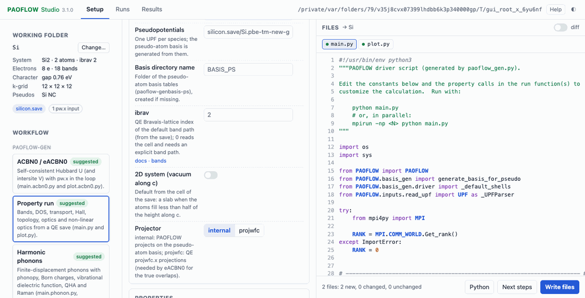
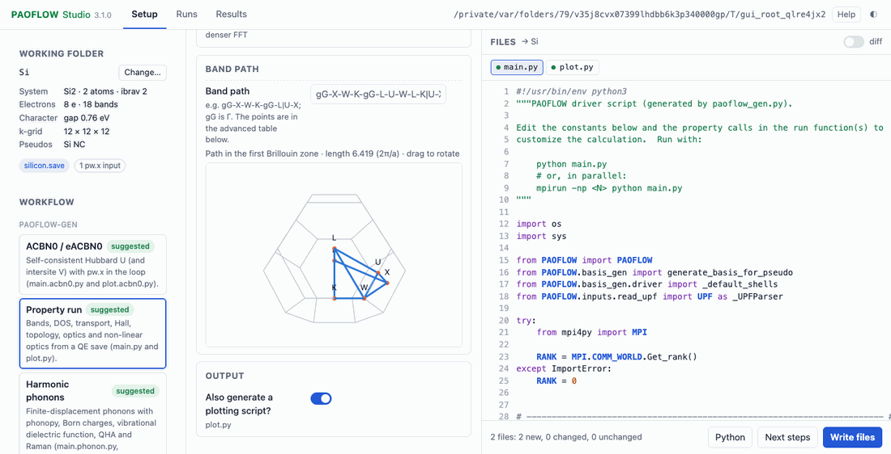
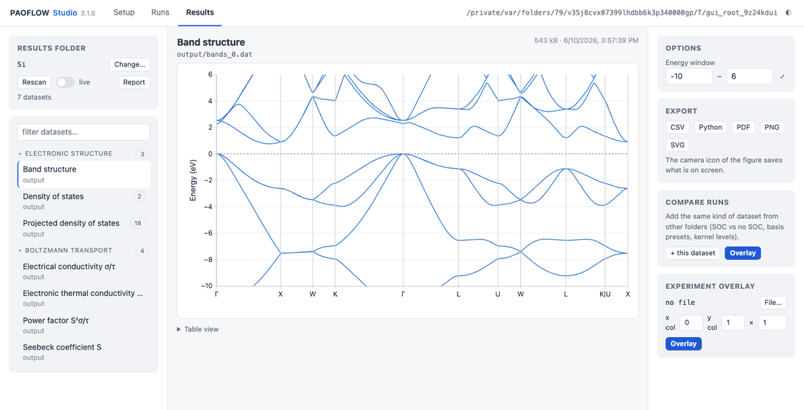

# Working in the browser: PAOFLOW Studio

PAOFLOW Studio (`paoflow-studio`) is a browser interface for PAOFLOW. It has three tabs:

- **Setup** asks the questions of `paoflow-gen` as a form, previews the generated files and writes them.
- **Runs** starts the generated drivers on the machine that serves the GUI and follows their logs.
- **Results** finds the outputs of a folder and plots them interactively.

The setup and plotting code is the same as on the command line. For the same answers, the form writes the same
bytes as `paoflow-gen`, and the plots read the files with the same readers as `GPAO`.

## Install and start

```bash
pip install "PAOFLOW[gui]"            # Plotly for the figures; the server needs nothing else
pip install "PAOFLOW[fermisurface]"   # optional: 3D Fermi surfaces (scikit-image)

paoflow-studio --root ~/runs             # serve ~/runs and open the browser
paoflow-studio --root ~/runs plot Si/output    # open the Results tab on one folder
paoflow-gen --gui                     # the same questions as paoflow-gen, in the browser
```

The server prints a URL that ends with `?token=...`; open it once and the browser keeps the session. The GUI
writes and runs only under `--root`.

It may also *read* other folders, but never write them:

- PAOFLOW's own `PSEUDOS/` and `BASIS/`, always;
- every folder given with `--allow-read`, for example pseudopotentials or results kept elsewhere:

```bash
paoflow-studio --root ~/runs --allow-read ~/pseudos --allow-read /data/TaC_results
```

The folder picker lists them under *Places*, marked read-only. The QE-input and basis tools take a
pseudopotential folder from there (*Browse…*), and the Results tab can open results in them. The list is fixed
when the server starts; nothing in the browser can widen it.

**On a remote machine** (cluster login node, workstation), start the server without a browser and tunnel the port
from your laptop:

```bash
paoflow-studio --root ~/runs --no-browser            # on the remote machine
ssh -N -L 8765:127.0.0.1:8765 user@remote         # on the laptop, then open the printed URL
```

The server listens on `127.0.0.1` only. Every request needs the session token, and requests whose Host or Origin
header is not the GUI's own are refused. These checks keep other users of a shared login node out of your session.

Other options:

- `--allow-read DIR`: also read `DIR`, never write it (repeatable).
- `--read-only`: browse and plot only, with no writes and no runs.
- `--max-ranks N`: cap the MPI ranks of a run (the default is the core budget of the machine).
- `--port`: the first port to try (the default is 8765).

## Setup



1. **Working folder.** Choose the folder of the QE run. The GUI shows what it found: the `*.save` folder, the UPF
   files, the `pw.x` inputs, existing drivers. From the save it reads a summary of the system: formula, lattice,
   electrons, gap or metal, k-grid, pseudopotential types, 2D slab.
2. **Workflow.** The workflows are those of `paoflow-gen`: property run, ACBN0/eACBN0, harmonic phonons (with
   Raman), electron–phonon system folder, SSCHA. Two tools sit next to them: a QE input from an AFLOW or C2DB entry
   (`paoflow-gen-qe`), and the pseudo-atom basis tables (`paoflow-genbasis-ps`).
3. **Form.** These are the CLI questions, shown only when they apply. Defaults follow the earlier answers: the
   dense grids follow the coarse ones, and the smearing follows the adaptive prefactor. Invalid values are marked
   where they occur, for example a q-grid that does not divide the k-grid. The *advanced* switch shows the
   settings the CLI leaves at the builder defaults, such as the SSCHA minimiser, `tr2_ph` and the coupled-SHG
   components.

   Fields that feed a PAOFLOW method have a *docs* link. It shows that parameter's description from the method's
   docstring, or the comment `system.py` carries for electron–phonon settings.

   

   **Band path.** For a band structure, the *Band path* section shows the path PAOFLOW follows for the lattice
   (`ibrav` from the save, or the in-plane path of a slab), drawn inside the first Brillouin zone. You can drag to
   rotate it. To change the path, edit the path string (`gG-X-W-K-gG-L|U-X`) or the point table (*advanced*: a
   label and crystal coordinates on each row). `main.py` then gets `BAND_PATH` and `HIGH_SYM` constants and calls
   `bands(..., band_path=BAND_PATH, high_sym_points=HIGH_SYM)`. An unchanged path writes the same `main.py` as the
   CLI.

   Some defaults come from the save, in the CLI as well:
   - `ibrav`, spin-orbit and 2D from the save;
   - metal, `nelec`, `nbnd` and the coupling source (`epw` for ultrasoft or PAW pseudopotentials) from the
     `pw.x` template of the electron–phonon workflow.
4. **Preview and write.** Every generated file is shown with its status (new, changed, unchanged) and, for
   changed files, its diff against the copy on disk. *Write files* asks before overwriting and keeps a timestamped
   backup (`main.py.bak-YYYYmmdd-HHMMSS`).
   - *Python* shows a script that writes the same files without the GUI.
   - *Next steps* lists the commands of the workflow in order.

## Runs

The Runs tab shows the run plan of the last written workflow. *Run* starts a step:

- `python` drivers run under `mpirun -np N` when the step supports MPI.
- `run_qe.sh` gets its rank count through `NP`.

Every run is niced, with one thread per rank. Runs continue when the GUI stops; a restarted GUI shows them again.
The log updates live, *Cancel* stops the process group, and *Results* opens the outputs.

Only the steps of a generated plan can run: Python drivers and shell scripts inside the root, and
`paoflow-genbasis-ps`. There is no free command line. Steps that need a terminal or a display (the `plot*.py`
scripts) are listed but not run; the Results tab replaces them.

## Results



The tab scans a folder and its subfolders: an `output/` folder, a run folder, or an electron–phonon system folder
with its `<workflow>/output/` folders. It lists the datasets by category:

- electronic structure;
- Boltzmann transport;
- topology and Hall;
- optics and non-linear optics;
- phonons and electron–phonon;
- Green's-function transport;
- ACBN0, SSCHA and quantum oscillations.

The tensor components, spin channels or temperatures of one quantity are the series of one figure.

- **Options** depend on the dataset:
  - the energy window of band plots;
  - the tensor component and the temperatures of transport;
  - the grouping of the projected DOS (element and ℓ, site, shell, orbital), as lines or as stacked areas;
  - the quantity of tables that mix units (mobility, Seebeck coefficient, carrier density, ...);
  - the η column of the absorption;
  - the bands, smoothing and zone of a Fermi surface.

  Quantities with different units are never drawn on one axis.
- **Maps** (ARPES intensity, spectral functions, Berry-curvature slices): click a point for the energy and
  momentum distribution curves (EDC and MDC) through it.
- **Fermi surfaces** are drawn in 3D in the browser, coloured by |v_F|, inside the Wigner–Seitz zone. This needs
  scikit-image. Berry-curvature grids are shown as plane slices.
- **Compare runs.** Overlay the same kind of dataset from several folders, for example SOC against no SOC, or two
  basis presets.
- **Experiment overlay.** Add measured points from a column or CSV file. The GUI reports the RMS, bias and relative
  RMS against the computed curve.
- **Export.**
  - CSV of the plotted data;
  - a Python snippet that rebuilds the figure (with the `GPAO` call where one exists);
  - PDF, PNG or SVG through matplotlib;
  - the camera icon saves the view on screen.

  *Report* writes one self-contained HTML file with every figure. It opens offline, so you can archive it or send
  it.
- **Live** rescans the folder every few seconds while a run writes files.
- Every line figure has a *Table view* of its values.

The same layer works without the GUI, in scripts and notebooks:

```python
from PAOFLOW.results import ResultsFolder

results = ResultsFolder('Si/output')
bands = results.load(results.find('bands').id, options={'window': [-6, 6]})
results.save(bands, 'bands.pdf')                 # matplotlib
spec = results.figure(bands, theme='light')      # plotly.graph_objects.Figure(spec) in Jupyter
```

or from the command line, without a server:

```bash
paoflow-studio report Si/output -o Si_report.html
```

At the end of every run, PAOFLOW writes `paoflow_outputs.json` in the output folder. It records the PAOFLOW
version, the DFT Fermi energy (output energies are relative to it), the spin and basis facts, and the files the run
wrote, each with its kind. The Results tab shows it as *Run information*.
