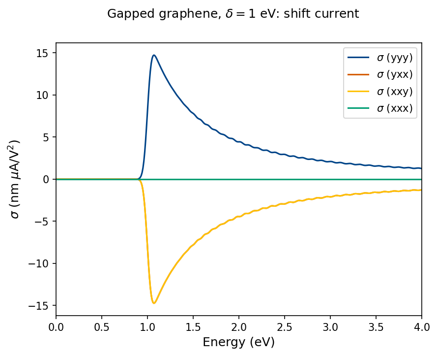
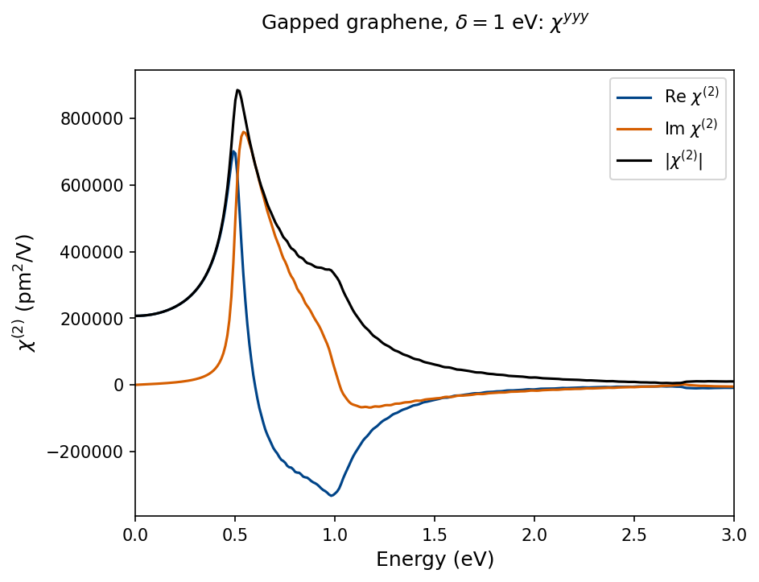

# How to compute the non-linear optical response of a tight-binding model

On this page you compute the second-order optical response of a tight-binding model with {py:meth}`~PAOFLOW.PAOFLOW.PAOFLOW.nonlinear_optics`: the shift current, the injection currents and the second-harmonic generation (SHG) susceptibility $\chi^{(2)}$. These responses vanish in a crystal with inversion symmetry, so a model is the place to test them, because you can switch inversion on and off with one parameter and know from the point group which components must vanish. The example is graphene with a sublattice potential, the simplest crystal without inversion. The responses are those of independent electrons in the bands of the model, with the position operator diagonal on the orbital centres (the tight-binding approximation), and without excitons or local fields. [Non-linear optics](../../internals/nonlinear-optics.md) gives the formulas the code evaluates and the conventions of the output files.

Base example: [examples/nlo_examples/Graphene/](https://github.com/marcobn/PAOFLOW/tree/master/examples/nlo_examples/Graphene)

:::{tip}
The model is built in code, so the page needs no input files. The workflow, {download}`main.py <nonlinear-optics-model/main.py>`, runs in about 30 s and prints the output below. Run {download}`figures.py <nonlinear-optics-model/figures.py>` after it, in the same directory, to draw the figures of this page.
:::

## Computing the responses

The `graphene` model with $\delta = 1$ eV has on-site energies $\pm\delta/2$ on the two sublattices, a gap of 1 eV at K and K′, and the point group $D_{3h}$, with $\mathbf{a}_1$ along $x$. The script computes the responses directly after the constructor:

```{literalinclude} nonlinear-optics-model/main.py
:language: python
:end-before: '# The same model with inversion symmetry'
```

`nonlinear_optics()` interpolates $H_{\alpha\beta}(\mathbf{R})$ to the k-points of its own mesh, so it needs no call to `interpolated_hamiltonian()` or `pao_eigh()`. On a DFT Hamiltonian it must come before these two calls, which release $H_{\alpha\beta}(\mathbf{R})$; on a model you call it right after the constructor, as here. Four arguments depend on the model.

`nk=(300, 300, 1)` gives 90 000 k-points of the two-dimensional zone, which take 20 s on 4 cores. The responses come from transitions near K and K′, where the bands are closest, so the mesh must resolve the region around the valleys on the scale of `eta`. Check the mesh by repeating the run on a denser one: the peaks should not move.

`nelec=2` fills the lower band. A model has no electron count of its own, and without spin–orbit coupling each band holds two electrons, so `nelec` is twice the number of occupied bands.

`twoD=True` gives the responses of the sheet: the bulk responses multiplied by the height of the cell, $|\mathbf{a}_3| = 10a$ for this model, in nm µA/V² for the shift current and pm²/V for $\chi^{(2)}$. Without it the responses depend on the vacuum in the cell, which is not a property of the layer.

`eta=0.05` is the width (eV) of the Gaussians that replace the $\delta$ functions of the shift and injection currents, and the imaginary part of the resonance denominators of $\chi^{(2)}$. It sets the resolution of the spectra: features narrower than `eta`, such as the onset at the gap, are broadened by it.

The run writes one file per response and component, with the photon energy (eV) and the value: `shift_*` (shift current), `shiftm_*` (magnetic shift current), `injectc_*` and `injectm_*` (circular and magnetic injection currents), and `shgr_*`, `shgi_*`, `shga_*` (real part, imaginary part and modulus of $\chi^{(2)}$). {py:meth}`~PAOFLOW.GPAO.GPAO.plot_optical` reads them by these prefixes, and `figures.py` draws the two figures below with it.



The shift current sets in at the 1 eV gap and peaks at 14.74 nm µA/V² at 1.07 eV, just above the gap, with an onset broadened by `eta`, and then decays as the transitions move away from the valleys. The symmetry $D_{3h}$ fixes the components: $\sigma^{yyy} = -\sigma^{yxx} = -\sigma^{xxy}$, so the `yxx` and `xxy` curves lie on top of each other, and $\sigma^{xxx} = 0$.



$\chi^{(2)}$ has two resonances, at half the gap and at the gap. $|\chi^{yyy}|$ peaks at $8.85 \times 10^{5}$ pm²/V at 0.51 eV, the two-photon resonance, where $2\hbar\omega$ reaches the gap. At the one-photon resonance the real part has its minimum, $-3.33 \times 10^{5}$ pm²/V at 0.98 eV, and $|\chi^{yyy}|$ a shoulder. Below both resonances $\chi^{(2)}$ tends to the static value $|\chi^{yyy}(0)| = 2.07 \times 10^{5}$ pm²/V.

## Checking the result

Symmetry gives the cheapest checks, because a component that the point group forbids must come out at the level of numerical noise. The centrosymmetric run uses the same model with $\delta = 0$ on a coarser mesh, since only the vanishing of the response is tested:

```{literalinclude} nonlinear-optics-model/main.py
:language: python
:start-after: '# The same model with inversion symmetry'
:end-before: '# Symmetry checks'
```

The script prints the checks after the two runs:

```{literalinclude} nonlinear-optics-model/main.py
:language: python
:start-after: '# Symmetry checks'
```

The output is:

```text
shift current: peak 14.74 nm muA/V^2 at 1.07 eV
  |yyy + yxx|, |yyy + xxy| <= 7.3e-04, |xxx| <= 7.4e-15
|chi_yyy|: 2.070e+05 pm^2/V at 0, peak 8.849e+05 at 0.51 eV
Re chi_yyy: minimum -3.330e+05 pm^2/V at 0.98 eV
max |shiftm|: yyy 0.0e+00, yxx 0.0e+00, xxy 9.3e-14, xxx 0.0e+00
max |injectm|: yyy 2.5e-04, yxx 4.3e-04, xxy 8.6e-05, xxx 4.5e-04
max |injectc|: yyy 1.2e-06, yxx 1.4e-06, xxy 8.6e+04, xxx 1.4e-06
delta = 0: max |shift| 5.8e-14, max |chi| 7.6e-06
```

Read it in three steps. First, the $D_{3h}$ relations hold to $7 \times 10^{-4}$ nm µA/V², $5 \times 10^{-5}$ of the peak, and $\sigma^{xxx}$ stays at $10^{-14}$. Second, the magnetic shift and injection currents are odd under time reversal, which the model preserves, so they vanish: `shiftm_*` stays below $10^{-13}$ and `injectm_*` below $5 \times 10^{-4}$, in the units of their files. Third, with $\delta = 0$ the model has inversion symmetry and every response vanishes, the shift current to $10^{-13}$ nm µA/V² and $|\chi^{(2)}|$ to $10^{-5}$ pm²/V.

The circular injection current is the exception. It is allowed only in gyrotropic point groups, which $D_{3h}$ is not, and its `yyy`, `yxx` and `xxx` components stay below $2 \times 10^{-6}$ A V⁻² s⁻¹, but `injectc_xxy.dat` reaches $-8.6 \times 10^{4}$ A V⁻² s⁻¹ at 1.75 eV, and the value does not decrease on denser meshes. Do not use `injectc_xxy` of this model as a physical result.

## Where to go next

- [Non-linear optics](../../internals/nonlinear-optics.md) derives the shift current and SHG, and lists the symmetry tests on model Hamiltonians and the GaAs and GeS examples.
- [How to run PAOFLOW on a tight-binding model](tight-binding-model.md) lists the other models and shows how to build one with your own parameters.
- [Tutorial 05](../tutorial05.ipynb) computes the Berry curvature and Chern number of the same gapped graphene.
