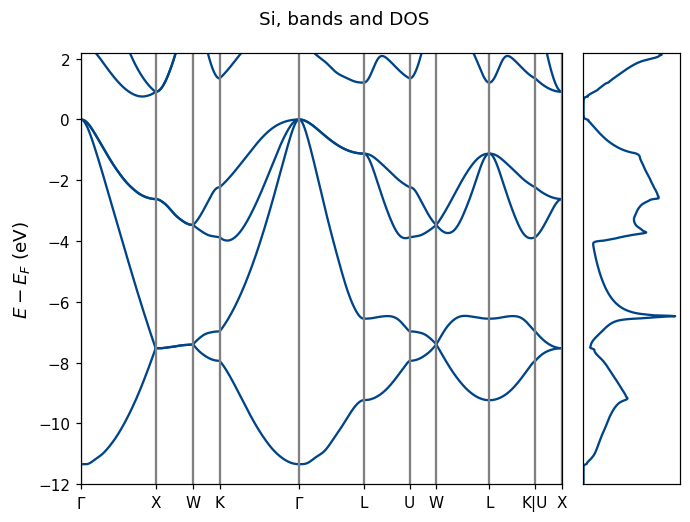
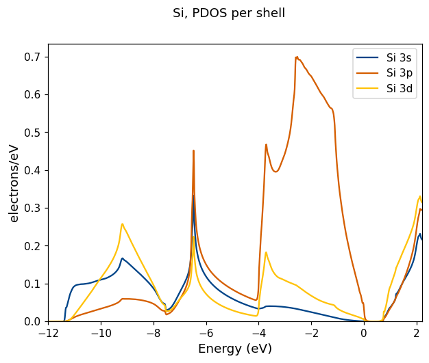
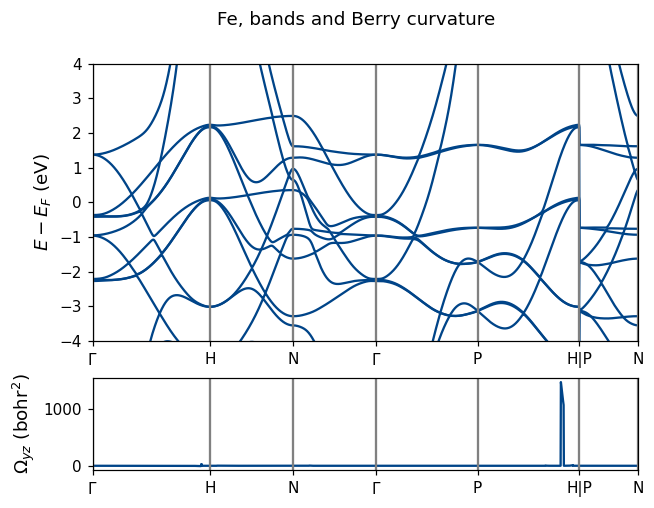
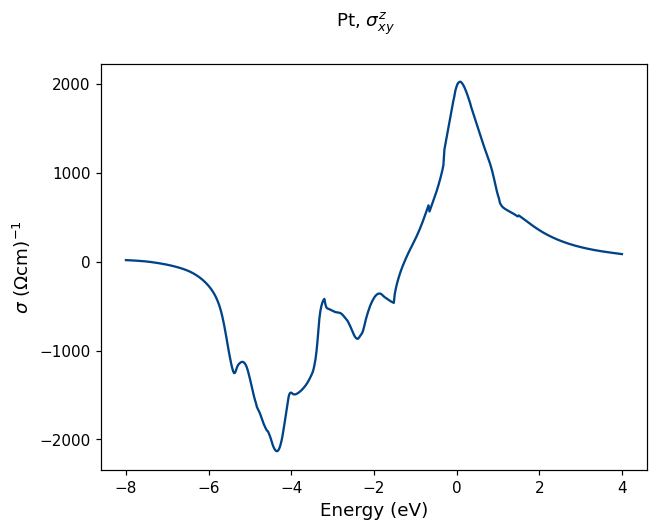
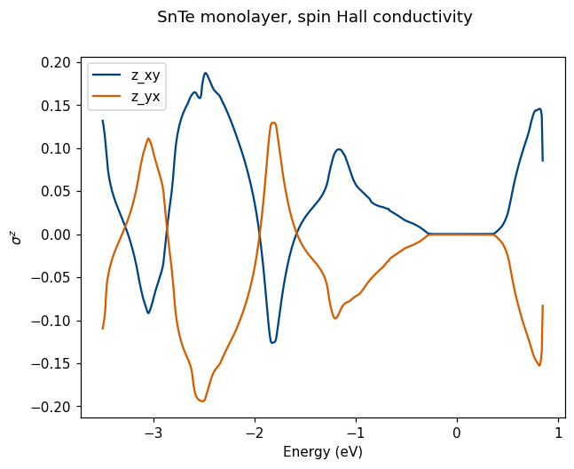
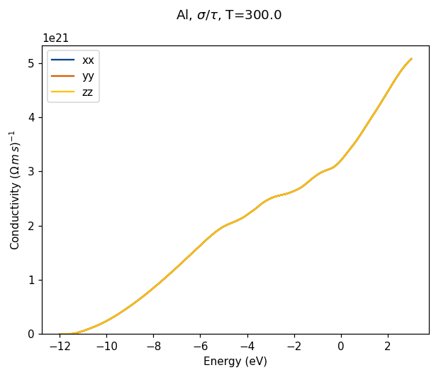
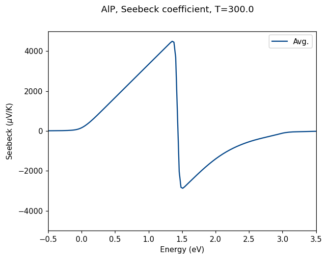
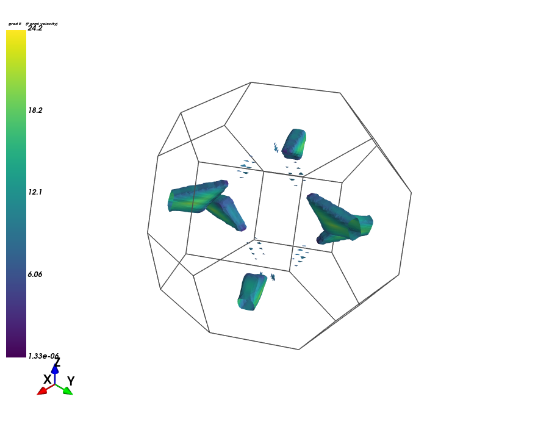

# How to plot PAOFLOW output with GPAO

Every PAOFLOW property writes its result as text files in `outputdir`: `bands()` writes `bands_0.dat` and `kpath_points.txt`, `dos()` the DOS and one projected-DOS (PDOS) file per orbital, `transport()` the transport tensors, `spin_Hall()` the spin Hall conductivity (SHC), `fermi_surface()` a BXSF file. The `GPAO` class reads these files and draws them with matplotlib, so you can plot a finished run without its `PAOFLOW` object, for example after a cluster job or on another machine. This page shows the call for each kind of output, the arguments that change what the figure shows, and how to check that a figure matches its run. GPAO computes nothing: a figure carries the approximations of the run that wrote the files.

Base examples: [examples/qe_examples/example01/](https://github.com/marcobn/PAOFLOW/tree/master/examples/qe_examples/example01) (Si), [examples/qe_examples/example02/](https://github.com/marcobn/PAOFLOW/tree/master/examples/qe_examples/example02) (Al), [examples/qe_examples/example04/](https://github.com/marcobn/PAOFLOW/tree/master/examples/qe_examples/example04) (Fe), [examples/qe_examples/example05/](https://github.com/marcobn/PAOFLOW/tree/master/examples/qe_examples/example05) (Pt), [examples/qe_examples/example06/](https://github.com/marcobn/PAOFLOW/tree/master/examples/qe_examples/example06) (AlP), [examples/qe_examples/example08/](https://github.com/marcobn/PAOFLOW/tree/master/examples/qe_examples/example08) (SnTe monolayer), [examples/pyskeaf_examples/Bi/](https://github.com/marcobn/PAOFLOW/tree/master/examples/pyskeaf_examples/Bi) (Bi)

:::{tip}
The output files of these examples are in `howto_assets.tar.gz` of the release [tutorial-assets-v1](https://github.com/marcobn/PAOFLOW/releases/tag/tutorial-assets-v1). Download it and extract it with `tar xzf howto_assets.tar.gz`, which creates one folder per system under `plotting/`. Run the code below from the directory that contains `plotting/`. To plot your own run, replace the paths with files from its `outputdir`.
:::

## Setting up

```python
from PAOFLOW import GPAO

plotter = GPAO.GPAO()
palette = ['#004488', '#D55E00', '#FFC20A']  # deep blue, vermillion, amber
```

Each GPAO method opens a new figure and calls `matplotlib.pyplot.show()`. In a notebook the figure appears below the cell. A script opens it in a window; to write it to a file instead, run the script with a non-interactive backend, `MPLBACKEND=Agg python plot.py`, where `show()` leaves the figure open with a warning, and call `matplotlib.pyplot.savefig('name.png')` after the GPAO call. The default colors of GPAO are black, red, green and blue; the calls below pass the colors of `palette` through `col` or `cols`.

## Band structure and DOS

`bands()` writes `bands_0.dat`, one row per k-point with the point index followed by every band energy in eV relative to $E_F$, and `kpath_points.txt`, the high-symmetry points of the path with the number of points to the next one, followed by the coordinates of every point. `dos()` writes `dosdk_0.dat`, the energy and the DOS per spin.

```python
si = 'plotting/si/'
plotter.plot_bands(
    si + 'bands_0.dat',
    sym_points=si + 'kpath_points.txt',
    label=r'$E - E_F$ (eV)',
    y_lim=(-12.0, 6.0),
    cols=palette[0],
)
plotter.plot_dos(si + 'dosdk_0.dat', x_lim=(-12.0, 2.2), col=palette[0])
plotter.plot_dos_beside_bands(
    si + 'dosdk_0.dat',
    si + 'bands_0.dat',
    sym_points=si + 'kpath_points.txt',
    title='Si, bands and DOS',
    band_label=r'$E - E_F$ (eV)',
    y_lim=(-12.0, 2.2),
    col=palette[0],
)
```

`sym_points` reads the tick positions and labels from `kpath_points.txt`. A segment with 0 points marks a jump in the path, and its tick carries both labels: `K|U` is the end of one piece of the path at K and the start of the next at U. `label` (`band_label` in `plot_dos_beside_bands`) is the energy-axis label, and `y_lim` the energy range. `plot_dos_beside_bands` draws the DOS on the energy axis of the bands, so set `y_lim` inside the energy range of the DOS file: the DOS stops where `dos(emin, emax)` stopped. `plot_bands` also takes a list of files and a list of `labels`, and overlays them, for example the bands of two runs.



The figure shows the files of example01, which calls `bands(ibrav=2, nk=2000)` and `dos(emin=-12.0, emax=2.2, ne=1000)`. The energy zero is $E_F$, here the valence-band maximum (VBM), and the DOS panel ends at 2.2 eV, the `emax` of the run. The VBM is at $\Gamma$ and the conduction-band minimum (CBM) at 0.754 eV on the $\Gamma$–X line, so the DOS is zero between 0 and 0.754 eV.

## Projected DOS grouped by orbital

`dos()` writes one PDOS file per pseudo-atomic orbital, named by atom and orbital (`Si1_3s_pdosdk_0.dat`, `Si1_3px_pdosdk_0.dat`, ...), with the energy and the PDOS per spin. `plot_pdos` draws one curve per file, or, with `psum_inds`, one curve per group of files: each inner list holds the positions in the file list of the files to add up.

```python
from pathlib import Path

files = sorted(Path(si).glob('Si*_pdosdk_0.dat'))
shells = ['3s', '3p', '3d']
plotter.plot_pdos(
    [str(f) for f in files],
    title='Si, PDOS per shell',
    x_lim=(-12.0, 2.2),
    cols=palette,
    labels=[f'Si {s}' for s in shells],
    psum_inds=[[i for i, f in enumerate(files) if f'_{s}' in f.name] for s in shells],
)
```

The groups here are built from the file names, so they hold the 2 $3s$, 6 $3p$ and 10 $3d$ files of both atoms. `labels` and `cols` take one entry per curve, that is, per group when `psum_inds` is given.



The $3s$ orbitals carry most of the weight at the bottom of the valence band, below $-10$ eV, and the $3p$ orbitals between $-4$ eV and the VBM. Integrated over the valence band, the three curves hold 0.81, 2.27 and 0.92 of the 4.00 states per spin, which [Tutorial 01](../tutorial01.ipynb#7-density-of-states-and-projected-dos) discusses.

## Berry curvature along the path

`topology(Berry=True, spol=..., ipol=..., jpol=...)` writes the Berry curvature $\Omega_{ij}(\mathbf{k})$ along the path of `bands()`, summed over the occupied bands, to `Omega_{spol}_{ipol}{jpol}.dat`: the point index and $\Omega$ in bohr$^2$. The first label in the name is the spin direction `spol`, which only the spin Berry curvature `Omegaj_*.dat` uses. Example04 (bcc Fe with spin–orbit coupling) calls `topology(spol=2, ipol=1, jpol=2, Berry=True)`, so its file is `Omega_z_yz.dat`.

```python
fe = 'plotting/fe/'
plotter.plot_berry_under_bands(
    fe + 'Omega_z_yz.dat',
    fe + 'bands_0.dat',
    sym_points=fe + 'kpath_points.txt',
    title='Fe, bands and Berry curvature',
    y_lim=(-4.0, 4.0),
    band_label=r'$E - E_F$ (eV)',
    berry_label=r'$\Omega_{yz}$ (bohr$^2$)',
    col=palette[0],
)
```

`plot_berry_under_bands` puts the curvature in a panel under the bands, on the same k axis; `y_lim` applies to the bands, and the curvature panel spans the range of the data. To choose the range of the curvature as well, plot it alone with `plotter.plot_berry(fe + 'Omega_z_yz.dat', sym_points=fe + 'kpath_points.txt', y_lim=(-50.0, 50.0))`.



The curvature has a peak of $1.47\times10^{3}$ bohr$^2$ on the P–H line, close to H, and is small elsewhere on this scale. At that point two bands lie 1.2 meV above and 31 meV below $E_F$. Because $\Omega$ contains the factor $1/(\varepsilon_{n\mathbf{k}}-\varepsilon_{m\mathbf{k}})^2$ for an occupied band $n$ and an empty band $m$, it peaks where such a pair nearly touches at $E_F$.

## Spin Hall conductivity

`spin_Hall(s_tensor=[[ipol, jpol, spol]])` writes `shcEf_{spol}_{ipol}{jpol}.dat`: the Fermi energy relative to $E_F$ (eV) and the spin Hall conductivity $\sigma^{s}_{ij}$ with the bands kept rigid. `plot_shc` takes one file, or a list of files drawn together, with a legend entry made of the last four characters of each file name (`z_xy`).

```python
plotter.plot_shc('plotting/pt/shcEf_z_xy.dat', title=r'Pt, $\sigma^z_{xy}$', cols=palette[0])
plotter.plot_shc(
    ['plotting/snte/shcEf_z_xy.dat', 'plotting/snte/shcEf_z_yx.dat'],
    title='SnTe monolayer, spin Hall conductivity',
    cols=palette[:2],
    label=r'$\sigma^z$',
)
```

The default axis label is $(\Omega\,\mathrm{cm})^{-1}$, the unit of a bulk calculation. A two-dimensional run, `spin_Hall(twoD=True)` as in example08, divides by the area of the cell instead of its volume, so the bulk label does not apply; `label` replaces it.



In Pt (example05) $\sigma^z_{xy}$ is 1961 $(\Omega\,\mathrm{cm})^{-1}$ at $E_F$ and has its maximum, 2025 $(\Omega\,\mathrm{cm})^{-1}$, 0.09 eV above it.



In the SnTe monolayer (example08) the two components have opposite signs. Between $-0.30$ and 0.38 eV, the VBM and CBM of the run, both stay below 0.0023, about 1% of their largest value: inside the gap the occupied states do not change as $E_F$ moves.

## Conductivity and Seebeck coefficient

`transport()` writes one file per tensor, with the columns temperature (K), chemical potential $\mu$ relative to $E_F$ (eV), and the components $xx$, $yy$, $zz$, $xy$, $xz$, $yz$. Without scattering channels the relaxation time is constant and equal to 1 s, so `sigmagauss_0.dat` holds $\sigma/\tau$ (see [Tutorial 02](../tutorial02.ipynb)). `t_ele` selects the components: the default is the three diagonal ones, `[(0, 1)]` gives $xy$, and `[]` plots the average of the diagonal. Each temperature in the file gets its own figure. `plot_seebeck` converts $S$ from V/K to $\mu$V/K.

```python
plotter.plot_electrical_conductivity(
    'plotting/al/sigmagauss_0.dat', title=r'Al, $\sigma/\tau$', col=palette
)
plotter.plot_seebeck(
    'plotting/alp/Seebeckgauss_0.dat',
    t_ele=[],
    title='AlP, Seebeck coefficient',
    x_lim=(-0.5, 3.5),
    y_lim=(-5000.0, 5000.0),
    col=palette[0],
)
```

The automatic y range of these plots covers the whole $\mu$ range of the file, not only `x_lim`. For AlP it would reach $-1.88\times10^{4}\,\mu$V/K, the value at $\mu = -8$ eV, so the call gives `y_lim`.



For cubic Al (example02) the three diagonal components coincide, and $\sigma/\tau$ is $3.20\times10^{21}\,(\Omega\,\mathrm{m\,s})^{-1}$ at $E_F$ and 300 K.



For AlP (example06) the VBM and CBM of the run are at $-0.81$ and 1.62 eV. The Seebeck coefficient is positive for $\mu$ below 1.43 eV, where holes carry the current, and negative above, with extremes of $+4495\,\mu$V/K at 1.35 eV and $-2876\,\mu$V/K at 1.51 eV.

## Fermi surface

`fermi_surface()` writes `FermiSurf_0.bxsf`, the energies of the bands that cross $E_F$ on the full k-grid, relative to $E_F$, in the BXSF format of XCrySDen. The `fermi-plotter` command draws the surface where these energies equal the `Fermi Energy` line of the file (0 for PAOFLOW files), colored by $|\nabla_\mathbf{k} E|$ in eV bohr. It needs Mayavi, which the `fermisurface` extra installs (`pip install "PAOFLOW[fermisurface]"`), and for the interactive window also a Qt binding such as PySide6.

```bash
fermi-plotter plotting/bi/FermiSurf_0.bxsf --interp 2 --cmap viridis
fermi-plotter plotting/bi/FermiSurf_0.bxsf --interp 2 --cmap viridis --save bi_fermi_surface.png
```

The first command opens an interactive window. The second writes the PNG instead; on Linux and Windows it renders off-screen and needs no Qt binding. The options that change the surface:

- `--interp N`: Fourier upsampling of the k-grid by a factor `N` before the surface is drawn; the BXSF grid of the run is often too coarse for smooth sheets.
- `--fermi-shift dE`: draws the surface at $E_F + dE$ (eV), the Fermi surface of the rigidly doped crystal.
- `--band`: one band or a list (`--band 15,16`) instead of all bands in the file.
- `--bz ws|cell|none`: folds the sheets into the Wigner–Seitz cell (default), keeps the reciprocal cell of the grid, or draws no outline.
- `--supercell N --center`: repeats the sheets over N cells with $\Gamma$ in the middle, to show pockets that the cell boundary cuts.



The figure shows the file of the Bi example, whose `fermi_surface()` keeps the bands within 1 eV of $E_F$ on the k-grid of the run (33 points per direction in the file), drawn with `--interp 2 --cmap viridis`. Two bands cross $E_F$. Band 16 forms the elongated sheets: its energy rises from a minimum of $-0.42$ eV inside them, so they enclose electrons. Band 15 reaches only 0.02 eV above $E_F$, and its hole pockets are the small fragments, which this grid barely resolves; `--band 15` draws them alone. A pocket of this size needs a denser k-grid in the run, because `--interp` only interpolates between the energies the file holds.

## Checking the result

GPAO plots whatever the files contain, so the checks are on the files.

```python
import numpy as np

energy, dos = np.loadtxt('plotting/si/dosdk_0.dat', unpack=True)
pdos = sum(np.loadtxt(f)[:, 1] for f in files)
print(f'max |sum of PDOS - DOS|: {np.abs(pdos - dos).max():.1e}')

sigma = np.loadtxt('plotting/al/sigmagauss_0.dat')
at_ef = sigma[np.abs(sigma[:, 1]).argmin()]
print(f'Al at E_F: off-diagonal / xx = {np.abs(at_ef[5:8]).max() / at_ef[2]:.1e}')
```

```text
max |sum of PDOS - DOS|: 3.9e-15
Al at E_F: off-diagonal / xx = 6.1e-03
```

- The PDOS of all orbitals adds up to the DOS, so a `psum_inds` grouping that covers every file reproduces `dosdk_0.dat`. A missing curve or a total below the DOS means that a group is empty or that a file is missing, often because a file-name pattern does not match the orbital names (`_3p` matches `_3px`, `_3p_` matches nothing).
- The tensors follow the symmetry of the crystal. For a cubic crystal the diagonal components coincide and the off-diagonal ones vanish to within the numerical error of the run, here 0.6% of $\sigma_{xx}$ at $E_F$.
- `bands_0.dat` and `kpath_points.txt` must come from the same `bands()` call. GPAO places the ticks from the second file without checking the first, so files of different paths give ticks at wrong positions.

## Where to go next

- {py:class}`~PAOFLOW.GPAO.GPAO` lists every plotting method, including those for optics, phonons and electron–phonon properties, with their arguments.
- [Tutorial 01](../tutorial01.ipynb) and [Tutorial 02](../tutorial02.ipynb) produce the band, DOS and transport files used here and explain what they contain.
- [Comparing pyskeaf orbits with quantum oscillations](qo_analysis.md) uses the BXSF files of `fermi_surface()` for de Haas–van Alphen orbits.
