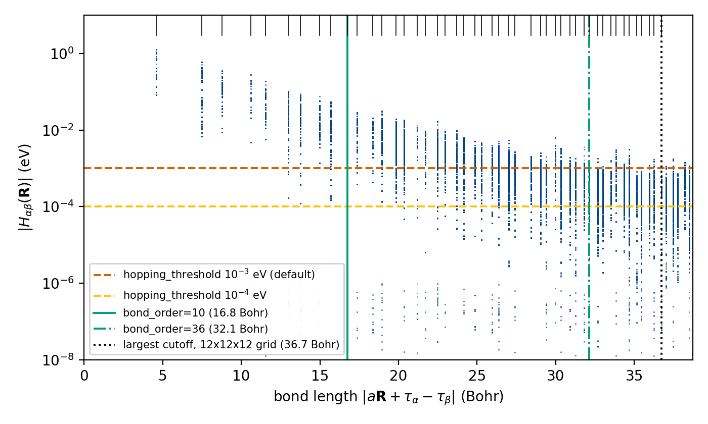
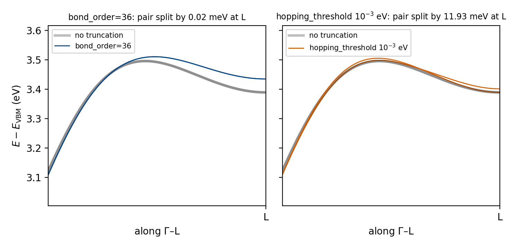
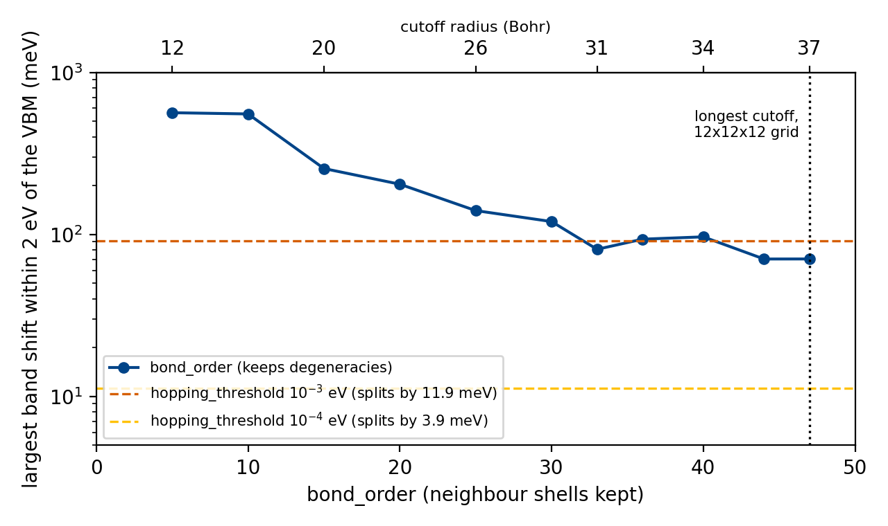
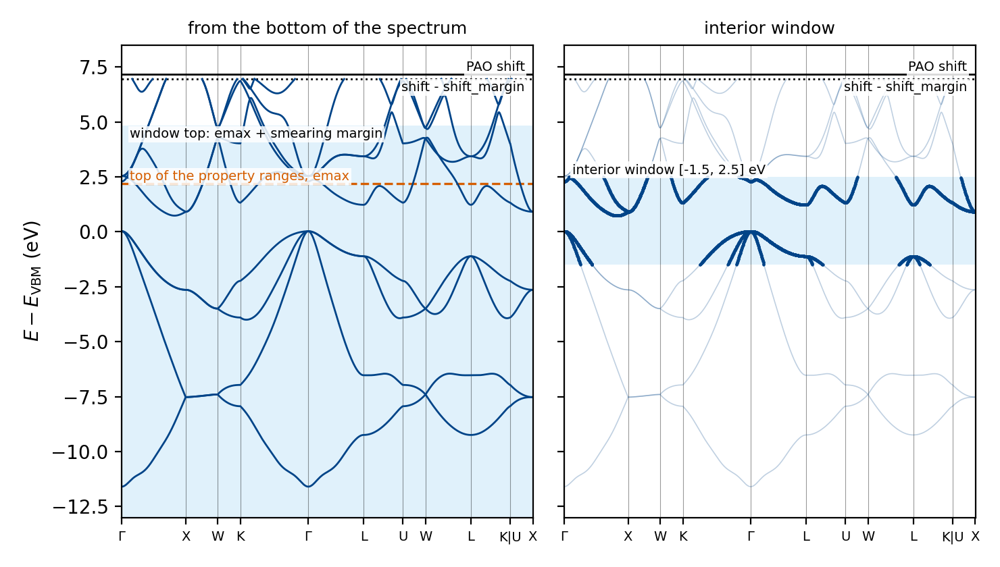

# How to run large systems on the sparse backend

The dense pipeline of [Tutorial 01](../tutorial01.ipynb) keeps three arrays on the interpolated k-mesh: the Hamiltonian $\tilde H(\mathbf{k})$, its k-gradient (three components) and the eigenvectors. Each holds $N_\mathrm{mesh}\, n_\mathrm{awf}^2$ complex numbers, where $N_\mathrm{mesh}$ is the number of k-points of the interpolated mesh and $n_\mathrm{awf}$ the number of PAOs in the cell. A 100-atom Si supercell with the basis of the base example (nine PAOs per atom) has 900 PAOs, and on a $12\times12\times12$ mesh the three arrays take 112 GB together. Defect supercells, slabs, interfaces and heterostructures therefore exhaust the memory of a node. To avoid this, the sparse backend never forms these arrays. Instead, it stores the real-space Hamiltonian $H_{\alpha\beta}(\mathbf{R})$ as a list of hoppings between pairs of orbitals, builds $\tilde H(\mathbf{k})$ at one k-point at a time, and discards it and its eigenvectors before the next.

The memory saving comes at the price of two approximations. First, the hopping list is kept short by dropping the hoppings of $H(\mathbf{R})$ between distant atoms; second, at each k-point only the states inside the energy range the requested properties use are solved. This page explains how to choose both, which properties the backend computes, and how to check a sparse result.

Base example: [examples/qe_examples/example01/](https://github.com/marcobn/PAOFLOW/tree/master/examples/qe_examples/example01) (`main.py` for the dense pipeline; `main_sparse.py` is the script below with a doubled cell and the Hall term added). The DFT data are `tutorial01/silicon.save` in `tutorial_assets.tar.gz` of the [tutorial-assets-v1 release](https://github.com/marcobn/PAOFLOW/releases/tag/tutorial-assets-v1).

## When to use the sparse backend

We use the dense pipeline whenever it fits in memory, because it has every PAOFLOW method and needs no truncation. When it does not fit, we switch to the sparse backend. To decide in advance, we evaluate the estimate above: $16\, N_\mathrm{mesh}\, n_\mathrm{awf}^2$ bytes per array, and five such arrays. The switch changes little in the script, because most properties run on the sparse backend with the same call; the few that do not are listed in [Computing other properties](#computing-other-properties), together with the way to run them.

## Switching a script

```python
from PAOFLOW.PAOFLOW import PAOFLOW

paoflow = PAOFLOW(savedir='silicon.save', outputdir='output_sparse', smearing='gauss',
                  sparse=True, sparse_config={'bond_order': 36})
paoflow.read_atomic_proj_QE()
paoflow.projectability()
paoflow.pao_hamiltonian()
paoflow.bands(ibrav=2, nk=2000)
paoflow.interpolated_hamiltonian()
with paoflow.sparse.fused():
    paoflow.dos(emin=-12.0, emax=2.2, ne=1000)
    paoflow.transport(emin=-12.0, emax=2.2)
paoflow.finish_execution()
```

The constructor takes `sparse=True`, and every option of the backend goes in the `sparse_config` dictionary; the full list is in the API entry of {py:class}`~PAOFLOW.sparse.config.SparseConfig`. Apart from these two arguments, the methods keep the names and arguments they have on the dense pipeline.

The first three calls, `read_atomic_proj_QE()`, `projectability()` and `pao_hamiltonian()`, run as on the dense pipeline, on the DFT cell. The sparse backend takes over at the end of `pao_hamiltonian()`, where the Hamiltonian is converted to the hopping list, and the hoppings on bonds longer than the 36th neighbour shell are dropped; [Truncating the Hamiltonian](#truncating-the-hamiltonian) explains this choice.

### Calls that compute nothing: `pao_eigh()`, `gradient_and_momenta()`, `adaptive_smearing()`

On the dense pipeline, `pao_eigh()` diagonalises $\tilde H(\mathbf{k})$ at every k-point and keeps all the eigenvectors for the steps that follow. For a large cell, however, that array does not fit in memory. The sparse backend therefore diagonalises one k-point at a time, computes there everything the properties of the script need (eigenvalues, band velocities, adaptive smearing widths, projections for the projected density of states, PDOS), and discards the eigenvectors before the next k-point. We call one such loop over the whole k-mesh a pass. Since only the properties tell the pass what to compute, the pass runs when a property needs it, not where these three methods are called. As a result, `pao_eigh()`, `gradient_and_momenta()` and `adaptive_smearing()` compute nothing themselves: they store their arguments for the pass, so a script that keeps their defaults can leave them out, as the script above does.

### Several properties in one pass

On the dense pipeline, `pao_eigh()` stores the eigenvectors of every k-point, and each property reads them when it is called. On the sparse backend, in contrast, the eigenvectors of a k-point exist only while the pass is at that k-point. After the pass only the eigenvalues and band velocities stay in memory, because they are small arrays. A property that needs only these, such as `transport()` called after `dos()`, reuses them. A property that needs the eigenvectors themselves, such as `dielectric_tensor()`, which uses matrix elements between states, starts a second pass that diagonalises every k-point again. A second pass is expensive: on the Si example, a run with `dos()` followed by `dielectric_tensor()` takes 31 s with two passes. To avoid it, we call the properties inside a `fused()` block, and the same run then takes 22 s with one pass:

```python
with paoflow.sparse.fused():
    paoflow.dos(emin=-12.0, emax=2.2, ne=1000)
    paoflow.dielectric_tensor(emin=0.0, emax=6.0, ne=500)
```


The figure compares the three cases. In the top row the eigenvectors of the whole mesh are held at once, which is what a large cell cannot afford. In the middle row each k-point is diagonalised once and feeds both properties before its eigenvectors are discarded. In the bottom row the eigenvalues and velocities survive the first pass, but the eigenvectors do not, so the second property repeats every diagonalisation.

The calls inside the block are collected, and one pass serves all of them when the block ends. The block matters for correctness as well as for cost, because a pass solves only the states up to the highest energy range among its properties (see [Which states are solved](#which-states-are-solved)). A property called after the pass, with a range above that energy, would therefore find states missing, and the backend stops with an error instead of returning an incomplete result.

### Computing other properties

Every property in the table below is computed with the same call as on the dense pipeline, with the arguments documented in its API entry, for example {py:meth}`~PAOFLOW.PAOFLOW.PAOFLOW.anomalous_Hall`. We add the call inside the `fused()` block, so that it shares the pass with the other properties. In the table, a property marked "all states" sums over every pair of bands at each k-point, so its pass solves the full spectrum (see [Properties that need every state](#properties-that-need-every-state) for what that costs).

| group                                         | methods                                                                                                                                        |
| --------------------------------------------- | ---------------------------------------------------------------------------------------------------------------------------------------------- |
| bands along a path                            | `bands`, `wave_function_projection`, `site_projected_bands` (all states), `berry_curvature` (all states), `topology`                           |
| densities and Fermi surface                   | `dos` (with PDOS), `density`, `fermi_surface`, `ipr`, `jdos`                                                                                   |
| textures                                      | `spin_texture`, `orbital_texture`                                                                                                              |
| transport and response                        | `transport` (all states with `do_hall=True`), `doping`, `conductivity`, `effective_mass` (all states), `dielectric_tensor`, `rashba_edelstein` |
| Berry phase and Hall                          | `berry_phase`, `anomalous_Hall`, `spin_Hall`, `orbital_Hall`, `linear_response` (all states)                                                   |
| operations on $H(\mathbf{R})$ of the DFT cell | `add_external_fields`, `adhoc_spin_orbit`, `j_to_lm_hamiltonian`, `cutting_Hamiltonian`, `write_Hamiltonian`                                   |

The operations in the last row act on the DFT cell, after `pao_hamiltonian()` and before any cell doubling or interpolation; those that change $H(\mathbf{R})$ truncate the result again with the same `sparse_config`.

Non-linear optics, ARPES, the Weyl-point search, the mirror Chern number, the position-dipole correction, and the phonon and electron-phonon workflows exist only on the dense pipeline. If a script calls one of them on the sparse backend, the run stops with a message that gives the reason.

### Passing the truncated Hamiltonian to the dense pipeline

The truncated hopping list is also a compact way to keep a PAO Hamiltonian. It holds only the hoppings that survive the truncation, so it is smaller than the dense $H(\mathbf{R})$: for the Si example, the dense $H(\mathbf{R})$ takes 9.0 MB, and the saved hopping list 1.8 MB with `bond_order=36`. Moreover, it carries everything the later steps need, so it replaces the DFT data and the first three steps of the workflow. We therefore build and truncate the Hamiltonian once, and compute properties from it on the dense pipeline whenever the cell fits in memory, either in the same run or in a later one.

#### Creating the truncated Hamiltonian

A sparse run builds the truncated Hamiltonian in its first three steps, and `save_sparse_hamiltonian()` writes it to a file:

```python
from PAOFLOW.PAOFLOW import PAOFLOW

paoflow = PAOFLOW(savedir='silicon.save', outputdir='output_sparse', smearing='gauss',
                  sparse=True, sparse_config={'bond_order': 36})
paoflow.read_atomic_proj_QE()
paoflow.projectability()
paoflow.pao_hamiltonian()                                   # truncated with sparse_config
paoflow.save_sparse_hamiltonian('silicon_hamiltonian.npz')  # written to outputdir
paoflow.finish_execution()
```

The file holds the kept hoppings together with the crystal structure, the orbital labels and the settings of the run. Because only the DFT cell has a well-defined set of bonds, the file is written right after `pao_hamiltonian()`, before any cell doubling or interpolation. In a sparse run the call takes no truncation options, because `sparse_config` has already applied them.

A dense run, built without `sparse=True`, writes the same file. Since it has no `sparse_config`, the truncation goes into the call instead, with the same options (`bond_order`, `rcut` or `hopping_threshold`):

```python
paoflow = PAOFLOW(savedir='silicon.save', outputdir='output_dense', smearing='gauss')
paoflow.read_atomic_proj_QE()
paoflow.projectability()
paoflow.pao_hamiltonian()                                                  # full H(R)
paoflow.save_sparse_hamiltonian('silicon_hamiltonian.npz', bond_order=36)  # only the file is truncated
```

The dense run itself keeps the full $H(\mathbf{R})$ and continues unchanged.

#### In the same run: `to_dense()`

To continue on the dense pipeline without a file, we call `to_dense()` in place of `save_sparse_hamiltonian()`. It converts the truncated hopping list of the DFT cell back into the dense $H(\mathbf{R})$, and every later call on the object runs on the dense pipeline. Because it converts the Hamiltonian of the DFT cell, it must come directly after `pao_hamiltonian()`, before any cell doubling, interpolation or band calculation:

```python
paoflow.pao_hamiltonian()           # truncated with sparse_config
paoflow.to_dense()                  # every call below runs on the dense pipeline
paoflow.bands(ibrav=2, nk=200)
paoflow.interpolated_hamiltonian()
paoflow.pao_eigh()
paoflow.gradient_and_momenta()
paoflow.adaptive_smearing()
paoflow.dos(emin=-12.0, emax=2.2, ne=1000, do_pdos=False)
```

The `do_pdos=False` in this example follows a recommendation for large cells: for a cell with many atoms we pass `do_pdos=False` to `dos()` unless the projected DOS is needed, because by default it writes one file per orbital, thousands of files for a large supercell.

#### In a later run: `load_sparse_hamiltonian()`

A later run starts from the file instead of the DFT data:

```python
from PAOFLOW.PAOFLOW import PAOFLOW

paoflow = PAOFLOW(outputdir='output_dense', restart=True, smearing='gauss')
paoflow.load_sparse_hamiltonian('output_sparse/silicon_hamiltonian.npz')
paoflow.bands(ibrav=2, nk=2000)
paoflow.interpolated_hamiltonian()
paoflow.pao_eigh()
paoflow.gradient_and_momenta()
paoflow.adaptive_smearing()
paoflow.dos(emin=-12.0, emax=2.2, ne=1000, do_pdos=False)
paoflow.transport(emin=-12.0, emax=2.2)
paoflow.finish_execution()
```

With `restart=True` the constructor reads no DFT data, and `load_sparse_hamiltonian()` takes the place of `read_atomic_proj_QE()`, `projectability()` and `pao_hamiltonian()`. This run needs neither `silicon.save` nor the projections. The Hamiltonian keeps the truncation stored in the file, which the call prints:

```text
Loaded truncated Hamiltonian from output_sparse/silicon_hamiltonian.npz
  152766 bonds, threshold = 0.0e+00 eV, bond_order = 36 (r_c = 32.129 Bohr), eig_bound = 4.111e+00 eV
```

Since the constructor has no `sparse=True`, the loaded Hamiltonian goes straight to the dense pipeline. A run built with `sparse=True` loads the same file onto the sparse backend instead, for a cell too large for the dense pipeline; there, `to_dense()` called right after `load_sparse_hamiltonian()` passes it to the dense pipeline, with the same result as the script above. Saving and loading this file is also how a sparse run is restarted, because `restart_dump()` saves the dense arrays and not the hopping list.

## Truncating the Hamiltonian

$H(\mathbf{R})$ built from the projections is the exact discrete Fourier transform of $H(\mathbf{k})$ on the DFT k-grid. As a result, it is not a maximally localised model, and it has small but nonzero hoppings out to the edge of the $\mathbf{R}$ grid. Most hoppings are small, so dropping them is what keeps the hopping list short. To see which ones are small, the figure shows every element $|H_{\alpha\beta}(\mathbf{R})|$ of the Si example against the length of the bond it connects, $|a\,\mathbf{R} + \boldsymbol{\tau}_\alpha - \boldsymbol{\tau}_\beta|$, where $a$ is the lattice parameter and $\boldsymbol{\tau}_\alpha$, $\boldsymbol{\tau}_\beta$ are the positions of the atoms that carry orbitals $\alpha$ and $\beta$.



The hoppings fall in vertical columns, one per neighbour shell (the set of bonds of one length; the ticks at the top mark them). The nearest-neighbour shell at 4.59 Bohr has hoppings up to 1.27 eV, and hoppings of $3\times10^{-3}$ eV remain beyond 30 Bohr. Within one shell the elements spread over several orders of magnitude, because each couples a different pair of orbitals. Accordingly, there are two ways to choose which hoppings go: a vertical line in this figure (by bond length) or a horizontal line (by size). Only the first respects the crystal symmetry, and it is the one we use. The figure is made from the full $H(\mathbf{R})$ of the Si example on its $12\times12\times12$ DFT grid, before any truncation; the vertical lines are the cutoffs of `bond_order=10` and `bond_order=36` and the longest cutoff the grid allows, and the horizontal lines the thresholds of $10^{-3}$ and $10^{-4}$ eV.

### Truncation by bond length

A symmetry operation maps a bond only onto bonds of the same length. A cutoff on the bond length therefore keeps or drops whole shells, so the truncated Hamiltonian keeps the symmetry of the crystal, and the degeneracies it protects stay intact: on Si, every bond-length cutoff we tried leaves them split by less than 0.4 meV. This matters for every property that depends on those degeneracies, such as band crossings, topological invariants and tensor components that vanish by symmetry.



The figure shows the doubly degenerate conduction-band pair of Si on the $\Gamma$–L line, 3.39 eV above the valence-band maximum at L, from runs of `bands()` on the Si example with the full Hamiltonian (grey) and two truncations. With `bond_order=36` the pair stays degenerate (0.02 meV apart at L) but moves up by 46 meV. With a threshold of $10^{-3}$ eV (see [the last section](#hopping_threshold-a-quick-truncation-for-tests)) it stays close to the full bands but splits by 11.9 meV at L.

The price is accuracy, which depends on how fast the hoppings decay with distance. For a covalent semiconductor such as Si the decay is slow: the cutoff at the 36th shell (32.1 Bohr) still drops thousands of hoppings above $10^{-3}$ eV, and it moves the bands within 2 eV of the valence-band maximum by up to 93 meV.

The cutoff also has an upper limit: it can only reach as far as the $\mathbf{R}$ grid represents bonds uniquely, 36.7 Bohr for the $12\times12\times12$ DFT grid of Si, the dotted line in the figure. Beyond that radius one grid value of $H(\mathbf{R})$ mixes bonds of different lengths, so a length has no meaning there, and a larger cutoff stops the run with an error that gives the limit. On the Si grid the longest allowed cutoff still moves the bands near the gap by up to 71 meV. To reach further, and with it an error of a few meV, we use a denser DFT k-grid, which extends the $\mathbf{R}$ grid. The cutoff is set in one of two ways.

#### `bond_order`: a number of neighbour shells

```python
sparse_config={'bond_order': 36}
```

`bond_order=n` keeps the bonds up to the $n$-th distinct interatomic distance; 1 is the nearest neighbours (4.59 Bohr in Si), 2 the second neighbours (7.50 Bohr). The shells move with the lattice, so the same `bond_order` describes the same physical truncation along a series of strained or relaxed structures. On the $12\times12\times12$ grid of Si, the largest allowed value is `bond_order=47`.

#### `rcut`: a radius

```python
sparse_config={'rcut': 30.0}       # Bohr
```

`rcut` fixes the range in Bohr, which is the natural choice to compare materials with different shell structures. The radius is moved down into the gap above the outermost shell it reaches, so that it never keeps part of a shell, and `sparse.log` records both values:

```text
  cutoff radius (Bohr)   30.000 requested, 29.981 applied (moved into the gap above the last shell)
```

### Choosing a truncation

We choose the cutoff by convergence: we raise `bond_order` or `rcut` until the bands near the energies the property uses stop moving, within the limit set by the $\mathbf{R}$ grid. We judge the bands, not the DOS, because the integration over the Brillouin zone averages band shifts of opposite sign, so a DOS can look converged while individual bands have moved by a few hundred meV.



The figure shows this test for Si: the largest shift of the bands within 2 eV of the valence-band maximum, from runs of `bands()` on the Si example in which only `bond_order` changes, measured against the full Hamiltonian. The shift falls from 564 meV at `bond_order=5` to 70 meV at 44 and 47, but not steadily: `bond_order=33` gives 81 meV, while 36 and 40 give 93 and 97 meV. We therefore compare several cutoffs before we accept one, rather than stopping at the first that looks converged. The dashed lines mark the two hopping thresholds for comparison: on this grid $10^{-4}$ eV gives smaller shifts than any cutoff, at the price of split degeneracies.

`sparse.log` prints a bound on the largest eigenvalue shift the truncation can cause at any k-point. The bound follows from the Gershgorin theorem: the dropped part of $H(\mathbf{k})$ is Hermitian, so its spectral norm is bounded by its largest absolute row sum. The bound is rigorous but loose: on Si it is 4.11 eV for `bond_order=36`, where the largest shift of the lowest eight bands is 0.26 eV.

```text
  max eigenvalue shift from truncation (eV)  4.11
```

A small bound guarantees a small error; a large one means the error has to be measured. The truncation is applied once, in `pao_hamiltonian()`, so it is set in the constructor and fixed for the rest of the run. If `sparse_config` gives no truncation, the backend applies a threshold of $10^{-3}$ eV (see the next section), so we always give `bond_order` or `rcut`.

### `hopping_threshold`: a quick truncation for tests

```python
sparse_config={'hopping_threshold': 1.0e-4}   # eV
```

For a quick test of a workflow, a threshold on the size of the hoppings is easier to set than a truncation by bond length, because it needs no knowledge of the shells or of the limit of the $\mathbf{R}$ grid. Every element with $|H_{\alpha\beta}(\mathbf{R})|$ below the threshold is dropped. On Si, $10^{-4}$ eV moves the bands within 2 eV of the valence-band maximum by up to 11 meV, and the default $10^{-3}$ eV by up to 91 meV.

However, a threshold cuts through the shells, and so it does not respect the crystal symmetry. The reason is that two bonds related by a symmetry operation connect orbitals that are rotated into each other, so the same coupling appears as elements of different size on the two bonds, and the threshold keeps a different set of elements on each. As a result, bands that the symmetry makes degenerate split, on Si by up to 3.9 meV at $10^{-4}$ eV and 11.9 meV at $10^{-3}$ eV. We therefore keep the threshold for tests and exploratory runs. It cannot be combined with `bond_order` or `rcut`.

## Which states are solved

The dense pipeline solves every band the PAO basis represents. The sparse backend, in contrast, solves at each k-point only the states the properties of a pass need. This needs no option in normal use, because before each pass the backend reads the energy ranges given to its properties and solves from the bottom of the spectrum up to the highest range plus a margin:

| property                                                         | range                  | margin above it                                |
| ---------------------------------------------------------------- | ---------------------- | ---------------------------------------------- |
| `dos` (with PDOS), `conductivity`, intra-band `rashba_edelstein` | `emin`, `emax`         | four times the largest adaptive smearing width |
| `transport`, `doping`                                            | `emin`, `emax`         | $10\,k_BT$ at the highest temperature          |
| `fermi_surface`, `spin_texture`, `orbital_texture`               | `fermi_dw`, `fermi_up` | none                                           |
| `dielectric_tensor`                                              | up to `emax`           | none                                           |

The margins come from the physics of each property. With adaptive smearing ([Tutorial 01, section 7](../tutorial01.ipynb#7-momentum-matrix-elements-and-adaptive-smearing)) a state of width $\sigma_{n\mathbf{k}}$ still contributes to a spectrum about $4\sigma_{n\mathbf{k}}$ away from its energy. Likewise, the derivative of the Fermi function in the transport integrals reaches about $10\,k_BT$ from the chemical potential (0.26 eV at 300 K).

The largest adaptive width is not known before the pass. The backend therefore estimates it by diagonalising $\tilde H(\mathbf{k})$ in full at 16 sample k-points ($\Gamma$, the other zone corners and generic low-symmetry points), and counts at the same points how many bands lie below the top of the window. For the script above, `sparse.log` records:

```text
Solve window (mesh pass 1)
--------------------------
  properties             dos, transport
  probe                  16 k-points; largest adaptive width 0.656 eV (afac 0.70, k spacing 0.0392 1/Bohr)
  smearing margin (eV)   2.624  (4 x the largest adaptive width)
  thermal margin (eV)    0.259 at 300 K  (10 kT)
  window (eV)            bottom of the spectrum to 4.824
```

The window ends at 4.82 eV, 2.62 eV above the `emax` of 2.2 eV requested by the user in this case, as in the left panel of the figure below. Because the sample points can miss the largest width, after the pass the widths found on the whole mesh are compared with the window, and a warning names the shortfall if states above it could still contribute.



Energies are relative to the valence-band maximum. Both panels come from runs of the Si example with `bond_order=36`. The left panel shows the bands of the script above and the window of its `dos()` and `transport()` pass, and the right panel the states that `bands()` solves with `interior_window={'elo': -1.5, 'ehi': 2.5}`, drawn over the full bands. This interior window is described [below](#interior_window-only-the-states-inside-a-window).

### Properties that need every state

The anomalous, spin and orbital Hall conductivities, the Berry curvature, `linear_response`, `effective_mass`, `site_projected_bands` and `transport(do_hall=True)` sum over pairs of bands that include every state. As a result, a pass that contains one of them solves the full spectrum at every k-point, for all the properties of the pass. Each k-point then needs a full diagonalisation of an $n_\mathrm{awf} \times n_\mathrm{awf}$ matrix, whose time grows as $n_\mathrm{awf}^3$. Because that matrix must fit in memory, these properties stop with an error above `dense_n_max` orbitals (default 4096), so we compute them on a smaller cell.

### The upper limit set by the PAO shift

`projectability()` places every Kohn–Sham state that the PAO basis does not represent (projectability below `pthr`) at one energy, the PAO shift, 7.16 eV above the valence-band maximum for Si. On the DFT k-grid these placeholder states sit exactly at the shift, but between grid points they spread around it, and they would appear as spurious bands. The backend therefore drops every state at or above the shift minus `shift_margin` (default 0.2 eV) at every k-point, real or placeholder, and writes the dropped states as `NaN` in band files. In the figure, the bands end at the dotted line. For the same reason, a property range that reaches above this limit is reduced to it.

We raise `shift_margin` when the band plot shows flat or erratic bands just below the limit, which are placeholder states that spread further than 0.2 eV. We lower it when real bands close to the shift are needed, at the risk of keeping placeholder states.

### `nev`: a fixed number of bands

```python
sparse_config={'bond_order': 36, 'nev': 120}
```

If we set `nev`, the sparse backend solves that many bands from the bottom at every k-point, instead of deriving the number from the property ranges of each pass as described [above](#which-states-are-solved). As a result, the 16 sample diagonalisations are skipped, and every pass solves the same number of bands. This makes `nev` useful on a cell with thousands of orbitals each sample diagonalisation is expensive, and above `dense_n_max` orbitals they cannot run at all: the backend then solves every state below the PAO shift, which is usually more than a k-point can afford.
The fixed count has a cost: with `nev` no smearing margin is added. If `nev` is too small, states that the DOS or the transport integrals need near the top of their range are missing; the widths are still checked after the pass, and a warning reports it. `nev` also sets the bands of `bands()`, which has no energy range and otherwise solves every well-projected band.

### `interior_window`: only the states inside a window

```python
sparse_config={'bond_order': 36, 'interior_window': {}}                         # around the property ranges
sparse_config={'bond_order': 36, 'interior_window': {'elo': -1.5, 'ehi': 2.5}}  # fixed bounds, eV
```

A window from the bottom of the spectrum must reach the Fermi level, so for any real material it holds 20 to 50 % of all states, and that fraction does not shrink as the cell grows. An interior window, in contrast, solves only the states between $\varepsilon_\mathrm{lo}$ and $\varepsilon_\mathrm{hi}$, a fraction that does shrink with the cell. Because that fraction is small, only in this mode can the cost per k-point fall below that of a full diagonalisation (see [The eigensolver at each k-point](#the-eigensolver-at-each-k-point)). With `{}` the backend places the window around the property ranges of each pass, with the margins above on both sides. With explicit bounds, the property ranges are clipped to the window, and transport keeps the chemical potential $10\,k_BT$ inside each edge.

The price is that the states below $\varepsilon_\mathrm{lo}$ are never computed, and with them the number of electrons:

| property                                                                     | under an interior window                                                                                                                    |
| ---------------------------------------------------------------------------- | ------------------------------------------------------------------------------------------------------------------------------------------- |
| DOS, PDOS                                                                    | computed inside the window; absent, not zero, outside it                                                                                    |
| `transport`                                                                  | chemical potentials kept $10\,k_BT$ inside each edge                                                                                        |
| `doping`, Hall coefficient, band curvature, properties that need every state | skipped with a warning: they need the total number of carriers or every state                                                               |
| band files                                                                   | padded with `NaN`; the columns are not band indices, since the number of states inside the window varies with k (right panel of the figure) |
| `bands()`                                                                    | with `{}`, takes the window of the last property pass, so it must come after a property                                                     |

Skipped properties are listed again at `finish_execution()`.

The margins also limit how narrow the window can be. The adaptive widths shrink as $N_\mathrm{mesh}^{-1/3}$, so on a coarse mesh a window with enough clearance on both sides covers most of the spectrum. An interior window therefore pays only on a converged k-mesh. `interior_window` and `nev` cannot be combined.

## The eigensolver at each k-point

```python
sparse_config={'hk_solver': 'auto'}   # 'auto' | 'sparse' | 'dense'
```

`hk_solver` chooses how the eigenproblem at one k-point is solved, and nothing else; with either solver $H(\mathbf{R})$ stays a hopping list.

- `'dense'` diagonalises the $n_\mathrm{awf}\times n_\mathrm{awf}$ matrix $\tilde H(\mathbf{k})$ of the current k-point with LAPACK and frees it before the next k-point. Its time grows as $n_\mathrm{awf}^3$ and its memory as $n_\mathrm{awf}^2$, whatever the number of states needed.
- `'sparse'` uses the iterative ARPACK solver, which applies $\tilde H(\mathbf{k})$ to vectors and never forms the matrix. Its cost grows with the number of states requested; once that is a sizeable part of the spectrum it is slower than a full diagonalisation and needs as much memory.
- `'auto'`, the default, takes ARPACK when the requested states are less than `dense_ratio` of the spectrum (default 1/8) and LAPACK otherwise. A window from the bottom of the spectrum is almost always above that fraction, so in practice ARPACK runs under an interior window. The rule is given in {py:func}`~PAOFLOW.sparse.solver.select_hk_solver`.

A full diagonalisation is allowed up to `dense_n_max` orbitals (default 4096, about 270 MB per matrix). Past that size, a solve that needs a large part of the spectrum stops with an error. The two ways out are fewer states per k-point (a narrower range, `nev` or `interior_window`), or a distributed eigensolver, which the backend does not provide. Because `'auto'` makes this choice for each pass, we leave `hk_solver` on `'auto'`, and set `'dense'` or `'sparse'` only to compare the two solvers on a small system.

## Checking the result

1. Read `<outputdir>/sparse.log`. It lists the options in force, the size of the hopping list and the eigenvalue bound of the truncation, the window of every pass with the ranges and margins it was built from, the number of bands solved per k-point, and the eigensolver chosen. Warnings start with `WARNING:` and are also printed on standard output.
2. Compare with the dense pipeline on a smaller version of the system (fewer atoms or a coarser grid), with `to_dense()` or a saved Hamiltonian so that the truncation is the same. The two agree exactly on the k-mesh, and along a band path they agree exactly at the k-points of the DFT grid. Between grid points, however, they differ by up to a few tens of meV, and this is the floor of the comparison. The difference comes from even k-grids, where the outermost plane of lattice vectors has no partner at $-\mathbf{R}$; the sparse backend splits those hoppings between $\pm\mathbf{R}$ at half weight, so that $\tilde H(\mathbf{k})$ is exactly Hermitian everywhere, while the dense band path uses them as stored.
3. Vary the truncation and watch the bands near the energies the property uses.
4. Compare `hk_solver='sparse'` and `hk_solver='dense'` with everything else equal.

## Troubleshooting

| message                                                                                                                   | meaning                                                                              | what to do                                                                                                               |
| ------------------------------------------------------------------------------------------------------------------------- | ------------------------------------------------------------------------------------ | ------------------------------------------------------------------------------------------------------------------------ |
| `PAOFLOW.X is dense-only, and this run was built with sparse=True: ...`                                                   | the method exists only on the dense pipeline; the message gives the reason           | on a cell that fits in memory, call `to_dense()` after `pao_hamiltonian()`, or load the saved Hamiltonian in a dense run |
| `... sum over interband pairs that include every state, which needs the full spectrum per k-point`                        | a property that needs every state, on a system with more than `dense_n_max` orbitals | run it on a smaller system                                                                                               |
| `... iterative regime (> 12.5%), but n exceeds dense_n_max = 4096`                                                        | too many orbitals and too large a part of the spectrum requested                     | narrow the property ranges, give `nev`, or use `interior_window`                                                         |
| `rcut = ... Bohr exceeds the aliasing-safe radius ...` or `bond_order=... exceeds the ... neighbour shells representable` | the cutoff is longer than the $\mathbf{R}$ grid represents                           | use a smaller cutoff or a denser DFT k-grid                                                                              |
| `hopping_threshold cannot be combined with rcut or bond_order`                                                            | an element threshold and a length cutoff were both given                             | give one of them                                                                                                         |
| `requested emax = ... lies above the lowest solved top band`                                                              | a later property reuses a pass whose bands end below its range                       | put the properties in one `fused()` block, call the widest range first, or give a larger `nev`                           |
| `Sparse mesh pass 2 recomputes the whole mesh for ...`                                                                    | a property needed data the earlier pass did not keep; it costs a full pass           | put the property calls in one `fused()` block                                                                            |
| `... may be contaminated near the window edge`                                                                            | the adaptive widths on the mesh reach past the solved states                         | a finer k-mesh, a larger `nev`, or wider interior bounds                                                                 |
| `interior_window={}: the bounds come from the property ranges, and no property of this pass has one`                      | `bands()` was called before any property under automatic interior bounds             | call `bands()` after a property, or give `{'elo': ..., 'ehi': ...}`                                                      |
| `... SKIPPED under the interior window: ...`                                                                              | the property needs states below the window                                           | run it without `interior_window`                                                                                         |
| `doubling_Hamiltonian may run out of memory: ...`                                                                         | the estimated peak of a doubling exceeds the memory per rank; the doubling continues | fewer doublings, a coarser truncation, or fewer ranks per node                                                           |
| `call doubling_Hamiltonian() before bands() and the properties`                                                           | a solve already sized the band count for the smaller cell                            | double before the first band or property calculation                                                                     |

## Where to go next

- {py:class}`~PAOFLOW.sparse.config.SparseConfig`: every option of `sparse_config`, with its default.
