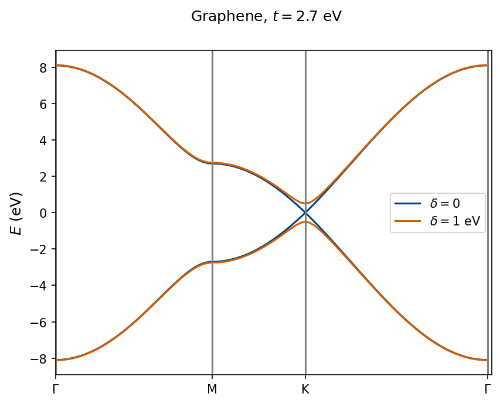
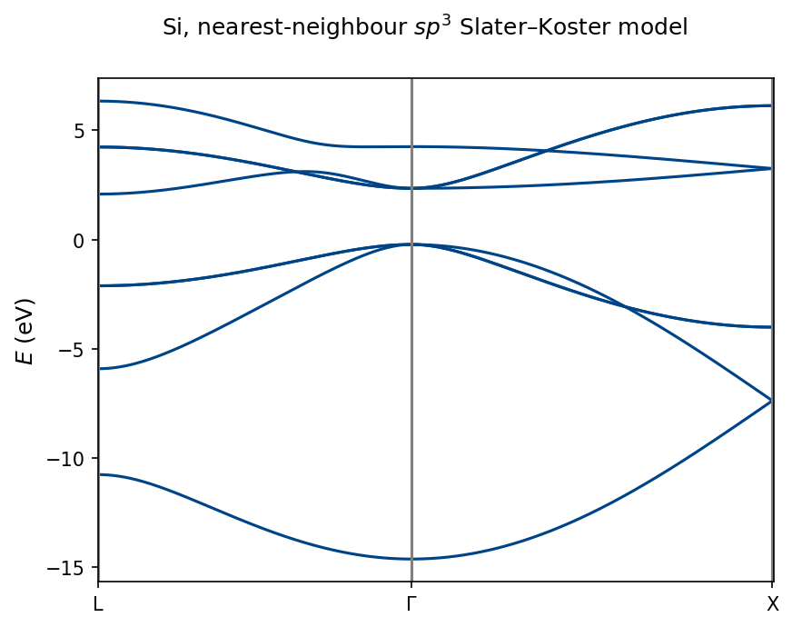
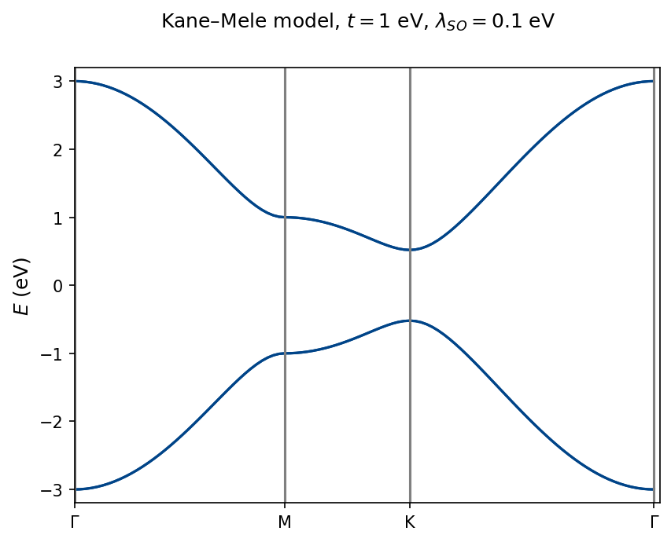
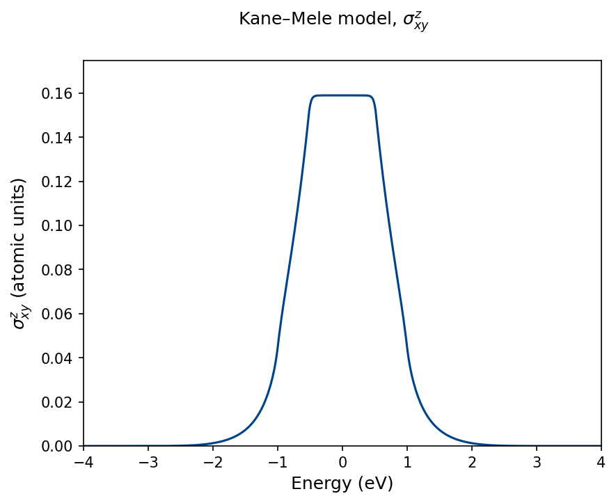
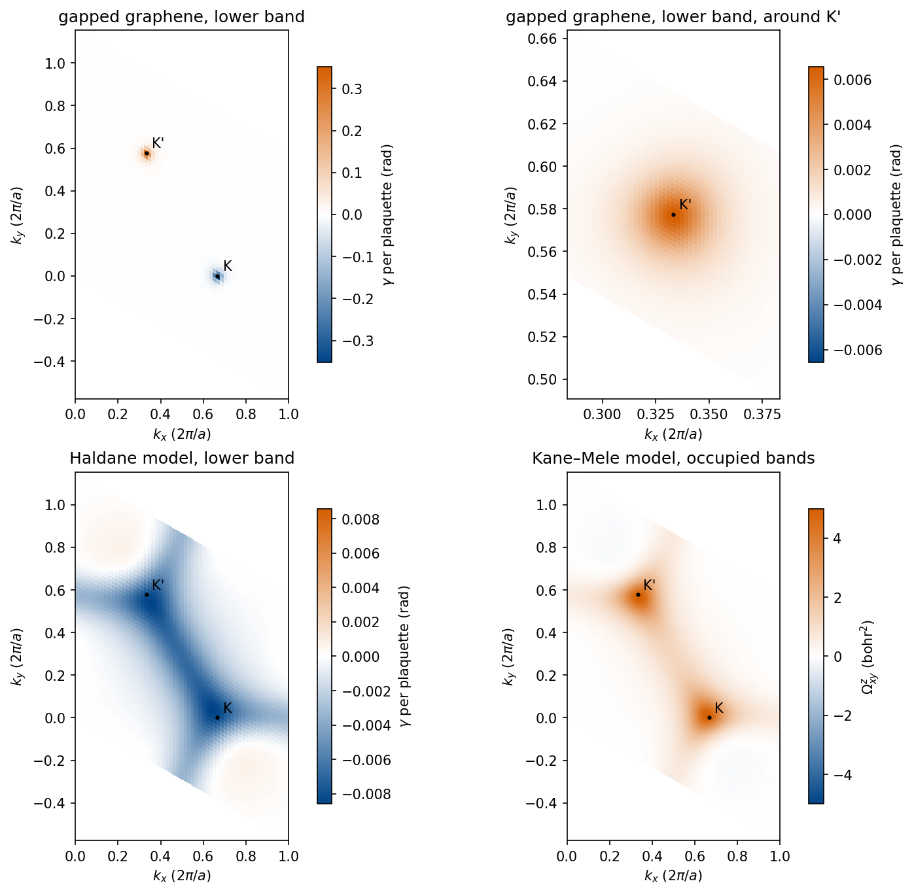
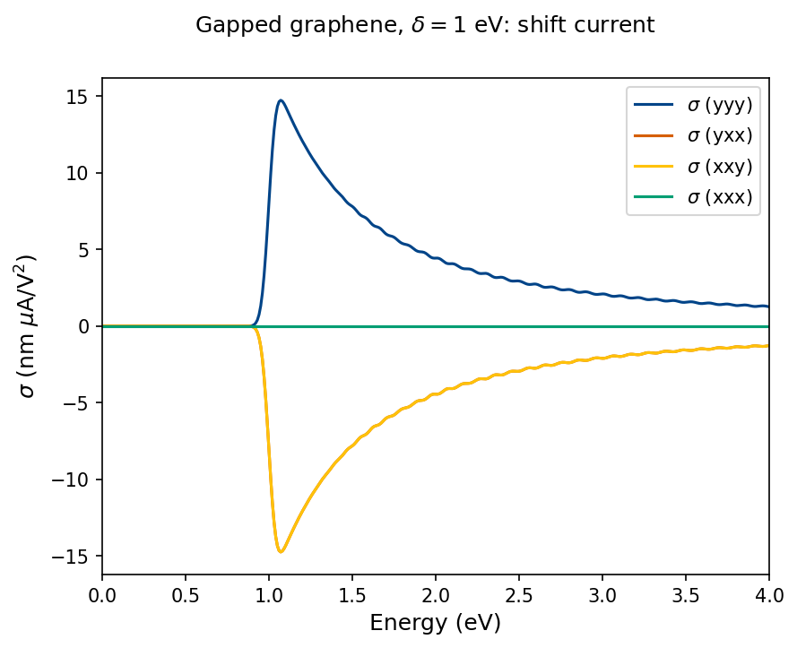
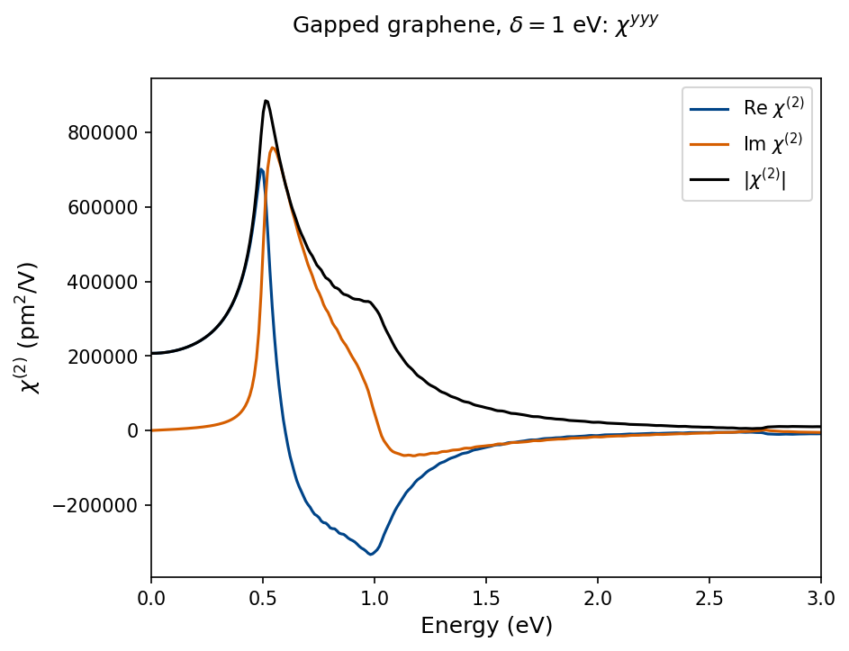

# How to run PAOFLOW on a tight-binding model

Every PAOFLOW property is computed from a real-space Hamiltonian $H_{\alpha\beta}(\mathbf{R})$. In the DFT workflow of [Tutorial 01](../tutorial01.ipynb) it comes from projecting the Kohn–Sham states on pseudo-atomic orbitals (PAOs). With the `model` argument of {py:class}`~PAOFLOW.PAOFLOW.PAOFLOW` you give it instead as a tight-binding model: one of the built-in models, a Slater–Koster model with your own parameters, or a model built with the PythTB package. Use it to test a property on a Hamiltonian whose answer you know before you run it on a material, or to compute the properties of a model itself: the spin Hall conductivity (SHC) of a quantum spin Hall insulator, the Berry phases and Chern numbers of honeycomb models, or the non-linear optical response of a crystal without inversion symmetry. The Hamiltonian is then the model and nothing else: the basis is orthogonal, the energies are the model parameters in eV, and no DFT calculation constrains the result.

:::{tip}
Every script on this page builds its model in code and runs in seconds, so it needs no input files. Reference outputs of these models are in `howto_assets.tar.gz` of the release [tutorial-assets-v1](https://github.com/marcobn/PAOFLOW/releases/tag/tutorial-assets-v1), under `tight-binding/`: `Kane_mele/` (bands, SHC, and the k-resolved files of `spin_Hall()` with its default `fermi_dw` and `fermi_up`), `Graphene2/` (bands and Berry phases of gapped graphene), `Graphene/` and `Cubium/` (bands). Compare your files with them after you change the PAOFLOW version or the model.
:::

## Replacing the DFT steps with a model

The script below computes the bands and the SHC of the Kane–Mele model.

```python
from PAOFLOW import PAOFLOW

model = {'label': 'Kane_Mele', 't': 1.0, 'soc_par': 0.1, 'r_par': 0.0, 'v_par': 0.0}
paoflow = PAOFLOW.PAOFLOW(model=model, outputdir='output')

points = {'G': [0.0, 0.0, 0.0], 'M': [0.5, 0.0, 0.0], 'K': [2 / 3, 1 / 3, 0.0]}
paoflow.bands(ibrav=4, nk=100, band_path='G-M-K-G', high_sym_points=points)

paoflow.interpolated_hamiltonian(nfft1=60, nfft2=60, nfft3=1)  # one k-point along z
paoflow.pao_eigh()
paoflow.gradient_and_momenta()
paoflow.adaptive_smearing()
paoflow.spin_Hall(
    twoD=True, emin=-4.0, emax=4.0, s_tensor=[[0, 1, 2]],
    fermi_dw=-4.0, fermi_up=0.0,  # occupied bands, for the k-resolved curvature
)
paoflow.finish_execution()
```

The constructor builds $H_{\alpha\beta}(\mathbf{R})$, the lattice vectors and the orbital positions from the dictionary. The script therefore leaves out {py:meth}`~PAOFLOW.PAOFLOW.PAOFLOW.read_atomic_proj_QE`, {py:meth}`~PAOFLOW.PAOFLOW.PAOFLOW.projectability` and {py:meth}`~PAOFLOW.PAOFLOW.PAOFLOW.pao_hamiltonian`: there are no Kohn–Sham states to project. The calls from {py:meth}`~PAOFLOW.PAOFLOW.PAOFLOW.bands` on are those of a DFT run. Three settings depend on the model instead of on a DFT calculation.

- The k-path. Give the path with `band_path` and `high_sym_points`, in crystal coordinates of the reciprocal vectors of the model. `bands()` also needs `ibrav` and stops with `KeyError: 'kq'` without it, but with the path given this way its value does not change the path. Pass the Quantum ESPRESSO number of the model's lattice: 4 for the hexagonal cells, 1 for simple cubic, 2 for fcc.
- Two-dimensional models. The graphene and Kane–Mele cells have no hopping along $z$, so every k-point along $z$ gives the same $H(\mathbf{k})$. Set `nfft3=1` in {py:meth}`~PAOFLOW.PAOFLOW.PAOFLOW.interpolated_hamiltonian`, and pass `twoD=True` to {py:meth}`~PAOFLOW.PAOFLOW.PAOFLOW.spin_Hall`, which then divides by the area of the cell instead of its volume. The result is a sheet conductivity in atomic units ($\hbar = e = 1$), where the conductance quantum $e/2\pi$ is $1/2\pi = 0.159$.
- The energy zero. PAOFLOW does not count electrons in a model, so $E = 0$ is the zero of the model parameters: the middle of the gap at half filling for Kane–Mele, the zero of the on-site energies for a Slater–Koster model. Properties scanned in energy, such as the SHC and the density of states, give the value at every chemical potential in `emin`…`emax`; read them at the filling of your model.

## Choosing the model

### Built-in models

The `label` selects the model; the case of the label does not matter. The other keys are its parameters, in eV.

| `label`       | parameters                                                                            | lattice and basis                                      | steps that run                                   |
| ------------- | ------------------------------------------------------------------------------------- | ------------------------------------------------------ | ------------------------------------------------ |
| `'graphene'`  | `t` (first-neighbour hopping), `delta` (on-site $\pm\delta/2$ on the two sublattices) | honeycomb, $a = 2.46$ Å, one orbital per site, no spin | `bands()`, `berry_phase()`, `nonlinear_optics()` |
| `'cubium'`    | `t`                                                                                   | simple cubic, $a = 1$ Å, one orbital                   | `bands()`                                        |
| `'cubium2'`   | `t`, `Eg` (gap between the two bands)                                                 | simple cubic, $a = 1$ Å, two orbitals                  | `bands()`                                        |
| `'Kane_Mele'` | `t`, `soc_par`, `r_par`, `v_par`; optional `alat` (Å, default 1)                      | honeycomb, two spin-orbitals per site                  | all steps of the script above                    |

The Kane–Mele Hamiltonian is

$$
H = t \sum_{\langle ij \rangle} c_i^\dagger c_j
  + i\lambda_{SO} \sum_{\langle\langle ij \rangle\rangle} \nu_{ij}\, c_i^\dagger s_z c_j
  + t\, v \sum_i \xi_i\, c_i^\dagger c_i
  + H_R ,
$$

with $\lambda_{SO}$ = `soc_par`, $v$ = `v_par`, $\xi_i = \pm 1$ on the two sublattices, and $\nu_{ij} = \pm 1$ depending on whether the second-neighbour path turns left or right. `r_par` sets the Rashba term $H_R$. With `r_par=0`, $s_z$ is conserved and the spin–orbit term opens a gap $6\sqrt{3}\,\lambda_{SO}$ at K.

The `graphene`, `cubium` and `cubium2` models stop at {py:meth}`~PAOFLOW.PAOFLOW.PAOFLOW.pao_eigh` or {py:meth}`~PAOFLOW.PAOFLOW.PAOFLOW.gradient_and_momenta` with a `KeyError`, because they do not define the number of bands or the orbital positions that these steps need. For a property of graphene on a k-mesh, use `Kane_Mele` with `soc_par=0`, `r_par=0` and `v_par=delta / (2 * t)`: it is the graphene Hamiltonian with every band doubled by spin, and its bands equal those of `graphene` to all printed digits. For the cubic models, use the path `'G-X-M-G-R'` with $X = (0, \tfrac12, 0)$, $M = (\tfrac12, \tfrac12, 0)$, $R = (\tfrac12, \tfrac12, \tfrac12)$ and `ibrav=1`; the reference bands in the assets are those of `{'label': 'cubium', 't': 1.0}` with `nk=100`.

The script below computes the bands of graphene with and without the sublattice potential and overlays them with {py:class}`~PAOFLOW.GPAO.GPAO`, which takes a list of band files:

```python
from PAOFLOW import GPAO

for delta in (0.0, 1.0):
    graphene = PAOFLOW.PAOFLOW(model={'label': 'graphene', 't': 2.7, 'delta': delta}, outputdir=f'graphene_{delta:g}')
    graphene.bands(ibrav=4, nk=100, band_path='G-M-K-G', high_sym_points=points)
    graphene.finish_execution()

plotter = GPAO.GPAO()
plotter.plot_bands(
    ['graphene_0/bands_0.dat', 'graphene_1/bands_0.dat'],
    sym_points='graphene_0/kpath_points.txt',
    title=r'Graphene, $t = 2.7$ eV',
    label=r'$E$ (eV)',
    labels=[r'$\delta = 0$', r'$\delta = 1$ eV'],
    cols=['#004488', '#D55E00'],
)
```



With $\delta = 0$ the two bands touch at K, the Dirac point, and span $\pm 3|t| = \pm 8.1$ eV at $\Gamma$. The sublattice potential $\pm\delta/2$ makes the two atoms of the cell inequivalent, breaks inversion symmetry and opens a gap $\delta$ at K and K′; away from K the bands hardly change. This gapped model is the one of the sections on Berry phases and non-linear optics below.

### A Slater–Koster model with your own parameters

The label `'Slater_Koster'` builds $H_{\alpha\beta}(\mathbf{R})$ in the two-centre approximation: each hopping is the Slater–Koster combination of the bond integrals $V_{ss\sigma}$, $V_{sp\sigma}$, $V_{pp\sigma}$, $V_{pp\pi}$ with the direction cosines of the bond. The model below is silicon with an $sp^3$ basis on the two atoms of the diamond cell, with parameters from D. A. Papaconstantopoulos, _Handbook of the Band Structure of Elemental Solids: From Z = 1 to Z = 112_, 2nd ed. (Springer, 2015).

```python
onsite = {'s': -5.19278, 'px': 1.05825, 'py': 1.05825, 'pz': 1.05825}
silicon = {
    'label': 'Slater_Koster',
    'alat': 10.26,  # bohr
    'model': {
        'a_vectors': [[0.5, 0.5, 0.0], [0.0, 0.5, 0.5], [0.5, 0.0, 0.5]],
        'atoms': {
            '0': {'name': 'Si', 'tau': [0.0, 0.0, 0.0], 'orbitals': ['s', 'px', 'py', 'pz'], **onsite},
            '1': {'name': 'Si', 'tau': [0.25, 0.25, 0.25], 'orbitals': ['s', 'px', 'py', 'pz'], **onsite},
        },
        'hoppings': {'sss': -2.36233, 'sps': 1.86401, 'pps': 2.85882, 'ppp': -0.94687},
    },
}
paoflow = PAOFLOW.PAOFLOW(model=silicon, outputdir='silicon')
fcc_points = {'G': [0.0, 0.0, 0.0], 'X': [0.5, 0.5, 0.0], 'L': [0.5, 0.5, 0.5]}
paoflow.bands(ibrav=2, nk=500, band_path='L-G-X', high_sym_points=fcc_points)
paoflow.finish_execution()
```

The keys of `model` are:

- `a_vectors`: the lattice vectors, in units of `alat`.
- `atoms`: one entry per atom, keyed `'0'`, `'1'`, ..., with the position `tau` in Cartesian coordinates in units of `alat`, the list of `orbitals`, and the on-site energy (eV) of each orbital.
- `hoppings`: the bond integrals (eV). A flat dictionary applies them to the nearest neighbours; nested dictionaries under `'nn'`, `'nnn'` and `'nnnn'` set the first, second and third shells.

`alat` (bohr, default 1) does not change the bands, which depend only on the bond directions. It sets the length scale of the band velocities, and with it of conductivities and Berry curvatures, so give the lattice constant of the material. For a lattice with one atom per cell, give a single entry in `atoms`: an fcc crystal with $s$ and $p$ orbitals at on-site energies $-2$ and $-1$ eV and bond integrals `{'sss': -0.2, 'sps': 0.01, 'pps': 0.2, 'ppp': -0.02}` runs with the same path. {py:func}`~PAOFLOW.models.models.Slater_Koster` lists the full input, including $d$ orbitals and several shells per atom.



The figure shows `silicon/bands_0.dat` of this run; the energy zero is the zero of the on-site energies. The valence-band maximum is at $\Gamma$ at $-0.229$ eV, and the conduction-band minimum at L at 2.081 eV, a gap of 2.309 eV. In silicon the conduction-band minimum lies near X: a nearest-neighbour $sp^3$ basis cannot produce that minimum, and you need second-neighbour hoppings (`'nnn'`) or more orbitals per atom to reach it.

### Models built with PythTB

[PythTB](https://pythtb.readthedocs.io/en/latest/) builds tight-binding models of any lattice and orbital basis from a list of on-site energies and hoppings. PAOFLOW does not install it by default; install it with the `pythtb` extra, `pip install "PAOFLOW[pythtb]"` (or `pip install -e ".[pythtb]"` in a source checkout), which pulls in PythTB 2. PAOFLOW takes a PythTB model in two ways: through a label for one of the models PAOFLOW defines, or as a model object you build yourself. In both cases PAOFLOW sets the lattice constant to 1 bohr, with the lattice vectors of the model in units of it, so give hoppings in eV and read velocities and three-dimensional conductivities in these units.

| `label`                 | parameters                                                              | lattice and basis                                                                             |
| ----------------------- | ----------------------------------------------------------------------- | --------------------------------------------------------------------------------------------- |
| `'cubium_pythtb'`       | `t`                                                                     | simple cubic, one orbital                                                                     |
| `'cubium2_pythtb'`      | `t`, `Eg`                                                               | simple cubic, two orbitals                                                                    |
| `'checkerboard_pythtb'` | `delta` (on-site $\mp\delta$), `t`                                      | square, two orbitals                                                                          |
| `'graphene_pythtb'`     | `delta` (on-site $\pm\delta/2$), `t`                                    | honeycomb, one orbital per site                                                               |
| `'haldane_pythtb'`      | `delta` (on-site $\mp\delta$), `t1`, `t2`, `phi`                        | honeycomb, one orbital per site                                                               |
| `'kane_mele_pythtb'`    | `delta`, `t`, `soc`, `rashba`                                           | honeycomb, two spin-orbitals per site                                                         |
| `'fu_kane_mele_pythtb'` | `t`, `soc`, `dt` (list of four changes of the first-neighbour hoppings) | diamond, two spin-orbitals per site                                                           |
| `'ssh_pythtb'`          | `v`, `w`                                                                | one-dimensional chain; does not build with PythTB 2 (see [Troubleshooting](#troubleshooting)) |

All of them, except `ssh_pythtb`, run the steps from `interpolated_hamiltonian()` to `dos()`; `spin_Hall()` needs a model with spin (`kane_mele_pythtb`, `fu_kane_mele_pythtb`). `kane_mele_pythtb` with `soc=0.1` and `rashba=0` is the same model as the built-in `Kane_Mele` with `soc_par=0.1`: it gives the same gap and the same plateau of the SHC. Each built-in model with a PythTB version, `graphene` and `cubium` included, can be swapped for it by changing the label, for example `{'label': 'graphene_pythtb', 't': 2.7, 'delta': 0.0}`.

For a model PAOFLOW does not define, build it with PythTB and pass the object as `model`. The script below builds the Haldane model, a honeycomb lattice with one orbital per site and a complex second-neighbour hopping $t_2 e^{i\phi}$, which breaks time-reversal symmetry and makes the lower band a Chern band. It then computes the Chern number $C$ of the lower band as the Berry flux through the whole Brillouin zone divided by $2\pi$.

```python
import numpy as np
from pythtb import Lattice, TBModel

lattice = Lattice([[1, 0], [1 / 2, np.sqrt(3) / 2]], [[1 / 3, 1 / 3], [2 / 3, 2 / 3]], periodic_dirs=[0, 1])
haldane = TBModel(lattice=lattice, spinful=False)
haldane.set_onsite([0.0, 0.0])
for R in ([0, 0], [-1, 0], [0, -1]):  # first neighbours, A to B
    haldane.set_hop(-1.0, 0, 1, R)
t2 = 0.15 * np.exp(1j * np.pi / 2)  # second neighbours, phase phi = pi/2
for R in ([1, 0], [-1, 1], [0, -1]):
    haldane.set_hop(t2, 0, 0, R)
for R in ([-1, 0], [1, -1], [0, 1]):
    haldane.set_hop(t2, 1, 1, R)

paoflow = PAOFLOW.PAOFLOW(model=haldane, outputdir='haldane')
paoflow.bands(ibrav=4, nk=600, band_path='G-M-K-G', high_sym_points=points)
paoflow.berry_phase(
    kspace_method='square', nk1=60, nk2=60, kxlim=[0.0, 1.0], kylim=[0.0, 1.0],
    sub=[0], method='berry', fname='flux_lower',
)
paoflow.finish_execution()

bands = np.loadtxt('haldane/bands_0.dat')[:, 1:]
print(f'gap: {bands[:, 1].min() - bands[:, 0].max():.4f} eV, 6 sqrt(3) |t2|: {6 * np.sqrt(3) * 0.15:.4f} eV')
flux = np.loadtxt('haldane/flux_lower.dat')[:, 2].sum()
print(f'Chern number of the lower band: {flux / (2 * np.pi):+.4f}')
```

```text
gap: 1.5588 eV, 6 sqrt(3) |t2|: 1.5588 eV
Chern number of the lower band: -1.0000
```

With `delta=0` and $\phi = \pi/2$ the gap is $6\sqrt{3}\,|t_2|$ at K and K′, and the lower band has $C = -1$; the upper band, `sub=[1]`, has $C = +1$. The same model comes from the label: `{'label': 'haldane_pythtb', 'delta': 0.0, 't1': -1.0, 't2': 0.15, 'phi': np.pi / 2}` gives identical bands. [Berry phases and Chern numbers](#berry-phases-and-chern-numbers) explains the `berry_phase()` call and shows where in the zone the flux sits.

## The spin Hall conductivity of the Kane–Mele model

Plot the output of the first script:

```python
plotter.plot_bands(
    'output/bands_0.dat',
    sym_points='output/kpath_points.txt',
    title=r'Kane–Mele model, $t = 1$ eV, $\lambda_{SO} = 0.1$ eV',
    label=r'$E$ (eV)',
    y_lim=(-3.2, 3.2),
    cols='#004488',
)
plotter.plot_shc(
    'output/shcEf_z_xy.dat',
    title=r'Kane–Mele model, $\sigma^z_{xy}$',
    x_lim=(-4.0, 4.0),
    cols='#004488',
    label=r'$\sigma^z_{xy}$ (atomic units)',
)
```



Each band is twofold degenerate, because the model has both time-reversal and inversion symmetry. The spin–orbit term opens a gap of 1.0392 eV at K, between $-0.520$ and 0.520 eV, which equals $6\sqrt{3}\,\lambda_{SO}$ for $\lambda_{SO} = 0.1$ eV. The energy zero is the middle of the gap, where the model is half filled.



The figure shows `output/shcEf_z_xy.dat` of the same run, on the $60 \times 60$ mesh. Inside the gap, $\sigma^z_{xy}$ is constant at 0.15899, the quantised value $e/2\pi$ of the quantum spin Hall phase: as long as $E$ stays in the gap, moving it does not change the occupied states. The value is the same to five digits on $30 \times 30$ and $120 \times 120$ meshes. Outside the gap the conductivity falls, and it vanishes below $-3$ eV and above 3 eV, where all bands are empty or all are full.

`spin_Hall()` also writes `Spin_Berry_z_xy.bxsf`, the spin Berry curvature $\Omega^z_{xy}(\mathbf{k})$ on the k-mesh, summed over the states between `fermi_dw` and `fermi_up`. The defaults, $-1$ and 1 eV, keep only the states near the gap; `fermi_dw=-4.0` (below the lowest band) and `fermi_up=0.0` in the script above sum over the occupied bands, so that the map integrates to the SHC at $E = 0$. The map is the last panel of the figure in the next section.

## Berry phases and Chern numbers

{py:meth}`~PAOFLOW.PAOFLOW.PAOFLOW.berry_phase` computes the Berry phase $\gamma = \oint \mathbf{A}(\mathbf{k}) \cdot d\mathbf{k}$ of the bands listed in `sub` along a closed loop in k-space, as $\gamma = -\arg\det \prod_i M(\mathbf{k}_i, \mathbf{k}_{i+1})$, where $M_{mn} = \langle u_{m\mathbf{k}_i} | u_{n\mathbf{k}_{i+1}} \rangle$ is the overlap matrix of these bands between neighbouring points (`method='berry'`; `'zak'` adds the Bloch factor $e^{-i\mathbf{G}\cdot\mathbf{r}}$ for the Zak phase of one-dimensional systems). With `kspace_method='circle'` the loop is a circle of `nk1` points with radius `kradius` around `kcenter` (`closed=True` joins the last point to the first). With `kspace_method='square'` the square `kxlim` × `kylim` (crystal coordinates) is divided into plaquettes, and the phase around each plaquette goes to a file of three columns $k_x$, $k_y$, $\gamma$, with the plaquette corners in a second file ending in `_kgrid_corners.dat`. The sum of the plaquette phases is the Berry flux through the square, and over the whole zone it is $2\pi C$.

The script below computes these phases for graphene with $t = -1$ eV and a small sublattice gap, $\delta = -0.2$ eV, around K′, for each band and for both bands together, and then the flux of the lower band through the whole zone:

```python
graphene = PAOFLOW.PAOFLOW(model={'label': 'graphene', 't': -1.0, 'delta': -0.2}, outputdir='graphene')
k_prime = [1 / 3, 2 / 3, 0.0]
patch = ([k_prime[0] - 0.05, k_prime[0] + 0.05], [k_prime[1] - 0.05, k_prime[1] + 0.05])
for sub, tag in (([0], '0'), ([1], '1'), ([0, 1], '01')):
    graphene.berry_phase(kspace_method='circle', kcenter=k_prime, kradius=0.05, nk1=51,
                         sub=sub, closed=True, method='berry', fname=f'circle_{tag}')
    graphene.berry_phase(kspace_method='square', nk1=51, nk2=51, kxlim=patch[0], kylim=patch[1],
                         sub=sub, method='berry', fname=f'square_{tag}')
graphene.berry_phase(kspace_method='square', nk1=60, nk2=60, kxlim=[0.0, 1.0], kylim=[0.0, 1.0],
                     sub=[0], method='berry', fname='zone_0')
graphene.finish_execution()

for tag in ('0', '1', '01'):
    circle = float(open(f'graphene/circle_{tag}.dat').read().split('Berry phase:')[1])
    square = np.loadtxt(f'graphene/square_{tag}.dat')[:, 2].sum()
    print(f'bands {tag:>2}: circle {circle:+.6f}, square {square:+.6f}')
zone = np.loadtxt('graphene/zone_0.dat')[:, 2].sum()
print(f'whole zone, lower band: {zone / (2 * np.pi):+.4f} x 2 pi')
```

```text
bands  0: circle +2.068796, square +2.178615
bands  1: circle -2.068796, square -2.178615
bands 01: circle -0.000000, square +0.000000
whole zone, lower band: -0.0000 x 2 pi
```

The reference bands of this model in the assets come from `bands(ibrav=0, nk=401, band_path='G-M-K-G', high_sym_points=points)`. The circle file ends with the line `Berry phase: <value>`; the square files hold one phase per plaquette, which the script adds up. Around K′ the two bands carry opposite phases, $\pm 2.07$ on the circle of radius 0.05 and $\pm 2.18$ on the larger square patch, and together they give zero. For gapless graphene the phase of each band is $\pm\pi$ on any loop around the Dirac point; the gap spreads the curvature over a region of size $\sim\delta/v_F$ around K′, so a finite loop encloses only part of it. Over the whole zone the flux of the lower band vanishes: K and K′ contribute equal and opposite amounts, and gapped graphene has $C = 0$.

The maps of the plaquette phases show where the flux sits. GPAO has no function for a map over the zone, so the script below draws them with matplotlib, from the `square` files of the graphene and Haldane runs and from `Spin_Berry_z_xy.bxsf` of the Kane–Mele run:

```python
from matplotlib.colors import LinearSegmentedColormap
import matplotlib.pyplot as plt
from PAOFLOW.gen.fermi_plotter import read_fermi_bxsf

cmap = LinearSegmentedColormap.from_list('palette', ['#004488', '#FFFFFF', '#D55E00'])
recip = np.array([[1.0, -1 / np.sqrt(3)], [0.0, 2 / np.sqrt(3)]])  # b1, b2 of the honeycomb cell (2 pi / a)

def square_phases(fname):
    """Plaquette corners (Cartesian) and Berry phase per plaquette of a 'square' berry_phase() run."""
    phase = np.loadtxt(fname)[:, 2]
    n = int(round(np.sqrt(phase.size)))
    corners = np.loadtxt(fname.replace('.dat', '_kgrid_corners.dat')).reshape(n + 1, n + 1, 2, order='F')
    return corners @ recip, phase.reshape(n, n, order='F')

spin_berry = read_fermi_bxsf('output/Spin_Berry_z_xy.bxsf')
n1, n2, _ = spin_berry.dims
grid = np.stack(np.meshgrid(np.linspace(0, 1, n1), np.linspace(0, 1, n2), indexing='ij'), axis=-1)

panels = [
    (*square_phases('graphene/zone_0.dat'), r'gapped graphene, lower band', r'$\gamma$ per plaquette (rad)'),
    (*square_phases('graphene/square_0.dat'), r"gapped graphene, lower band, around K'", r'$\gamma$ per plaquette (rad)'),
    (*square_phases('haldane/flux_lower.dat'), 'Haldane model, lower band', r'$\gamma$ per plaquette (rad)'),
    (grid @ recip, spin_berry.bands[1][:, :, 0], 'Kane–Mele model, occupied bands', r'$\Omega^z_{xy}$ (bohr$^2$)'),
]
fig, axes = plt.subplots(2, 2, figsize=(10, 9), constrained_layout=True)
for ax, (k, value, title, label) in zip(axes.flat, panels):
    vmax = np.abs(value).max()
    shading = 'flat' if k.shape[0] > value.shape[0] else 'gouraud'
    mesh = ax.pcolormesh(k[..., 0], k[..., 1], value, cmap=cmap, vmin=-vmax, vmax=vmax, shading=shading)
    for name, point in (('K', [2 / 3, 1 / 3]), ("K'", [1 / 3, 2 / 3])):
        x, y = np.array(point) @ recip
        if k[..., 0].min() <= x <= k[..., 0].max() and k[..., 1].min() <= y <= k[..., 1].max():
            ax.plot(x, y, 'k.', ms=4)
            ax.annotate(name, (x, y), xytext=(4, 4), textcoords='offset points')
    ax.set_aspect('equal')
    ax.set_title(title)
    ax.set_xlabel(r'$k_x$ ($2\pi/a$)')
    ax.set_ylabel(r'$k_y$ ($2\pi/a$)')
    fig.colorbar(mesh, ax=ax, label=label, shrink=0.8)
```



Each panel covers one reciprocal cell, the parallelogram spanned by $\mathbf{b}_1$ and $\mathbf{b}_2$, in Cartesian coordinates in units of $2\pi/a$.

- Gapped graphene (top left, top right). The curvature of the lower band is concentrated within about 0.02 of K and K′, with opposite signs, so the total flux is zero. The top right panel is the $51 \times 51$ patch around K′ whose phases add up to 2.18 above.
- Haldane model (bottom left). The complex second-neighbour hopping gives the curvature the same sign at K and K′. It spreads over the zone because the gap, 1.56 eV, is almost eight times that of the gapped graphene above, and the phases add up to $-2\pi$.
- Kane–Mele model (bottom right). The spin Berry curvature of the occupied bands peaks around K and K′ with the same sign, up to 4.99 bohr² for $\lambda_{SO} = 0.1$ eV: each spin species is a copy of the Haldane model, with opposite Chern numbers for spin up and down. The average of the map over the zone, 0.4917 bohr², divided by the area of the cell, 3.0926 bohr², gives 0.15899, the plateau of the SHC.

## The non-linear optical response of gapped graphene

The sublattice potential of the `graphene` model makes it the simplest crystal without inversion symmetry: with $\delta \neq 0$ the point group is $D_{3h}$, with $\mathbf{a}_1$ along $x$. Second-order optical responses, which vanish in a crystal with inversion, are then allowed. {py:meth}`~PAOFLOW.PAOFLOW.PAOFLOW.nonlinear_optics` computes the shift current, the injection currents and the second-harmonic generation (SHG) susceptibility $\chi^{(2)}$ from $H_{\alpha\beta}(\mathbf{R})$ and the orbital centres of the model. The base example runs:

```python
paoflow = PAOFLOW.PAOFLOW(model={'label': 'graphene', 't': 2.7, 'delta': 1.0}, outputdir='nlo')
paoflow.nonlinear_optics(nk=(300, 300, 1), emin=0.0, emax=6.0, ne=601, eta=0.05,
                         components=['yyy', 'yxx', 'xxy', 'xxx'], nelec=2, twoD=True)
paoflow.finish_execution()

plotter.plot_optical('shift', path='nlo', component=['yyy', 'yxx', 'xxy', 'xxx'], x_lim=(0.0, 4.0),
                     title=r'Gapped graphene, $\delta = 1$ eV: shift current', labels=[r'$\sigma$'],
                     cols=['#004488', '#D55E00', '#FFC20A', '#009E73'], y_label=r'$\sigma$ (nm $\mu$A/V$^2$)')
plotter.plot_optical(['shgr', 'shgi', 'shga'], path='nlo', component='yyy', x_lim=(0.0, 3.0),
                     title=r'Gapped graphene, $\delta = 1$ eV: $\chi^{yyy}$', cols=['#004488', '#D55E00', '#000000'],
                     y_label=r'$\chi^{(2)}$ (pm$^2$/V)')
```

The arguments that a model needs:

- `nk=(300, 300, 1)`: 90 000 k-points of the two-dimensional zone, which take about 5 s. The response is concentrated near K and K′, so the mesh must resolve the gap region there.
- `nelec=2`: the number of electrons per cell. A model has no electron count of its own; with two electrons and the spin degeneracy of a spinless model, the lower band is full.
- `twoD=True`: the responses of the sheet, in nm µA/V² for the shift current and pm²/V for $\chi^{(2)}$. They are the bulk responses multiplied by the height of the cell, $|\mathbf{a}_3| = 10a$ for this model.
- `eta=0.05`: the width (eV) of the $\delta$ functions of the shift and injection currents and the imaginary part of the SHG resonance denominators.

The run writes one file per response and component: `shift_*` (shift current), `shiftm_*` (magnetic shift current), `injectc_*` and `injectm_*` (circular and magnetic injection currents), and `shgr_*`, `shgi_*`, `shga_*` (real part, imaginary part and modulus of $\chi^{(2)}$). [Non-linear optics](../../internals/nonlinear-optics.md) gives the formulas and the conventions of the files.



The shift current starts at the 1 eV gap at K and peaks at 14.74 nm µA/V² at 1.07 eV. The $D_{3h}$ symmetry fixes the components: $\sigma^{yyy} = -\sigma^{yxx} = -\sigma^{xxy}$, so the `yxx` and `xxy` curves lie on top of each other, and $\sigma^{xxx} = 0$. In the run the relations hold to $7 \times 10^{-4}$ nm µA/V², and $\sigma^{xxx}$ stays below $10^{-14}$.



$|\chi^{yyy}|$ has its largest peak, $8.85 \times 10^{5}$ pm²/V, at 0.51 eV, the two-photon resonance at half the gap, and a second one, $3.46 \times 10^{5}$ pm²/V, at 0.97 eV, the one-photon resonance at the gap. The same relations as for the shift current hold between the components of $\chi^{(2)}$. The magnetic shift and injection currents are odd under time reversal, which the model preserves, and vanish: `shiftm_*` stays below $10^{-13}$ and `injectm_*` below $5 \times 10^{-4}$, in the units of their files. The circular injection current is allowed only in gyrotropic point groups, which $D_{3h}$ is not. Its `yyy`, `yxx` and `xxx` components stay below $2 \times 10^{-6}$ A V⁻² s⁻¹, but `injectc_xxy.dat` reaches $-8.6 \times 10^{4}$ A V⁻² s⁻¹ at 1.75 eV, and the value does not decrease with the mesh ($-1.08 \times 10^{5}$ on $150 \times 150$, $-8.5 \times 10^{4}$ on $450 \times 450$). With `delta=0` the model has inversion symmetry again and every response vanishes: on a $120 \times 120$ mesh the shift current stays below $10^{-6}$ nm µA/V² and $|\chi^{(2)}|$ below $2 \times 10^{-5}$ pm²/V.

## Other properties

Any property that starts from $H_{\alpha\beta}(\mathbf{R})$ is called as in a DFT run, provided the model defines what it needs (see the table of built-in models). For the Kane–Mele model, {py:meth}`~PAOFLOW.PAOFLOW.PAOFLOW.dos` runs after `adaptive_smearing()` with its usual arguments. For a three-dimensional Slater–Koster model, {py:meth}`~PAOFLOW.PAOFLOW.PAOFLOW.transport` runs as well. On a two-dimensional model, `transport()` stops (see [Troubleshooting](#troubleshooting)): it inverts the full $3 \times 3$ conductivity tensor to compute the Seebeck coefficient, and the $zz$ component is zero for a cell without hopping along $z$.

## Troubleshooting

| message                                                                                                     | meaning                                                               | what to do                                                             |
| ----------------------------------------------------------------------------------------------------------- | --------------------------------------------------------------------- | ---------------------------------------------------------------------- |
| `KeyError: 'kq'` in `bands()`                                                                               | `ibrav` is missing                                                    | pass the `ibrav` of the model's lattice together with the path         |
| `KeyError: 'bnd'` in `pao_eigh()`, with `SUGGESTION: pao_hamiltonian must be called before pao_eigh`        | the model does not define the number of bands (`graphene`)            | use `Kane_Mele` with `soc_par=0`, `r_par=0`, `v_par=delta / (2 * t)`   |
| `KeyError: 'Dnm'` in `gradient_and_momenta()`                                                               | the model does not define the orbital positions (`cubium`, `cubium2`) | use these models for `bands()` only, or their `_pythtb` versions       |
| `Check t_tensor components - matrix cannot be singular` and `LinAlgError: Singular matrix` in `transport()` | the model is two-dimensional, and its $zz$ conductivity is zero       | `transport()` does not run on a two-dimensional model                  |
| `ERROR: Label "..." not found in builtin models.`                                                           | the label is not one of the built-in models                           | check the spelling against the tables above                            |
| `ModuleNotFoundError: No module named 'pythtb'`                                                             | a `_pythtb` label or a PythTB object needs PythTB                     | `pip install "PAOFLOW[pythtb]"`                                        |
| `Check! TB model finite (nonperiodic) in one or more dimensions not implemented`                            | printed for every model passed as a PythTB object                     | the run continues; the message does not depend on the model            |
| `ValueError: Conjugate element already specified for i=1, j=0, R=[0]` with `ssh_pythtb`                     | PythTB 2 rejects a hopping that this model sets twice                 | build the chain yourself as a PythTB object, setting each hopping once |

## Where to go next

- [Tutorial 01](../tutorial01.ipynb) follows the same calls on a DFT Hamiltonian and explains what each one computes.
- [Non-linear optics](../../internals/nonlinear-optics.md) derives the shift current and SHG and lists the symmetry tests on model Hamiltonians.
- [Environment-dependent Slater–Koster models](../../internals/sk-edtb.md) extends the two-centre model above with screened hoppings.
