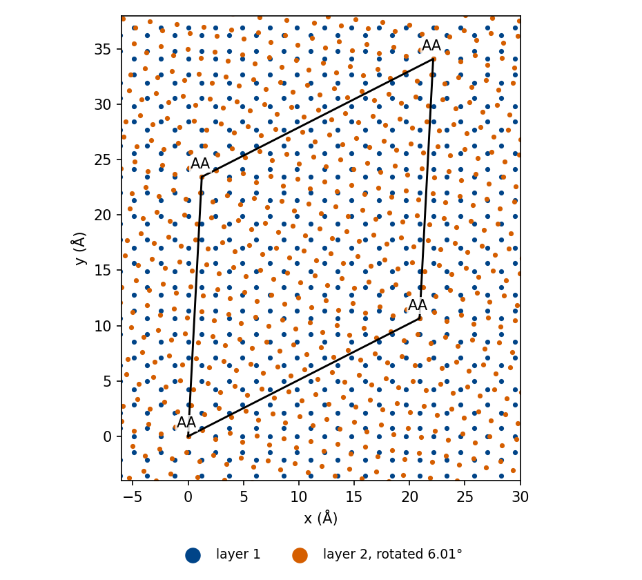
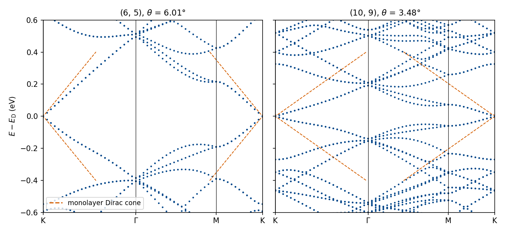
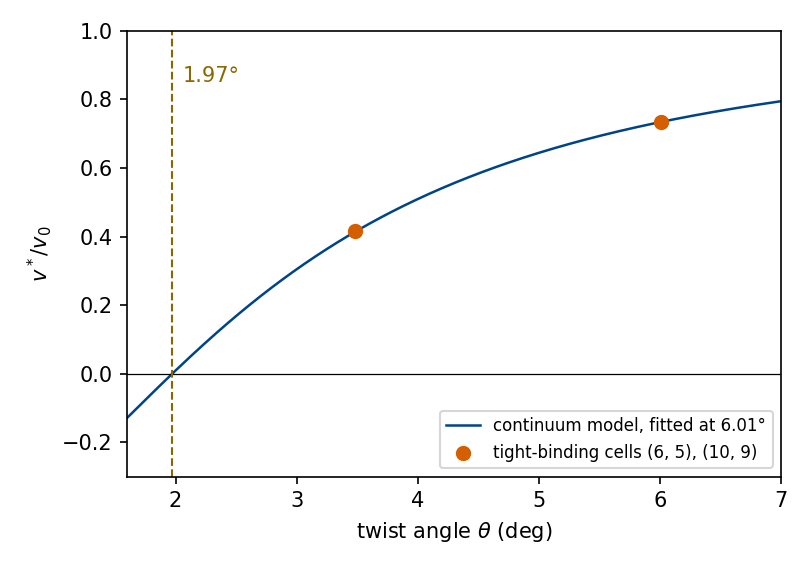

# How to compute the band structure of twisted bilayer graphene

Two graphene layers rotated by an angle $\theta$ form a moiré pattern of period $L = a / (2\sin(\theta/2))$, where $a = 2.46$ Å is the lattice constant of graphene. The moiré couples the Dirac cones of the two layers, and as $\theta$ decreases it slows the electrons at the Dirac point: in the continuum model of R. Bistritzer and A. H. MacDonald, Proc. Natl. Acad. Sci. USA 108, 12233 (2011), the Dirac velocity vanishes near $\theta = 1.1^\circ$ and the bands around the charge-neutrality point become flat. At commensurate angles the twisted bilayer is a crystal, but its cell holds thousands of atoms at small $\theta$, too many for the dense diagonalisation of [Tutorial 01](../tutorial01.ipynb). This page builds the commensurate cells and computes their bands with a sparse solver that diagonalises only the states near the Dirac energy. The layers are rigid and flat: the in-plane and out-of-plane relaxation of real samples, which changes the bands at small angles, is not included.

The tight-binding model is the environment-dependent (EDTB) model of carbon with distance-dependent hoppings defined on the [band-unfolding how-to](band-unfolding.md#large-supercells); the code below uses its `carbon` dictionary. The scripts need no input files.

## Commensurate cells

A twisted bilayer is periodic only when a lattice vector of the lower layer is also a lattice vector of the rotated upper layer. For two integers $n > m \ge 0$, the vector $\mathbf{T}_1 = n\mathbf{a}_1 + m\mathbf{a}_2$ of the lower layer coincides with $m\mathbf{a}_1 + n\mathbf{a}_2$ of the upper one when the upper layer is rotated by

$$
\cos\theta = \frac{n^2 + m^2 + 4nm}{2(n^2 + nm + m^2)} ,
$$

and $\mathbf{T}_1$ with its $60^\circ$ rotation $\mathbf{T}_2 = -m\mathbf{a}_1 + (n+m)\mathbf{a}_2$ spans the moiré cell. Each layer then holds $n^2 + nm + m^2$ primitive cells, and the cell holds four times as many atoms. The cells $(n, n - 1)$ have the largest period for a given angle, $L = |\mathbf{T}_1|$:

| $(n, m)$ | $\theta$ (deg) | atoms | orbitals ($sp^3d^5$) | $L$ (Å) |
| --- | --- | --- | --- | --- |
| (2, 1) | 21.79 | 28 | 252 | 6.5 |
| (6, 5) | 6.01 | 364 | 3276 | 23.5 |
| (10, 9) | 3.48 | 1084 | 9756 | 40.5 |
| (15, 14) | 2.28 | 2524 | 22716 | 61.8 |
| (20, 19) | 1.70 | 4564 | 41076 | 83.1 |
| (31, 30) | 1.08 | 11164 | 100476 | 129.9 |

The function below builds the $(n, m)$ cell with the lattice constant of graphene as `alat`, the lower layer at $z = 0$ and the upper layer rotated by $\theta$ about the origin, which is a site of both layers:

```python
import numpy as np
from PAOFLOW.models.edtb_params import EDTBModel
from PAOFLOW.spectrum.sparse_bands import SparseEDTB


def twisted_bilayer(n, m, d=2.68, vacuum=15.0, a_cc=1.42):
    """Commensurate twisted bilayer graphene (n, m); lengths in angstrom, alat = graphene a."""
    a = a_cc * np.sqrt(3)
    a1, a2 = np.array([1.0, 0]), np.array([0.5, np.sqrt(3) / 2])
    theta = np.arccos((n * n + m * m + 4 * n * m) / (2 * (n * n + n * m + m * m)))
    c, s = np.cos(theta), np.sin(theta)
    cell = np.array([n * a1 + m * a2, -m * a1 + (n + m) * a2])
    span = range(-2 * (n + m), 2 * (n + m) + 1)
    atoms = []
    for z, rot in ((0.0, np.eye(2)), (d / a, np.array([[c, s], [-s, c]]))):
        sites = {}
        for i in span:
            for j in span:
                for t in (0, 1 / 3):  # sublattices A and B
                    f = np.linalg.solve(cell.T, rot @ (i * a1 + j * a2 + t * (a1 + a2)))
                    f -= np.floor(f + 1e-8)
                    sites[tuple(np.round(f, 6))] = f @ cell
        atoms += [{'species': 'C', 'tau': [x, y, z]} for x, y in sites.values()]
    a_vectors = [[*cell[0], 0], [*cell[1], 0], [0, 0, (d + vacuum) / a]]
    return {'alat': a / 0.529177249, 'a_vectors': a_vectors, 'atoms': atoms}, np.degrees(theta)
```



The figure shows `twisted_bilayer(6, 5)` repeated over four cells, with the moiré cell outlined. At the corners of the cell the atoms of the two layers lie on top of each other (AA stacking); in between, the stacking passes through AB and BA regions, where half of the upper atoms sit over the centres of the lower hexagons. The period of this pattern is the 23.5 Å of the table.

## The interlayer distance

The default `d=2.68` Å is a choice for this carbon model, not the spacing of real bilayers (3.35 Å). The model's hoppings between the layers are weak at 3.35 Å: in the AA-stacked bilayer, whose Dirac cones the interlayer hopping shifts apart, the two Dirac points at K lie only 0.19 eV apart at 3.35 Å and 0.68 eV apart at 2.68 Å. Because the angle at which the Dirac velocity vanishes grows with the interlayer coupling, the smaller distance moves the interesting physics to angles whose cells are smaller. Compare results with experiment only after you have checked the interlayer coupling of your model, for example against this AA splitting from DFT.

## Bands with the sparse solver

{py:class}`~PAOFLOW.spectrum.sparse_bands.SparseEDTB` stores the Hamiltonian of the cell as a sparse matrix of bonds and computes, at each k-point, the `n_eigs` eigenvalues closest to the energy `sigma` (eV) with the shift-invert Lanczos method of SciPy's `eigsh`, which converges first to the eigenvalues nearest the target. The energy range of these states is called the window below. `compute_bands` runs it along a path:

```python
geom, theta = twisted_bilayer(10, 9)
bands = SparseEDTB(EDTBModel(carbon, geom).to_model_dict(), verbose=False)
moire = {'G': [0, 0, 0], 'M': [0.5, 0, 0], 'K': [2 / 3, 1 / 3, 0]}
result = bands.compute_bands('K-G-M-K', moire, nk=60, n_eigs=40, sigma=-0.52,
                             outputdir='tbg_10_9', n_workers=-1)
```

The path is in fractional coordinates of the reciprocal lattice of the moiré cell, so G, M and K are the points of the moiré Brillouin zone; since $\mathbf{T}_1$ and $\mathbf{T}_2$ are at $60^\circ$, K is $(\tfrac23, \tfrac13)$ (see the [K-point note](band-unfolding.md#large-supercells) on the unfolding page). `nk` is the total number of k-points along the path. `sigma=-0.52` is the Dirac energy of the model (the mean of the two Dirac points of the AA bilayer at 2.68 Å, $-0.521$ eV). `n_eigs` sets the width of the window: the number of states per eV grows with the number of atoms, so the same `n_eigs` covers a narrower window in a larger cell. Check `result['eigenvalues'].min()` and `.max()` against the energy range you plot. `n_workers=-1` distributes the k-points over all the cores available to the process (its share of the node under `mpirun`). Start the script with `OMP_NUM_THREADS=1`: each worker runs its own linear algebra, and several threads per worker oversubscribe the cores and slow the run down many times.

`compute_bands` returns the eigenvalues, of shape (k-points, `n_eigs`), and the path, and writes them to `tbg_10_9/bands_0.dat` (the distance along the path, then one column per state) and the positions of the high-symmetry points to `tbg_10_9/kpath_points.txt`.



The figure shows this run and the same run for `twisted_bilayer(6, 5)`. The markers are the eigenvalues; plot them as markers rather than lines, because the window moves from one k-point to the next, so the $j$-th eigenvalue at neighbouring k-points need not belong to the same band. The energy zero $E_\mathrm{D}$ is the energy of the four states at the moiré K point: the Dirac points of the two layers both fold onto it, at $-0.519$ eV for $(6, 5)$ and $-0.512$ eV for $(10, 9)$. The dashed lines are the Dirac cone of a single layer of the same model, $E = \pm\hbar v_0 |\mathbf{k} - \mathbf{K}|$, drawn from each K. Between the two K points, at M, the cones of the two layers meet, and the interlayer coupling turns their crossing into a saddle point. At $6.01^\circ$ the band above $E_\mathrm{D}$ reaches 0.216 eV at M and 0.494 eV at $\Gamma$, and the band below it $-0.191$ eV at M and $-0.385$ eV at $\Gamma$. At $3.48^\circ$ the moiré zone is smaller and the same bands stay within 0.073 and $-0.060$ eV at M and within 0.191 and $-0.140$ eV at $\Gamma$: they narrow faster than the angle, because the Dirac velocity drops as well.

## The velocity at the Dirac point

The renormalised velocity $v^*$ at the Dirac point measures how strongly the moiré couples the layers: $v^*/v_0 = 1$ for decoupled layers, and it vanishes at the magic angle. Compute the bands on a short segment from K towards $\Gamma$, here 4 % of its length, and fit the slope of the lower of the two bands that leave the Dirac point upwards:

```python
moire['P'] = [0.64, 0.32, 0]  # 4 % of the way from K to G
near_K = bands.compute_bands('K-P', moire, nk=8, n_eigs=8, sigma=-0.52, n_workers=-1)
k, E = near_K['k_dist'], near_K['eigenvalues']
four = np.array([np.sort(e[np.argsort(np.abs(e + 0.52))[:4]]) for e in E])  # the states at the Dirac energy
print('hbar v* =', np.polyfit(k[2:6], four[2:6, 2], 1)[0], 'eV per (1/alat)')
```

The k-distances of `compute_bands` are in radians per `alat`, so the slope is $\hbar v^*$ in eV $\cdot$ `alat`. Leave out the first point after K: the four states at K are split by up to 0.5 meV, which distorts the slope closest to K. The same fit on one layer of the model (the atoms of `twisted_bilayer(1, 0)` at $z = 0$, on a segment 0.4 % of K–$\Gamma$ long, so that $|\mathbf{k} - \mathbf{K}|$ is as small as in the moiré cells) gives $\hbar v_0 = 1.603$ eV $\cdot$ `alat` $= 3.94$ eV Å, or $v_0 = 6.0 \times 10^5$ m/s. The twisted cells give $\hbar v^* = 1.177$ eV $\cdot$ `alat` at $6.01^\circ$ and 0.666 at $3.48^\circ$, so $v^*/v_0 = 0.734$ and 0.415. The continuum model of Bistritzer and MacDonald gives $v^*/v_0 = (1 - 3\alpha^2)/(1 + 6\alpha^2)$, where $\alpha = w/(\hbar v_0 k_\theta)$ is the ratio of the interlayer hopping $w$ to the kinetic energy across the moiré zone, and $k_\theta \propto \theta$ at small angles. Fitted to the $6.01^\circ$ cell ($\alpha = 0.190$), it predicts $v^*/v_0 = 0.415$ at $3.48^\circ$, the value computed. The velocity vanishes at $\alpha = 1/\sqrt3$, which for this model is $\theta = 1.97^\circ$; the nearest commensurate cell is $(17, 16)$ at $2.00^\circ$, with 3268 atoms. With the real interlayer distance of 3.35 Å the coupling, and with it the magic angle, would be smaller.



The markers are $v^*/v_0$ of the two cells from the fits above, the line the continuum-model formula with $\alpha$ fitted to the $6.01^\circ$ cell, and the dashed line the angle where it vanishes. The $3.48^\circ$ cell lies on the line, so the continuum model describes this tight-binding model down to that angle; a run of the $(17, 16)$ cell tests it where it matters, at the magic angle.

## Smaller angles

The cost per k-point grows faster than the number of orbitals, because the shift-invert method factorises $\tilde H(\mathbf{k}) - \sigma$ at each k-point, and the factors of a sparse matrix fill in. On the 20 cores of a workstation, with `n_eigs=40` and 60 k-points, the $(6, 5)$ cell (3276 orbitals) takes 4 minutes and the $(10, 9)$ cell (9756 orbitals) 25 minutes; a single k-point of the $(10, 9)$ cell takes 4.7 minutes on one core. Cells below $3^\circ$, the $(17, 16)$ cell near the magic angle of this model among them, belong on a cluster node. Before a full path, time one k-point, `bands.eigvals_at_k([2 / 3, 1 / 3, 0], n_eigs=40, sigma=-0.52)`, and watch its memory, then choose `nk` and the number of cores. Run the script as

```bash
OMP_NUM_THREADS=1 python tbg_bands.py
```

with `n_workers=-1`, which uses all the cores the job has. A smaller `n_eigs` lowers the cost per k-point; 8 states are enough for the velocity at the Dirac point, 40 for the bands within a few hundred meV of it at these angles.

These bands cannot be unfolded onto the Brillouin zone of graphene with {py:func}`~PAOFLOW.models.band_unfold.unfold_bands`: the atoms of the rotated layer are not sites of the lower layer shifted by a lattice vector, which the unfolding requires (see [How to unfold supercell bands onto the primitive Brillouin zone](band-unfolding.md)).

## Where to go next

- [How to unfold supercell bands onto the primitive Brillouin zone](band-unfolding.md) defines the carbon model and unfolds supercells that keep the primitive sites.
- [Environment-dependent Slater–Koster models](../../internals/sk-edtb.md) describes the EDTB models and their fitting.
